---
tags:
  - 物品
  - 速查
---

# 背包与胸挂（Item Catalog）

> 版本基线：2026 年 10 月 ｜ 1.2.0.0（第一赛季 KORD BREACH）｜ 数据来源：tarkov.dev（二级）
> 本页为**生成页**，数值随版本调整，引用时请附「以游戏内为准」。

## 📸 本页概览

| 项目 | 说明 |
|------|------|
| **收录件数** | **152 件**（全站物品图鉴共 4,983 件） |
| **叶子分类** | 2 个官方分类：[胸挂](#胸挂)、[背包](#背包) |
| **获取方式** | 站内收录的**固定**渠道：`商人出售` / `以物换物` / `制作`。本页 **110 / 152 件**有至少一条（商人出售 44 ｜ 以物换物 63 ｜ 制作 10）；`—` **不是「拿不到」**，只表示站内没收录它的固定渠道 —— 那类得靠搜刮或跳蚤市场，而这两样站内不给点位（判据见[战利品分布](../entries/loot.md)）|
| **数据来源** | `json.tarkov.dev` 的 `itemCategories` 树与 `items` 接口，二级来源 |
| **抓取日期** | 2026-10-08 |
| **配套页面** | [物品图鉴总览](index.md) ｜ [任务需求物品反查](../quests/item-lookup.md) ｜ [配方速查表](../docs/recipes.md) |

---

## 🔎 检索与筛选

本页的检索、筛选与详情面板需要 JavaScript —— **下方表格是静态生成的，不开 JS 也能读完**。

### 胸挂

分类路径：物品 › 组合物品 › 可搜索物品

| # | 名称 | 英文名 | 重量 | 关键属性 | 获取方式 | 商人最低售价 | 商人最高回收 |
|---|------|--------|------|----------|----------|--------------|--------------|
| 1 |  IDEA DIY胸挂 | `diy-idea-chest-rig` | 0.22 千克 | 容量 8 格；移速惩罚 0%；转身惩罚 0%；人机工效惩罚 0% | — | — | 2,500 卢布（4 家最高） |
| 2 | 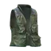 Scav背心 | `scav-vest` | 0.4 千克 | 容量 6 格；移速惩罚 0%；转身惩罚 0%；人机工效惩罚 0% | 以物换物 | — | 2,099 卢布（4 家最高） |
| 3 | 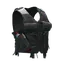 保安背心 | `security-vest` | 0.51 千克 | 容量 6 格；移速惩罚 0%；转身惩罚 0%；人机工效惩罚 0% | — | — | 1,950 卢布（4 家最高） |
| 4 | 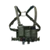 Zulu Nylon Gear M4 低特征胸挂（丛林绿） | `zulu-nylon-gear-m4-reduced-signature-chest-rig-ranger-green` | 0.521 千克 | 容量 6 格；移速惩罚 0%；转身惩罚 0%；人机工效惩罚 0% | 商人出售 | 11,212 卢布，需 Ragman 1 级 | 4,033 卢布（4 家最高） |
| 5 | 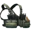 Blue Force Gear Ten-Speed SF 胸挂（丛林绿） | `blue-force-gear-ten-speed-sf-chest-rig-ranger-green` | 0.614 千克 | 容量 24 格；移速惩罚 0%；转身惩罚 0%；人机工效惩罚 1% | — | — | — |
| 6 | 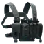 Direct Action Thunderbolt 紧凑型胸挂 | `direct-action-thunderbolt-compact-chest-rig-shadow-grey` | 0.62 千克 | 容量 16 格；移速惩罚 0%；转身惩罚 0%；人机工效惩罚 0% | — | — | 12,580 卢布（4 家最高） |
| 7 | 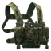 Direct Action Thunderbolt 紧凑型胸挂（PenCott 荒林迷彩） | `direct-action-thunderbolt-compact-chest-rig-pencott-wildwood` | 0.62 千克 | 容量 16 格；移速惩罚 0%；转身惩罚 0%；人机工效惩罚 0% | 以物换物 | — | 12,580 卢布（4 家最高） |
| 8 | 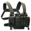 Direct Action Thunderbolt 紧凑型胸挂（丛林绿） | `direct-action-thunderbolt-compact-chest-rig-ranger-green` | 0.62 千克 | 容量 16 格；移速惩罚 0%；转身惩罚 0%；人机工效惩罚 0% | 以物换物 | — | 12,580 卢布（4 家最高） |
| 9 | 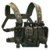 Direct Action Thunderbolt 紧凑型胸挂（劫掠者） | `direct-action-thunderbolt-compact-chest-rig-marauder` | 0.62 千克 | 容量 16 格；移速惩罚 0%；转身惩罚 0%；人机工效惩罚 0% | — | — | — |
| 10 | 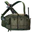 56式胸挂 | `type-56-chicom-chest-harness` | 0.65 千克 | 容量 10 格；移速惩罚 0%；转身惩罚 0%；人机工效惩罚 1% | 商人出售 | 15,581 卢布，需 Ragman 1 级 | 4,670 卢布（4 家最高） |
| 11 | 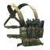 Haley Strategic D3CRX 胸挂（复合迷彩） | `haley-strategic-d3crx-chest-harness-multicam` | 0.65 千克 | 容量 18 格；移速惩罚 0%；转身惩罚 0%；人机工效惩罚 1% | 以物换物 | — | 12,625 卢布（4 家最高） |
| 12 | 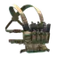 Haley Strategic D3CRX 胸挂（狼棕色） | `haley-strategic-d3crx-chest-harness-coyote-brown` | 0.65 千克 | 容量 18 格；移速惩罚 0%；转身惩罚 0%；人机工效惩罚 1% | — | — | 4,670 卢布（4 家最高） |
| 13 | 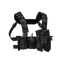 Spiritus Systems Bank Robber 胸挂 | `spiritus-systems-bank-robber-chest-rig-multicam-black` | 0.7 千克 | 容量 8 格；移速惩罚 0%；转身惩罚 0%；人机工效惩罚 0% | 商人出售 | 10,259 卢布，需 Ragman 1 级 | 4,100 卢布（4 家最高） |
| 14 | 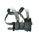 Spiritus Systems Bank Robber 胸挂 (高原复合迷彩) | `spiritus-systems-bank-robber-chest-rig-multicam-alpine` | 0.7 千克 | 容量 8 格；移速惩罚 0%；转身惩罚 0%；人机工效惩罚 0% | 商人出售 | 10,829 卢布，需 Ragman 1 级 | 4,100 卢布（4 家最高） |
| 15 | 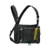 CSA 胸挂（黑色） | `csa-chest-rig-black` | 0.75 千克 | 容量 10 格；移速惩罚 0%；转身惩罚 0%；人机工效惩罚 0% | 商人出售 | 14,237 卢布，需 Ragman 1 级 | 5,121 卢布（4 家最高） |
| 16 |  SOE微型胸挂 | `soe-micro-rig-multicam` | 0.8 千克 | 容量 8 格；移速惩罚 0%；转身惩罚 0%；人机工效惩罚 0% | 商人出售 | 17,960 卢布，需 Peacekeeper 2 级 | 4,800 卢布（4 家最高） |
| 17 | 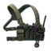 Haley Strategic D3CRX 胸挂（丛林绿） | `haley-strategic-d3crx-chest-harness-ranger-green` | 0.9 千克 | 容量 16 格；移速惩罚 0%；转身惩罚 0%；人机工效惩罚 0% | 商人出售 | 43,924 卢布，需 Ragman 2 级 | 15,800 卢布（4 家最高） |
| 18 | 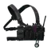 Haley Strategic D3CRX 胸挂（黑色） | `haley-strategic-d3crx-chest-harness-black` | 0.9 千克 | 容量 16 格；移速惩罚 0%；转身惩罚 0%；人机工效惩罚 0% | 以物换物 | — | 15,800 卢布（4 家最高） |
| 19 | 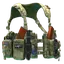 Gear Craft GC-BSS-MK1 胸挂 (A-TACS 橄榄绿迷彩) | `gear-craft-gc-bss-mk1-chest-rig-a-tacs-fg` | 1 千克 | 容量 16 格；移速惩罚 0%；转身惩罚 0%；人机工效惩罚 0% | 商人出售 | 33,377 卢布，需 Ragman 2 级 | 15,007 卢布（4 家最高） |
| 20 | 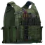 WARTECH TV-115 插板胸挂（橄榄绿） | `wartech-tv-115-plate-carrier-olive-drab` | 1.02 千克 | 防护等级 3 级；材质 轻型；容量 13 格；耐久 122；防护区域 4 处（共 10 项） | — | — | 4,386 卢布（4 家最高） |
| 21 | 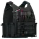 WARTECH TV-115 插板胸挂（黑色） | `wartech-tv-115-plate-carrier-black` | 1.02 千克 | 防护等级 3 级；材质 轻型；容量 13 格；耐久 122；防护区域 2 处（共 10 项） | 以物换物 | — | 13,442 卢布（4 家最高） |
| 22 | 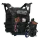 Tac-Kek JayPC 插板胸挂（黑色） | `tac-kek-jaypc-plate-carrier-black` | 1.1 千克 | 防护等级 1 级；材质 轻型；容量 13 格；耐久 180；防护区域 2 处（共 10 项） | — | — | 8,225 卢布（4 家最高） |
| 23 | 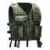 Umka М33-SET1 猎人背心 | `umka-m33-set1-hunter-vest-olive-drab` | 1.2 千克 | 容量 16 格；移速惩罚 1%；转身惩罚 0%；人机工效惩罚 2% | 商人出售 | 33,667 卢布，需 Jaeger 1 级 | 12,850 卢布（4 家最高） |
| 24 | 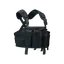 Triton M43-A胸挂 | `dynaforce-triton-m43-a-chest-harness-black` | 1.3 千克 | 容量 16 格；移速惩罚 0%；转身惩罚 0%；人机工效惩罚 1% | 商人出售 | 33,113 卢布，需 Ragman 2 级 | 11,911 卢布（4 家最高） |
| 25 | 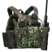 S&S Precision PlateFrame 插板胸挂（Goons 特别版） | `ss-precision-plateframe-plate-carrier-goons-edition` | 1.32 千克 | 防护等级 5 级；材质 轻型；容量 10 格；耐久 120；防护区域 4 处（共 10 项） | — | — | 25,199 卢布（4 家最高） |
| 26 | 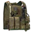 Eagle Allied Industries MBSS 插板胸挂（狼棕色） | `eagle-allied-industries-mbss-plate-carrier-coyote-brown` | 1.33 千克 | 防护等级 3 级；材质 轻型；容量 12 格；耐久 70；防护区域 2 处（共 10 项） | — | — | 8,047 卢布（4 家最高） |
| 27 | 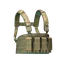 Blackhawk! Commando胸挂（Desert Tan） | `blackhawk-commando-chest-harness-desert-tan` | 1.35 千克 | 容量 16 格；移速惩罚 0%；转身惩罚 0%；人机工效惩罚 0% | 商人出售 | 39,780 卢布，需 Ragman 2 级 | 14,309 卢布（4 家最高） |
| 28 | 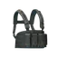 Blackhawk! Commando胸挂（黑） | `blackhawk-commando-chest-harness-black` | 1.35 千克 | 容量 16 格；移速惩罚 0%；转身惩罚 0%；人机工效惩罚 0% | 制作 | — | 14,309 卢布（4 家最高） |
| 29 | 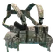 LBT-1961A 承重胸挂（AOR1） | `lbt-1961a-load-bearing-chest-rig-aor1` | 1.36 千克 | 容量 18 格；移速惩罚 0%；转身惩罚 0%；人机工效惩罚 0% | 以物换物 | — | 24,500 卢布（4 家最高） |
| 30 | 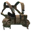 LBT-1961A 承重胸挂（Goons特别版） | `lbt-1961a-load-bearing-chest-rig-goons-edition` | 1.36 千克 | 容量 18 格；移速惩罚 0%；转身惩罚 0%；人机工效惩罚 0% | — | — | 24,500 卢布（4 家最高） |
| 31 | 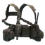 LBT-1961A 承重胸挂（MAS 灰色） | `lbt-1961a-load-bearing-chest-rig-mas-grey` | 1.36 千克 | 容量 18 格；移速惩罚 0%；转身惩罚 0%；人机工效惩罚 0% | 以物换物 | — | 19,125 卢布（4 家最高） |
| 32 | 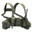 LBT-1961A 承重胸挂（复合迷彩） | `lbt-1961a-load-bearing-chest-rig-multicam` | 1.36 千克 | 容量 18 格；移速惩罚 0%；转身惩罚 0%；人机工效惩罚 0% | 以物换物 | — | 19,125 卢布（4 家最高） |
| 33 | 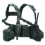 LBT-1961A 承重胸挂（沙漠防夜视迷彩） | `lbt-1961a-load-bearing-chest-rig-dnc` | 1.36 千克 | 容量 18 格；移速惩罚 0%；转身惩罚 0%；人机工效惩罚 0% | 以物换物 | — | 19,125 卢布（4 家最高） |
| 34 |  Stich Profi MK2胸挂（侦察型，A-TACS FG迷彩） | `stich-profi-chest-rig-mk2-recon-a-tacs-fg` | 1.4 千克 | 容量 18 格；移速惩罚 0%；转身惩罚 0%；人机工效惩罚 0% | 商人出售 | 45,036 卢布，需 Ragman 2 级 | 16,200 卢布（4 家最高） |
| 35 | 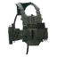 Stich Profi MK2胸挂（侦察型，数码丛林迷彩） | `stich-profi-chest-rig-mk2-recon-emr` | 1.4 千克 | 容量 18 格；移速惩罚 0%；转身惩罚 0%；人机工效惩罚 0% | 以物换物 | — | 16,200 卢布（4 家最高） |
| 36 | 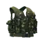 Splav Tarzan M22 胸挂 | `splav-tarzan-m22-chest-rig-smog` | 1.45 千克 | 容量 14 格；移速惩罚 1%；转身惩罚 0%；人机工效惩罚 2% | 以物换物 | — | 9,600 卢布（4 家最高） |
| 37 | 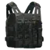 Tasmanian Tiger SK 插板胸挂（黑系复合迷彩） | `tasmanian-tiger-sk-plate-carrier-multicam-black` | 1.5 千克 | 防护等级 6 级；材质 轻型；容量 8 格；耐久 110；防护区域 2 处（共 10 项） | — | — | 12,074 卢布（4 家最高） |
| 38 | 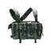 Azimut SS ”Zhuk”胸挂（SURPAT） | `azimut-ss-zhuk-chest-harness-surpat` | 1.6 千克 | 容量 20 格；移速惩罚 2%；转身惩罚 0%；人机工效惩罚 2% | — | — | 15,074 卢布（4 家最高） |
| 39 | 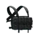 Azimut SS ”Zhuk”胸挂（黑） | `azimut-ss-zhuk-chest-harness-black` | 1.6 千克 | 容量 20 格；移速惩罚 2%；转身惩罚 0%；人机工效惩罚 2% | 商人出售 | 41,906 卢布，需 Ragman 2 级 | 15,074 卢布（4 家最高） |
| 40 | 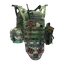 Tac-Kek JayPC 插板胸挂（橄榄绿） | `tac-kek-jaypc-plate-carrier-od-green` | 1.6 千克 | 防护等级 1 级；材质 轻型；容量 15 格；耐久 180；防护区域 2 处（共 10 项） | — | — | 9,502 卢布（4 家最高） |
| 41 | 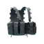 Velocity Systems多用途巡逻背心 | `velocity-systems-mppv-multi-purpose-patrol-vest-wolf-grey` | 1.6 千克 | 容量 24 格；移速惩罚 0%；转身惩罚 0%；人机工效惩罚 0% | 以物换物 | — | 21,648 卢布（4 家最高） |
| 42 | 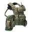 WARTECH MK3 TV-104 胸挂 (复合迷彩) | `wartech-mk3-tv-104-chest-rig-multicam` | 1.65 千克 | 容量 20 格；移速惩罚 0%；转身惩罚 0%；人机工效惩罚 0% | 商人出售 | 51,372 卢布，需 Ragman 3 级 | 18,479 卢布（4 家最高） |
| 43 | 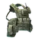 WARTECH MK3 TV-104 胸挂 (苔藓迷彩) | `wartech-mk3-tv-104-chest-rig-moss` | 1.65 千克 | 容量 20 格；移速惩罚 0%；转身惩罚 0%；人机工效惩罚 0% | 以物换物 | — | 18,479 卢布（4 家最高） |
| 44 | 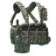 ANA Tactical Alpha 胸挂（A-TACS AU） | `ana-tactical-alpha-chest-rig-a-tacs-au` | 1.7 千克 | 容量 20 格；移速惩罚 0%；转身惩罚 0%；人机工效惩罚 0% | 以物换物 | — | 32,161 卢布（4 家最高） |
| 45 | 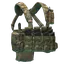 ANA Tactical Alpha 胸挂（复合迷彩） | `ana-tactical-alpha-chest-rig-multicam` | 1.7 千克 | 容量 20 格；移速惩罚 0%；转身惩罚 0%；人机工效惩罚 0% | 以物换物 | — | 32,161 卢布（3 家最高） |
| 46 | 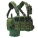 ANA Tactical Alpha胸挂 | `ana-tactical-alpha-chest-rig-olive-drab` | 1.7 千克 | 容量 20 格；移速惩罚 0%；转身惩罚 0%；人机工效惩罚 0% | 商人出售 / 以物换物 | 59,605 卢布，需 Ragman 3 级 | 21,440 卢布（4 家最高） |
| 47 | 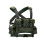 Azimut SS ”Khamelion”胸挂（橄榄色） | `azimut-ss-khamelion-chest-harness-olive` | 1.7 千克 | 容量 12 格；移速惩罚 0%；转身惩罚 0%；人机工效惩罚 0% | — | — | 25,000 卢布（4 家最高） |
| 48 |  Poyas-A + Poyas-B 复合胸挂 | `poyas-a-poyas-b-gear-rig` | 1.7 千克 | 容量 25 格；移速惩罚 1%；转身惩罚 0%；人机工效惩罚 2% | 以物换物 | — | 20,662 卢布（4 家最高） |
| 49 | 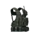 UMTBS 6Sh112 Scout-Sniper胸挂（数码丛林迷彩） | `umtbs-6sh112-scout-sniper-chest-rig-emr` | 1.7 千克 | 容量 12 格；移速惩罚 0%；转身惩罚 0%；人机工效惩罚 0% | 商人出售 / 以物换物 | 29,778 卢布，需 Ragman 2 级 | 10,711 卢布（4 家最高） |
| 50 | 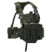 Stich Profi MK2胸挂（突击型，A-TACS FG迷彩） | `stich-profi-chest-rig-mk2-assault-a-tacs-fg` | 1.75 千克 | 容量 18 格；移速惩罚 0%；转身惩罚 0%；人机工效惩罚 1% | 商人出售 | 46,913 卢布，需 Ragman 3 级 | 16,875 卢布（4 家最高） |
| 51 | 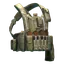 BlackRock 胸挂（卡其色） | `blackrock-chest-rig-khaki` | 1.8 千克 | 容量 20 格；移速惩罚 1%；转身惩罚 0%；人机工效惩罚 1% | 以物换物 | — | 27,472 卢布（3 家最高） |
| 52 | 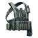 BlackRock胸挂 | `blackrock-chest-rig-gray` | 1.8 千克 | 容量 20 格；移速惩罚 1%；转身惩罚 0%；人机工效惩罚 1% | 商人出售 / 制作 | 56,573 卢布，需 Ragman 3 级 | 20,350 卢布（4 家最高） |
| 53 | 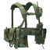 WARTECH TV-109 + TV-106 胸挂（A-TACS 橄榄绿迷彩） | `wartech-tv-109-tv-106-chest-rig-a-tacs-fg` | 1.8 千克 | 容量 10 格；移速惩罚 0%；转身惩罚 0%；人机工效惩罚 0% | 商人出售 | 19,811 卢布，需 Ragman 1 级 | 7,126 卢布（4 家最高） |
| 54 | 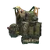 Crye Precision JPC 插板胸挂（复合迷彩） | `crye-precision-jpc-plate-carrier-multicam` | 1.83 千克 | 防护等级 5 级；材质 轻型；容量 24 格；耐久 110；防护区域 2 处（共 10 项） | — | — | 20,263 卢布（4 家最高） |
| 55 |  Crye Precision AVS 插板胸挂（Tagilla 版） | `crye-precision-avs-plate-carrier-tagilla-edition` | 1.98 千克 | 防护等级 6 级；材质 重型；容量 12 格；耐久 170；防护区域 4 处（共 10 项） | — | — | 24,951 卢布（4 家最高） |
| 56 |  Stich Profi V2 插板胸挂（A-TACS FG） | `stich-profi-plate-carrier-v2-a-tacs-fg` | 2.2 千克 | 防护等级 4 级；材质 轻型；容量 20 格；耐久 198；防护区域 11 处（共 10 项） | 以物换物 | — | 17,520 卢布（4 家最高） |
| 57 |  Stich Profi V2 插板胸挂（MARPAT 林地迷彩） | `stich-profi-plate-carrier-v2-marpat-woodland` | 2.2 千克 | 防护等级 4 级；材质 轻型；容量 20 格；耐久 198；防护区域 9 处（共 10 项） | 以物换物 | — | 17,020 卢布（4 家最高） |
| 58 |  Stich Profi V2 插板胸挂（灰褐色） | `stich-profi-plate-carrier-v2-coyote` | 2.2 千克 | 防护等级 4 级；材质 轻型；容量 20 格；耐久 198；防护区域 11 处（共 10 项） | 以物换物 | — | 17,520 卢布（4 家最高） |
| 59 |  Stich Profi V2 插板胸挂（黑色） | `stich-profi-plate-carrier-v2-black` | 2.2 千克 | 防护等级 4 级；材质 轻型；容量 20 格；耐久 198；防护区域 9 处（共 10 项） | — | — | 17,020 卢布（4 家最高） |
| 60 |  ANA Tactical M2 插板胸挂 (A-TACS AU-X) | `ana-tactical-m2-plate-carrier-a-tacs-au-x` | 2.25 千克 | 防护等级 4 级；材质 轻型；容量 18 格；耐久 206；防护区域 10 处（共 10 项） | 以物换物 | — | 25,681 卢布（4 家最高） |
| 61 |  ANA Tactical M2 插板胸挂 (A-TACS iX) | `ana-tactical-m2-plate-carrier-a-tacs-ix` | 2.25 千克 | 防护等级 4 级；材质 轻型；容量 18 格；耐久 206；防护区域 10 处（共 10 项） | 以物换物 | — | 25,681 卢布（4 家最高） |
| 62 |  ANA Tactical M2 插板胸挂（橄榄绿） | `ana-tactical-m2-plate-carrier-od-green` | 2.25 千克 | 防护等级 4 级；材质 轻型；容量 18 格；耐久 206；防护区域 10 处（共 10 项） | 制作 | — | 25,681 卢布（4 家最高） |
| 63 |  ANA Tactical M2 插板胸挂（高原复合迷彩） | `ana-tactical-m2-plate-carrier-multicam-alpine` | 2.25 千克 | 防护等级 4 级；材质 轻型；容量 18 格；耐久 206；防护区域 10 处（共 10 项） | 以物换物 | — | 25,681 卢布（4 家最高） |
| 64 |  Blue Force Gear PLATEminus V2 插板胸挂（灾厄） | `blue-force-gear-plateminus-v2-plate-carrier-scourge` | 2.28 千克 | 防护等级 2 级；材质 轻型；容量 22 格；耐久 68；防护区域 8 处（共 10 项） | 以物换物 | — | 27,351 卢布（4 家最高） |
| 65 |  5.11 Tactical TacTec 插板胸挂（丛林绿） | `511-tactical-tactec-plate-carrier-ranger-green` | 2.35 千克 | 防护等级 5 级；材质 轻型；容量 18 格；耐久 170；防护区域 4 处（共 10 项） | 制作 | — | 26,199 卢布（4 家最高） |
| 66 |  5.11 Tactical TacTec 插板胸挂（风暴灰） | `511-tactical-tactec-plate-carrier-storm` | 2.35 千克 | 防护等级 5 级；材质 轻型；容量 18 格；耐久 170；防护区域 4 处（共 10 项） | 以物换物 | — | 26,199 卢布（3 家最高） |
| 67 |  Blue Force Gear PLATEminus V2 插板胸挂（复合迷彩） | `blue-force-gear-plateminus-v2-plate-carrier-multicam` | 2.41 千克 | 防护等级 2 级；材质 轻型；容量 20 格；耐久 68；防护区域 8 处（共 10 项） | 以物换物 | — | 21,851 卢布（4 家最高） |
| 68 |  Ars Arma A18 Skanda 插板胸挂（复合迷彩） | `ars-arma-a18-skanda-plate-carrier-multicam` | 2.45 千克 | 防护等级 4 级；材质 轻型；容量 25 格；耐久 186；防护区域 8 处（共 10 项） | 制作 | — | 12,859 卢布（4 家最高） |
| 69 |  Blue Force Gear PLATEminus V2 插板胸挂（狼棕色） | `blue-force-gear-plateminus-v2-plate-carrier-coyote-brown` | 2.45 千克 | 防护等级 2 级；材质 轻型；容量 23 格；耐久 68；防护区域 8 处（共 10 项） | 以物换物 | — | 21,851 卢布（4 家最高） |
| 70 |  ECLiPSE RBAV-AF 插板胸挂（丛林绿） | `eclipse-rbav-af-plate-carrier-ranger-green` | 2.65 千克 | 防护等级 4 级；材质 轻型；容量 19 格；耐久 218；防护区域 9 处（共 10 项） | — | — | 17,135 卢布（4 家最高） |
| 71 |  Blue Force Gear PLATEminus V2 插板胸挂（狼灰色） | `blue-force-gear-plateminus-v2-plate-carrier-wolf-gray` | 2.67 千克 | 防护等级 2 级；材质 轻型；容量 23 格；耐久 68；防护区域 8 处（共 10 项） | 以物换物 | — | 24,351 卢布（4 家最高） |
| 72 |  Stich Profi Stich Defense mod.2 插板胸挂（复合迷彩） | `stich-profi-stich-defense-mod2-plate-carrier-multicam` | 2.71 千克 | 防护等级 6 级；材质 轻型；容量 14 格；耐久 220；防护区域 8 处（共 10 项） | — | — | 26,796 卢布（4 家最高） |
| 73 |  Ars Arma CPC MOD.1 插板胸挂（A-TACS FG 迷彩） | `ars-arma-cpc-mod1-plate-carrier-a-tacs-fg` | 2.75 千克 | 防护等级 5 级；材质 轻型；容量 23 格；耐久 240；防护区域 8 处（共 10 项） | 以物换物 | — | 34,495 卢布（4 家最高） |
| 74 |  FORT Gladiator-S（格斗-S）轻型插板胸挂（复合迷彩） | `fort-gladiator-s-plate-carrier-lightweight-multicam` | 2.77 千克 | 防护等级 5 级；材质 轻型；容量 16 格；耐久 270；防护区域 6 处（共 10 项） | 以物换物 | — | 34,348 卢布（4 家最高） |
| 75 |  Eagle Industries MMAC 插板胸挂 （丛林绿） | `eagle-industries-mmac-plate-carrier-ranger-green` | 2.83 千克 | 防护等级 4 级；材质 轻型；容量 14 格；耐久 144；防护区域 8 处（共 10 项） | — | — | 11,029 卢布（4 家最高） |
| 76 |  Crye Precision AVS 插板胸挂（丛林绿） | `crye-precision-avs-plate-carrier-ranger-green` | 2.88 千克 | 防护等级 4 级；材质 轻型；容量 23 格；耐久 212；防护区域 6 处（共 10 项） | — | — | 29,314 卢布（4 家最高） |
| 77 |  Crye Precision AVS 插板胸挂（复合迷彩） | `crye-precision-avs-plate-carrier-multicam` | 2.88 千克 | 防护等级 4 级；材质 轻型；容量 23 格；耐久 212；防护区域 6 处（共 10 项） | 以物换物 | — | 29,314 卢布（3 家最高） |
| 78 |  ANA Tactical M1 插板胸挂（数码丛林迷彩） | `ana-tactical-m1-plate-carrier-emr` | 2.95 千克 | 防护等级 4 级；材质 重型；容量 20 格；耐久 194；防护区域 10 处（共 10 项） | 以物换物 | — | 19,016 卢布（4 家最高） |
| 79 |  ANA Tactical M1 插板胸挂（橄榄绿） | `ana-tactical-m1-plate-carrier-od-green` | 2.95 千克 | 防护等级 4 级；材质 重型；容量 20 格；耐久 194；防护区域 10 处（共 10 项） | — | — | 19,016 卢布（4 家最高） |
| 80 |  FORT Gladiator-S（格斗-S）轻型插板胸挂（维京） | `fort-gladiator-s-plate-carrier-viking` | 3.05 千克 | 防护等级 5 级；材质 轻型；容量 20 格；耐久 282；防护区域 7 处（共 10 项） | 以物换物 | — | 38,135 卢布（4 家最高） |
| 81 |  Shellback Tactical Banshee 插板胸挂（A-TACS AU 迷彩） | `shellback-tactical-banshee-plate-carrier-a-tacs-au` | 3.08 千克 | 防护等级 4 级；材质 轻型；容量 16 格；耐久 152；防护区域 8 处（共 10 项） | — | — | 12,380 卢布（4 家最高） |
| 82 |  Tasmanian Tiger MKIII 插板胸挂（狼棕色） | `tasmanian-tiger-plate-carrier-mkiii-coyote-brown` | 3.08 千克 | 防护等级 5 级；材质 轻型；容量 15 格；耐久 110；防护区域 2 处（共 10 项） | — | — | 11,077 卢布（4 家最高） |
| 83 |  FirstSpear Strandhogg 插板胸挂（ABU 迷彩） | `first-spear-strandhogg-plate-carrier-abupat` | 3.2 千克 | 防护等级 4 级；材质 轻型；容量 17 格；耐久 198；防护区域 9 处（共 10 项） | 以物换物 | — | 18,059 卢布（4 家最高） |
| 84 |  FirstSpear Strandhogg 插板胸挂（丛林绿） | `first-spear-strandhogg-plate-carrier-ranger-green` | 3.2 千克 | 防护等级 4 级；材质 轻型；容量 17 格；耐久 198；防护区域 9 处（共 10 项） | 制作 | — | 18,059 卢布（4 家最高） |
| 85 |  FirstSpear Strandhogg 插板胸挂（黑系复合迷彩） | `first-spear-strandhogg-plate-carrier-multicam-black` | 3.2 千克 | 防护等级 4 级；材质 轻型；容量 17 格；耐久 198；防护区域 7 处（共 10 项） | 以物换物 | — | 18,059 卢布（4 家最高） |
| 86 |  WARTECH TV-110 插板胸挂（灰褐色） | `wartech-tv-110-plate-carrier-coyote` | 3.5 千克 | 防护等级 4 级；材质 轻型；容量 23 格；耐久 160；防护区域 4 处（共 10 项） | — | — | 13,021 卢布（4 家最高） |
| 87 |  Stich Profi Stich Defense mod.2 插板胸挂（A-TACS FG 迷彩） | `stich-profi-stich-defense-mod2-plate-carrier-a-tacs-fg` | 3.66 千克 | 防护等级 3 级；材质 轻型；容量 24 格；耐久 155；防护区域 10 处（共 10 项） | 以物换物 | — | 32,098 卢布（4 家最高） |
| 88 |  Stich Profi Stich Defense mod.2 插板胸挂（清场小队） | `stich-profi-stich-defense-mod2-plate-carrier-cleanup-crew` | 3.66 千克 | 防护等级 3 级；材质 轻型；容量 24 格；耐久 155；防护区域 10 处（共 10 项） | 以物换物 | — | 32,098 卢布（4 家最高） |
| 89 |  Crye Precision CPC 插板胸挂（Goons 特别版） | `crye-precision-cpc-plate-carrier-goons-edition` | 3.7 千克 | 防护等级 5 级；材质 轻型；容量 18 格；耐久 230；防护区域 8 处（共 10 项） | — | — | 34,389 卢布（4 家最高） |
| 90 |  Spiritus Systems LV-119 插板胸挂 (黑色军团 V1) | `spiritus-systems-lv-119-plate-carrier-black-division-v1` | 3.9 千克 | 防护等级 6 级；材质 轻型；容量 24 格；耐久 220；防护区域 6 处（共 10 项） | 以物换物 | — | 43,176 卢布（4 家最高） |
| 91 |  6B45 防弹胸挂（突击型，数码丛林迷彩） | `6b45-armored-rig-assault-emr` | 4.3 千克 | 防护等级 6 级；材质 轻型；容量 19 格；耐久 414；防护区域 12 处（共 10 项） | 商人出售 | 114,999 卢布，需 Prapor 4 级 | 42,279 卢布（4 家最高） |
| 92 |  6B45 防弹胸挂（通用型，数码丛林迷彩） | `6b45-armored-rig-general-purpose-emr` | 4.36 千克 | 防护等级 5 级；材质 轻型；容量 16 格；耐久 364；防护区域 12 处（共 10 项） | 商人出售 | 110,919 卢布，需 Prapor 3 级 | 40,779 卢布（4 家最高） |
| 93 |  6B45 防弹胸挂（医疗型，数码丛林迷彩） | `6b45-armored-rig-medic-emr` | 4.5 千克 | 防护等级 5 级；材质 轻型；容量 16 格；耐久 364；防护区域 12 处（共 10 项） | 商人出售 | 109,559 卢布，需 Prapor 3 级 | 40,279 卢布（4 家最高） |
| 94 |  FORT Gladiator-S（格斗-S）轻型插板胸挂（复合迷彩） | `fort-gladiator-s-plate-carrier-multicam` | 4.83 千克 | 防护等级 5 级；材质 重型；容量 22 格；耐久 345；防护区域 9 处（共 10 项） | — | — | 47,401 卢布（4 家最高） |
| 95 |  NPP KlASS Bagariy 防弹胸挂（数码丛林迷彩） | `npp-klass-bagariy-plate-carrier-emr` | 5.1 千克 | 防护等级 5 级；材质 重型；容量 25 格；耐久 232；防护区域 10 处（共 10 项） | 制作 | — | 25,842 卢布（4 家最高） |
| 96 |  Spiritus Systems LV-119 插板胸挂 (黑系复合迷彩) | `spiritus-systems-lv-119-plate-carrier-multicam-black` | 5.1 千克 | 防护等级 5 级；材质 轻型；容量 28 格；耐久 198；防护区域 4 处（共 10 项） | — | — | 36,192 卢布（4 家最高） |
| 97 |  Spiritus Systems LV-119 插板胸挂 (黑色军团 V2) | `spiritus-systems-lv-119-plate-carrier-black-division-v2` | 5.1 千克 | 防护等级 5 级；材质 轻型；容量 25 格；耐久 198；防护区域 4 处（共 10 项） | 以物换物 | — | 36,192 卢布（4 家最高） |
| 98 |  Ferro Concepts FCPC V5 插板胸挂 (黑色军团) | `ferro-concepts-fcpc-v5-plate-carrier-black-division` | 5.3 千克 | 防护等级 5 级；材质 轻型；容量 14 格；耐久 198；防护区域 6 处（共 10 项） | 以物换物 | — | 34,199 卢布（4 家最高） |
| 99 |  CQC 鱼鹰 MK4A 防弹胸挂（突击型，多地形迷彩） | `cqc-osprey-mk4a-plate-carrier-assault-mtp` | 6.4 千克 | 防护等级 4 级；材质 轻型；容量 25 格；耐久 222；防护区域 14 处（共 10 项） | — | — | 24,608 卢布（4 家最高） |
| 100 |  CQC 鱼鹰 MK4A 防弹胸挂（防护型，多地形迷彩） | `cqc-osprey-mk4a-plate-carrier-protection-mtp` | 6.9 千克 | 防护等级 5 级；材质 轻型；容量 24 格；耐久 272；防护区域 14 处（共 10 项） | — | — | 41,139 卢布（4 家最高） |
| 101 |  6B5-16 Zh-86 Uley 防弹胸挂（卡其色） | `6b5-16-zh-86-uley-armored-rig-khaki` | 7.1 千克 | 防护等级 3 级；材质 重型；容量 10 格；耐久 160；防护区域 7 处（共 10 项） | 商人出售 | 53,100 卢布，需 Prapor 2 级 | 19,522 卢布（4 家最高） |
| 102 |  FORT Gladiator-S（格斗-S）插板胸挂（无惧死亡） | `fort-gladiator-s-plate-carrier-death-is-inevitable` | 7.12 千克 | 防护等级 5 级；材质 重型；容量 12 格；耐久 440；防护区域 15 处（共 10 项） | 以物换物 | — | 53,059 卢布（4 家最高） |
| 103 |  6B3TM-01 防弹胸挂（卡其色） | `6b3tm-01-armored-rig-khaki` | 8.2 千克 | 防护等级 4 级；材质 重型；容量 12 格；耐久 86；防护区域 6 处（共 10 项） | 以物换物 | — | 22,210 卢布（4 家最高） |
| 104 |  First Spear Siege-R Optimized M.A.S.S. 插板胸挂 (黑色军团) | `first-spear-siege-r-optimized-mass-plate-carrier-black-division` | 10.8 千克 | 防护等级 5 级；材质 轻型；容量 25 格；耐久 350；防护区域 15 处（共 10 项） | 以物换物 | — | 73,612 卢布（4 家最高） |
| 105 |  6B5-15 Zh-86 Uley 防弹胸挂（丛林迷彩） | `6b5-15-zh-86-uley-armored-rig-flora` | 12.2 千克 | 防护等级 4 级；材质 轻型；容量 10 格；耐久 110；防护区域 7 处（共 10 项） | 商人出售 | 71,084 卢布，需 Ragman 2 级 | 25,569 卢布（4 家最高） |

> 本分类 **105 件**。价格取各商人中的最优价；「商人最低售价」栏附商人与等级要求，「最高回收」栏标注参与回收的商人数。

本分类 105 件的名称一览（点开可浏览；站内搜索靠它命中物品名）

IDEA DIY胸挂　Scav背心　保安背心　Zulu Nylon Gear M4 低特征胸挂（丛林绿）　Blue Force Gear Ten-Speed SF 胸挂（丛林绿）　Direct Action Thunderbolt 紧凑型胸挂　Direct Action Thunderbolt 紧凑型胸挂（PenCott 荒林迷彩）　Direct Action Thunderbolt 紧凑型胸挂（丛林绿）　Direct Action Thunderbolt 紧凑型胸挂（劫掠者）　56式胸挂　Haley Strategic D3CRX 胸挂（复合迷彩）　Haley Strategic D3CRX 胸挂（狼棕色）　Spiritus Systems Bank Robber 胸挂　Spiritus Systems Bank Robber 胸挂 (高原复合迷彩)　CSA 胸挂（黑色）　SOE微型胸挂　Haley Strategic D3CRX 胸挂（丛林绿）　Haley Strategic D3CRX 胸挂（黑色）　Gear Craft GC-BSS-MK1 胸挂 (A-TACS 橄榄绿迷彩)　WARTECH TV-115 插板胸挂（橄榄绿）　WARTECH TV-115 插板胸挂（黑色）　Tac-Kek JayPC 插板胸挂（黑色）　Umka М33-SET1 猎人背心　Triton M43-A胸挂　S&S Precision PlateFrame 插板胸挂（Goons 特别版）　Eagle Allied Industries MBSS 插板胸挂（狼棕色）　Blackhawk! Commando胸挂（Desert Tan）　Blackhawk! Commando胸挂（黑）　LBT-1961A 承重胸挂（AOR1）　LBT-1961A 承重胸挂（Goons特别版）　LBT-1961A 承重胸挂（MAS 灰色）　LBT-1961A 承重胸挂（复合迷彩）　LBT-1961A 承重胸挂（沙漠防夜视迷彩）　Stich Profi MK2胸挂（侦察型，A-TACS FG迷彩）　Stich Profi MK2胸挂（侦察型，数码丛林迷彩）　Splav Tarzan M22 胸挂　Tasmanian Tiger SK 插板胸挂（黑系复合迷彩）　Azimut SS ”Zhuk”胸挂（SURPAT）　Azimut SS ”Zhuk”胸挂（黑）　Tac-Kek JayPC 插板胸挂（橄榄绿）　Velocity Systems多用途巡逻背心　WARTECH MK3 TV-104 胸挂 (复合迷彩)　WARTECH MK3 TV-104 胸挂 (苔藓迷彩)　ANA Tactical Alpha 胸挂（A-TACS AU）　ANA Tactical Alpha 胸挂（复合迷彩）　ANA Tactical Alpha胸挂　Azimut SS ”Khamelion”胸挂（橄榄色）　Poyas-A + Poyas-B 复合胸挂　UMTBS 6Sh112 Scout-Sniper胸挂（数码丛林迷彩）　Stich Profi MK2胸挂（突击型，A-TACS FG迷彩）　BlackRock 胸挂（卡其色）　BlackRock胸挂　WARTECH TV-109 + TV-106 胸挂（A-TACS 橄榄绿迷彩）　Crye Precision JPC 插板胸挂（复合迷彩）　Crye Precision AVS 插板胸挂（Tagilla 版）　Stich Profi V2 插板胸挂（A-TACS FG）　Stich Profi V2 插板胸挂（MARPAT 林地迷彩）　Stich Profi V2 插板胸挂（灰褐色）　Stich Profi V2 插板胸挂（黑色）　ANA Tactical M2 插板胸挂 (A-TACS AU-X)　ANA Tactical M2 插板胸挂 (A-TACS iX)　ANA Tactical M2 插板胸挂（橄榄绿）　ANA Tactical M2 插板胸挂（高原复合迷彩）　Blue Force Gear PLATEminus V2 插板胸挂（灾厄）　5.11 Tactical TacTec 插板胸挂（丛林绿）　5.11 Tactical TacTec 插板胸挂（风暴灰）　Blue Force Gear PLATEminus V2 插板胸挂（复合迷彩）　Ars Arma A18 Skanda 插板胸挂（复合迷彩）　Blue Force Gear PLATEminus V2 插板胸挂（狼棕色）　ECLiPSE RBAV-AF 插板胸挂（丛林绿）　Blue Force Gear PLATEminus V2 插板胸挂（狼灰色）　Stich Profi Stich Defense mod.2 插板胸挂（复合迷彩）　Ars Arma CPC MOD.1 插板胸挂（A-TACS FG 迷彩）　FORT Gladiator-S（格斗-S）轻型插板胸挂（复合迷彩）　Eagle Industries MMAC 插板胸挂 （丛林绿）　Crye Precision AVS 插板胸挂（丛林绿）　Crye Precision AVS 插板胸挂（复合迷彩）　ANA Tactical M1 插板胸挂（数码丛林迷彩）　ANA Tactical M1 插板胸挂（橄榄绿）　FORT Gladiator-S（格斗-S）轻型插板胸挂（维京）　Shellback Tactical Banshee 插板胸挂（A-TACS AU 迷彩）　Tasmanian Tiger MKIII 插板胸挂（狼棕色）　FirstSpear Strandhogg 插板胸挂（ABU 迷彩）　FirstSpear Strandhogg 插板胸挂（丛林绿）　FirstSpear Strandhogg 插板胸挂（黑系复合迷彩）　WARTECH TV-110 插板胸挂（灰褐色）　Stich Profi Stich Defense mod.2 插板胸挂（A-TACS FG 迷彩）　Stich Profi Stich Defense mod.2 插板胸挂（清场小队）　Crye Precision CPC 插板胸挂（Goons 特别版）　Spiritus Systems LV-119 插板胸挂 (黑色军团 V1)　6B45 防弹胸挂（突击型，数码丛林迷彩）　6B45 防弹胸挂（通用型，数码丛林迷彩）　6B45 防弹胸挂（医疗型，数码丛林迷彩）　FORT Gladiator-S（格斗-S）轻型插板胸挂（复合迷彩）　NPP KlASS Bagariy 防弹胸挂（数码丛林迷彩）　Spiritus Systems LV-119 插板胸挂 (黑系复合迷彩)　Spiritus Systems LV-119 插板胸挂 (黑色军团 V2)　Ferro Concepts FCPC V5 插板胸挂 (黑色军团)　CQC 鱼鹰 MK4A 防弹胸挂（突击型，多地形迷彩）　CQC 鱼鹰 MK4A 防弹胸挂（防护型，多地形迷彩）　6B5-16 Zh-86 Uley 防弹胸挂（卡其色）　FORT Gladiator-S（格斗-S）插板胸挂（无惧死亡）　6B3TM-01 防弹胸挂（卡其色）　First Spear Siege-R Optimized M.A.S.S. 插板胸挂 (黑色军团)　6B5-15 Zh-86 Uley 防弹胸挂（丛林迷彩）

### 背包

分类路径：物品 › 组合物品 › 可搜索物品

| # | 名称 | 英文名 | 重量 | 关键属性 | 获取方式 | 商人最低售价 | 商人最高回收 |
|---|------|--------|------|----------|----------|--------------|--------------|
| 1 |  Vertx Ready Pack背包（红色） | `vertx-ready-pack-backpack-red` | 0.453 千克 | 容量 16 格；移速惩罚 1%；转身惩罚 0%；人机工效惩罚 1% | — | — | 6,076 卢布（3 家最高） |
| 2 |  战术挎包 | `tactical-sling-bag-khaki` | 0.48 千克 | 容量 6 格；移速惩罚 0%；转身惩罚 0%；人机工效惩罚 2% | 商人出售 | 8,340 卢布，需 Ragman 1 级 | 3,000 卢布（3 家最高） |
| 3 |  LBT-8005A Day Pack 背包（黑系复合迷彩） | `lbt-8005a-day-pack-backpack-multicam-black` | 0.57 千克 | 容量 20 格；移速惩罚 1%；转身惩罚 1%；人机工效惩罚 2% | 商人出售 / 以物换物 | 42,280 卢布，需 Peacekeeper 2 级 | 11,300 卢布（3 家最高） |
| 4 |  Partizan的包 | `partisans-bag` | 0.7 千克 | 容量 20 格；移速惩罚 5%；转身惩罚 2%；人机工效惩罚 8% | — | — | 18,428 卢布（3 家最高） |
| 5 |  邮差小挎包 | `transformer-bag` | 0.84 千克 | 容量 9 格；移速惩罚 0%；转身惩罚 0%；人机工效惩罚 2% | 商人出售 | 14,387 卢布，需 Ragman 1 级 | 4,500 卢布（3 家最高） |
| 6 |  VKBO军用背包 | `vkbo-army-bag` | 0.96 千克 | 容量 8 格；移速惩罚 1%；转身惩罚 0%；人机工效惩罚 1% | 商人出售 | 10,480 卢布，需 Jaeger 1 级 | 4,000 卢布（3 家最高） |
| 7 |  LolKek 3F Transfer 旅行背包 | `lolkek-3f-transfer-tourist-backpack` | 0.984 千克 | 容量 12 格；移速惩罚 0%；转身惩罚 0%；人机工效惩罚 2% | — | — | 9,000 卢布（3 家最高） |
| 8 |  Oakley Mechanism 重型背包（黑色） | `oakley-mechanism-heavy-duty-backpack-black` | 0.997 千克 | 容量 32 格；移速惩罚 2%；转身惩罚 1%；人机工效惩罚 3% | 商人出售 | 153,562 卢布，需 Ragman 2 级 | 27,619 卢布（3 家最高） |
| 9 |  WARTECH 金雕 BB-102 背包 (A-TACS FG 迷彩) | `wartech-berkut-bb-102-backpack-a-tacs-fg` | 1 千克 | 容量 20 格；移速惩罚 0%；转身惩罚 0%；人机工效惩罚 2% | 商人出售 | 30,692 卢布，需 Ragman 2 级 | 11,040 卢布（3 家最高） |
| 10 |  Tasmanian Tiger Trooper 35 背包（卡其色） | `tasmanian-tiger-trooper-35-backpack-khaki` | 1.004 千克 | 容量 35 格；移速惩罚 4%；转身惩罚 1%；人机工效惩罚 5% | 以物换物 | — | 41,382 卢布（3 家最高） |
| 11 |  旅行包 | `duffle-bag` | 1.08 千克 | 容量 12 格；移速惩罚 4%；转身惩罚 1%；人机工效惩罚 3% | — | — | 5,650 卢布（3 家最高） |
| 12 |  Flyye MBSS 背包（通用迷彩） | `flyye-mbss-backpack-ucp` | 1.1 千克 | 容量 16 格；移速惩罚 1%；转身惩罚 0%；人机工效惩罚 1% | 商人出售 / 以物换物 | 25,465 卢布，需 Ragman 2 级 | 9,160 卢布（3 家最高） |
| 13 |  Tehinkom RK-PT-25巡逻背包（数码丛林迷彩） | `tehinkom-rk-pt-25-patrol-backpack-emr` | 1.1 千克 | 容量 25 格；移速惩罚 1%；转身惩罚 1%；人机工效惩罚 2% | 商人出售 | 38,018 卢布，需 Ragman 2 级 | 13,675 卢布（3 家最高） |
| 14 |  LBT-1476A 3 日行军背包 (高原复合迷彩) | `lbt-1476a-3day-pack-multicam-alpine` | 1.133 千克 | 容量 25 格；移速惩罚 1%；转身惩罚 0%；人机工效惩罚 2% | 以物换物 | — | 14,250 卢布（3 家最高） |
| 15 |  LBT-1476A 3 日行军背包（林地迷彩） | `lbt-1476a-3day-pack-woodland` | 1.133 千克 | 容量 25 格；移速惩罚 1%；转身惩罚 0%；人机工效惩罚 2% | 以物换物 | — | 14,250 卢布（3 家最高） |
| 16 |  Gruppa 99 T20背包 （复合迷彩） | `gruppa-99-t20-backpack-multicam` | 1.25 千克 | 容量 25 格；移速惩罚 1%；转身惩罚 0%；人机工效惩罚 1% | 商人出售 | 40,880 卢布，需 Ragman 3 级 | 14,705 卢布（3 家最高） |
| 17 |  Gruppa 99 T20背包（茶褐色） | `gruppa-99-t20-backpack-umber-brown` | 1.25 千克 | 容量 25 格；移速惩罚 1%；转身惩罚 0%；人机工效惩罚 1% | 商人出售 | 40,880 卢布，需 Ragman 3 级 | 14,705 卢布（3 家最高） |
| 18 |  Gruppa 99 T30背包 （复合迷彩） | `gruppa-99-t30-backpack-multicam` | 1.4 千克 | 容量 30 格；移速惩罚 2%；转身惩罚 1%；人机工效惩罚 2% | 以物换物 | — | 32,438 卢布（3 家最高） |
| 19 |  Gruppa 99 T30背包（黑色） | `gruppa-99-t30-backpack-black` | 1.4 千克 | 容量 30 格；移速惩罚 2%；转身惩罚 1%；人机工效惩罚 2% | 以物换物 | — | 32,438 卢布（3 家最高） |
| 20 |  Sanitar 包 | `sanitars-bag` | 1.44 千克 | 容量 16 格；移速惩罚 4%；转身惩罚 1%；人机工效惩罚 3% | — | — | 23,037 卢布（3 家最高） |
| 21 |  Mystery Ranch 2 日突击包 (黑色) | `mystery-ranch-2-day-assault-pack-black` | 1.485 千克 | 容量 30 格；移速惩罚 4%；转身惩罚 2%；人机工效惩罚 6% | 以物换物 | — | 63,350 卢布（3 家最高） |
| 22 |  Hazard 4 Takedown 单肩背包（复合迷彩） | `hazard-4-takedown-sling-backpack-multicam` | 1.58 千克 | 容量 24 格；移速惩罚 3%；转身惩罚 1%；人机工效惩罚 3% | 商人出售 / 以物换物 | 37,685 卢布，需 Ragman 2 级 | 13,555 卢布（3 家最高） |
| 23 |  Hazard 4 Takedown 单肩背包（黑色） | `hazard-4-takedown-sling-backpack-black` | 1.58 千克 | 容量 24 格；移速惩罚 3%；转身惩罚 1%；人机工效惩罚 3% | 商人出售 | 37,685 卢布，需 Ragman 3 级 | 13,555 卢布（3 家最高） |
| 24 |  Eberlestock F5 弹簧刀 背包（干土色） | `eberlestock-f5-switchblade-backpack-dry-earth` | 1.632 千克 | 容量 30 格；移速惩罚 3%；转身惩罚 1%；人机工效惩罚 3% | 制作 | — | 29,475 卢布（3 家最高） |
| 25 |  Hazard 4 Drawbridge 背包（黄褐色） | `hazard-4-drawbridge-backpack-coyote-tan` | 1.67 千克 | 容量 25 格；移速惩罚 2%；转身惩罚 0%；人机工效惩罚 2% | — | — | 15,000 卢布（3 家最高） |
| 26 |  LBT-2670 小型野战医物包 | `lbt-2670-slim-field-med-pack-black` | 1.92 千克 | 容量 48 格；移速惩罚 4%；转身惩罚 1%；人机工效惩罚 6% | 以物换物 | — | 10,000 卢布（3 家最高） |
| 27 |  ANA Tactical Beta 2 战斗背包（橄榄绿） | `ana-tactical-beta-2-battle-backpack-olive-drab` | 2 千克 | 容量 30 格；移速惩罚 2%；转身惩罚 3%；人机工效惩罚 6% | 商人出售 | 171,327 卢布，需 Ragman 3 级 | 34,238 卢布（3 家最高） |
| 28 |  3V Gear Paratus 3 日干员战术背包（林地灰） | `3v-gear-paratus-3-day-operators-tactical-backpack-foliage-grey` | 2.01 千克 | 容量 35 格；移速惩罚 3%；转身惩罚 1%；人机工效惩罚 5% | 商人出售 | 187,323 卢布，需 Peacekeeper 4 级 | 29,450 卢布（3 家最高） |
| 29 |  Camelbak Tri-Zip 突击背包（叶绿色） | `camelbak-tri-zip-assault-backpack-foliage` | 2.2 千克 | 容量 30 格；移速惩罚 3%；转身惩罚 1%；人机工效惩罚 4% | 商人出售 | 153,436 卢布，需 Ragman 3 级 | 30,662 卢布（3 家最高） |
| 30 |  Camelbak Tri-Zip 突击背包（复合迷彩） | `camelbak-tri-zip-assault-backpack-multicam` | 2.2 千克 | 容量 30 格；移速惩罚 3%；转身惩罚 1%；人机工效惩罚 4% | 商人出售 | 76,718 卢布，需 Ragman 3 级 | 30,662 卢布（3 家最高） |
| 31 |  Mystery Ranch Terraframe 背包（橄榄绿） | `mystery-ranch-terraframe-backpack-olive-drab` | 2.2 千克 | 容量 30 格；移速惩罚 3%；转身惩罚 2%；人机工效惩罚 5% | — | — | 24,775 卢布（3 家最高） |
| 32 |  Scav背包 | `scav-backpack` | 2.214 千克 | 容量 20 格；移速惩罚 2%；转身惩罚 0%；人机工效惩罚 3% | 制作 | — | 10,050 卢布（3 家最高） |
| 33 |  Mystery Ranch Terraframe 背包（圣诞特装版） | `mystery-ranch-terraframe-backpack-christmas-edition` | 2.3 千克 | 容量 30 格；移速惩罚 3%；转身惩罚 2%；人机工效惩罚 5% | — | — | 29,730 卢布（3 家最高） |
| 34 |  Hazard 4 Pillbox 背包 （黑色） | `hazard-4-pillbox-backpack-black` | 2.338 千克 | 容量 20 格；移速惩罚 3%；转身惩罚 1%；人机工效惩罚 4% | 以物换物 | — | 10,700 卢布（3 家最高） |
| 35 |  5.11 Tactical RUSH 100 背包（黑色） | `511-tactical-rush-100-backpack-black` | 2.6 千克 | 容量 45 格；移速惩罚 5%；转身惩罚 3%；人机工效惩罚 7% | — | — | 61,198 卢布（3 家最高） |
| 36 |  圣诞老人的背包 | `santas-bag` | 2.64 千克 | 容量 35 格；移速惩罚 4%；转身惩罚 3%；人机工效惩罚 7% | — | — | 31,011 卢布（3 家最高） |
| 37 |  SSO Attack 2 突击背包（卡其色） | `sso-attack-2-raid-backpack-khaki` | 2.8 千克 | 容量 35 格；移速惩罚 5%；转身惩罚 3%；人机工效惩罚 7% | 以物换物 | — | 43,725 卢布（3 家最高） |
| 38 |  Eberlestock G2 Gunslinger II 背包（干土色） | `eberlestock-g2-gunslinger-ii-backpack-dry-earth` | 2.948 千克 | 容量 35 格；移速惩罚 4%；转身惩罚 1%；人机工效惩罚 3% | 商人出售 | 169,580 卢布，需 Ragman 4 级 | 30,500 卢布（3 家最高） |
| 39 |  Direct Action 龙蛋 Mark II 背包（黑色） | `direct-action-dragon-egg-mark-ii-backpack-black` | 2.95 千克 | 容量 25 格；移速惩罚 1%；转身惩罚 1%；人机工效惩罚 1% | 商人出售 | 42,291 卢布，需 Ragman 3 级 | 15,212 卢布（3 家最高） |
| 40 |  Mystery Ranch SATL Bridger突击背包（叶绿色） | `mystery-ranch-satl-bridger-assault-pack-foliage` | 2.95 千克 | 容量 36 格；移速惩罚 5%；转身惩罚 3%；人机工效惩罚 6% | 商人出售 | 200,325 卢布，需 Ragman 4 级 | 45,037 卢布（3 家最高） |
| 41 |  Tasmanian Tiger Modular Pack 45 Plus 模块化背包 (黑系复合迷彩) | `tasmanian-tiger-modular-pack-45-plus-multicam-black` | 2.965 千克 | 容量 40 格；移速惩罚 4%；转身惩罚 2%；人机工效惩罚 6% | 以物换物 | — | 63,350 卢布（3 家最高） |
| 42 |  Mystery Ranch Blackjack 50 背包（复合迷彩） | `mystery-ranch-blackjack-50-backpack-multicam` | 3.265 千克 | 容量 42 格；移速惩罚 4%；转身惩罚 2%；人机工效惩罚 6% | 以物换物 | — | 63,350 卢布（3 家最高） |
| 43 |  Pilgrim旅行包 | `pilgrim-tourist-backpack` | 3.48 千克 | 容量 35 格；移速惩罚 7%；转身惩罚 4%；人机工效惩罚 8% | 制作 | — | 39,499 卢布（3 家最高） |
| 44 |  6Sh118 突击背包（数码丛林迷彩） | `6sh118-raid-backpack-emr` | 3.5 千克 | 容量 48 格；移速惩罚 5%；转身惩罚 3%；人机工效惩罚 7% | 以物换物 | — | 72,000 卢布（3 家最高） |
| 45 |  Eberlestock F4 终结者 承重背包（虎纹迷彩） | `eberlestock-f4-terminator-load-bearing-backpack-tiger-stripe` | 4.194 千克 | 容量 40 格；移速惩罚 5%；转身惩罚 1%；人机工效惩罚 4% | 商人出售 / 以物换物 | 226,381 卢布，需 Ragman 4 级 | 45,240 卢布（3 家最高） |
| 46 |  Mystery Ranch NICE 框架式承重系统 | `mystery-ranch-nice-frame-load-sling` | 7.035 千克 | 容量 35 格；移速惩罚 4%；转身惩罚 2%；人机工效惩罚 6% | 以物换物 | — | 63,350 卢布（3 家最高） |
| 47 |  Mystery Ranch NICE COMM 3 BVS 稳固系统（黄褐色） | `mystery-ranch-nice-comm-3-bvs-frame-system-coyote` | 15 千克 | 容量 14 格；移速惩罚 6%；转身惩罚 1%；人机工效惩罚 5% | — | — | 90,000 卢布（3 家最高） |

> 本分类 **47 件**。价格取各商人中的最优价；「商人最低售价」栏附商人与等级要求，「最高回收」栏标注参与回收的商人数。

本分类 47 件的名称一览（点开可浏览；站内搜索靠它命中物品名）

Vertx Ready Pack背包（红色）　战术挎包　LBT-8005A Day Pack 背包（黑系复合迷彩）　Partizan的包　邮差小挎包　VKBO军用背包　LolKek 3F Transfer 旅行背包　Oakley Mechanism 重型背包（黑色）　WARTECH 金雕 BB-102 背包 (A-TACS FG 迷彩)　Tasmanian Tiger Trooper 35 背包（卡其色）　旅行包　Flyye MBSS 背包（通用迷彩）　Tehinkom RK-PT-25巡逻背包（数码丛林迷彩）　LBT-1476A 3 日行军背包 (高原复合迷彩)　LBT-1476A 3 日行军背包（林地迷彩）　Gruppa 99 T20背包 （复合迷彩）　Gruppa 99 T20背包（茶褐色）　Gruppa 99 T30背包 （复合迷彩）　Gruppa 99 T30背包（黑色）　Sanitar 包　Mystery Ranch 2 日突击包 (黑色)　Hazard 4 Takedown 单肩背包（复合迷彩）　Hazard 4 Takedown 单肩背包（黑色）　Eberlestock F5 弹簧刀 背包（干土色）　Hazard 4 Drawbridge 背包（黄褐色）　LBT-2670 小型野战医物包　ANA Tactical Beta 2 战斗背包（橄榄绿）　3V Gear Paratus 3 日干员战术背包（林地灰）　Camelbak Tri-Zip 突击背包（叶绿色）　Camelbak Tri-Zip 突击背包（复合迷彩）　Mystery Ranch Terraframe 背包（橄榄绿）　Scav背包　Mystery Ranch Terraframe 背包（圣诞特装版）　Hazard 4 Pillbox 背包 （黑色）　5.11 Tactical RUSH 100 背包（黑色）　圣诞老人的背包　SSO Attack 2 突击背包（卡其色）　Eberlestock G2 Gunslinger II 背包（干土色）　Direct Action 龙蛋 Mark II 背包（黑色）　Mystery Ranch SATL Bridger突击背包（叶绿色）　Tasmanian Tiger Modular Pack 45 Plus 模块化背包 (黑系复合迷彩)　Mystery Ranch Blackjack 50 背包（复合迷彩）　Pilgrim旅行包　6Sh118 突击背包（数码丛林迷彩）　Eberlestock F4 终结者 承重背包（虎纹迷彩）　Mystery Ranch NICE 框架式承重系统　Mystery Ranch NICE COMM 3 BVS 稳固系统（黄褐色）

---

## 📚 相关页面

- [物品图鉴总览](index.md) — 全站物品的分类入口与检索
- [任务需求物品反查](../quests/item-lookup.md) — 某物品被哪些任务要求、要不要留
- [配方速查表](../docs/recipes.md) — 制作与以物换物的完整配方
- [跳蚤定价与手续费](../entries/flea-pricing.md) — 市场侧的定价规则
- [商人系统](../entries/traders.md) — 商人等级与补货机制

📖 [返回物品图鉴总览](index.md)

⬆️ **[回到顶部](#top)**

**最后更新**: 2026 年 10 月 ｜ **贡献者** [GTX950L](https://github.com/GTX950L) ｜ **License**: CC BY-NC-SA 4.0
