---
tags:
  - 物品
  - 速查
---

# 防护装备（Item Catalog）

> 版本基线：2026 年 10 月 ｜ 1.2.0.0（第一赛季 KORD BREACH）｜ 数据来源：tarkov.dev（二级）
> 本页为**生成页**，数值随版本调整，引用时请附「以游戏内为准」。

## 📸 本页概览

| 项目 | 说明 |
|------|------|
| **收录件数** | **128 件**（全站物品图鉴共 4,983 件） |
| **叶子分类** | 3 个官方分类：[护甲](#护甲)、[观测装置](#观测装置)、[护甲插板](#护甲插板) |
| **获取方式** | 站内收录的**固定**渠道：`商人出售` / `以物换物` / `制作`。本页 **79 / 128 件**有至少一条（商人出售 31 ｜ 以物换物 50 ｜ 制作 4）；`—` **不是「拿不到」**，只表示站内没收录它的固定渠道 —— 那类得靠搜刮或跳蚤市场，而这两样站内不给点位（判据见[战利品分布](../entries/loot.md)）|
| **数据来源** | `json.tarkov.dev` 的 `itemCategories` 树与 `items` 接口，二级来源 |
| **抓取日期** | 2026-10-08 |
| **配套页面** | [物品图鉴总览](index.md) ｜ [任务需求物品反查](../quests/item-lookup.md) ｜ [配方速查表](../docs/recipes.md) |

---

## 🔎 检索与筛选

本页的检索、筛选与详情面板需要 JavaScript —— **下方表格是静态生成的，不开 JS 也能读完**。

### 护甲

分类路径：物品 › 组合物品 › 装备 › 护甲装备

| # | 名称 | 英文名 | 重量 | 关键属性 | 获取方式 | 商人最低售价 | 商人最高回收 |
|---|------|--------|------|----------|----------|--------------|--------------|
| 1 | 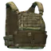 Hexatac HPC 插板背心（复合迷彩） | `hexatac-hpc-plate-carrier-multicam` | 0.47 千克 | 防护等级 5 级；材质 轻型；耐久 90；防护区域 2 处；钝伤防护 23%（共 9 项） | 以物换物 | — | 15,699 卢布（4 家最高） |
| 2 | 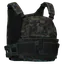 Hexatac HPC 插板背心（黑系复合迷彩） | `hexatac-hpc-plate-carrier-multicam-black` | 0.47 千克 | 防护等级 5 级；材质 轻型；耐久 90；防护区域 2 处；钝伤防护 23%（共 9 项） | — | — | 15,699 卢布（5 家最高） |
| 3 | 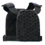 5.11 Hexgrid 插板背心 | `511-tactical-hexgrid-plate-carrier` | 1.02 千克 | 防护等级 6 级；材质 不适用；耐久 100；防护区域 2 处；钝伤防护 0%（共 9 项） | — | — | 12,998 卢布（5 家最高） |
| 4 | 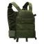 LBT 6094A Slick 插板背心（橄榄绿） | `lbt-6094a-slick-plate-carrier-olive-drab` | 1.3 千克 | 防护等级 6 级；材质 轻型；耐久 200；防护区域 4 处；钝伤防护 23%（共 9 项） | — | — | 32,100 卢布（5 家最高） |
| 5 | 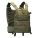 LBT 6094A Slick 插板背心（黄褐色） | `lbt-6094a-slick-plate-carrier-coyote-tan` | 1.3 千克 | 防护等级 6 级；材质 轻型；耐久 200；防护区域 4 处；钝伤防护 23%（共 9 项） | — | — | 32,100 卢布（5 家最高） |
| 6 | 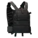 LBT-6094A Slick 插板背心（黑色） | `lbt-6094a-slick-plate-carrier-black` | 1.3 千克 | 防护等级 6 级；材质 轻型；耐久 200；防护区域 4 处；钝伤防护 23%（共 9 项） | — | — | 32,100 卢布（5 家最高） |
| 7 | 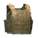 Blue Force Gear PLATEminus V2 防弹衣（狼棕色） | `blue-force-gear-plateminus-v2-body-armor-coyote-brown` | 1.37 千克 | 防护等级 2 级；材质 轻型；耐久 68；防护区域 8 处；钝伤防护 42%（共 9 项） | 以物换物 | — | 19,351 卢布（5 家最高） |
| 8 | 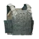 Blue Force Gear PLATEminus V2 防弹衣（狼灰色） | `blue-force-gear-plateminus-v2-body-armor-wolf-gray` | 1.37 千克 | 防护等级 2 级；材质 轻型；耐久 68；防护区域 8 处；钝伤防护 42%（共 9 项） | 以物换物 | — | 19,351 卢布（5 家最高） |
| 9 | 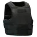 NFM THOR 隐蔽型强化防弹背心 | `nfm-thor-concealable-reinforced-vest-body-armor` | 1.7 千克 | 防护等级 4 级；材质 不适用；耐久 170；防护区域 10 处；钝伤防护 0%（共 9 项） | — | — | 19,048 卢布（5 家最高） |
| 10 | 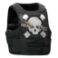 NFM THOR 隐蔽型强化防弹背心（头眼） | `nfm-thor-concealable-reinforced-vest-body-armor-head-eyes` | 1.7 千克 | 防护等级 4 级；材质 不适用；耐久 170；防护区域 10 处；钝伤防护 0%（共 9 项） | 以物换物 | — | 19,048 卢布（5 家最高） |
| 11 | 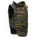 NPP KlASS Korund-VM（刚玉-VM）防弹衣（虎纹迷彩） | `npp-klass-korund-vm-body-armor-kamysh` | 1.9 千克 | 防护等级 5 级；材质 重型；耐久 310；防护区域 14 处；钝伤防护 29%（共 9 项） | 以物换物 | — | 24,214 卢布（5 家最高） |
| 12 | 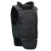 NPP KlASS Korund-VM（刚玉-VM）防弹衣（黑色） | `npp-klass-korund-vm-body-armor-black` | 1.9 千克 | 防护等级 5 级；材质 重型；耐久 310；防护区域 14 处；钝伤防护 29%（共 9 项） | — | — | 24,214 卢布（5 家最高） |
| 13 |  BNTI Zhuk（甲虫）防弹衣（战地记者版） | `bnti-zhuk-body-armor-press` | 2.37 千克 | 防护等级 3 级；材质 轻型；耐久 185；防护区域 14 处；钝伤防护 29%（共 9 项） | 制作 | — | 8,159 卢布（5 家最高） |
| 14 | 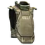 6B13 M 突击甲（Killa 版） | `6b13-m-assault-armor-killa-edition` | 2.8 千克 | 防护等级 5 级；材质 轻型；耐久 249；防护区域 11 处；钝伤防护 24%（共 9 项） | — | — | 74,271 卢布（5 家最高） |
| 15 | 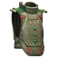 6B13 M 突击甲（圣诞特装版） | `6b13-m-assault-armor-christmas-edition` | 2.8 千克 | 防护等级 5 级；材质 轻型；耐久 249；防护区域 11 处；钝伤防护 24%（共 9 项） | — | — | 99,271 卢布（5 家最高） |
| 16 | 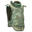 6B13 突击甲（丛林迷彩） | `6b13-assault-armor-flora` | 2.8 千克 | 防护等级 4 级；材质 轻型；耐久 203；防护区域 11 处；钝伤防护 32%（共 9 项） | — | — | 15,327 卢布（5 家最高） |
| 17 | 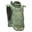 6B13 突击甲（数码丛林迷彩） | `6b13-assault-armor-emr` | 2.8 千克 | 防护等级 4 级；材质 轻型；耐久 203；防护区域 11 处；钝伤防护 32%（共 9 项） | — | — | 15,327 卢布（5 家最高） |
| 18 | 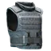 BNTI Gzhel-K（彩瓷-K）防弹衣 | `bnti-gzhel-k-body-armor` | 2.95 千克 | 防护等级 5 级；材质 轻型；耐久 259；防护区域 12 处；钝伤防护 14%（共 9 项） | 以物换物 | — | 39,049 卢布（5 家最高） |
| 19 | 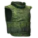 BNTI Zhuk（甲虫）防弹衣（数码丛林迷彩） | `bnti-zhuk-body-armor-emr` | 2.97 千克 | 防护等级 6 级；材质 轻型；耐久 305；防护区域 12 处；钝伤防护 30%（共 9 项） | 以物换物 | — | 47,076 卢布（5 家最高） |
| 20 | 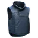 BNTI Kirasa-N（胸甲-N）防弹衣 | `bnti-kirasa-n-body-armor` | 3 千克 | 防护等级 3 级；材质 轻型；耐久 240；防护区域 10 处；钝伤防护 29%（共 9 项） | — | — | 10,370 卢布（5 家最高） |
| 21 | 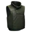 BNTI Kirasa-N（胸甲-N）防弹衣（绿色） | `bnti-kirasa-n-body-armor-green` | 3 千克 | 防护等级 3 级；材质 轻型；耐久 240；防护区域 10 处；钝伤防护 29%（共 9 项） | 以物换物 | — | 12,486 卢布（4 家最高） |
| 22 | 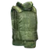 6B23-1 防弹衣（数码丛林迷彩） | `6b23-1-body-armor-emr` | 3.3 千克 | 防护等级 3 级；材质 轻型；耐久 206；防护区域 12 处；钝伤防护 21%（共 9 项） | — | — | 12,538 卢布（5 家最高） |
| 23 | 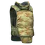 6B23-2 防弹衣（山地丛林迷彩） | `6b23-2-body-armor-mountain-flora` | 3.3 千克 | 防护等级 4 级；材质 轻型；耐久 246；防护区域 12 处；钝伤防护 33%（共 9 项） | 制作 | — | 17,397 卢布（5 家最高） |
| 24 | 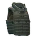 FORT Gladiator-S（格斗-S）插板胸挂（灰色） | `fort-gladiator-s-plate-carrier-gray` | 3.31 千克 | 防护等级 5 级；材质 轻型；耐久 345；防护区域 12 处；钝伤防护 29%（共 9 项） | 以物换物 | — | 34,662 卢布（5 家最高） |
| 25 | 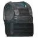 PACA 软质防弹背心 | `paca-soft-armor` | 3.5 千克 | 防护等级 2 级；材质 轻型；耐久 100；防护区域 6 处；钝伤防护 36%（共 9 项） | 商人出售 / 以物换物 | 36,506 卢布，需 Ragman 1 级 | 13,131 卢布（5 家最高） |
| 26 | 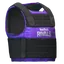 PACA 软质防弹背心（Rivals 版本） | `paca-soft-armor-rivals-edition` | 3.5 千克 | 防护等级 2 级；材质 轻型；耐久 100；防护区域 6 处；钝伤防护 36%（共 9 项） | — | — | 26,419 卢布（5 家最高） |
| 27 | 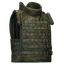 6B45 防弹衣（数码丛林迷彩） | `6b45-body-armor-emr` | 3.65 千克 | 防护等级 6 级；材质 轻型；耐久 374；防护区域 12 处；钝伤防护 32%（共 9 项） | 商人出售 | 104,323 卢布，需 Prapor 3 级 | 38,354 卢布（5 家最高） |
| 28 | 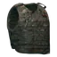 Interceptor OTV 防弹衣（林地迷彩） | `interceptor-otv-body-armor-woodland` | 3.8 千克 | 防护等级 4 级；材质 轻型；耐久 222；防护区域 8 处；钝伤防护 33%（共 9 项） | 以物换物 | — | 20,245 卢布（5 家最高） |
| 29 | 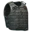 Interceptor OTV防弹衣（通用迷彩） | `interceptor-otv-body-armor-ucp` | 3.8 千克 | 防护等级 4 级；材质 轻型；耐久 222；防护区域 8 处；钝伤防护 33%（共 9 项） | — | — | 20,245 卢布（5 家最高） |
| 30 | 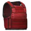 DRD防弹衣 | `drd-body-armor` | 4 千克 | 防护等级 3 级；材质 轻型；耐久 120；防护区域 6 处；钝伤防护 36%（共 9 项） | — | — | 27,901 卢布（5 家最高） |
| 31 | 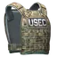 HighCom Trooper TFO 防弹背心（复合迷彩） | `highcom-trooper-tfo-body-armor-multicam` | 4.1 千克 | 防护等级 4 级；材质 轻型；耐久 180；防护区域 6 处；钝伤防护 33%（共 9 项） | — | — | 27,880 卢布（5 家最高） |
| 32 | 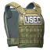 HighCom Trooper TFO 防弹背心（郊狼棕） | `highcom-trooper-tfo-body-armor-coyote` | 4.1 千克 | 防护等级 4 级；材质 轻型；耐久 180；防护区域 6 处；钝伤防护 33%（共 9 项） | 以物换物 | — | 27,880 卢布（4 家最高） |
| 33 | 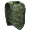 6B2 防弹衣（丛林迷彩） | `6b2-body-armor-flora` | 5.4 千克 | 防护等级 2 级；材质 轻型；耐久 128；防护区域 4 处；钝伤防护 29%（共 9 项） | 商人出售 | 24,402 卢布，需 Prapor 1 级 | 8,971 卢布（5 家最高） |
| 34 | 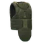 FORT Defender-2 防弹衣 | `fort-defender-2-body-armor` | 5.7 千克 | 防护等级 5 级；材质 重型；耐久 320；防护区域 10 处；钝伤防护 24%（共 9 项） | — | — | 40,304 卢布（5 家最高） |
| 35 | 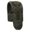 FORT Defender-2 防弹衣（德国斑点迷彩） | `fort-defender-2-body-armor-flecktarn` | 5.7 千克 | 防护等级 5 级；材质 重型；耐久 320；防护区域 10 处；钝伤防护 24%（共 9 项） | 以物换物 | — | 40,304 卢布（5 家最高） |
| 36 | 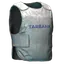 BNTI Module-3M 防弹背心 | `bnti-module-3m-body-armor` | 6 千克 | 防护等级 2 级；材质 轻型；耐久 80；防护区域 6 处；钝伤防护 42%（共 9 项） | 商人出售 / 制作 | 30,893 卢布，需 Skier 1 级 | 10,726 卢布（5 家最高） |
| 37 | 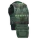 FORT Redut-M（堡垒-M）防弹衣 | `fort-redut-m-body-armor` | 7.7 千克 | 防护等级 5 级；材质 重型；耐久 358；防护区域 14 处；钝伤防护 24%（共 9 项） | 以物换物 | — | 37,453 卢布（5 家最高） |
| 38 | 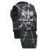 FORT Redut-M（堡垒-M）防弹衣（竞技场之囚） | `fort-redut-m-body-armor-prisoner-of-the-arena` | 7.7 千克 | 防护等级 5 级；材质 重型；耐久 358；防护区域 14 处；钝伤防护 24%（共 9 项） | 以物换物 | — | 38,453 卢布（5 家最高） |
| 39 | 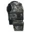 FORT Redut-M（堡垒-M）防弹衣（韩国林地迷彩） | `fort-redut-m-body-armor-sk-woodland` | 7.7 千克 | 防护等级 5 级；材质 重型；耐久 358；防护区域 14 处；钝伤防护 24%（共 9 项） | 以物换物 | — | 37,453 卢布（4 家最高） |
| 40 | 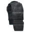 FORT Redut-M（堡垒-M）防弹衣（黑色） | `fort-redut-m-body-armor-black` | 7.7 千克 | 防护等级 5 级；材质 重型；耐久 358；防护区域 14 处；钝伤防护 24%（共 9 项） | 以物换物 | — | 38,453 卢布（5 家最高） |
| 41 | 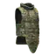 IOTV Gen4 防弹衣（高机动型，复合迷彩） | `iotv-gen4-body-armor-high-mobility-kit-multicam` | 7.88 千克 | 防护等级 5 级；材质 重型；耐久 320；防护区域 14 处；钝伤防护 26%（共 9 项） | — | — | 41,644 卢布（5 家最高） |
| 42 | 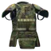 FORT Redut-T5（堡垒-T5）防弹衣（烟雾迷彩） | `fort-redut-t5-body-armor-smog` | 8.1 千克 | 防护等级 6 级；材质 重型；耐久 504；防护区域 16 处；钝伤防护 24%（共 9 项） | 以物换物 | — | 53,432 卢布（5 家最高） |
| 43 | 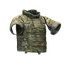 IOTV Gen4 防弹衣（突击型，复合迷彩） | `iotv-gen4-body-armor-assault-kit-multicam` | 8.18 千克 | 防护等级 5 级；材质 重型；耐久 362；防护区域 14 处；钝伤防护 26%（共 9 项） | — | — | 43,340 卢布（5 家最高） |
| 44 | 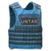 MF-UNTAR防弹背心 | `mf-untar-body-armor` | 8.5 千克 | 防护等级 3 级；材质 轻型；耐久 100；防护区域 6 处；钝伤防护 24%（共 9 项） | 商人出售 / 以物换物 | 49,062 卢布，需 Peacekeeper 2 级 | 13,112 卢布（5 家最高） |
| 45 | 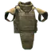 NFM THOR 一体式防弹护甲 | `nfm-thor-integrated-carrier-body-armor` | 8.5 千克 | 防护等级 6 级；材质 不适用；耐久 466；防护区域 15 处；钝伤防护 0%（共 9 项） | 以物换物 | — | 64,751 卢布（5 家最高） |
| 46 | 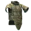 IOTV Gen4 防弹衣（全面防护型，复合迷彩） | `iotv-gen4-body-armor-full-protection-kit-multicam` | 9.08 千克 | 防护等级 5 级；材质 重型；耐久 398；防护区域 16 处；钝伤防护 26%（共 9 项） | 以物换物 | — | 50,241 卢布（5 家最高） |
| 47 | 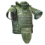 6B43 屏障-Sh 防弹衣（数码丛林迷彩） | `6b43-zabralo-sh-body-armor-emr` | 10.8 千克 | 防护等级 6 级；材质 重型；耐久 510；防护区域 15 处；钝伤防护 30%（共 9 项） | 以物换物 | — | 56,523 卢布（5 家最高） |
| 48 | 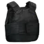 NPP KlASS Kora-Kulon防弹衣 | `npp-klass-kora-kulon-body-armor-black` | 11.1 千克 | 防护等级 3 级；材质 轻型；耐久 128；防护区域 4 处；钝伤防护 30%（共 9 项） | 以物换物 | — | 16,621 卢布（5 家最高） |
| 49 | 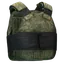 NPP KlASS Kora-Kulon防弹衣（数码迷彩） | `npp-klass-kora-kulon-body-armor-emr` | 11.1 千克 | 防护等级 3 级；材质 轻型；耐久 128；防护区域 4 处；钝伤防护 30%（共 9 项） | 商人出售 | 45,210 卢布，需 Prapor 1 级 | 16,621 卢布（5 家最高） |

> 本分类 **49 件**。价格取各商人中的最优价；「商人最低售价」栏附商人与等级要求，「最高回收」栏标注参与回收的商人数。

本分类 49 件的名称一览（点开可浏览；站内搜索靠它命中物品名）

Hexatac HPC 插板背心（复合迷彩）　Hexatac HPC 插板背心（黑系复合迷彩）　5.11 Hexgrid 插板背心　LBT 6094A Slick 插板背心（橄榄绿）　LBT 6094A Slick 插板背心（黄褐色）　LBT-6094A Slick 插板背心（黑色）　Blue Force Gear PLATEminus V2 防弹衣（狼棕色）　Blue Force Gear PLATEminus V2 防弹衣（狼灰色）　NFM THOR 隐蔽型强化防弹背心　NFM THOR 隐蔽型强化防弹背心（头眼）　NPP KlASS Korund-VM（刚玉-VM）防弹衣（虎纹迷彩）　NPP KlASS Korund-VM（刚玉-VM）防弹衣（黑色）　BNTI Zhuk（甲虫）防弹衣（战地记者版）　6B13 M 突击甲（Killa 版）　6B13 M 突击甲（圣诞特装版）　6B13 突击甲（丛林迷彩）　6B13 突击甲（数码丛林迷彩）　BNTI Gzhel-K（彩瓷-K）防弹衣　BNTI Zhuk（甲虫）防弹衣（数码丛林迷彩）　BNTI Kirasa-N（胸甲-N）防弹衣　BNTI Kirasa-N（胸甲-N）防弹衣（绿色）　6B23-1 防弹衣（数码丛林迷彩）　6B23-2 防弹衣（山地丛林迷彩）　FORT Gladiator-S（格斗-S）插板胸挂（灰色）　PACA 软质防弹背心　PACA 软质防弹背心（Rivals 版本）　6B45 防弹衣（数码丛林迷彩）　Interceptor OTV 防弹衣（林地迷彩）　Interceptor OTV防弹衣（通用迷彩）　DRD防弹衣　HighCom Trooper TFO 防弹背心（复合迷彩）　HighCom Trooper TFO 防弹背心（郊狼棕）　6B2 防弹衣（丛林迷彩）　FORT Defender-2 防弹衣　FORT Defender-2 防弹衣（德国斑点迷彩）　BNTI Module-3M 防弹背心　FORT Redut-M（堡垒-M）防弹衣　FORT Redut-M（堡垒-M）防弹衣（竞技场之囚）　FORT Redut-M（堡垒-M）防弹衣（韩国林地迷彩）　FORT Redut-M（堡垒-M）防弹衣（黑色）　IOTV Gen4 防弹衣（高机动型，复合迷彩）　FORT Redut-T5（堡垒-T5）防弹衣（烟雾迷彩）　IOTV Gen4 防弹衣（突击型，复合迷彩）　MF-UNTAR防弹背心　NFM THOR 一体式防弹护甲　IOTV Gen4 防弹衣（全面防护型，复合迷彩）　6B43 屏障-Sh 防弹衣（数码丛林迷彩）　NPP KlASS Kora-Kulon防弹衣　NPP KlASS Kora-Kulon防弹衣（数码迷彩）

### 观测装置

分类路径：物品 › 组合物品 › 装备 › 护甲装备

| # | 名称 | 英文名 | 重量 | 关键属性 | 获取方式 | 商人最低售价 | 商人最高回收 |
|---|------|--------|------|----------|----------|--------------|--------------|
| 1 | 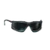 Pyramex Proximity防护眼镜 | `pyramex-proximity-safety-glasses` | 0.026 千克 | 防护等级 0 级；耐久 0；钝伤防护 0%；移速惩罚 0%；转身惩罚 0%（共 7 项） | 商人出售 | 4,448 卢布，需 Ragman 3 级 | 1,600 卢布（4 家最高） |
| 2 |  反光太阳镜 (白色) | `mirror-glasses-white` | 0.027 千克 | 防护等级 0 级；耐久 0；钝伤防护 0%；移速惩罚 0%；转身惩罚 0%（共 7 项） | — | — | 3,350 卢布（4 家最高） |
| 3 |  反光太阳镜 (绿色) | `mirror-glasses-green` | 0.027 千克 | 防护等级 0 级；耐久 0；钝伤防护 0%；移速惩罚 0%；转身惩罚 0%（共 7 项） | — | — | 3,350 卢布（4 家最高） |
| 4 |  反光太阳镜 (蓝色) | `mirror-glasses-blue` | 0.027 千克 | 防护等级 0 级；耐久 0；钝伤防护 0%；移速惩罚 0%；转身惩罚 0%（共 7 项） | — | — | 3,350 卢布（4 家最高） |
| 5 | 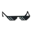 大佬墨镜 | `sunglasses-deal-with-it` | 0.027 千克 | 防护等级 0 级；耐久 0；钝伤防护 0%；移速惩罚 0%；转身惩罚 0%（共 7 项） | 以物换物 | — | 3,350 卢布（4 家最高） |
| 6 |  斐格力太阳镜 | `figley-sunglasses` | 0.027 千克 | 防护等级 0 级；耐久 0；钝伤防护 0%；移速惩罚 0%；转身惩罚 0%（共 7 项） | 以物换物 | — | 3,350 卢布（4 家最高） |
| 7 |  斐格力太阳镜 (红色) | `figley-sunglasses-red` | 0.027 千克 | 防护等级 0 级；耐久 0；钝伤防护 0%；移速惩罚 0%；转身惩罚 0%（共 7 项） | 以物换物 | — | 3,350 卢布（4 家最高） |
| 8 |  斐格力太阳镜 (绿色) | `figley-sunglasses-green` | 0.027 千克 | 防护等级 0 级；耐久 0；钝伤防护 0%；移速惩罚 0%；转身惩罚 0%（共 7 项） | 以物换物 | — | 3,350 卢布（4 家最高） |
| 9 |  百叶窗太阳镜 (白色) | `shutter-glasses-white` | 0.027 千克 | 防护等级 0 级；耐久 0；钝伤防护 0%；移速惩罚 0%；转身惩罚 0%（共 7 项） | 以物换物 | — | 3,350 卢布（4 家最高） |
| 10 |  百叶窗太阳镜 (红色) | `shutter-glasses-red` | 0.027 千克 | 防护等级 0 级；耐久 0；钝伤防护 0%；移速惩罚 0%；转身惩罚 0%（共 7 项） | — | — | 3,350 卢布（4 家最高） |
| 11 |  百叶窗太阳镜 (绿色) | `shutter-glasses-green` | 0.027 千克 | 防护等级 0 级；耐久 0；钝伤防护 0%；移速惩罚 0%；转身惩罚 0%（共 7 项） | — | — | 3,350 卢布（4 家最高） |
| 12 |  百叶窗太阳镜 (蓝色) | `shutter-glasses-blue` | 0.027 千克 | 防护等级 0 级；耐久 0；钝伤防护 0%；移速惩罚 0%；转身惩罚 0%（共 7 项） | — | — | 3,350 卢布（4 家最高） |
| 13 |  百叶窗太阳镜 (黑色) | `shutter-glasses-black` | 0.027 千克 | 防护等级 0 级；耐久 0；钝伤防护 0%；移速惩罚 0%；转身惩罚 0%（共 7 项） | 以物换物 | — | 3,350 卢布（4 家最高） |
| 14 |  雷硼飞行员墨镜 | `raybench-aviator-glasses` | 0.027 千克 | 防护等级 0 级；耐久 0；钝伤防护 0%；移速惩罚 0%；转身惩罚 0%（共 7 项） | 商人出售 | 9,313 卢布，需 Ragman 4 级 | 3,350 卢布（4 家最高） |
| 15 |  雷硼飞行员墨镜（绿色镜片） | `raybench-aviator-glasses-green-lenses` | 0.027 千克 | 防护等级 0 级；耐久 0；钝伤防护 0%；移速惩罚 0%；转身惩罚 0%（共 7 项） | 以物换物 | — | 2,500 卢布（3 家最高） |
| 16 |  Crossbow战术目镜 | `ess-crossbow-tactical-glasses` | 0.03 千克 | 防护等级 0 级；耐久 0；钝伤防护 0%；移速惩罚 0%；转身惩罚 0%（共 7 项） | 商人出售 | 4,865 卢布，需 Ragman 2 级 | 1,750 卢布（4 家最高） |
| 17 |  NPP KIASS Condor 护目镜 | `npp-klass-condor-glasses` | 0.03 千克 | 防护等级 1 级；耐久 25；钝伤防护 32%；移速惩罚 0%；转身惩罚 0%（共 7 项） | 商人出售 / 以物换物 | 21,216 卢布，需 Prapor 4 级 | 7,800 卢布（4 家最高） |
| 18 |  Revision ShadowStrike 战术眼镜（灰色） | `revision-shadowstrike-tactical-glasses-gray` | 0.03 千克 | 防护等级 0 级；耐久 0；钝伤防护 0%；移速惩罚 0%；转身惩罚 0%（共 7 项） | 以物换物 | — | 1,875 卢布（4 家最高） |
| 19 |  Revision ShadowStrike 战术眼镜（黄褐色） | `revision-shadowstrike-tactical-glasses-tan` | 0.03 千克 | 防护等级 0 级；耐久 0；钝伤防护 0%；移速惩罚 0%；转身惩罚 0%（共 7 项） | 以物换物 | — | 1,875 卢布（4 家最高） |
| 20 |  Gatorz Specter 军规防弹眼镜 | `gatorz-specter-milspec-ballistic-glasses` | 0.032 千克 | 防护等级 0 级；耐久 0；钝伤防护 0%；移速惩罚 0%；转身惩罚 0%（共 7 项） | 以物换物 | — | 2,350 卢布（4 家最高） |
| 21 |  Oakley SI M Frame 护目镜 | `oakley-si-m-frame-safety-glasses` | 0.032 千克 | 防护等级 0 级；耐久 0；钝伤防护 0%；移速惩罚 0%；转身惩罚 0%（共 7 项） | 商人出售 | 6,533 卢布，需 Ragman 4 级 | 2,350 卢布（4 家最高） |
| 22 |  Oakley SI M Frame 护目镜（橙色镜片） | `oakley-si-m-frame-safety-glasses-orange-lenses` | 0.032 千克 | 防护等级 0 级；耐久 0；钝伤防护 0%；移速惩罚 0%；转身惩罚 0%（共 7 项） | 以物换物 | — | 2,500 卢布（3 家最高） |
| 23 |  Fit Viper 防护眼镜 (Actualbush) | `fit-viper-glasses-actualbush` | 0.033 千克 | 防护等级 0 级；耐久 0；钝伤防护 0%；移速惩罚 0%；转身惩罚 0%（共 7 项） | 以物换物 | — | 1,300 卢布（4 家最高） |
| 24 |  Fit Viper 防护眼镜 (Exec) | `fit-viper-glasses-exec` | 0.033 千克 | 防护等级 0 级；耐久 0；钝伤防护 0%；移速惩罚 0%；转身惩罚 0%（共 7 项） | 以物换物 | — | 1,300 卢布（4 家最高） |
| 25 |  Fit Viper 防护眼镜 (Straya) | `fit-viper-glasses-straya` | 0.033 千克 | 防护等级 0 级；耐久 0；钝伤防护 0%；移速惩罚 0%；转身惩罚 0%（共 7 项） | 以物换物 | — | 1,300 卢布（4 家最高） |
| 26 |  Oakley SI Gascan 墨镜 | `oakley-si-gascan-glasses` | 0.034 千克 | 防护等级 0 级；耐久 0；钝伤防护 0%；移速惩罚 0%；转身惩罚 0%（共 7 项） | 商人出售 | 7,784 卢布，需 Ragman 3 级 | 2,800 卢布（4 家最高） |
| 27 |  Twitch Rivals 2020 眼镜 | `twitch-rivals-2020-glasses` | 0.034 千克 | 防护等级 0 级；耐久 0；钝伤防护 0%；移速惩罚 0%；转身惩罚 0%（共 7 项） | — | — | 12,800 卢布（4 家最高） |
| 28 |  圆框太阳镜 | `round-frame-sunglasses` | 0.04 千克 | 防护等级 0 级；耐久 0；钝伤防护 0%；移速惩罚 0%；转身惩罚 0%（共 7 项） | — | — | 1,542 卢布（4 家最高） |
| 29 |  圆框太阳镜（绿色镜片） | `round-frame-sunglasses-green-lenses` | 0.04 千克 | 防护等级 0 级；耐久 0；钝伤防护 0%；移速惩罚 0%；转身惩罚 0%（共 7 项） | 以物换物 | — | 2,500 卢布（3 家最高） |
| 30 |  Dundukk 运动太阳镜（橙色镜片） | `dundukk-sport-sunglasses-orange-lenses` | 0.05 千克 | 防护等级 0 级；耐久 0；钝伤防护 0%；移速惩罚 0%；转身惩罚 0%（共 7 项） | 以物换物 | — | 2,500 卢布（3 家最高） |
| 31 |  Dundukk运动太阳镜 | `dundukk-sport-sunglasses` | 0.05 千克 | 防护等级 0 级；耐久 0；钝伤防护 0%；移速惩罚 0%；转身惩罚 0%（共 7 项） | 商人出售 | 2,819 卢布，需 Ragman 1 级 | 1,014 卢布（4 家最高） |
| 32 |  Oakley SI Batwolf 墨镜 | `oakley-si-batwolf-glasses` | 0.05 千克 | 防护等级 1 级；耐久 20；钝伤防护 22%；移速惩罚 0%；转身惩罚 0%（共 7 项） | 商人出售 | 32,916 卢布，需 Peacekeeper 4 级 | 10,350 卢布（4 家最高） |
| 33 |  战术目镜 | `tactical-glasses` | 0.05 千克 | 防护等级 0 级；耐久 0；钝伤防护 0%；移速惩罚 0%；转身惩罚 0%（共 7 项） | 商人出售 | 2,320 卢布，需 Ragman 1 级 | 834 卢布（4 家最高） |
| 34 |  JohnB ”Liquid DNB”墨镜 | `johnb-liquid-dnb-glasses` | 0.06 千克 | 防护等级 0 级；耐久 0；钝伤防护 0%；移速惩罚 0%；转身惩罚 0%（共 7 项） | — | — | 6,000 卢布（4 家最高） |
| 35 |  雷硼嬉皮太阳镜 | `raybench-hipster-reserve-sunglasses` | 0.08 千克 | 防护等级 0 级；耐久 0；钝伤防护 0%；移速惩罚 0%；转身惩罚 0%（共 7 项） | — | — | 1,790 卢布（4 家最高） |
| 36 |  防破片护目镜 | `anti-fragmentation-glasses` | 0.11 千克 | 防护等级 1 级；耐久 25；钝伤防护 90%；移速惩罚 0%；转身惩罚 0%（共 7 项） | 商人出售 | 39,700 卢布，需 Ragman 3 级 | 8,450 卢布（4 家最高） |
| 37 |  6B34防破片护目镜 | `6b34-anti-fragmentation-glasses` | 0.12 千克 | 防护等级 1 级；耐久 25；钝伤防护 90%；移速惩罚 0%；转身惩罚 0%（共 7 项） | 商人出售 | 23,256 卢布，需 Prapor 3 级 | 8,550 卢布（4 家最高） |
| 38 |  Wiley X SPEAR 防护眼镜（黄褐色） | `wiley-x-spear-ballistic-goggles-tan` | 0.12 千克 | 防护等级 1 级；耐久 25；钝伤防护 90%；移速惩罚 0%；转身惩罚 0%（共 7 项） | 以物换物 | — | 6,377 卢布（4 家最高） |
| 39 |  Wiley X SPEAR 防护眼镜（黑色） | `wiley-x-spear-ballistic-goggles-black` | 0.12 千克 | 防护等级 1 级；耐久 25；钝伤防护 90%；移速惩罚 0%；转身惩罚 0%（共 7 项） | 以物换物 | — | 6,377 卢布（4 家最高） |
| 40 |  气焊护目镜 | `gas-welder-safety-goggles` | 0.15 千克 | 防护等级 0 级；耐久 0；钝伤防护 0%；移速惩罚 0%；转身惩罚 0%（共 7 项） | — | — | 15,000 卢布（4 家最高） |

> 本分类 **40 件**。价格取各商人中的最优价；「商人最低售价」栏附商人与等级要求，「最高回收」栏标注参与回收的商人数。

本分类 40 件的名称一览（点开可浏览；站内搜索靠它命中物品名）

Pyramex Proximity防护眼镜　反光太阳镜 (白色)　反光太阳镜 (绿色)　反光太阳镜 (蓝色)　大佬墨镜　斐格力太阳镜　斐格力太阳镜 (红色)　斐格力太阳镜 (绿色)　百叶窗太阳镜 (白色)　百叶窗太阳镜 (红色)　百叶窗太阳镜 (绿色)　百叶窗太阳镜 (蓝色)　百叶窗太阳镜 (黑色)　雷硼飞行员墨镜　雷硼飞行员墨镜（绿色镜片）　Crossbow战术目镜　NPP KIASS Condor 护目镜　Revision ShadowStrike 战术眼镜（灰色）　Revision ShadowStrike 战术眼镜（黄褐色）　Gatorz Specter 军规防弹眼镜　Oakley SI M Frame 护目镜　Oakley SI M Frame 护目镜（橙色镜片）　Fit Viper 防护眼镜 (Actualbush)　Fit Viper 防护眼镜 (Exec)　Fit Viper 防护眼镜 (Straya)　Oakley SI Gascan 墨镜　Twitch Rivals 2020 眼镜　圆框太阳镜　圆框太阳镜（绿色镜片）　Dundukk 运动太阳镜（橙色镜片）　Dundukk运动太阳镜　Oakley SI Batwolf 墨镜　战术目镜　JohnB ”Liquid DNB”墨镜　雷硼嬉皮太阳镜　防破片护目镜　6B34防破片护目镜　Wiley X SPEAR 防护眼镜（黄褐色）　Wiley X SPEAR 防护眼镜（黑色）　气焊护目镜

### 护甲插板

分类路径：物品 › 组合物品 › 装备 › 护甲装备

| # | 名称 | 英文名 | 重量 | 关键属性 | 获取方式 | 商人最低售价 | 商人最高回收 |
|---|------|--------|------|----------|----------|--------------|--------------|
| 1 |  PRTCTR轻量化防弹插板 | `prtctr-lightweight-ballistic-plate` | 0.43 千克 | 防护等级 3 级；材质 轻型；耐久 35；防护区域 2 处；钝伤防护 26%（共 9 项） | — | — | 6,509 卢布（4 家最高） |
| 2 |  GAC 3s15m防弹插板 | `gac-3s15m-ballistic-plate` | 0.97 千克 | 防护等级 5 级；材质 轻型；耐久 45；防护区域 2 处；钝伤防护 26%（共 9 项） | — | — | 26,900 卢布（4 家最高） |
| 3 |  SSAPI III+ 级防弹插板（侧边） | `ssapi-level-iii-ballistic-plate-side` | 1 千克 | 防护等级 5 级；材质 重型；耐久 15；防护区域 4 处；钝伤防护 30%（共 9 项） | 商人出售 | 16,471 卢布，需 Peacekeeper 3 级 | 4,402 卢布（4 家最高） |
| 4 |  Tac-Kek SAPI Level III+ 防弹插板（仿制品） | `tac-kek-sapi-level-iii-ballistic-plate-replica` | 1.1 千克 | 防护等级 1 级；材质 轻型；耐久 90；防护区域 2 处；钝伤防护 33%（共 9 项） | — | — | 2,175 卢布（4 家最高） |
| 5 |  刚玉-VM 防弹插板（侧边） | `korund-vm-ballistic-plate-side` | 1.1 千克 | 防护等级 5 级；材质 重型；耐久 25；防护区域 4 处；钝伤防护 18%（共 9 项） | 商人出售 | 13,485 卢布，需 Prapor 4 级 | 3,813 卢布（4 家最高） |
| 6 |  ESBI IV 级防弹插板（侧边） | `esbi-level-iv-ballistic-plate-side` | 1.15 千克 | 防护等级 6 级；材质 重型；耐久 18；防护区域 4 处；钝伤防护 30%（共 9 项） | — | — | 8,060 卢布（4 家最高） |
| 7 |  Granit 防弹插板（侧边） | `granit-ballistic-plate-side` | 1.3 千克 | 防护等级 6 级；材质 重型；耐久 20；防护区域 4 处；钝伤防护 28%（共 9 项） | — | — | 7,260 卢布（4 家最高） |
| 8 |  Ops-Core SLAAP 附加防弹板（黄褐色） | `velocity-systems-slaap-plate-tan` | 1.3 千克 | 防护等级 5 级；材质 不适用；耐久 30；防护区域 1 处；钝伤防护 8%（共 9 项） | 商人出售 | 187,945 卢布，需 Peacekeeper 4 级 | 55,812 卢布（4 家最高） |
| 9 |  Monoclete III 级 PE 防弹插板 | `monoclete-level-iii-pe-ballistic-plate` | 1.35 千克 | 防护等级 4 级；材质 轻型；耐久 40；防护区域 2 处；钝伤防护 26%（共 9 项） | 以物换物 | — | 9,310 卢布（4 家最高） |
| 10 |  SPRTN Elaphros防弹插板 | `sprtn-elaphros-ballistic-plate` | 1.6 千克 | 防护等级 4 级；材质 重型；耐久 45；防护区域 2 处；钝伤防护 30%（共 9 项） | 商人出售 | 38,088 卢布，需 Peacekeeper 3 级 | 8,627 卢布（4 家最高） |
| 11 |  SAPI III+ 级防弹插板 | `sapi-level-iii-ballistic-plate` | 1.82 千克 | 防护等级 5 级；材质 重型；耐久 50；防护区域 2 处；钝伤防护 30%（共 9 项） | 以物换物 | — | 18,542 卢布（4 家最高） |
| 12 |  NewSphereTech III 级防弹插板 | `newspheretech-level-iii-ballistic-plate` | 2.15 千克 | 防护等级 4 级；材质 轻型；耐久 45；防护区域 2 处；钝伤防护 27%（共 9 项） | 商人出售 | 36,234 卢布，需 Peacekeeper 3 级 | 8,421 卢布（4 家最高） |
| 13 |  Kiba Arms Titan防弹插板 | `kiba-arms-titan-ballistic-plate` | 2.25 千克 | 防护等级 4 级；材质 重型；耐久 55；防护区域 2 处；钝伤防护 14%（共 9 项） | 以物换物 | — | 10,810 卢布（4 家最高） |
| 14 |  刚玉-VM 防弹插板（背部） | `korund-vm-ballistic-plate-back` | 2.3 千克 | 防护等级 5 级；材质 重型；耐久 40；防护区域 1 处；钝伤防护 18%（共 9 项） | 商人出售 | 48,724 卢布，需 Prapor 3 级 | 13,269 卢布（4 家最高） |
| 15 |  Zhuk-3防弹插板（前部） | `zhuk-3-ballistic-plate-front` | 2.4 千克 | 防护等级 3 级；材质 轻型；耐久 40；防护区域 1 处；钝伤防护 24%（共 9 项） | 以物换物 | — | 5,092 卢布（4 家最高） |
| 16 |  KITECO SC-IV SA防弹插板 | `kiteco-sc-iv-sa-ballistic-plate` | 2.45 千克 | 防护等级 6 级；材质 轻型；耐久 45；防护区域 2 处；钝伤防护 26%（共 9 项） | — | — | 34,852 卢布（4 家最高） |
| 17 |  Cult Locust防弹插板 | `cult-locust-ballistic-plate` | 2.56 千克 | 防护等级 5 级；材质 重型；耐久 60；防护区域 2 处；钝伤防护 14%（共 9 项） | 以物换物 | — | 20,177 卢布（4 家最高） |
| 18 |  GAC 4sss2防弹插板 | `gac-4sss2-ballistic-plate` | 2.7 千克 | 防护等级 6 级；材质 轻型；耐久 50；防护区域 2 处；钝伤防护 26%（共 9 项） | — | — | 42,501 卢布（4 家最高） |
| 19 |  刚玉-VM-K 防弹插板（背部） | `korund-vm-k-ballistic-plate-back` | 2.7 千克 | 防护等级 6 级；材质 重型；耐久 45；防护区域 1 处；钝伤防护 29%（共 9 项） | — | — | 21,320 卢布（4 家最高） |
| 20 |  Granit Br4防弹插板 | `granit-br4-ballistic-plate` | 2.9 千克 | 防护等级 5 级；材质 重型；耐久 55；防护区域 2 处；钝伤防护 28%（共 9 项） | 以物换物 | — | 19,573 卢布（4 家最高） |
| 21 |  Granit 4防弹插板（前部） | `granit-4-ballistic-plate-front` | 3.05 千克 | 防护等级 5 级；材质 重型；耐久 50；防护区域 1 处；钝伤防护 28%（共 9 项） | 商人出售 / 以物换物 | 59,558 卢布，需 Prapor 4 级 | 17,378 卢布（4 家最高） |
| 22 |  ESAPI IV 级防弹插板 | `esapi-level-iv-ballistic-plate` | 3.2 千克 | 防护等级 6 级；材质 重型；耐久 55；防护区域 2 处；钝伤防护 30%（共 9 项） | — | — | 36,213 卢布（4 家最高） |
| 23 |  Granit 4防弹插板（背部） | `granit-4-ballistic-plates-back` | 3.3 千克 | 防护等级 5 级；材质 重型；耐久 45；防护区域 1 处；钝伤防护 29%（共 9 项） | — | — | 16,351 卢布（4 家最高） |
| 24 |  Granit Br5防弹插板 | `granit-br5-ballistic-plate` | 3.3 千克 | 防护等级 6 级；材质 重型；耐久 60；防护区域 2 处；钝伤防护 28%（共 9 项） | — | — | 30,977 卢布（4 家最高） |
| 25 |  Global Armor’s Steel防弹插板 | `global-armors-steel-ballistic-plate` | 3.4 千克 | 防护等级 4 级；材质 重型；耐久 45；防护区域 2 处；钝伤防护 18%（共 9 项） | 商人出售 | 23,154 卢布，需 Skier 3 级 | 8,039 卢布（4 家最高） |
| 26 |  刚玉-VM 防弹插板（前部） | `korund-vm-ballistic-plates-front` | 3.4 千克 | 防护等级 5 级；材质 重型；耐久 60；防护区域 1 处；钝伤防护 18%（共 9 项） | 商人出售 / 以物换物 | 57,956 卢布，需 Prapor 4 级 | 16,390 卢布（4 家最高） |
| 27 |  6B23-2防弹插板（黑色） | `6b23-2-ballistic-plate-back` | 3.5 千克 | 防护等级 4 级；材质 重型；耐久 40；防护区域 1 处；钝伤防护 18%（共 9 项） | 商人出售 | 15,234 卢布，需 Prapor 2 级 | 5,600 卢布（4 家最高） |
| 28 |  Granit 4RS防弹插板（前部） | `granit-4rs-ballistic-plate-front` | 3.5 千克 | 防护等级 6 级；材质 重型；耐久 55；防护区域 1 处；钝伤防护 28%（共 9 项） | — | — | 25,701 卢布（4 家最高） |
| 29 |  TallCom Guardian防弹插板 | `tallcom-guardian-ballistic-plate` | 3.5 千克 | 防护等级 5 级；材质 重型；耐久 55；防护区域 2 处；钝伤防护 18%（共 9 项） | — | — | 18,403 卢布（4 家最高） |
| 30 |  NESCO 4400-SA-MC防弹插板 | `nesco-4400-sa-mc-ballistic-plate` | 3.6 千克 | 防护等级 6 级；材质 重型；耐久 60；防护区域 2 处；钝伤防护 22%（共 9 项） | — | — | 34,108 卢布（4 家最高） |
| 31 |  6B33防弹插板（前部） | `6b33-ballistic-plate-front` | 3.7 千克 | 防护等级 4 级；材质 重型；耐久 50；防护区域 1 处；钝伤防护 18%（共 9 项） | 商人出售 | 20,682 卢布，需 Prapor 3 级 | 7,603 卢布（4 家最高） |
| 32 |  Granit 4RS防弹插板（背部） | `granit-4rs-ballistic-plates-back` | 3.8 千克 | 防护等级 6 级；材质 重型；耐久 50；防护区域 1 处；钝伤防护 29%（共 9 项） | — | — | 24,813 卢布（4 家最高） |
| 33 |  AR500 Legacy Plate防弹插板 | `ar500-legacy-plate-ballistic-plate` | 3.85 千克 | 防护等级 3 级；材质 重型；耐久 45；防护区域 2 处；钝伤防护 18%（共 9 项） | 商人出售 | 18,116 卢布，需 Skier 2 级 | 6,290 卢布（4 家最高） |
| 34 |  Cult Termite防弹插板 | `cult-termite-ballistic-plate` | 3.85 千克 | 防护等级 6 级；材质 重型；耐久 65；防护区域 2 处；钝伤防护 14%（共 9 项） | — | — | 38,509 卢布（4 家最高） |
| 35 |  刚玉-VM-K 防弹插板（前部） | `korund-vm-k-ballistic-plates-front` | 4 千克 | 防护等级 6 级；材质 重型；耐久 60；防护区域 1 处；钝伤防护 29%（共 9 项） | — | — | 26,765 卢布（4 家最高） |
| 36 |  6B13定制防弹插板（黑色） | `6b13-custom-ballistic-plates-back` | 4.1 千克 | 防护等级 4 级；材质 重型；耐久 45；防护区域 1 处；钝伤防护 18%（共 9 项） | 制作 | — | 6,019 卢布（4 家最高） |
| 37 |  SPRTN Omega防弹插板 | `sprtn-omega-ballistic-plate` | 4.39 千克 | 防护等级 4 级；材质 重型；耐久 50；防护区域 2 处；钝伤防护 18%（共 9 项） | 商人出售 | 26,268 卢布，需 Skier 3 级 | 9,120 卢布（4 家最高） |
| 38 |  6B12防弹插板（前部） | `6b12-ballistic-plates-front` | 4.6 千克 | 防护等级 3 级；材质 重型；耐久 50；防护区域 1 处；钝伤防护 18%（共 9 项） | 商人出售 | 16,889 卢布，需 Prapor 2 级 | 6,209 卢布（4 家最高） |
| 39 |  Kiba Arms Steel防弹插板 | `kiba-arms-steel-ballistic-plate` | 5.1 千克 | 防护等级 6 级；材质 重型；耐久 50；防护区域 2 处；钝伤防护 18%（共 9 项） | — | — | 26,450 卢布（4 家最高） |

> 本分类 **39 件**。价格取各商人中的最优价；「商人最低售价」栏附商人与等级要求，「最高回收」栏标注参与回收的商人数。

本分类 39 件的名称一览（点开可浏览；站内搜索靠它命中物品名）

PRTCTR轻量化防弹插板　GAC 3s15m防弹插板　SSAPI III+ 级防弹插板（侧边）　Tac-Kek SAPI Level III+ 防弹插板（仿制品）　刚玉-VM 防弹插板（侧边）　ESBI IV 级防弹插板（侧边）　Granit 防弹插板（侧边）　Ops-Core SLAAP 附加防弹板（黄褐色）　Monoclete III 级 PE 防弹插板　SPRTN Elaphros防弹插板　SAPI III+ 级防弹插板　NewSphereTech III 级防弹插板　Kiba Arms Titan防弹插板　刚玉-VM 防弹插板（背部）　Zhuk-3防弹插板（前部）　KITECO SC-IV SA防弹插板　Cult Locust防弹插板　GAC 4sss2防弹插板　刚玉-VM-K 防弹插板（背部）　Granit Br4防弹插板　Granit 4防弹插板（前部）　ESAPI IV 级防弹插板　Granit 4防弹插板（背部）　Granit Br5防弹插板　Global Armor’s Steel防弹插板　刚玉-VM 防弹插板（前部）　6B23-2防弹插板（黑色）　Granit 4RS防弹插板（前部）　TallCom Guardian防弹插板　NESCO 4400-SA-MC防弹插板　6B33防弹插板（前部）　Granit 4RS防弹插板（背部）　AR500 Legacy Plate防弹插板　Cult Termite防弹插板　刚玉-VM-K 防弹插板（前部）　6B13定制防弹插板（黑色）　SPRTN Omega防弹插板　6B12防弹插板（前部）　Kiba Arms Steel防弹插板

---

## 📚 相关页面

- [物品图鉴总览](index.md) — 全站物品的分类入口与检索
- [任务需求物品反查](../quests/item-lookup.md) — 某物品被哪些任务要求、要不要留
- [配方速查表](../docs/recipes.md) — 制作与以物换物的完整配方
- [跳蚤定价与手续费](../entries/flea-pricing.md) — 市场侧的定价规则
- [商人系统](../entries/traders.md) — 商人等级与补货机制

📖 [返回物品图鉴总览](index.md)

⬆️ **[回到顶部](#top)**

**最后更新**: 2026 年 10 月 ｜ **贡献者** [GTX950L](https://github.com/GTX950L) ｜ **License**: CC BY-NC-SA 4.0
