---
tags:
  - 物品
  - 速查
---

# 情报与笔记（Item Catalog）

> 版本基线：2026 年 10 月 ｜ 1.2.0.0（第一赛季 KORD BREACH）｜ 数据来源：tarkov.dev（二级）
> 本页为**生成页**，数值随版本调整，引用时请附「以游戏内为准」。

## 📸 本页概览

| 项目 | 说明 |
|------|------|
| **收录件数** | **224 件**（全站物品图鉴共 4,983 件） |
| **叶子分类** | 6 个官方分类：[地图](#地图)、[磁带](#磁带)、[海报传单](#海报传单)、[笔记](#笔记)、[对话物品](#对话物品)、[赛季通行证文件](#赛季通行证文件) |
| **获取方式** | 站内收录的**固定**渠道：`商人出售` / `以物换物` / `制作`。本页 **16 / 224 件**有至少一条（商人出售 6 ｜ 以物换物 1 ｜ 制作 10）；`—` **不是「拿不到」**，只表示站内没收录它的固定渠道 —— 那类得靠搜刮或跳蚤市场，而这两样站内不给点位（判据见[战利品分布](../entries/loot.md)）|
| **数据来源** | `json.tarkov.dev` 的 `itemCategories` 树与 `items` 接口，二级来源 |
| **抓取日期** | 2026-10-08 |
| **配套页面** | [物品图鉴总览](index.md) ｜ [任务需求物品反查](../quests/item-lookup.md) ｜ [配方速查表](../docs/recipes.md) |

---

## 🔎 检索与筛选

本页的检索、筛选与详情面板需要 JavaScript —— **下方表格是静态生成的，不开 JS 也能读完**。

### 地图

| # | 名称 | 英文名 | 重量 | 关键属性 | 获取方式 | 商人最低售价 | 商人最高回收 |
|---|------|--------|------|----------|----------|--------------|--------------|
| 1 |  工厂地图 | `factory-plan-map` | 0.045 千克 | — | 商人出售 | 22,410 卢布，需 Therapist 1 级 | 8,222 卢布（2 家最高） |
| 2 |  森林地图 | `woods-plan-map` | 0.045 千克 | — | — | — | 6,486 卢布（2 家最高） |
| 3 |  海关地图 | `customs-plan-map` | 0.045 千克 | — | — | — | 6,848 卢布（2 家最高） |
| 4 |  海岸线疗养院平面图 | `shoreline-health-resort-plan-map` | 0.045 千克 | — | 商人出售 | 13,033 卢布，需 Therapist 1 级 | 4,781 卢布（2 家最高） |
| 5 |  海岸线纸地图 | `shoreline-plan-map` | 0.045 千克 | — | 商人出售 | 27,731 卢布，需 Therapist 1 级 | 10,174 卢布（2 家最高） |
| 6 | 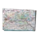 立交桥纸地图 | `interchange-plan-map` | 0.045 千克 | — | 商人出售 | 12,719 卢布，需 Therapist 2 级 | 4,666 卢布（2 家最高） |

> 本分类 **6 件**。价格取各商人中的最优价；「商人最低售价」栏附商人与等级要求，「最高回收」栏标注参与回收的商人数。

本分类 6 件的名称一览（点开可浏览；站内搜索靠它命中物品名）

工厂地图　森林地图　海关地图　海岸线疗养院平面图　海岸线纸地图　立交桥纸地图

### 磁带

分类路径：物品 › 可完成类

| # | 名称 | 英文名 | 重量 | 关键属性 | 获取方式 | 商人最低售价 | 商人最高回收 |
|---|------|--------|------|----------|----------|--------------|--------------|
| 1 | 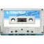 A.P. 会议录音带 - 1 | `ap-meeting-audio-tape-part-1` | 0.065 千克 | — | — | — | — |
| 2 |  A.P. 会议录音带 - 2 | `ap-meeting-audio-tape-part-2` | 0.065 千克 | — | — | — | — |
| 3 | 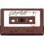 BEAR 指挥官留下的录音带，上面标着“给 BEAR 战友” | `bear-commanders-audio-tape-labeled-for-the-bears` | 0.065 千克 | — | — | — | — |
| 4 |  Boreas 科学家录音带 | `boreas-scientist-audio-tape` | 0.065 千克 | — | — | — | — |
| 5 |  USEC 指挥官留下的录音带，上面标着“给 USEC 战友” | `usec-commanders-audio-tape-labeled-for-the-usec` | 0.065 千克 | — | — | — | — |
| 6 |  USEC 行动人员留下的录音带，标着“第 35 天” | `usec-operatives-audio-tape-labeled-day-35` | 0.065 千克 | — | — | — | — |
| 7 |  Voevoda 的思考录音带 | `voevodas-thoughts-audio-tape` | 0.065 千克 | — | — | — | — |
| 8 |  俄罗斯邮政录音带 5.11/ 001 | `rus-post-audio-tape-1105-001` | 0.065 千克 | — | — | — | — |
| 9 |  俄罗斯邮政录音带 5.11/ 002 | `rus-post-audio-tape-1105-002` | 0.065 千克 | — | — | — | — |
| 10 |  俄罗斯邮政录音带 5.11/ 003 | `rus-post-audio-tape-1105-003` | 0.065 千克 | — | — | — | — |
| 11 |  情况报告录音带 | `audio-tape-with-report` | 0.065 千克 | — | — | — | — |
| 12 | 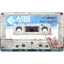 死去科学家的录音带 | `deceased-scientists-audio-tape` | 0.065 千克 | — | — | — | — |
| 13 |  犯罪证据录音带 | `audio-tape-with-incriminating-evidence` | 0.065 千克 | — | — | — | — |
| 14 | 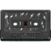 神秘录音带 | `mysterious-audio-tape` | 0.065 千克 | — | — | — | — |
| 15 |  邪教受害者录音带 #1 | `cult-victim-audio-tape-1` | 0.065 千克 | — | — | — | — |
| 16 |  邪教受害者录音带 #2 | `cult-victim-audio-tape-2` | 0.065 千克 | — | — | — | — |

> 本分类 **16 件**。价格取各商人中的最优价；「商人最低售价」栏附商人与等级要求，「最高回收」栏标注参与回收的商人数。

本分类 16 件的名称一览（点开可浏览；站内搜索靠它命中物品名）

A.P. 会议录音带 - 1　A.P. 会议录音带 - 2　BEAR 指挥官留下的录音带，上面标着“给 BEAR 战友”　Boreas 科学家录音带　USEC 指挥官留下的录音带，上面标着“给 USEC 战友”　USEC 行动人员留下的录音带，标着“第 35 天”　Voevoda 的思考录音带　俄罗斯邮政录音带 5.11/ 001　俄罗斯邮政录音带 5.11/ 002　俄罗斯邮政录音带 5.11/ 003　情况报告录音带　死去科学家的录音带　犯罪证据录音带　神秘录音带　邪教受害者录音带 #1　邪教受害者录音带 #2

### 海报传单

| # | 名称 | 英文名 | 重量 | 关键属性 | 获取方式 | 商人最低售价 | 商人最高回收 |
|---|------|--------|------|----------|----------|--------------|--------------|
| 1 |  “撤离真兄弟”海报 | `exfil-brothers` | 0.05 千克 | — | — | — | — |
| 2 | 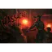 “最后一息”海报 | `last-breath-poster` | 0.05 千克 | — | — | — | 50,000 卢布（1 家最高） |
| 3 | 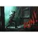 “最后时刻”海报 | `final-moment-poster` | 0.05 千克 | — | — | — | 50,000 卢布（1 家最高） |
| 4 |  “陶鲁斯”海报 | `taurus-poster` | 0.05 千克 | — | — | — | 50,000 卢布（1 家最高） |
| 5 |  《Pulp 任务》海报 | `pulp-mission` | 0.05 千克 | — | — | — | — |
| 6 |  《人在塔科夫》海报 | `men-in-tarkov` | 0.05 千克 | — | — | — | — |
| 7 | 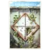 为了全人类海报 | `for-humanity-poster` | 0.05 千克 | — | — | — | — |
| 8 | 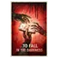 堕入黑暗海报 | `to-fall-in-the-darkness-poster` | 0.05 千克 | — | — | — | — |
| 9 | 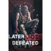 塔科夫之魂海报 | `tark-souls-poster` | 0.05 千克 | — | — | — | 50,000 卢布（1 家最高） |
| 10 | 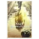 幸存者海报 | `survivor-poster` | 0.05 千克 | — | — | — | — |
| 11 | 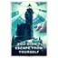 灯塔海报 | `lighthouse-poster` | 0.05 千克 | — | — | — | — |
| 12 |  Alex Green 海报 | `alex-green-poster` | 0.1 千克 | — | — | — | 15,000 卢布（1 家最高） |
| 13 | 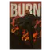 BURN 海报 | `burn-poster` | 0.1 千克 | — | — | — | — |
| 14 | 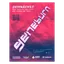 Geneburn 音乐会广告 | `geneburn-concert-advertisement` | 0.1 千克 | — | — | — | 50,000 卢布（1 家最高） |
| 15 | 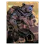 I Bear Loot 海报 | `i-bear-loot-poster` | 0.1 千克 | — | — | — | — |
| 16 | 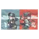 Killa 与 Tagilla 海报 | `killa-and-tagilla-poster` | 0.1 千克 | — | — | — | 50,000 卢布（1 家最高） |
| 17 |  Killa妹海报 | `killagirl-poster` | 0.1 千克 | — | — | — | — |
| 18 |  Killa小迷妹海报 | `killa-fangirl-poster` | 0.1 千克 | — | — | — | 50,000 卢布（1 家最高） |
| 19 | 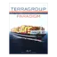 Paradigm 航运海报 | `paradigm-shipping-poster` | 0.1 千克 | — | — | — | 13,500 卢布（1 家最高） |
| 20 | 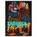 Ryzhy 编年史海报 | `chronicles-of-ryzhy-poster` | 0.1 千克 | — | — | — | — |
| 21 | 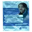 TerraGroup 实验室招募广告 | `terragroup-labs-advertisement` | 0.1 千克 | — | — | — | 25,000 卢布（1 家最高） |
| 22 | 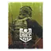 USEC 海报 | `usec-poster` | 0.1 千克 | — | — | — | 25,000 卢布（1 家最高） |
| 23 | 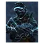 What You Seek 海报 | `what-you-seek-poster` | 0.1 千克 | — | — | — | — |
| 24 |  “RUN”海报 | `run-poster` | 0.1 千克 | — | — | — | 40,000 卢布（1 家最高） |
| 25 |  “丫喜欢修勾吗？”海报 | `dya-like-dags-poster` | 0.1 千克 | — | — | — | 50,000 卢布（1 家最高） |
| 26 |  “宿舍楼地头蛇”海报 | `dorm-snake-poster` | 0.1 千克 | — | — | — | 50,000 卢布（1 家最高） |
| 27 | 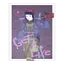 “干点正经事”海报 | `get-a-life-poster` | 0.1 千克 | — | — | — | — |
| 28 |  “早日康复”海报 | `get-well-poster` | 0.1 千克 | — | — | — | 50,000 卢布（1 家最高） |
| 29 |  “早日滚蛋”海报 | `get-lost-poster` | 0.1 千克 | — | — | — | 50,000 卢布（1 家最高） |
| 30 |  “深渊”海报 | `the-abyss-poster` | 0.1 千克 | — | — | — | 50,000 卢布（1 家最高） |
| 31 |  “路途”海报 | `the-path-poster` | 0.1 千克 | — | — | — | 50,000 卢布（1 家最高） |
| 32 | 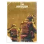 《伏击现场》海报 | `the-ambush-poster` | 0.1 千克 | — | — | — | 40,000 卢布（1 家最高） |
| 33 | 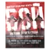 《惊天枪战》海报 | `gunfight-poster` | 0.1 千克 | — | — | — | 25,000 卢布（1 家最高） |
| 34 | 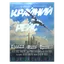 《末路航班》海报 | `last-flight-poster` | 0.1 千克 | — | — | — | 25,000 卢布（1 家最高） |
| 35 | 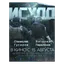 《流亡之路》海报 | `exodus-poster` | 0.1 千克 | — | — | — | 25,000 卢布（1 家最高） |
| 36 | 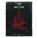 《狼窝》海报 | `den-of-wolves-poster` | 0.1 千克 | — | — | — | 25,000 卢布（1 家最高） |
| 37 | 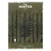 《猎物》海报 | `the-hunted-poster` | 0.1 千克 | — | — | — | 50,000 卢布（1 家最高） |
| 38 | 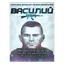 《瓦西里》海报 | `vasily-poster` | 0.1 千克 | — | — | — | 25,000 卢布（1 家最高） |
| 39 | 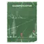 《神射手》海报 | `sharpshooter-poster` | 0.1 千克 | — | — | — | 40,000 卢布（1 家最高） |
| 40 | 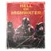 《赴汤蹈火》海报 | `hell-or-highwater-poster` | 0.1 千克 | — | — | — | 25,000 卢布（1 家最高） |
| 41 |  《逃离鸭科夫》海报 | `escape-from-duckov-poster` | 0.1 千克 | — | — | — | 50,000 卢布（1 家最高） |
| 42 | 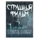 《骇人影片》海报 | `spooky-movie-poster` | 0.1 千克 | — | — | — | 25,000 卢布（1 家最高） |
| 43 | 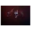 三人成虎海报 | `trio-poster` | 0.1 千克 | — | — | — | 50,000 卢布（1 家最高） |
| 44 |  不同寻常的皮具吊带海报 | `unusual-leather-rig-poster` | 0.1 千克 | — | — | — | 50,000 卢布（1 家最高） |
| 45 |  塔格勒传说海报 | `targrad-tales-poster` | 0.1 千克 | — | — | — | 50,000 卢布（1 家最高） |
| 46 | 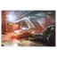 塔科夫火车站海报 | `tarkov-train-station-poster` | 0.1 千克 | — | — | — | 50,000 卢布（1 家最高） |
| 47 | 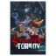 塔科夫街区海报 | `streets-of-tarkov-poster` | 0.1 千克 | — | — | — | — |
| 48 | 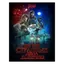 奇怪物语海报 | `things-sure-are-strange-poster` | 0.1 千克 | — | — | — | 40,000 卢布（1 家最高） |
| 49 |  女郎海报 | `girl-poster` | 0.1 千克 | — | — | — | 25,000 卢布（1 家最高） |
| 50 | 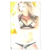 女郎海报 | `girl-poster-1` | 0.1 千克 | — | — | — | 25,000 卢布（1 家最高） |
| 51 | 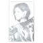 女郎海报 | `girl-poster-2` | 0.1 千克 | — | — | — | 25,000 卢布（1 家最高） |
| 52 |  女郎海报 | `girl-poster-3` | 0.1 千克 | — | — | — | 25,000 卢布（1 家最高） |
| 53 |  女郎海报 | `girl-poster-4` | 0.1 千克 | — | — | — | 40,000 卢布（1 家最高） |
| 54 | 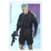 小心熊出没海报 | `beware-the-bear-poster` | 0.1 千克 | — | — | — | — |
| 55 | 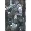 手榴弹女孩海报 | `grenade-girl-poster` | 0.1 千克 | — | — | — | 50,000 卢布（1 家最高） |
| 56 | 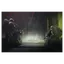 控制海报 | `control-poster` | 0.1 千克 | — | — | — | 50,000 卢布（1 家最高） |
| 57 | 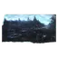 末日高速海报 | `highway-poster` | 0.1 千克 | — | — | — | 25,000 卢布（1 家最高） |
| 58 | 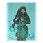 汪汪拳海报 | `get-a-paw-poster` | 0.1 千克 | — | — | — | — |
| 59 |  特殊女郎海报 | `special-girl-poster` | 0.1 千克 | — | — | — | 50,000 卢布（1 家最高） |
| 60 |  神秘仪式海报 | `ritual-poster` | 0.1 千克 | — | — | — | 50,000 卢布（1 家最高） |
| 61 | 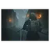 突袭海报 | `raid-poster` | 0.1 千克 | — | — | — | 50,000 卢布（1 家最高） |
| 62 | 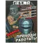 竞技场广告海报 | `arena-advertisement-poster` | 0.1 千克 | — | 商人出售 | 100,800 卢布，需 Skier 1 级 | 17,500 卢布（1 家最高） |
| 63 | 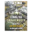 竞技场海报 | `arena-poster` | 0.1 千克 | — | — | — | 40,000 卢布（1 家最高） |
| 64 | 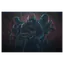 邪教海报 | `cult-poster` | 0.1 千克 | — | — | — | 50,000 卢布（1 家最高） |
| 65 | 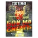 野牛 vs 复仇者海报 | `bison-vs-undertaker-poster` | 0.1 千克 | — | — | — | 40,000 卢布（1 家最高） |
| 66 | 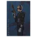 隐入黑暗海报 | `going-dark-poster` | 0.1 千克 | — | — | — | — |
| 67 |  新兵浅浮雕 | `recruit-bas-relief` | 1 千克 | — | — | — | 42,500 卢布（1 家最高） |
| 68 |  幸存者浅浮雕 | `survivor-bas-relief` | 1.23 千克 | — | — | — | 47,500 卢布（1 家最高） |
| 69 |  老兵浅浮雕 | `veteran-bas-relief` | 1.34 千克 | — | — | — | 50,000 卢布（1 家最高） |
| 70 |  冷酷战士浅浮雕 | `ruthless-bas-relief` | 1.41 千克 | — | — | — | 52,500 卢布（1 家最高） |
| 71 |  升格浅浮雕 | `ascended-bas-relief` | 1.66 千克 | — | — | — | 67,500 卢布（1 家最高） |
| 72 |  升格浅浮雕 | `ascended-bas-relief-1` | 1.8 千克 | — | — | — | 77,500 卢布（1 家最高） |
| 73 |  重生浅浮雕 | `reborn-bas-relief` | 2.44 千克 | — | — | — | 57,500 卢布（1 家最高） |

> 本分类 **73 件**。价格取各商人中的最优价；「商人最低售价」栏附商人与等级要求，「最高回收」栏标注参与回收的商人数。

本分类 73 件的名称一览（点开可浏览；站内搜索靠它命中物品名）

“撤离真兄弟”海报　“最后一息”海报　“最后时刻”海报　“陶鲁斯”海报　《Pulp 任务》海报　《人在塔科夫》海报　为了全人类海报　堕入黑暗海报　塔科夫之魂海报　幸存者海报　灯塔海报　Alex Green 海报　BURN 海报　Geneburn 音乐会广告　I Bear Loot 海报　Killa 与 Tagilla 海报　Killa妹海报　Killa小迷妹海报　Paradigm 航运海报　Ryzhy 编年史海报　TerraGroup 实验室招募广告　USEC 海报　What You Seek 海报　“RUN”海报　“丫喜欢修勾吗？”海报　“宿舍楼地头蛇”海报　“干点正经事”海报　“早日康复”海报　“早日滚蛋”海报　“深渊”海报　“路途”海报　《伏击现场》海报　《惊天枪战》海报　《末路航班》海报　《流亡之路》海报　《狼窝》海报　《猎物》海报　《瓦西里》海报　《神射手》海报　《赴汤蹈火》海报　《逃离鸭科夫》海报　《骇人影片》海报　三人成虎海报　不同寻常的皮具吊带海报　塔格勒传说海报　塔科夫火车站海报　塔科夫街区海报　奇怪物语海报　女郎海报　女郎海报　女郎海报　女郎海报　女郎海报　小心熊出没海报　手榴弹女孩海报　控制海报　末日高速海报　汪汪拳海报　特殊女郎海报　神秘仪式海报　突袭海报　竞技场广告海报　竞技场海报　邪教海报　野牛 vs 复仇者海报　隐入黑暗海报　新兵浅浮雕　幸存者浅浮雕　老兵浅浮雕　冷酷战士浅浮雕　升格浅浮雕　升格浅浮雕　重生浅浮雕

### 笔记

分类路径：物品 › 可完成类

| # | 名称 | 英文名 | 重量 | 关键属性 | 获取方式 | 商人最低售价 | 商人最高回收 |
|---|------|--------|------|----------|----------|--------------|--------------|
| 1 |  Leshy 的命令 | `leshys-orders` | 0.002 千克 | — | — | — | — |
| 2 |  关于“世界之眼”的记录 | `note-about-the-eye-of-the-world` | 0.002 千克 | — | — | — | — |
| 3 |  受害者的笔记 | `victims-note` | 0.002 千克 | — | — | — | — |
| 4 |  密码笔记的第一部分 | `first-piece-of-code-note` | 0.002 千克 | — | — | — | — |
| 5 |  密码笔记的第二部分 | `second-piece-of-code-note` | 0.002 千克 | — | — | — | — |
| 6 |  岗亭留下的便条 | `guard-post-note` | 0.002 千克 | — | — | — | — |
| 7 |  带有地址的消息 | `note-with-an-address` | 0.002 千克 | — | — | — | — |
| 8 |  未知文件的碎片 | `fragment-of-an-unknown-document` | 0.002 千克 | — | — | — | — |
| 9 |  来自 Kerman 先生的笔记 | `note-from-mr-kerman` | 0.002 千克 | — | — | — | — |
| 10 |  来自 Prapor 手下的便条 | `note-from-prapors-men` | 0.002 千克 | — | — | — | — |
| 11 |  来自修车店的便条 | `note-from-the-repair-shop` | 0.002 千克 | — | — | — | — |
| 12 |  码头大门处的便条 | `note-at-the-seaport-door` | 0.002 千克 | — | — | — | — |
| 13 |  研究助理关于 #12 组测试对象的笔记 | `assistants-notes-on-group-12` | 0.002 千克 | — | — | — | — |
| 14 |  研究助理关于 #3 与 #10 组测试对象的笔记 | `assistants-notes-on-group-3-and-group-10` | 0.002 千克 | — | — | — | — |
| 15 |  研究助理关于 #3 组测试对象的笔记 | `assistants-notes-on-group-3` | 0.002 千克 | — | — | — | — |
| 16 |  研究助理关于 #8 组测试对象的笔记 | `assistants-notes-on-group-8` | 0.002 千克 | — | — | — | — |
| 17 |  研究助理关于 TG-Vi-24 测试对象的笔记 | `assistants-notes-on-tg-vi-24-test-subjects` | 0.002 千克 | — | — | — | — |
| 18 |  警告消息 | `note-with-a-warning` | 0.002 千克 | — | — | — | — |
| 19 |  邪教徒祭司的笔记 | `cultist-priests-note` | 0.002 千克 | — | — | — | — |
| 20 |  Boreas 水手日志 | `sailors-diary` | 0.003 千克 | — | — | — | — |
| 21 |  C-1 舱室访问记录 | `compartment-c-1-access-log` | 0.003 千克 | — | — | — | — |
| 22 |  Paradigm 航运指示 | `paradigm-shipping-directive` | 0.003 千克 | — | — | — | — |
| 23 |  Strelets 的笔记 | `strelets-note` | 0.003 千克 | — | — | — | — |
| 24 |  USEC 尸体上发现的笔记 | `note-from-usecs-corpse` | 0.003 千克 | — | — | — | — |
| 25 |  Ultra 商场后方哨站的 BEAR 字条 | `bear-note-from-the-outpost-behind-ultra` | 0.003 千克 | — | — | — | — |
| 26 |  带有邪教标记的 Voevoda 照片 | `voevodas-photo-with-a-cultist-mark` | 0.003 千克 | — | — | — | — |
| 27 |  提到 #1156 项目的笔记 | `note-mentioning-item-1156` | 0.003 千克 | — | — | — | — |
| 28 |  提到 Prapor 的笔记 | `note-mentioning-prapor` | 0.003 千克 | — | — | — | — |
| 29 |  提到将军的笔记 | `note-mentioning-general` | 0.003 千克 | — | — | — | — |
| 30 |  留在 #1156 项目原型旁的便条 | `note-by-item-1156` | 0.003 千克 | — | — | — | — |
| 31 |  破冰船数据库文件 | `icebreaker-archive-data` | 0.003 千克 | — | — | — | — |
| 32 |  神秘蓝焰的目击报告 | `blue-fire-witness-note` | 0.003 千克 | — | — | — | — |
| 33 |  程序员的笔记 | `programmers-note` | 0.003 千克 | — | — | — | — |
| 34 |  降临仪式的准备笔记 | `note-on-preparations-for-the-arrival` | 0.003 千克 | — | — | — | — |
| 35 |  Reshala 窝棚里的字条 | `letter-from-reshalas-bunkhouse` | 0.005 千克 | — | — | — | — |
| 36 |  TerraGroup 全球总部的直接命令 | `order-from-terragroup-worldwide-headquarters` | 0.005 千克 | — | — | — | — |
| 37 |  TerraGroup 办公区域撤离路线图 | `escape-route-map-from-the-terragroup-office-area` | 0.005 千克 | — | — | — | — |
| 38 |  《塔科夫先驱报》摘要 | `tarkov-herald-summary` | 0.005 千克 | — | — | — | — |
| 39 |  《第九圈》第 14 期 | `the-ninth-circle-issue-14` | 0.005 千克 | — | — | — | — |
| 40 |  《第九圈》第 19 期 | `the-ninth-circle-issue-19` | 0.005 千克 | — | — | — | — |
| 41 |  与 A 女士的谈话记录 | `transcript-of-conversation-with-ms-a` | 0.005 千克 | — | — | — | — |
| 42 |  从邪教徒屋子里发现的剪报 | `newspaper-clipping-from-the-cultists-house` | 0.005 千克 | — | — | — | — |
| 43 |  关于“大净化”的零散笔记 | `note-with-ramblings-about-the-purification` | 0.005 千克 | — | — | — | — |
| 44 |  写有笔记的货运清单 | `transport-log-with-notes` | 0.005 千克 | — | — | — | — |
| 45 |  向 TerraGroup 全球总部提交报告的副本 | `copy-of-report-for-tg-worldwide` | 0.005 千克 | — | — | — | — |
| 46 |  带有阿纳斯塔西娅照片的剪报 | `newspaper-clipping-with-a-photo-of-anastasia` | 0.005 千克 | — | — | — | — |
| 47 |  拆开的信封 | `unsealed-envelope` | 0.005 千克 | — | — | — | — |
| 48 |  提到“守望者”的文件 | `document-mentioning-the-warden` | 0.005 千克 | — | — | — | — |
| 49 |  提到某种协议的文件 | `document-mentioning-a-protocol` | 0.005 千克 | — | — | — | — |
| 50 |  烧焦的文件 | `burnt-document` | 0.005 千克 | — | — | — | — |
| 51 |  硬盘恢复内容 | `hard-drive-printout` | 0.005 千克 | — | 制作 | — | — |
| 52 |  给科兹洛夫的警告信 | `note-for-kozlov` | 0.005 千克 | — | — | — | — |
| 53 |  货运传真 | `cargo-transport-fax` | 0.005 千克 | — | — | — | — |
| 54 |  EMERCOM 传单 | `emercom-leaflet` | 0.01 千克 | — | — | — | — |
| 55 |  Leshy 的日志 | `leshys-diary` | 0.01 千克 | — | — | — | — |
| 56 |  感应钥匙卡说明书 | `rfid-card-manual` | 0.01 千克 | — | — | — | — |
| 57 |  科兹洛夫房间里的信 | `letter-from-kozlovs-room` | 0.01 千克 | — | — | — | — |
| 58 |  邮箱里的信 | `letter-from-the-mailbox` | 0.01 千克 | — | — | — | — |
| 59 |  塔科夫新闻第 142 期 | `tarkov-news-issue-142` | 0.04 千克 | — | — | — | — |
| 60 |  “迷宫”设施研发报告 | `labyrinth-facility-research-report` | 0.043 千克 | — | — | — | — |
| 61 |  刊有 A.米哈伊洛娃文章的《塔科夫先驱报》 | `tarkov-herald-newspaper-with-article-by-a-mikhailova` | 0.08 千克 | — | — | — | — |
| 62 |  FSB 报告 | `fsb-report` | 0.09 千克 | — | — | — | — |
| 63 |  Moreman 的个人档案 | `moremans-personnel-file` | 0.09 千克 | — | — | — | — |
| 64 |  Strelets 的个人档案 | `strelets-personnel-file` | 0.09 千克 | — | — | — | — |
| 65 |  Taran 的个人档案 | `tarans-personnel-file` | 0.09 千克 | — | — | — | — |
| 66 |  Voevoda 的个人档案 | `voevodas-personnel-file` | 0.09 千克 | — | — | — | — |
| 67 |  从 Fence 笔记本提取的数据 | `data-from-fences-laptop` | 0.09 千克 | — | 制作 | — | — |
| 68 |  来自 Voevoda 的人质疏散报告 | `hostage-evacuation-report-from-voevoda` | 0.09 千克 | — | — | — | — |
| 69 |  间谍网络部署情况报告 | `agent-network-deployment-report` | 0.09 千克 | — | — | — | — |
| 70 |  Bogatyr (战士) 小队行动报告 | `bogatyr-squad-operations-report` | 0.105 千克 | — | — | — | — |
| 71 |  更新企业协作流程的文件指示 | `document-on-changes-in-enterprise-interactions` | 0.11 千克 | — | — | — | — |
| 72 |  诺文斯克地区政府设施情报文件夹 | `folder-with-intelligence-on-norvinsk-region-facilities` | 0.11 千克 | — | — | — | — |
| 73 |  #1156 项目规格文件 | `item-1156-specification` | 0.12 千克 | — | — | — | — |
| 74 |  ARRS 系统规格说明 | `arrs-system-specifications` | 0.12 千克 | — | — | — | — |
| 75 |  燃料催化剂测试报告 | `fuel-catalyst-test-report` | 0.13 千克 | — | — | — | — |
| 76 |  信号三角定位地图 | `map-with-triangulated-signal` | 0.3 千克 | — | — | — | — |
| 77 |  降临之书 | `book-of-the-arrival` | 0.8 千克 | — | — | — | — |

> 本分类 **77 件**。价格取各商人中的最优价；「商人最低售价」栏附商人与等级要求，「最高回收」栏标注参与回收的商人数。

本分类 77 件的名称一览（点开可浏览；站内搜索靠它命中物品名）

Leshy 的命令　关于“世界之眼”的记录　受害者的笔记　密码笔记的第一部分　密码笔记的第二部分　岗亭留下的便条　带有地址的消息　未知文件的碎片　来自 Kerman 先生的笔记　来自 Prapor 手下的便条　来自修车店的便条　码头大门处的便条　研究助理关于 #12 组测试对象的笔记　研究助理关于 #3 与 #10 组测试对象的笔记　研究助理关于 #3 组测试对象的笔记　研究助理关于 #8 组测试对象的笔记　研究助理关于 TG-Vi-24 测试对象的笔记　警告消息　邪教徒祭司的笔记　Boreas 水手日志　C-1 舱室访问记录　Paradigm 航运指示　Strelets 的笔记　USEC 尸体上发现的笔记　Ultra 商场后方哨站的 BEAR 字条　带有邪教标记的 Voevoda 照片　提到 #1156 项目的笔记　提到 Prapor 的笔记　提到将军的笔记　留在 #1156 项目原型旁的便条　破冰船数据库文件　神秘蓝焰的目击报告　程序员的笔记　降临仪式的准备笔记　Reshala 窝棚里的字条　TerraGroup 全球总部的直接命令　TerraGroup 办公区域撤离路线图　《塔科夫先驱报》摘要　《第九圈》第 14 期　《第九圈》第 19 期　与 A 女士的谈话记录　从邪教徒屋子里发现的剪报　关于“大净化”的零散笔记　写有笔记的货运清单　向 TerraGroup 全球总部提交报告的副本　带有阿纳斯塔西娅照片的剪报　拆开的信封　提到“守望者”的文件　提到某种协议的文件　烧焦的文件　硬盘恢复内容　给科兹洛夫的警告信　货运传真　EMERCOM 传单　Leshy 的日志　感应钥匙卡说明书　科兹洛夫房间里的信　邮箱里的信　塔科夫新闻第 142 期　“迷宫”设施研发报告　刊有 A.米哈伊洛娃文章的《塔科夫先驱报》　FSB 报告　Moreman 的个人档案　Strelets 的个人档案　Taran 的个人档案　Voevoda 的个人档案　从 Fence 笔记本提取的数据　来自 Voevoda 的人质疏散报告　间谍网络部署情况报告　Bogatyr (战士) 小队行动报告　更新企业协作流程的文件指示　诺文斯克地区政府设施情报文件夹　#1156 项目规格文件　ARRS 系统规格说明　燃料催化剂测试报告　信号三角定位地图　降临之书

### 对话物品

分类路径：物品 › 信息

| # | 名称 | 英文名 | 重量 | 关键属性 | 获取方式 | 商人最低售价 | 商人最高回收 |
|---|------|--------|------|----------|----------|--------------|--------------|
| 1 |  固态硬盘 | `ssd-drive` | 0.04 千克 | — | — | — | 28,800 卢布（2 家最高） |
| 2 |  正式版游戏光盘 | `disk-with-release-version` | 0.04 千克 | — | — | — | — |
| 3 |  硬盘 1 | `disk-drive-1` | 0.04 千克 | — | — | — | — |
| 4 |  加密U盘 | `secure-flash-drive` | 0.08 千克 | — | 制作 | — | 14,454 卢布（2 家最高） |
| 5 |  加密U盘 | `encrypted-flash-drive` | 0.08 千克 | — | — | — | 3,600 卢布（2 家最高） |
| 6 |  装有特殊程序的U盘 | `flash-drive-with-special-software` | 0.08 千克 | — | — | — | — |
| 7 |  解密数据文件 | `documents-with-decrypted-data` | 0.08 千克 | — | — | — | — |
| 8 |  写有暗号“Adaptation”的纸条 | `note-with-code-word-adaptation` | 0.1 千克 | — | — | — | — |
| 9 |  写有暗号“Ark”的纸条 | `note-with-code-word-ark` | 0.1 千克 | — | — | — | — |
| 10 |  写有暗号“Heartbeat”的纸条 | `note-with-code-word-heartbeat` | 0.1 千克 | — | — | — | — |
| 11 |  写有暗号“Onyx”的纸条 | `note-with-code-word-onyx` | 0.1 千克 | — | — | — | — |
| 12 |  写有暗号“Voron”的纸条 | `note-with-code-word-voron` | 0.1 千克 | — | — | — | — |
| 13 |  地图碎片 | `map-piece` | 0.1 千克 | — | — | — | — |
| 14 |  袖珍日记 | `slim-diary` | 0.1 千克 | — | — | — | 25,560 卢布（2 家最高） |
| 15 |  装有 Kerman 哈希代码的 U 盘 | `flash-drive-with-mr-kermans-hash-codes` | 0.1 千克 | — | — | — | — |
| 16 |  装有 Prapor 哈希代码的 U 盘 | `flash-drive-with-prapors-hash-codes` | 0.1 千克 | — | — | — | — |
| 17 |  雷区地图（储备站） | `minefield-map-reserve` | 0.1 千克 | — | — | — | — |
| 18 |  雷区地图（森林） | `minefield-map-woods` | 0.1 千克 | — | — | — | — |
| 19 |  雷区地图（灯塔） | `minefield-map-lighthouse` | 0.1 千克 | — | — | — | — |
| 20 |  Prapor 给港口检查点的信 | `prapors-letter-for-the-port-checkpoint` | 0.105 千克 | — | 商人出售 | 6,256,000 卢布，需 Prapor 1 级 | — |
| 21 |  Dunduk 软盘 | `dunduk-floppy-disk` | 0.14 千克 | — | — | — | 24,254 卢布（2 家最高） |
| 22 |  军用数据随身碟 | `military-thumb-drive` | 0.14 千克 | — | — | — | 3,600 卢布（2 家最高） |
| 23 |  军用闪存装置 | `military-flash-drive` | 0.14 千克 | — | 制作 | — | 21,600 卢布（2 家最高） |
| 24 |  《天雷地火》录像带 | `video-cassette-with-the-cyborg-killer-movie` | 0.15 千克 | — | — | — | 35,190 卢布（3 家最高） |
| 25 |  技术指导文件 | `tech-manual` | 0.2 千克 | — | — | — | 8,604 卢布（2 家最高） |
| 26 |  日记 | `diary` | 0.2 千克 | — | — | — | 20,880 卢布（2 家最高） |
| 27 |  程序员日志 (副本) | `programmers-diary-copy` | 0.2 千克 | — | — | — | 3,600 卢布（2 家最高） |
| 28 |  TG-Vi-24正版疫苗 | `tg-vi-24-true-vaccine` | 0.23 千克 | — | — | — | — |
| 29 |  TG-Vi-24致命疫苗 | `tg-vi-24-lethal-vaccine` | 0.23 千克 | — | — | — | — |
| 30 |  串口硬盘 | `sas-drive` | 0.23 千克 | — | 制作 | — | 33,120 卢布（2 家最高） |
| 31 |  情报文件夹 | `intelligence-folder` | 0.23 千克 | — | 以物换物 / 制作 | — | 24,840 卢布（2 家最高） |
| 32 |  破译的情报文件夹 | `decrypted-intelligence-folder` | 0.23 千克 | — | 制作 | — | — |
| 33 |  黑色军团加密密钥 | `black-division-encryption-keys` | 0.23 千克 | — | — | — | 14,760 卢布（2 家最高） |
| 34 |  BakeEzy烹饪书 | `bakeezy-cook-book` | 0.25 千克 | — | — | — | 29,580 卢布（3 家最高） |
| 35 |  加密磁带盒 | `secure-magnetic-tape-cassette` | 0.25 千克 | — | 制作 | — | 52,200 卢布（2 家最高） |
| 36 |  地形调查地图 | `topographic-survey-maps` | 0.27 千克 | — | 制作 | — | 25,920 卢布（2 家最高） |
| 37 |  游荡者情报地图 | `rogue-intel-maps` | 0.27 千克 | — | — | — | 11,520 卢布（1 家最高） |
| 38 |  立交桥地下设施平面图 | `interchange-underground-utility-plan` | 0.3 千克 | — | — | — | — |
| 39 |  Labrys 研发记录 | `labrys-research-notes` | 0.33 千克 | — | — | — | 270,000 卢布（2 家最高） |
| 40 |  TerraGroup ”蓝色文件夹” 材料 | `terragroup-blue-folders-materials` | 0.33 千克 | — | 制作 | — | 270,000 卢布（2 家最高） |
| 41 |  先进电子材料教材 | `advanced-electronic-materials-textbook` | 0.5 千克 | — | — | — | 176,400 卢布（2 家最高） |
| 42 |  硅基光电集成电路教材 | `silicon-optoelectronic-integrated-circuits-textbook` | 0.5 千克 | — | — | — | 180,000 卢布（2 家最高） |
| 43 |  加固手提箱 | `armored-case-1` | 7 千克 | — | — | — | — |

> 本分类 **43 件**。价格取各商人中的最优价；「商人最低售价」栏附商人与等级要求，「最高回收」栏标注参与回收的商人数。

本分类 43 件的名称一览（点开可浏览；站内搜索靠它命中物品名）

固态硬盘　正式版游戏光盘　硬盘 1　加密U盘　加密U盘　装有特殊程序的U盘　解密数据文件　写有暗号“Adaptation”的纸条　写有暗号“Ark”的纸条　写有暗号“Heartbeat”的纸条　写有暗号“Onyx”的纸条　写有暗号“Voron”的纸条　地图碎片　袖珍日记　装有 Kerman 哈希代码的 U 盘　装有 Prapor 哈希代码的 U 盘　雷区地图（储备站）　雷区地图（森林）　雷区地图（灯塔）　Prapor 给港口检查点的信　Dunduk 软盘　军用数据随身碟　军用闪存装置　《天雷地火》录像带　技术指导文件　日记　程序员日志 (副本)　TG-Vi-24正版疫苗　TG-Vi-24致命疫苗　串口硬盘　情报文件夹　破译的情报文件夹　黑色军团加密密钥　BakeEzy烹饪书　加密磁带盒　地形调查地图　游荡者情报地图　立交桥地下设施平面图　Labrys 研发记录　TerraGroup ”蓝色文件夹” 材料　先进电子材料教材　硅基光电集成电路教材　加固手提箱

### 赛季通行证文件

分类路径：物品 › 可堆叠物品

| # | 名称 | 英文名 | 重量 | 关键属性 | 获取方式 | 商人最低售价 | 商人最高回收 |
|---|------|--------|------|----------|----------|--------------|--------------|
| 1 |  测试文档 | `test-documentation` | 0.19 千克 | — | — | — | — |
| 2 |  员工文档 | `user-documentation` | 0.26 千克 | — | — | — | — |
| 3 |  技术文档 | `technical-documentation` | 0.29 千克 | — | — | — | — |
| 4 |  PMC 个人档案 | `pmc-personnel-files` | 0.3 千克 | — | — | — | — |
| 5 |  医疗文件 | `medical-documents` | 0.34 千克 | — | — | — | — |
| 6 |  秘密文件 | `classified-documents` | 0.42 千克 | — | — | — | — |
| 7 |  项目文件 | `project-documentation` | 0.43 千克 | — | — | — | — |
| 8 |  财务文件 | `financial-documents` | 0.6 千克 | — | — | — | — |
| 9 |  蓝图与技术文档 | `blueprints-and-technical-documentation` | 0.65 千克 | — | — | — | — |

> 本分类 **9 件**。价格取各商人中的最优价；「商人最低售价」栏附商人与等级要求，「最高回收」栏标注参与回收的商人数。

#### 刷新地图速查

> **8 类文件各在固定的 3 张图上刷新** —— 地图列表逐件取自**游戏内物品描述原文**（「可在以下地点找到此类文件」一句），不是社区整理表；版本更新后重跑生成器即跟上。

| 文件 | 刷新地图 |
|------|----------|
| 测试文档 | [海岸线](../maps/shoreline.md)、[森林](../maps/woods.md)、[破冰船](../maps/icebreaker.md) |
| 员工文档 | [中心区](../maps/ground-zero.md)、[塔科夫街区](../maps/streets-of-tarkov.md)、[实验室](../maps/the-lab.md) |
| 技术文档 | [海岸线](../maps/shoreline.md)、[森林](../maps/woods.md)、[灯塔](../maps/lighthouse.md) |
| PMC 个人档案 | [储备站](../maps/reserve.md)、[灯塔](../maps/lighthouse.md)、[破冰船](../maps/icebreaker.md) |
| 医疗文件 | [实验室](../maps/the-lab.md)、[中心区](../maps/ground-zero.md)、[迷宫](../maps/the-labyrinth.md) |
| 项目文件 | [工厂](../maps/factory.md)、[储备站](../maps/reserve.md)、[海关](../maps/customs.md) |
| 财务文件 | [海关](../maps/customs.md)、[塔科夫街区](../maps/streets-of-tarkov.md)、[立交桥](../maps/interchange.md) |
| 蓝图与技术文档 | [立交桥](../maps/interchange.md)、[工厂](../maps/factory.md)、[迷宫](../maps/the-labyrinth.md) |

> **秘密文件** 不在地图刷新 —— 它是**购买品**：在游戏内的 **Expansions Hub** 购入，可替代任意类型上交，且对后续赛季同样有效。

> **收集机制四条**（来源：官方 Wiki 与两家中文站交叉核对，2026-10-16）：
>
> ① **每人独立刷新** —— 你捡到的那一份别人拿不走（PMC 与 Scav、三种模式都能捡）；击杀**黑色分部干员**也会掉文件（这一类是全队共享的战利品）。
>
> ② **每日拾取上限**：赛季模式 **30** / PvP **20** / PvE **15**，三个模式**共享**同一个额度（先在 PvE 捡了 15 份，当天在赛季模式就只剩 15 份），每日重置、剩余数量在游戏内通行证界面的文件区可见。⚠ 部分英文社区站记为 25 / 15 / 10 —— 口径不一，**以游戏内显示为准**。
>
> ③ **5 换 1**：在通行证界面的交换区，任意 5 份可换成 1 份自选类型。
>
> ④ **领完全部奖励共需上交 501 份**（各玩家所需类型组合不同）；已解锁的奖励在所有模式间通用且永久保留，赛季结束仍未解锁的则永久不可获得。

本分类 9 件的名称一览（点开可浏览；站内搜索靠它命中物品名）

测试文档　员工文档　技术文档　PMC 个人档案　医疗文件　秘密文件　项目文件　财务文件　蓝图与技术文档

---

## 📚 相关页面

- [物品图鉴总览](index.md) — 全站物品的分类入口与检索
- [任务需求物品反查](../quests/item-lookup.md) — 某物品被哪些任务要求、要不要留
- [配方速查表](../docs/recipes.md) — 制作与以物换物的完整配方
- [跳蚤定价与手续费](../entries/flea-pricing.md) — 市场侧的定价规则
- [商人系统](../entries/traders.md) — 商人等级与补货机制

📖 [返回物品图鉴总览](index.md)

⬆️ **[回到顶部](#top)**

**最后更新**: 2026 年 10 月 ｜ **贡献者** [GTX950L](https://github.com/GTX950L) ｜ **License**: CC BY-NC-SA 4.0
