---
tags:
  - 物品
  - 速查
---

# 零散物品（Item Catalog）

> 版本基线：2026 年 10 月 ｜ 1.2.0.0（第一赛季 KORD BREACH）｜ 数据来源：tarkov.dev（二级）
> 本页为**生成页**，数值随版本调整，引用时请附「以游戏内为准」。

## 📸 本页概览

| 项目 | 说明 |
|------|------|
| **收录件数** | **32 件**（全站物品图鉴共 4,983 件） |
| **叶子分类** | 2 个官方分类：[钱](#钱)、[刀](#刀) |
| **获取方式** | 站内收录的**固定**渠道：`商人出售` / `以物换物` / `制作`。本页 **10 / 32 件**有至少一条（商人出售 2 ｜ 以物换物 8 ｜ 制作 0）；`—` **不是「拿不到」**，只表示站内没收录它的固定渠道 —— 那类得靠搜刮或跳蚤市场，而这两样站内不给点位（判据见[战利品分布](../entries/loot.md)）|
| **数据来源** | `json.tarkov.dev` 的 `itemCategories` 树与 `items` 接口，二级来源 |
| **抓取日期** | 2026-10-08 |
| **配套页面** | [物品图鉴总览](index.md) ｜ [任务需求物品反查](../quests/item-lookup.md) ｜ [配方速查表](../docs/recipes.md) |

---

## 🔎 检索与筛选

本页的检索、筛选与详情面板需要 JavaScript —— **下方表格是静态生成的，不开 JS 也能读完**。

### 钱

分类路径：物品 › 可堆叠物品

| # | 名称 | 英文名 | 重量 | 关键属性 | 获取方式 | 商人最低售价 | 商人最高回收 |
|---|------|--------|------|----------|----------|--------------|--------------|
| 1 |  卢布 | `roubles` | 0 千克 | — | — | — | — |
| 2 |  欧元 | `euros` | 0 千克 | — | 商人出售 | 192 卢布，需 Skier 1 级 | — |
| 3 |  美元 | `dollars` | 0 千克 | — | 商人出售 | 169 卢布，需 Peacekeeper 1 级 | — |
| 4 |  GP币 | `gp-coin` | 0.01 千克 | — | — | — | — |
| 5 |  TarCoin | `tarcoin` | 0.05 千克 | — | — | — | — |

> 本分类 **5 件**。价格取各商人中的最优价；「商人最低售价」栏附商人与等级要求，「最高回收」栏标注参与回收的商人数。

本分类 5 件的名称一览（点开可浏览；站内搜索靠它命中物品名）

卢布　欧元　美元　GP币　TarCoin

### 刀

| # | 名称 | 英文名 | 重量 | 关键属性 | 获取方式 | 商人最低售价 | 商人最高回收 |
|---|------|--------|------|----------|----------|--------------|--------------|
| 1 |  “杀人鲸”推刃匕首 | `kasatka-push-dagger` | 0.155 千克 | 劈砍伤害 24；穿刺伤害 39；命中半径 0.5 厘米 | — | — | 13,459 卢布（1 家最高） |
| 2 | 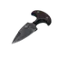 “鲨鱼”推刃匕首 | `akula-push-dagger` | 0.155 千克 | 劈砍伤害 24；穿刺伤害 39；命中半径 0.5 厘米 | — | — | 13,459 卢布（1 家最高） |
| 3 | 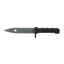 6Kh5 刺刀 | `6kh5-bayonet` | 0.223 千克 | 劈砍伤害 24；穿刺伤害 31；命中半径 0.4 厘米 | 以物换物 | — | 13,459 卢布（2 家最高） |
| 4 | 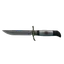 NKVD 芬卡工具刀 | `nkvd-finka-knife` | 0.223 千克 | 劈砍伤害 24；穿刺伤害 31；命中半径 0.4 厘米 | — | — | 16,339 卢布（1 家最高） |
| 5 |  NKVD 芬卡工具刀 | `nkvd-finka-knife-1` | 0.223 千克 | 劈砍伤害 24；穿刺伤害 31；命中半径 0.4 厘米 | — | — | 16,339 卢布（1 家最高） |
| 6 | 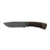 A-2607 95Kh18 匕首 | `bars-a-2607-95kh18-knife` | 0.28 千克 | 劈砍伤害 19；穿刺伤害 25；命中半径 0.35 厘米 | — | — | 2,453 卢布（2 家最高） |
| 7 |  A-2607 大马士革钢匕首 | `bars-a-2607-damascus-knife` | 0.28 千克 | 劈砍伤害 18；穿刺伤害 25；命中半径 0.35 厘米 | — | — | 1,723 卢布（2 家最高） |
| 8 | 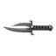 邪教徒之刃 | `cultist-knife` | 0.28 千克 | 劈砍伤害 25；穿刺伤害 32；命中半径 0.35 厘米 | — | — | 16,800 卢布（2 家最高） |
| 9 | 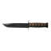 KA-BAR 美国海军陆战队战斗刀 | `ka-bar-usmc-fighter-knife` | 0.32 千克 | 劈砍伤害 34；穿刺伤害 35；命中半径 0.4 厘米 | — | — | 20,789 卢布（1 家最高） |
| 10 | 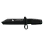 ER“支点”刺刀 | `er-fulcrum-bayonet` | 0.45 千克 | 劈砍伤害 25；穿刺伤害 27；命中半径 0.4 厘米 | — | — | 8,208 卢布（2 家最高） |
| 11 | 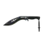 United Cutlery M48战术尼泊尔军刀 | `united-cutlery-m48-tactical-kukri` | 0.45 千克 | 劈砍伤害 27；穿刺伤害 32；命中半径 0.4 厘米 | — | — | — |
| 12 |  Microtech Jagdkommando 战术直刀 | `microtech-jagdkommando-knife` | 0.58 千克 | 劈砍伤害 24；穿刺伤害 31；命中半径 0.4 厘米 | — | — | 41,299 卢布（1 家最高） |
| 13 |  SP-8生存砍刀 | `sp-8-survival-machete` | 0.635 千克 | 劈砍伤害 30；穿刺伤害 40；命中半径 0.5 厘米 | — | — | 37,200 卢布（2 家最高） |
| 14 | 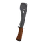 UVSR“针叶林-1”求生砍刀 | `uvsr-taiga-1-survival-machete` | 0.64 千克 | 劈砍伤害 33；穿刺伤害 55；命中半径 0.5 厘米 | — | — | 399,600 卢布（2 家最高） |
| 15 | 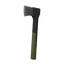 野营斧 | `camper-axe` | 0.64 千克 | 劈砍伤害 32；穿刺伤害 35；命中半径 0.5 厘米 | 以物换物 | — | 19,776 卢布（2 家最高） |
| 16 | 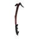 Red Rebel冰镐 | `red-rebel-ice-pick` | 0.65 千克 | 劈砍伤害 29；穿刺伤害 35；命中半径 0.6 厘米 | 以物换物 | — | 796,773 卢布（2 家最高） |
| 17 | 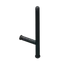 PR-Taran警棍 | `pr-taran-police-baton` | 0.75 千克 | 劈砍伤害 26；穿刺伤害 43；命中半径 0.5 厘米 | — | — | 10,745 卢布（2 家最高） |
| 18 | 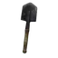 MPL-50挖掘工具 | `mpl-50-entrenching-tool` | 0.8 千克 | 劈砍伤害 24；穿刺伤害 43；命中半径 0.55 厘米 | 以物换物 | — | 1,708 卢布（2 家最高） |
| 19 | 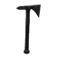 SOG Voodoo Hawk战术斧 | `sog-voodoo-hawk-tactical-tomahawk` | 0.807 千克 | 劈砍伤害 32；穿刺伤害 40；命中半径 0.45 厘米 | 以物换物 | — | 48,000 卢布（2 家最高） |
| 20 | 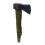 古董斧头 | `antique-axe` | 1.1 千克 | 劈砍伤害 28；穿刺伤害 49；命中半径 0.45 厘米 | — | — | 45,408 卢布（2 家最高） |
| 21 | 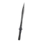 APOK ”荒原之地“ 战术短剑 | `apok-tactical-wasteland-gladius` | 1.247 千克 | 劈砍伤害 38；穿刺伤害 57；命中半径 0.8 厘米 | 以物换物 | — | 376,800 卢布（2 家最高） |
| 22 | 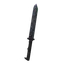 Miller Bros. Blades M-2 战术剑 | `miller-bros-blades-m-2-tactical-sword` | 1.3 千克 | 劈砍伤害 34；穿刺伤害 51；命中半径 0.7 厘米 | 以物换物 | — | 376,800 卢布（2 家最高） |
| 23 | 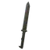 Miller Bros. Blades M-2 战术剑 (棕色) | `miller-bros-blades-m-2-tactical-sword-brown` | 1.3 千克 | 劈砍伤害 34；穿刺伤害 51；命中半径 0.7 厘米 | — | — | 376,800 卢布（1 家最高） |
| 24 | 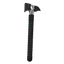 冲击斧 | `crash-axe` | 1.4 千克 | 劈砍伤害 31；穿刺伤害 52；命中半径 0.45 厘米 | 以物换物 | — | 216,000 卢布（2 家最高） |
| 25 | 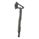 Kiba Arms Tactical战斧 | `kiba-arms-tactical-tomahawk` | 1.861 千克 | 劈砍伤害 25；穿刺伤害 35；命中半径 0.5 厘米 | — | — | 8,064 卢布（2 家最高） |
| 26 |  Freeman撬棍 | `freeman-crowbar` | 1.9 千克 | 劈砍伤害 25；穿刺伤害 34；命中半径 0.5 厘米 | — | — | 8,736 卢布（2 家最高） |
| 27 | 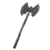 系链双刃斧 | `chained-labrys` | 19.08 千克 | 劈砍伤害 166；穿刺伤害 199；命中半径 0.9 厘米 | — | — | 21,600 卢布（2 家最高） |

> 本分类 **27 件**。价格取各商人中的最优价；「商人最低售价」栏附商人与等级要求，「最高回收」栏标注参与回收的商人数。

本分类 27 件的名称一览（点开可浏览；站内搜索靠它命中物品名）

“杀人鲸”推刃匕首　“鲨鱼”推刃匕首　6Kh5 刺刀　NKVD 芬卡工具刀　NKVD 芬卡工具刀　A-2607 95Kh18 匕首　A-2607 大马士革钢匕首　邪教徒之刃　KA-BAR 美国海军陆战队战斗刀　ER“支点”刺刀　United Cutlery M48战术尼泊尔军刀　Microtech Jagdkommando 战术直刀　SP-8生存砍刀　UVSR“针叶林-1”求生砍刀　野营斧　Red Rebel冰镐　PR-Taran警棍　MPL-50挖掘工具　SOG Voodoo Hawk战术斧　古董斧头　APOK ”荒原之地“ 战术短剑　Miller Bros. Blades M-2 战术剑　Miller Bros. Blades M-2 战术剑 (棕色)　冲击斧　Kiba Arms Tactical战斧　Freeman撬棍　系链双刃斧

---

## 📚 相关页面

- [物品图鉴总览](index.md) — 全站物品的分类入口与检索
- [任务需求物品反查](../quests/item-lookup.md) — 某物品被哪些任务要求、要不要留
- [配方速查表](../docs/recipes.md) — 制作与以物换物的完整配方
- [跳蚤定价与手续费](../entries/flea-pricing.md) — 市场侧的定价规则
- [商人系统](../entries/traders.md) — 商人等级与补货机制

📖 [返回物品图鉴总览](index.md)

⬆️ **[回到顶部](#top)**

**最后更新**: 2026 年 10 月 ｜ **贡献者** [GTX950L](https://github.com/GTX950L) ｜ **License**: CC BY-NC-SA 4.0
