---
tags:
  - 物品
  - 速查
---

# 武器配件·枪管与膛口 · 枪管–导气箍（Item Catalog）

> 版本基线：2026 年 10 月 ｜ 1.2.0.0（第一赛季 KORD BREACH）｜ 数据来源：tarkov.dev（二级）
> 本页为**生成页**，数值随版本调整，引用时请附「以游戏内为准」。

## 📸 本页概览

| 项目 | 说明 |
|------|------|
| **收录件数** | **250 件**（全站物品图鉴共 4,983 件） |
| **本页范围** | 第 **2** / 2 部分（[武器配件·枪管与膛口](mods-barrel.md) 整类共 558 件、7 个官方分类） |
| **叶子分类** | 4 个官方分类：[枪管](#枪管)、[脚架](#脚架)、[下挂式榴弹发射器](#下挂式榴弹发射器)、[导气箍](#导气箍) |
| **获取方式** | 站内收录的**固定**渠道：`商人出售` / `以物换物` / `制作`。本页 **223 / 250 件**有至少一条（商人出售 219 ｜ 以物换物 7 ｜ 制作 0）；`—` **不是「拿不到」**，只表示站内没收录它的固定渠道 —— 那类得靠搜刮或跳蚤市场，而这两样站内不给点位（判据见[战利品分布](../entries/loot.md)）|
| **数据来源** | `json.tarkov.dev` 的 `itemCategories` 树与 `items` 接口，二级来源 |
| **抓取日期** | 2026-10-08 |
| **配套页面** | [物品图鉴总览](index.md) ｜ [任务需求物品反查](../quests/item-lookup.md) ｜ [配方速查表](../docs/recipes.md) |

---

## 🔎 检索与筛选

本页的检索、筛选与详情面板需要 JavaScript —— **下方表格是静态生成的，不开 JS 也能读完**。

### 枪管

分类路径：物品 › 组合物品 › 武器配件 › 基础配件

| # | 名称 | 英文名 | 重量 | 关键属性 | 获取方式 | 商人最低售价 | 商人最高回收 |
|---|------|--------|------|----------|----------|--------------|--------------|
| 1 | 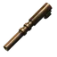 116毫米7.62x25 TT镀金枪管 | `tt-762x25-116mm-gilded-barrel` | 0.06 千克 | 人机工效 -4；精度修正 0%；后坐修正 3%；弹着点 0.35 厘米；散布曲线 2.25（共 7 项） | — | — | 4,505 卢布（7 家最高） |
| 2 | 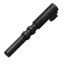 116毫米TT枪管 7.62x25 | `tt-762x25-116mm-barrel` | 0.06 千克 | 人机工效 -4；精度修正 0%；后坐修正 3%；弹着点 0.35 厘米；散布曲线 2.25（共 7 项） | — | — | 559 卢布（7 家最高） |
| 3 | 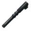 121毫米 7.62x25 自制TT螺纹口枪管 | `tt-762x25-121mm-makeshift-threaded-barrel` | 0.062 千克 | 人机工效 -5；精度修正 0%；后坐修正 3%；弹着点 0.27 厘米；散布曲线 2.25（共 7 项） | 商人出售 | 2,687 卢布，需 Mechanic 1 级 | 1,031 卢布（7 家最高） |
| 4 | 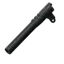 M1911A1 .45 ACP 标准枪管 | `m1911a1-45-acp-127mm-barrel` | 0.095 千克 | 人机工效 -1；精度修正 0%；后坐修正 2%；弹着点 0.35 厘米；散布曲线 2.25（共 7 项） | — | — | 816 卢布（7 家最高） |
| 5 | 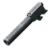 Glock 19X 9x19枪管 | `glock-19x-9x19-102mm-barrel` | 0.11 千克 | 人机工效 0；精度修正 0%；后坐修正 3%；弹着点 0.3 厘米；散布曲线 2.25（共 7 项） | — | — | 1,104 卢布（7 家最高） |
| 6 | 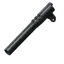 National M1911 .45 ACP 竞赛枪管 | `m1911a1-45-acp-national-match-127mm-barrel` | 0.11 千克 | 人机工效 -1；精度修正 0%；后坐修正 2%；弹着点 0.3 厘米；散布曲线 2.25（共 8 项） | — | — | 1,488 卢布（7 家最高） |
| 7 | 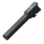 HK USP .45 ACP 112 毫米枪管 | `hk-usp-45-acp-112mm-barrel` | 0.113 千克 | 人机工效 0；精度修正 0%；后坐修正 1%；弹着点 0.28 厘米；散布曲线 2.25（共 7 项） | 商人出售 | 4,676 卢布，需 Peacekeeper 2 级 | 1,200 卢布（7 家最高） |
| 8 | 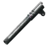 M1911A1 .45 ACP 螺纹枪管 | `m1911a1-45-acp-141mm-threaded-barrel` | 0.12 千克 | 人机工效 -2；精度修正 0%；后坐修正 2%；弹着点 0.29 厘米；散布曲线 2.25（共 7 项） | 商人出售 | 5,986 卢布，需 Peacekeeper 1 级 | 1,536 卢布（7 家最高） |
| 9 | 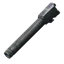 HK USP 战术型 .45 ACP 129 毫米螺纹枪管 | `hk-usp-tactical-45-acp-129mm-threaded-barrel` | 0.122 千克 | 人机工效 -1；精度修正 0%；后坐修正 2%；弹着点 0.27 厘米；散布曲线 2.25（共 7 项） | 商人出售 | 5,425 卢布，需 Peacekeeper 2 级 | 1,392 卢布（7 家最高） |
| 10 | 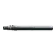 UZI 238毫米3-lug螺纹枪管 | `uzi-238mm-threaded-3-lug-barrel` | 0.128 千克 | 人机工效 -4；精度修正 0%；后坐修正 6%；弹着点 0.14 厘米；散布曲线 2（共 8 项） | 商人出售 | 8,068 卢布，需 Mechanic 2 级 | 3,097 卢布（7 家最高） |
| 11 | 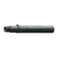 UZI PRO 9x19 Pike Arms 114毫米螺纹枪管 | `uzi-pro-9x19-pike-arms-114mm-threaded-barrel` | 0.128 千克 | 人机工效 -1；精度修正 0%；后坐修正 3%；弹着点 0.22 厘米；散布曲线 2.25（共 8 项） | 商人出售 | 9,467 卢布，需 Mechanic 2 级 | 3,635 卢布（7 家最高） |
| 12 | 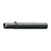 UZI PRO 9x19 114毫米枪管 | `uzi-pro-9x19-114mm-barrel` | 0.131 千克 | 人机工效 -1；精度修正 0%；后坐修正 3%；弹着点 0.23 厘米；散布曲线 2.25（共 8 项） | 商人出售 | 8,092 卢布，需 Peacekeeper 2 级 | 2,076 卢布（7 家最高） |
| 13 | 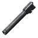 HK USP 专家型 .45 ACP 132 毫米枪管 | `hk-usp-expert-45-acp-132mm-barrel` | 0.141 千克 | 人机工效 -1；精度修正 0%；后坐修正 2%；弹着点 0.26 厘米；散布曲线 2.25（共 7 项） | 商人出售 | 4,500 卢布，需 Mechanic 2 级 | 1,728 卢布（7 家最高） |
| 14 | 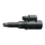 4.5 英寸 MPX 枪管 9x19 | `mpx-9x19-45-inch-barrel` | 0.16 千克 | 人机工效 -2；精度修正 0%；后坐修正 3%；弹着点 0.25 厘米；散布曲线 2.25（共 8 项） | 商人出售 | 5,332 卢布，需 Peacekeeper 1 级 | 1,824 卢布（7 家最高） |
| 15 |  5 英寸 KRISS Vector 枪管 9x19 | `kriss-vector-9x19-5-inch-barrel` | 0.16 千克 | 人机工效 0；精度修正 0%；后坐修正 1%；弹着点 0.19 厘米；散布曲线 2.25（共 8 项） | 商人出售 | 11,808 卢布，需 Skier 3 级 | 3,936 卢布（7 家最高） |
| 16 | 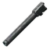 HK USP 精英型 .45 ACP 153 毫米枪管 | `hk-usp-elite-45-acp-153mm-barrel` | 0.163 千克 | 人机工效 -2；精度修正 1%；后坐修正 2%；弹着点 0.21 厘米；散布曲线 2.25（共 8 项） | 商人出售 | 5,625 卢布，需 Mechanic 2 级 | 2,160 卢布（7 家最高） |
| 17 |  5 英寸 KRISS Vector 枪管 .45 ACP | `kriss-vector-45-acp-5-inch-barrel` | 0.17 千克 | 人机工效 -1；精度修正 0%；后坐修正 2%；弹着点 0.2 厘米；散布曲线 2.25（共 8 项） | 商人出售 | 12,816 卢布，需 Skier 3 级 | 4,272 卢布（7 家最高） |
| 18 | 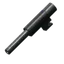 Five-seveN 5.7x28枪管 | `fn-five-seven-57x28-120mm-barrel` | 0.17 千克 | 人机工效 0；精度修正 0%；后坐修正 2%；弹着点 0.24 厘米；散布曲线 2.25（共 7 项） | 商人出售 | 7,446 卢布，需 Peacekeeper 2 级 | 1,910 卢布（7 家最高） |
| 19 | 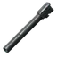 HK USP 赛事型 .45 ACP 153 毫米枪管 | `hk-usp-match-45-acp-153mm-barrel` | 0.17 千克 | 人机工效 -2；精度修正 2%；后坐修正 2%；弹着点 0.23 厘米；散布曲线 2.25（共 8 项） | 商人出售 | 7,500 卢布，需 Mechanic 2 级 | 2,880 卢布（7 家最高） |
| 20 | 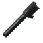 112毫米P226枪管 9x19 | `p226-9x19-112mm-barrel` | 0.18 千克 | 人机工效 -2；精度修正 0%；后坐修正 3%；弹着点 0.3 厘米；散布曲线 2.25（共 7 项） | 商人出售 | 1,954 卢布，需 Mechanic 1 级 | 750 卢布（7 家最高） |
| 21 | 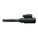 4.75 英寸 Ronin Arms MPX 开口式消音枪管 9x19 | `mpx-9x19-ronin-arms-475-inch-ported-sd-barrel` | 0.18 千克 | 人机工效 -2；精度修正 0%；后坐修正 3%；弹着点 0.24 厘米；散布曲线 2.25（共 8 项） | 商人出售 | 8,083 卢布，需 Peacekeeper 2 级 | 2,074 卢布（7 家最高） |
| 22 | 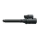 6.5英寸 MPX-SD 分体式枪管 9x19 | `mpx-sd-9x19-65-inch-ported-barrel` | 0.18 千克 | 人机工效 -3；精度修正 0%；后坐修正 4%；弹着点 0.18 厘米；散布曲线 3.1（共 8 项） | 商人出售 | 7,561 卢布，需 Mechanic 2 级 | 2,697 卢布（7 家最高） |
| 23 | 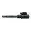 6.75 英寸 Ronin Arms MPX 开口式消音枪管 9x19 | `mpx-9x19-ronin-arms-675-inch-ported-sd-barrel` | 0.18 千克 | 人机工效 -3；精度修正 0%；后坐修正 4%；弹着点 0.19 厘米；散布曲线 2.29（共 8 项） | 商人出售 | 9,386 卢布，需 Peacekeeper 2 级 | 2,408 卢布（7 家最高） |
| 24 | 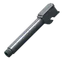 Double Diamond Glock 9x19螺纹枪管 | `glock-9x19-double-diamond-114mm-threaded-barrel` | 0.18 千克 | 人机工效 -1；精度修正 0%；后坐修正 3%；弹着点 0.33 厘米；散布曲线 2.25（共 8 项） | 商人出售 | 10,702 卢布，需 Mechanic 2 级 | 2,863 卢布（7 家最高） |
| 25 | 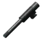 Five-seveN 5.7x28螺纹枪管 | `fn-five-seven-57x28-120mm-threaded-barrel` | 0.18 千克 | 人机工效 0；精度修正 0%；后坐修正 2%；弹着点 0.24 厘米；散布曲线 2.25（共 7 项） | 商人出售 | 7,857 卢布，需 Peacekeeper 3 级 | 2,016 卢布（7 家最高） |
| 26 | 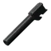 Glock 17标准枪管 9x19 | `glock-17-9x19-114mm-barrel` | 0.18 千克 | 人机工效 -2；精度修正 0%；后坐修正 3%；弹着点 0.34 厘米；散布曲线 2.25（共 7 项） | 商人出售 | 2,805 卢布，需 Mechanic 1 级 | 750 卢布（7 家最高） |
| 27 | 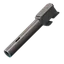 Glock 17补偿器枪管 9x19 | `glock-17-9x19-114mm-compensated-barrel` | 0.18 千克 | 人机工效 -2；精度修正 0%；后坐修正 3%；弹着点 0.35 厘米；散布曲线 2.25（共 8 项） | 商人出售 | 3,387 卢布，需 Mechanic 1 级 | 906 卢布（7 家最高） |
| 28 | 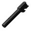 Glock 18C补偿器枪管 9x19 | `glock-18c-9x19-114mm-compensated-barrel` | 0.18 千克 | 人机工效 -2；精度修正 0%；后坐修正 3%；弹着点 0.35 厘米；散布曲线 2.25（共 8 项） | — | — | 1,528 卢布（7 家最高） |
| 29 | 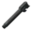 Glock 9x19 Lone Wolf AlphaWolf螺纹枪管 | `glock-9x19-lone-wolf-alphawolf-114mm-threaded-barrel` | 0.18 千克 | 人机工效 -1；精度修正 0%；后坐修正 3%；弹着点 0.3 厘米；散布曲线 2.25（共 8 项） | 商人出售 | 14,260 卢布，需 Mechanic 1 级 | 3,815 卢布（7 家最高） |
| 30 | 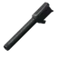 P226带螺纹枪管 9x19 | `p226-9x19-112mm-threaded-barrel` | 0.18 千克 | 人机工效 -2；精度修正 0%；后坐修正 3%；弹着点 0.3 厘米；散布曲线 2.25（共 7 项） | 商人出售 | 2,922 卢布，需 Peacekeeper 1 级 | 749 卢布（7 家最高） |
| 31 | 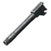 PL-15 9x19 112 毫米螺纹枪管 | `pl-15-9x19-112mm-threaded-barrel` | 0.18 千克 | 人机工效 -2；精度修正 0%；后坐修正 3%；弹着点 0.32 厘米；散布曲线 2.25（共 7 项） | 商人出售 | 6,730 卢布，需 Prapor 1 级 | 2,375 卢布（7 家最高） |
| 32 | 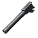 PL-15 9x19 112毫米枪管 | `pl-15-9x19-112mm-barrel` | 0.18 千克 | 人机工效 -2；精度修正 0%；后坐修正 3%；弹着点 0.32 厘米；散布曲线 2.25（共 7 项） | 商人出售 | 3,486 卢布，需 Prapor 1 级 | 1,230 卢布（7 家最高） |
| 33 | 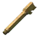 Salient Arms Glock 9x19螺纹枪管 | `glock-9x19-sai-114mm-threaded-barrel` | 0.18 千克 | 人机工效 0；精度修正 0%；后坐修正 3%；弹着点 0.27 厘米；散布曲线 2.25（共 8 项） | 商人出售 | 20,373 卢布，需 Mechanic 2 级 | 5,450 卢布（7 家最高） |
| 34 | 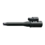 6.5 英寸 MPX 枪管 9x19 | `mpx-9x19-65-inch-barrel` | 0.19 千克 | 人机工效 -3；精度修正 0%；后坐修正 4%；弹着点 0.2 厘米；散布曲线 2.25（共 8 项） | 商人出售 | 7,259 卢布，需 Peacekeeper 1 级 | 2,483 卢布（7 家最高） |
| 35 |  UZI PRO 9x19 170毫米枪管 | `uzi-pro-9x19-170mm-barrel` | 0.19 千克 | 人机工效 -3；精度修正 0%；后坐修正 4%；弹着点 0.18 厘米；散布曲线 2.25（共 8 项） | 商人出售 | 10,613 卢布，需 Peacekeeper 2 级 | 2,723 卢布（7 家最高） |
| 36 | 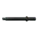 6 英寸 KRISS Vector 枪管 9x19 | `kriss-vector-9x19-6-inch-barrel` | 0.2 千克 | 人机工效 -2；精度修正 0%；后坐修正 2%；弹着点 0.18 厘米；散布曲线 3.1（共 7 项） | 商人出售 / 以物换物 | 13,968 卢布，需 Skier 3 级 | 4,656 卢布（7 家最高） |
| 37 | 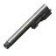 M9A3 9x19 127 毫米螺纹枪管 | `m9a3-9x19-127mm-threaded-barrel` | 0.2 千克 | 人机工效 -4；精度修正 0%；后坐修正 3%；弹着点 0.29 厘米；散布曲线 2.25（共 7 项） | — | — | 796 卢布（7 家最高） |
| 38 | 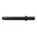 6 英寸 KRISS Vector 枪管 .45 ACP | `kriss-vector-45-acp-6-inch-barrel` | 0.21 千克 | 人机工效 -2；精度修正 0%；后坐修正 2%；弹着点 0.19 厘米；散布曲线 2.25（共 7 项） | 商人出售 | 15,408 卢布，需 Skier 3 级 | 5,136 卢布（7 家最高） |
| 39 |  UZI PRO 9x19 210毫米枪管 | `uzi-pro-9x19-210mm-barrel` | 0.241 千克 | 人机工效 -3；精度修正 0%；后坐修正 5%；弹着点 0.15 厘米；散布曲线 2.5（共 7 项） | 商人出售 | 12,296 卢布，需 Peacekeeper 2 级 | 3,155 卢布（7 家最高） |
| 40 | 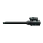 8 英寸 MPX 枪管 9x19 | `mpx-9x19-8-inch-barrel` | 0.25 千克 | 人机工效 -6；精度修正 0%；后坐修正 5%；弹着点 0.15 厘米；散布曲线 2.5（共 7 项） | 商人出售 | 12,298 卢布，需 Peacekeeper 1 级 | 3,155 卢布（7 家最高） |
| 41 | 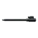 10.5 英寸 MPX 枪管 9x19 | `mpx-9x19-105-inch-barrel` | 0.28 千克 | 人机工效 -9；精度修正 0%；后坐修正 7%；弹着点 0.12 厘米；散布曲线 2（共 8 项） | 商人出售 | 11,468 卢布，需 Peacekeeper 1 级 | 3,923 卢布（7 家最高） |
| 42 |  UZI 9x19 259毫米枪管 | `uzi-9x19-259mm-barrel` | 0.288 千克 | 人机工效 -4；精度修正 0%；后坐修正 6%；弹着点 0.13 厘米；散布曲线 2（共 7 项） | 商人出售 | 9,640 卢布，需 Peacekeeper 1 级 | 2,473 卢布（7 家最高） |
| 43 |  UZI 9x19 409毫米枪管 | `uzi-9x19-409mm-barrel` | 0.288 千克 | 人机工效 -10；精度修正 0%；后坐修正 10%；弹着点 0.05 厘米；散布曲线 1.75（共 8 项） | 商人出售 | 8,170 卢布，需 Mechanic 1 级 | 3,137 卢布（7 家最高） |
| 44 |  UZI PRO 9x19 240毫米枪管 | `uzi-pro-9x19-240mm-barrel` | 0.288 千克 | 人机工效 -4；精度修正 0%；后坐修正 6%；弹着点 0.14 厘米；散布曲线 2（共 8 项） | 商人出售 | 12,856 卢布，需 Peacekeeper 2 级 | 3,298 卢布（7 家最高） |
| 45 | 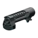 沙漠之鹰L5 .357 127毫米枪管 | `desert-eagle-l5-357-127mm-barrel` | 0.336 千克 | 人机工效 -2；精度修正 0%；后坐修正 2%；弹着点 0.26 厘米；散布曲线 2.25（共 7 项） | 商人出售 | 2,564 卢布，需 Jaeger 2 级 | 939 卢布（7 家最高） |
| 46 | 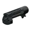 沙漠之鹰L5 .50 AE 127毫米枪管 | `desert-eagle-l5-50-ae-127mm-barrel` | 0.336 千克 | 人机工效 -2；精度修正 0%；后坐修正 1%；弹着点 0.24 厘米；散布曲线 2.25（共 7 项） | 商人出售 | 2,533 卢布，需 Jaeger 3 级 | 927 卢布（7 家最高） |
| 47 |  14 英寸 MPX 枪管 9x19 | `mpx-9x19-14-inch-barrel` | 0.35 千克 | 人机工效 -14；精度修正 0%；后坐修正 9%；弹着点 0.04 厘米；散布曲线 1.75（共 8 项） | 商人出售 | 17,370 卢布，需 Peacekeeper 2 级 | 5,942 卢布（7 家最高） |
| 48 |  11.5 英寸 MDR 枪管 5.56x45 | `mdr-556x45-115-inch-barrel` | 0.386 千克 | 人机工效 -3；精度修正 0%；后坐修正 6%；弹着点 0.06 厘米；散布曲线 1.35（共 8 项） | 商人出售 | 24,750 卢布，需 Mechanic 3 级 | 9,504 卢布（7 家最高） |
| 49 | 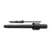 HK G36 5.56x45 228毫米枪管 | `hk-g36-556x45-228mm-barrel` | 0.39 千克 | 人机工效 -1；精度修正 0%；后坐修正 5%；弹着点 0.08 厘米；散布曲线 1.4（共 8 项） | 商人出售 | 26,192 卢布，需 Peacekeeper 2 级 | 6,720 卢布（7 家最高） |
| 50 |  10.3 英寸 AR-15 枪管 5.56x45 | `ar-15-556x45-103-inch-barrel` | 0.409 千克 | 人机工效 -2；精度修正 0%；后坐修正 5%；弹着点 0.07 厘米；散布曲线 1.4（共 8 项） | 商人出售 / 以物换物 | 35,765 卢布，需 Peacekeeper 3 级 | 9,176 卢布（7 家最高） |
| 51 |  10.5 英寸 STM-9 枪管 9x19 | `stm-9-9x19-105-inch-barrel` | 0.409 千克 | 人机工效 -2；精度修正 0%；后坐修正 7%；弹着点 0.11 厘米；散布曲线 2.1（共 8 项） | 商人出售 | 10,080 卢布，需 Skier 3 级 | 3,360 卢布（7 家最高） |
| 52 | 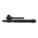 11 英寸 SA-58 枪管 7.62x51 | `sa58-762x51-11-inch-barrel` | 0.409 千克 | 人机工效 -5；精度修正 0%；后坐修正 8%；弹着点 0.08 厘米；散布曲线 1.6（共 8 项） | 商人出售 | 26,672 卢布，需 Mechanic 3 级 | 10,241 卢布（7 家最高） |
| 53 | 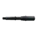 6.75 英寸 MCX 枪管 .300 BLK | `mcx-300-blk-675-inch-barrel` | 0.409 千克 | 人机工效 0；精度修正 0%；后坐修正 3%；弹着点 0.1 厘米；散布曲线 1.7（共 8 项） | 商人出售 | 23,210 卢布，需 Skier 3 级 | 7,736 卢布（7 家最高） |
| 54 | 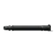 8 英寸 HK UMP 枪管 .45 ACP | `hk-ump-45-acp-8-inch-barrel` | 0.409 千克 | 人机工效 -4；精度修正 0%；后坐修正 2%；弹着点 0.16 厘米；散布曲线 2.75（共 7 项） | — | — | 3,312 卢布（7 家最高） |
| 55 | 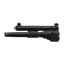 9A-91 9x39枪管 | `9a-91-9x39-barrel` | 0.409 千克 | 人机工效 0；精度修正 0%；后坐修正 3%；弹着点 0.13 厘米；散布曲线 1.9（共 7 项） | 商人出售 | 10,608 卢布，需 Prapor 1 级 | 3,744 卢布（7 家最高） |
| 56 | 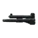 VSK-94 9x39枪管 | `vsk-94-9x39-barrel` | 0.409 千克 | 人机工效 0；精度修正 0%；后坐修正 3%；弹着点 0.13 厘米；散布曲线 1.9（共 7 项） | 商人出售 | 10,744 卢布，需 Prapor 2 级 | 3,792 卢布（7 家最高） |
| 57 |  8 英寸HK UMP 螺纹枪管 .45 ACP | `hk-ump-45-acp-8-inch-threaded-barrel` | 0.415 千克 | 人机工效 -5；精度修正 0%；后坐修正 2%；弹着点 0.16 厘米；散布曲线 2.5（共 7 项） | 商人出售 | 14,218 卢布，需 Peacekeeper 2 级 | 3,648 卢布（7 家最高） |
| 58 | 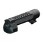 沙漠之鹰L6 .50 AE 152毫米枪管 | `desert-eagle-l6-50-ae-152mm-barrel` | 0.436 千克 | 人机工效 -3；精度修正 0%；后坐修正 4%；弹着点 0.2 厘米；散布曲线 2.25（共 7 项） | 商人出售 | 3,029 卢布，需 Mechanic 3 级 | 1,163 卢布（7 家最高） |
| 59 | 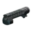 沙漠之鹰L6 .50 AE 152毫米枪管（白色虎纹） | `desert-eagle-l6-50-ae-152mm-barrel-wts` | 0.436 千克 | 人机工效 -3；精度修正 0%；后坐修正 4%；弹着点 0.2 厘米；散布曲线 2.25（共 8 项） | — | — | 1,656 卢布（7 家最高） |
| 60 | 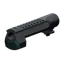 沙漠之鹰Mk XIX .50 AE 152毫米枪管 | `desert-eagle-mk-xix-50-ae-152mm-barrel` | 0.436 千克 | 人机工效 -4；精度修正 2%；后坐修正 3%；弹着点 0.19 厘米；散布曲线 2.25（共 8 项） | — | — | 1,308 卢布（7 家最高） |
| 61 | 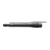 254毫米Mk47枪管 | `mk47-254mm-barrel` | 0.47 千克 | 人机工效 -5；精度修正 0%；后坐修正 5%；弹着点 0.08 厘米；散布曲线 1.5（共 8 项） | 商人出售 | 32,875 卢布，需 Mechanic 3 级 | 12,624 卢布（7 家最高） |
| 62 | 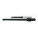 HK G36 5.56x45 318毫米枪管 | `hk-g36-556x45-318mm-barrel` | 0.47 千克 | 人机工效 -12；精度修正 0%；后坐修正 6%；弹着点 0.06 厘米；散布曲线 1.4（共 8 项） | 商人出售 | 30,868 卢布，需 Peacekeeper 4 级 | 7,920 卢布（7 家最高） |
| 63 |  13 英寸 MCX-SPEAR 枪管 6.8x51 | `mcx-spear-68x51-13-inch-barrel` | 0.479 千克 | 人机工效 -13；精度修正 0%；后坐修正 6%；弹着点 0.04 厘米；散布曲线 1.35（共 7 项） | 商人出售 | 45,409 卢布，需 Peacekeeper 4 级 | 11,650 卢布（7 家最高） |
| 64 |  9 英寸 MCX 枪管 .300 BLK | `mcx-300-blk-9-inch-barrel` | 0.479 千克 | 人机工效 -4；精度修正 0%；后坐修正 4%；弹着点 0.08 厘米；散布曲线 1.6（共 7 项） | 商人出售 | 27,962 卢布，需 Skier 3 级 | 9,320 卢布（7 家最高） |
| 65 |  10.5 英寸 P90 枪管 5.7x28 | `fn-p90-57x28-105-inch-barrel` | 0.5 千克 | 人机工效 -2；精度修正 0%；后坐修正 5%；弹着点 0.12 厘米；散布曲线 2.1（共 7 项） | 商人出售 | 10,625 卢布，需 Mechanic 4 级 | 4,080 卢布（7 家最高） |
| 66 |  12 英寸 STM-9 枪管 9x19 | `stm-9-9x19-12-inch-barrel` | 0.5 千克 | 人机工效 -3；精度修正 0%；后坐修正 8%；弹着点 0.07 厘米；散布曲线 1.75（共 8 项） | 商人出售 | 10,800 卢布，需 Skier 3 级 | 3,600 卢布（7 家最高） |
| 67 |  13.7 英寸 Hanson Carbine AR-15 枪管 5.56x45 | `ar-15-556x45-ballistic-advantage-hanson-carbine-pro-137-inch-barrel` | 0.509 千克 | 人机工效 -8；精度修正 5%；后坐修正 7%；弹着点 0.04 厘米；散布曲线 1.35（共 8 项） | 商人出售 | 35,377 卢布，需 Skier 3 级 | 11,792 卢布（7 家最高） |
| 68 |  14.5 英寸 AR-15 枪管 5.56x45 | `ar-15-556x45-145-inch-barrel` | 0.509 千克 | 人机工效 -12；精度修正 0%；后坐修正 7%；弹着点 0.05 厘米；散布曲线 1.35（共 8 项） | 商人出售 | 45,960 卢布，需 Peacekeeper 3 级 | 11,792 卢布（7 家最高） |
| 69 |  16 英寸 MDR 枪管 5.56x45 | `mdr-556x45-16-inch-barrel` | 0.509 千克 | 人机工效 -12；精度修正 0%；后坐修正 8%；弹着点 0.04 厘米；散布曲线 1.35（共 7 项） | 商人出售 | 46,584 卢布，需 Mechanic 3 级 | 17,888 卢布（7 家最高） |
| 70 |  7.62x25 PPSh-41 269 毫米枪管 | `ppsh-41-762x25-269mm-barrel` | 0.51 千克 | 人机工效 -5；精度修正 0%；后坐修正 3%；弹着点 0.21 厘米；散布曲线 3.5（共 7 项） | — | — | 3,936 卢布（7 家最高） |
| 71 |  11.5 英寸HK UMP 螺纹枪管 .45 ACP | `hk-ump-45-acp-115-inch-threaded-barrel` | 0.52 千克 | 人机工效 -8；精度修正 0%；后坐修正 3%；弹着点 0.08 厘米；散布曲线 1.8（共 7 项） | 商人出售 | 19,268 卢布，需 Peacekeeper 2 级 | 4,943 卢布（7 家最高） |
| 72 |  16 英寸 MCX 枪管 .300 BLK | `mcx-300-blk-16-inch-barrel` | 0.526 千克 | 人机工效 -13；精度修正 0%；后坐修正 7%；弹着点 0.06 厘米；散布曲线 1.48（共 8 项） | 商人出售 | 36,314 卢布，需 Skier 3 级 | 12,104 卢布（7 家最高） |
| 73 |  16 英寸 Steyr AUG A3 枪管 5.56x45 | `steyr-aug-a3-556x45-16-inch-barrel` | 0.53 千克 | 人机工效 -14；精度修正 0%；后坐修正 8%；弹着点 0.05 厘米；散布曲线 1.35（共 8 项） | 商人出售 | 61,736 卢布，需 Peacekeeper 3 级 | 15,840 卢布（7 家最高） |
| 74 |  16 英寸 Steyr AUG A1 枪管 5.56x45 | `steyr-aug-a1-556x45-16-inch-barrel` | 0.535 千克 | 人机工效 -14；精度修正 0%；后坐修正 8%；弹着点 0.05 厘米；散布曲线 1.35（共 8 项） | 商人出售 | 53,318 卢布，需 Peacekeeper 1 级 | 13,680 卢布（7 家最高） |
| 75 |  15 英寸 RPK-16 枪管 5.45x39 | `rpk-16-545x39-15-inch-barrel` | 0.54 千克 | 人机工效 -16；精度修正 0%；后坐修正 7%；弹着点 0.05 厘米；散布曲线 1.35（共 7 项） | 商人出售 | 16,592 卢布，需 Prapor 4 级 | 5,856 卢布（7 家最高） |
| 76 |  QBZ-191 5.8x42 266毫米枪管 | `qbz-191-58x42-266mm-barrel` | 0.55 千克 | 人机工效 -3.5；精度修正 0%；后坐修正 5%；弹着点 0.07 厘米；散布曲线 1.4（共 8 项） | 商人出售 | 24,120 卢布，需 Skier 3 级 | 8,040 卢布（7 家最高） |
| 77 |  10.6 英寸 HK416 枪管 5.56x45 | `hk-416-556x45-106-inch-barrel` | 0.572 千克 | 人机工效 -3；精度修正 0%；后坐修正 5%；弹着点 0.07 厘米；散布曲线 1.5（共 8 项） | 商人出售 | 26,413 卢布，需 Mechanic 4 级 | 10,142 卢布（7 家最高） |
| 78 |  11.5 英寸 AR-15 枪管 5.56x45 | `ar-15-556x45-115-inch-barrel` | 0.581 千克 | 人机工效 -4；精度修正 0%；后坐修正 6%；弹着点 0.06 厘米；散布曲线 1.38（共 8 项） | 商人出售 | 39,754 卢布，需 Peacekeeper 2 级 | 10,200 卢布（7 家最高） |
| 79 |  16 英寸 Molot Arms AR-15 枪管 5.56x45 | `ar-15-556x45-molot-arms-16-inch-barrel` | 0.594 千克 | 人机工效 -16；精度修正 0%；后坐修正 8%；弹着点 0.06 厘米；散布曲线 1.35（共 8 项） | 商人出售 | 23,328 卢布，需 Skier 1 级 | 7,776 卢布（7 家最高） |
| 80 |  14 英寸 STM-9 枪管 9x19 | `stm-9-9x19-14-inch-barrel` | 0.6 千克 | 人机工效 -7；精度修正 0%；后坐修正 9%；弹着点 0.06 厘米；散布曲线 1.75（共 7 项） | 商人出售 | 14,400 卢布，需 Skier 3 级 | 4,800 卢布（7 家最高） |
| 81 |  16 英寸 SA-58 枪管 7.62x51 | `sa58-762x51-16-inch-barrel` | 0.609 千克 | 人机工效 -18；精度修正 0%；后坐修正 12%；弹着点 0.05 厘米；散布曲线 1.35（共 7 项） | 商人出售 | 29,247 卢布，需 Mechanic 3 级 | 11,230 卢布（7 家最高） |
| 82 |  11 英寸 HK416 枪管 5.56x45 | `hk-416-556x45-11-inch-barrel` | 0.615 千克 | 人机工效 -4；精度修正 0%；后坐修正 6%；弹着点 0.07 厘米；散布曲线 1.4（共 8 项） | 商人出售 / 以物换物 | 30,163 卢布，需 Mechanic 3 级 | 11,582 卢布（7 家最高） |
| 83 |  16 英寸 MDR 枪管 7.62x51 | `mdr-762x51-16-inch-barrel` | 0.62 千克 | 人机工效 -20；精度修正 0%；后坐修正 10%；弹着点 0.04 厘米；散布曲线 1.35（共 7 项） | — | — | 23,648 卢布（7 家最高） |
| 84 |  22 英寸 RPK-16 枪管 5.45x39 | `rpk-16-545x39-22-inch-barrel` | 0.65 千克 | 人机工效 -22；精度修正 0%；后坐修正 11%；弹着点 0.03 厘米；散布曲线 1.35（共 8 项） | 商人出售 | 23,528 卢布，需 Prapor 4 级 | 8,304 卢布（7 家最高） |
| 85 |  QBZ-191 5.8x42 368毫米枪管 | `qbz-191-58x42-368mm-barrel` | 0.66 千克 | 人机工效 -12.5；精度修正 0%；后坐修正 7%；弹着点 0.06 厘米；散布曲线 1.35（共 8 项） | 商人出售 | 56,153 卢布，需 Skier 4 级 | 18,717 卢布（7 家最高） |
| 86 |  20 英寸 MDR 枪管 5.56x45 | `mdr-556x45-20-inch-barrel` | 0.675 千克 | 人机工效 -23；精度修正 0%；后坐修正 10%；弹着点 0.03 厘米；散布曲线 1.35（共 8 项） | 商人出售 | 46,125 卢布，需 Mechanic 3 级 | 17,712 卢布（7 家最高） |
| 87 |  16.5 英寸HK UMP 螺纹枪管 .45 ACP | `hk-ump-45-acp-165-inch-threaded-barrel` | 0.68 千克 | 人机工效 -13；精度修正 5%；后坐修正 5%；弹着点 0.05 厘米；散布曲线 1.4（共 7 项） | 商人出售 | 29,558 卢布，需 Peacekeeper 3 级 | 7,584 卢布（7 家最高） |
| 88 |  HK G36 5.56x45 480毫米枪管 | `hk-g36-556x45-480mm-barrel` | 0.69 千克 | 人机工效 -26；精度修正 0%；后坐修正 10%；弹着点 0.05 厘米；散布曲线 1.4（共 8 项） | 商人出售 | 34,797 卢布，需 Peacekeeper 3 级 | 8,928 卢布（7 家最高） |
| 89 |  莫辛纳甘 200 毫米锯短枪管 7.62x54R | `mosin-rifle-762x54r-sawed-off-200mm-barrel` | 0.7 千克 | 人机工效 0；精度修正 0%；后坐修正 5%；弹着点 0.18 厘米；散布曲线 1.35（共 8 项） | 商人出售 | 2,751 卢布，需 Jaeger 2 级 | 1,008 卢布（7 家最高） |
| 90 |  20 英寸 MDR 枪管 7.62x51 | `mdr-762x51-20-inch-barrel` | 0.763 千克 | 人机工效 -34；精度修正 0%；后坐修正 13%；弹着点 0.03 厘米；散布曲线 1.35（共 8 项） | 商人出售 | 51,875 卢布，需 Mechanic 4 级 | 19,920 卢布（7 家最高） |
| 91 |  11.5 英寸 NL545 (GP) 枪管 5.45x39 | `nl545-gp-545x39-115-inch-barrel` | 0.78 千克 | 人机工效 -6；精度修正 0%；后坐修正 2%；弹着点 0.06 厘米；散布曲线 1.37（共 8 项） | 商人出售 | 32,256 卢布，需 Skier 4 级 | 10,752 卢布（7 家最高） |
| 92 |  16 英寸 Hanson Carbine AR-15 枪管 5.56x45 | `ar-15-556x45-ballistic-advantage-hanson-carbine-pro-16-inch-barrel` | 0.78 千克 | 人机工效 -14；精度修正 7%；后坐修正 8%；弹着点 0.03 厘米；散布曲线 1.35（共 7 项） | 商人出售 | 45,457 卢布，需 Skier 4 级 | 15,152 卢布（7 家最高） |
| 93 |  16.3 英寸 NL545 (DI) 枪管 5.45x39 | `nl545-di-545x39-163-inch-barrel` | 0.78 千克 | 人机工效 -16.5；精度修正 0%；后坐修正 5%；弹着点 0.04 厘米；散布曲线 1.34（共 8 项） | 商人出售 | 45,792 卢布，需 Skier 3 级 | 15,264 卢布（7 家最高） |
| 94 |  16.5 英寸 NL545 (GP) 枪管 5.45x39 | `nl545-gp-545x39-165-inch-barrel` | 0.78 千克 | 人机工效 -19；精度修正 0%；后坐修正 6%；弹着点 0.04 厘米；散布曲线 1.34（共 8 项） | 商人出售 | 48,816 卢布，需 Skier 4 级 | 16,272 卢布（7 家最高） |
| 95 |  18 英寸 AR-15 枪管 5.56x45 | `ar-15-556x45-18-inch-barrel` | 0.78 千克 | 人机工效 -26；精度修正 0%；后坐修正 9%；弹着点 0.04 厘米；散布曲线 1.35（共 7 项） | 商人出售 | 59,055 卢布，需 Peacekeeper 2 级 | 15,152 卢布（7 家最高） |
| 96 |  21 英寸 SA-58 枪管 7.62x51 | `sa58-762x51-21-inch-barrel` | 0.784 千克 | 人机工效 -33；精度修正 0%；后坐修正 16%；弹着点 0.03 厘米；散布曲线 1.35（共 8 项） | 商人出售 | 41,325 卢布，需 Mechanic 4 级 | 15,868 卢布（7 家最高） |
| 97 |  16 英寸 P90 枪管 5.7x28 | `fn-p90-57x28-16-inch-barrel` | 0.8 千克 | 人机工效 -16.5；精度修正 0%；后坐修正 17%；弹着点 0.04 厘米；散布曲线 1.75（共 8 项） | 商人出售 | 14,112 卢布，需 Skier 3 级 | 4,704 卢布（7 家最高） |
| 98 |  16 英寸 STM-9 枪管 9x19 | `stm-9-9x19-16-inch-barrel` | 0.8 千克 | 人机工效 -10；精度修正 0%；后坐修正 10%；弹着点 0.04 厘米；散布曲线 1.75（共 8 项） | 商人出售 | 18,000 卢布，需 Skier 4 级 | 6,000 卢布（7 家最高） |
| 99 |  AA-12 12 铅径 330 毫米枪管 | `aa-12-12ga-330mm-barrel` | 0.8 千克 | 人机工效 0；精度修正 0%；后坐修正 2%；弹着点 0.65 厘米；散布曲线 3（共 7 项） | 商人出售 | 13,662 卢布，需 Skier 4 级 | 4,553 卢布（7 家最高） |
| 100 |  Benelli M3 Super 90 12铅径 500毫米枪管 | `benelli-m3-super-90-12ga-500mm-barrel` | 0.8 千克 | 人机工效 -8；精度修正 0%；后坐修正 7%；弹着点 0.53 厘米；散布曲线 2.5（共 8 项） | 商人出售 | 17,685 卢布，需 Jaeger 3 级 | 6,480 卢布（7 家最高） |
| 101 |  MP-133 12 铅径 510 毫米枪管 | `mp-133-12ga-510mm-barrel` | 0.8 千克 | 人机工效 -5；精度修正 0%；后坐修正 3%；弹着点 0.62 厘米；散布曲线 3（共 8 项） | 商人出售 | 5,248 卢布，需 Jaeger 3 级 | 1,922 卢布（7 家最高） |
| 102 |  MP-133 12 铅径 540 毫米枪管 | `mp-133-12ga-540mm-barrel` | 0.8 千克 | 人机工效 -6；精度修正 0%；后坐修正 4%；弹着点 0.6 厘米；散布曲线 3（共 8 项） | 商人出售 | 5,109 卢布，需 Jaeger 2 级 | 1,872 卢布（7 家最高） |
| 103 |  MP-155 12 铅径 510 毫米枪管 | `mp-155-12ga-510mm-barrel` | 0.8 千克 | 人机工效 -5；精度修正 0%；后坐修正 3%；弹着点 0.62 厘米；散布曲线 3（共 8 项） | 商人出售 | 9,178 卢布，需 Jaeger 2 级 | 3,362 卢布（7 家最高） |
| 104 |  MP-155 12 铅径 660 毫米枪管 | `mp-155-12ga-660mm-barrel` | 0.8 千克 | 人机工效 -10；精度修正 0%；后坐修正 7%；弹着点 0.52 厘米；散布曲线 2.7（共 8 项） | 商人出售 | 10,334 卢布，需 Jaeger 1 级 | 3,786 卢布（7 家最高） |
| 105 |  MP-155 12 铅径 750 毫米枪管 | `mp-155-12ga-750mm-barrel` | 0.8 千克 | 人机工效 -12；精度修正 0%；后坐修正 9%；弹着点 0.44 厘米；散布曲线 2.6（共 8 项） | 商人出售 | 11,037 卢布，需 Jaeger 1 级 | 4,044 卢布（7 家最高） |
| 106 |  MP-43 12铅径 310毫米截短枪管 | `mp-43-12ga-sawed-off-310mm-barrel` | 0.8 千克 | 人机工效 3；精度修正 0%；后坐修正 0%；弹着点 0.68 厘米；散布曲线 3（共 8 项） | — | — | 878 卢布（7 家最高） |
| 107 |  20 英寸 Steyr AUG A1 枪管 5.56x45 | `steyr-aug-a1-556x45-20-inch-barrel` | 0.83 千克 | 人机工效 -25；精度修正 0%；后坐修正 10%；弹着点 0.04 厘米；散布曲线 1.35（共 8 项） | 商人出售 | 47,830 卢布，需 Peacekeeper 1 级 | 12,272 卢布（7 家最高） |
| 108 |  14.5 英寸 HK416 枪管 5.56x45 | `hk-416-556x45-145-inch-barrel` | 0.85 千克 | 人机工效 -12；精度修正 0%；后坐修正 7%；弹着点 0.06 厘米；散布曲线 1.35（共 8 项） | 商人出售 | 51,259 卢布，需 Peacekeeper 3 级 | 13,152 卢布（7 家最高） |
| 109 |  MP-133 12 铅径 510 毫米枪管 (附基座) | `mp-133-12ga-510mm-barrel-with-rib` | 0.85 千克 | 人机工效 -3；精度修正 0%；后坐修正 3%；弹着点 0.62 厘米；散布曲线 3（共 8 项） | 商人出售 | 5,267 卢布，需 Jaeger 3 级 | 1,929 卢布（7 家最高） |
| 110 |  MP-133 12 铅径 540 毫米枪管 (附基座) | `mp-133-12ga-540mm-barrel-with-rib` | 0.85 千克 | 人机工效 -5；精度修正 0%；后坐修正 4%；弹着点 0.6 厘米；散布曲线 3（共 8 项） | 商人出售 | 5,502 卢布，需 Jaeger 2 级 | 2,016 卢布（7 家最高） |
| 111 |  13 英寸 20 式枪管 5.56x45 | `type-20-556x45-13-inch-barrel` | 0.88 千克 | 人机工效 -8；精度修正 0%；后坐修正 7%；弹着点 0.06 厘米；散布曲线 1.35（共 8 项） | 商人出售 | 35,527 卢布，需 Peacekeeper 3 级 | 9,115 卢布（7 家最高） |
| 112 |  325毫米M870截短枪管 12铅径 | `m870-12ga-sawed-off-325mm-barrel` | 0.899 千克 | 人机工效 2；精度修正 0%；后坐修正 1%；弹着点 0.65 厘米；散布曲线 3（共 8 项） | 商人出售 | 6,992 卢布，需 Mechanic 1 级 | 2,684 卢布（7 家最高） |
| 113 |  10 英寸 FN SCAR-L 枪管 5.56x45 | `fn-scar-l-556x45-10-inch-barrel` | 0.9 千克 | 人机工效 -3；精度修正 0%；后坐修正 5%；弹着点 0.08 厘米；散布曲线 1.6（共 8 项） | 商人出售 | 57,059 卢布，需 Peacekeeper 2 级 | 14,640 卢布（7 家最高） |
| 114 |  莫辛纳甘 220 毫米锯短螺纹枪管 7.62x54R | `mosin-rifle-762x54r-sawed-off-220mm-threaded-barrel` | 0.9 千克 | 人机工效 -1；精度修正 0%；后坐修正 6%；弹着点 0.19 厘米；散布曲线 1.35（共 8 项） | 商人出售 | 9,629 卢布，需 Jaeger 2 级 | 3,528 卢布（7 家最高） |
| 115 |  18 英寸 RFB 枪管 7.62x51 | `rfb-762x51-18-inch-barrel` | 0.91 千克 | 人机工效 -8；精度修正 0%；后坐修正 11%；弹着点 0.04 厘米；散布曲线 1.1（共 7 项） | 商人出售 | 22,608 卢布，需 Skier 2 级 | 7,536 卢布（7 家最高） |
| 116 |  20 英寸 AR-15 枪管 5.56x45 | `ar-15-556x45-20-inch-barrel` | 0.91 千克 | 人机工效 -29；精度修正 0%；后坐修正 10%；弹着点 0.03 厘米；散布曲线 1.35（共 8 项） | 商人出售 | 68,410 卢布，需 Peacekeeper 4 级 | 17,552 卢布（7 家最高） |
| 117 |  510mm枪管 KS-23 23x75mm | `ks-23-23x75-510mm-barrel` | 0.91 千克 | 人机工效 -4；精度修正 0%；后坐修正 4%；弹着点 0.75 厘米；散布曲线 3（共 8 项） | — | — | 3,888 卢布（7 家最高） |
| 118 |  20 英寸 M16A2 枪管 5.56x45 | `ar-15-556x45-a2-type-20-inch-barrel` | 0.96 千克 | 人机工效 -32；精度修正 0%；后坐修正 10%；弹着点 0.04 厘米；散布曲线 1.36（共 8 项） | 商人出售 | 63,588 卢布，需 Peacekeeper 2 级 | 16,315 卢布（7 家最高） |
| 119 |  355毫米M870枪管 12铅径 | `m870-12ga-355mm-barrel` | 0.968 千克 | 人机工效 -3；精度修正 0%；后坐修正 2%；弹着点 0.64 厘米；散布曲线 3（共 8 项） | — | — | 1,764 卢布（7 家最高） |
| 120 |  AA-12 12 铅径 342 毫米螺纹枪管 | `aa-12-12ga-342mm-threaded-barrel` | 0.97 千克 | 人机工效 -1；精度修正 0%；后坐修正 3%；弹着点 0.64 厘米；散布曲线 3（共 8 项） | 商人出售 | 15,082 卢布，需 Skier 4 级 | 5,027 卢布（7 家最高） |
| 121 |  TKPD 9.3x64 457 毫米枪管 | `tkpd-93x64-457mm-barrel` | 0.97 千克 | 人机工效 -15；精度修正 0%；后坐修正 8%；弹着点 0.05 厘米；散布曲线 1.1（共 7 项） | 商人出售 | 65,280 卢布，需 Prapor 4 级 | 18,432 卢布（7 家最高） |
| 122 |  14.5 英寸 HK416 附折叠式准星枪管 5.56x45 | `hk-416-556x45-145-inch-barrel-with-flip-up-front-sight` | 0.985 千克 | 人机工效 -12；精度修正 0%；后坐修正 7%；弹着点 0.06 厘米；散布曲线 1.35（共 8 项） | 商人出售 | 51,259 卢布，需 Peacekeeper 2 级 | 13,152 卢布（7 家最高） |
| 123 |  14 英寸 FN SCAR-L 枪管 5.56x45 | `fn-scar-l-556x45-14-inch-barrel` | 1 千克 | 人机工效 -11；精度修正 0%；后坐修正 7%；弹着点 0.06 厘米；散布曲线 1.35（共 8 项） | 商人出售 | 44,900 卢布，需 Peacekeeper 3 级 | 11,520 卢布（7 家最高） |
| 124 |  16 英寸 Centurion Arms Mk12 AR-15 枪管 5.56x45 | `ar-15-556x45-centurion-arms-mk12-16-inch-barrel` | 1 千克 | 人机工效 -15；精度修正 0%；后坐修正 8%；弹着点 0.03 厘米；散布曲线 1.3（共 8 项） | 商人出售 | 65,291 卢布，需 Peacekeeper 3 级 | 16,752 卢布（7 家最高） |
| 125 |  13 英寸 FN SCAR-H 枪管 7.62x51 | `fn-scar-h-762x51-13-inch-barrel` | 1.02 千克 | 人机工效 -8；精度修正 0%；后坐修正 10%；弹着点 0.07 厘米；散布曲线 1.35（共 8 项） | 商人出售 | 78,948 卢布，需 Peacekeeper 4 级 | 20,256 卢布（7 家最高） |
| 126 |  13 英寸 HK417 枪管 7.62x51 | `hk417-762x51-13-inch-barrel` | 1.02 千克 | 人机工效 -15；精度修正 0%；后坐修正 8%；弹着点 0.06 厘米；散布曲线 1.35（共 8 项） | 商人出售 | 28,505 卢布，需 Jaeger 3 级 | 10,444 卢布（7 家最高） |
| 127 |  16 英寸 SR-25 枪管 7.62x51 | `sr-25-762x51-16-inch-barrel` | 1.02 千克 | 人机工效 -17；精度修正 0%；后坐修正 10%；弹着点 0.04 厘米；散布曲线 1.1（共 7 项） | 商人出售 | 53,691 卢布，需 Peacekeeper 4 级 | 13,776 卢布（7 家最高） |
| 128 |  AA-12 12 铅径 417 毫米螺纹枪管 | `aa-12-12ga-417mm-threaded-barrel` | 1.03 千克 | 人机工效 -4；精度修正 0%；后坐修正 5%；弹着点 0.62 厘米；散布曲线 3（共 8 项） | 商人出售 | 20,834 卢布，需 Skier 4 级 | 6,944 卢布（7 家最高） |
| 129 |  16 英寸 M1A 枪管 7.62x51 | `m1a-762x51-16-inch-barrel` | 1.04 千克 | 人机工效 -17；精度修正 0%；后坐修正 10%；弹着点 0.04 厘米；散布曲线 1.1（共 7 项） | 商人出售 | 19,500 卢布，需 Mechanic 3 级 | 7,488 卢布（7 家最高） |
| 130 |  16.5 英寸 HK416 附折叠式准星枪管 5.56x45 | `hk-416-556x45-165-inch-barrel-with-flip-up-front-sight` | 1.05 千克 | 人机工效 -17；精度修正 0%；后坐修正 8%；弹着点 0.04 厘米；散布曲线 1.35（共 7 项） | 商人出售 | 41,875 卢布，需 Mechanic 3 级 | 16,080 卢布（7 家最高） |
| 131 |  18 英寸 FN SCAR-L 枪管 5.56x45 | `fn-scar-l-556x45-18-inch-barrel` | 1.05 千克 | 人机工效 -26；精度修正 0%；后坐修正 9%；弹着点 0.04 厘米；散布曲线 1.35（共 7 项） | 商人出售 | 59,865 卢布，需 Peacekeeper 3 级 | 15,360 卢布（7 家最高） |
| 132 |  18 英寸 Centurion Arms Mk12 AR-15 枪管 5.56x45 | `ar-15-556x45-centurion-arms-mk12-18-inch-barrel` | 1.1 千克 | 人机工效 -27；精度修正 0%；后坐修正 9%；弹着点 0.03 厘米；散布曲线 1.3（共 8 项） | 商人出售 | 70,904 卢布，需 Peacekeeper 4 级 | 18,192 卢布（7 家最高） |
| 133 |  DS Arms 7.62x39 RPD 370毫米枪管 | `rpd-762x39-ds-arms-370mm-barrel` | 1.1 千克 | 人机工效 -16；精度修正 0%；后坐修正 7%；弹着点 0.06 厘米；散布曲线 1.35（共 8 项） | 商人出售 | 16,728 卢布，需 Mechanic 3 级 | 6,423 卢布（7 家最高） |
| 134 |  MXLR .308 ME 24 英寸枪管 | `mxlr-308-me-24-inch-barrel` | 1.1 千克 | 人机工效 -14；精度修正 0%；后坐修正 9%；弹着点 0.04 厘米；散布曲线 1.15（共 7 项） | 商人出售 | 13,729 卢布，需 Jaeger 2 级 | 5,030 卢布（7 家最高） |
| 135 |  RPD 7.62x39 350毫米截短枪管 | `rpd-762x39-sawed-off-350mm-barrel` | 1.1 千克 | 人机工效 -14；精度修正 0%；后坐修正 6%；弹着点 0.06 厘米；散布曲线 1.35（共 8 项） | 商人出售 | 11,030 卢布，需 Mechanic 3 级 | 4,235 卢布（7 家最高） |
| 136 |  22 英寸 M1A 枪管 7.62x51 | `m1a-762x51-22-inch-barrel` | 1.11 千克 | 人机工效 -38；精度修正 0%；后坐修正 14%；弹着点 0.03 厘米；散布曲线 1.1（共 7 项） | 商人出售 | 30,572 卢布，需 Mechanic 3 级 | 11,739 卢布（7 家最高） |
| 137 |  16 英寸 FN SCAR-H 枪管 7.62x51 | `fn-scar-h-762x51-16-inch-barrel` | 1.12 千克 | 人机工效 -18；精度修正 0%；后坐修正 12%；弹着点 0.05 厘米；散布曲线 1.35（共 7 项） | 商人出售 | 71,090 卢布，需 Peacekeeper 4 级 | 18,240 卢布（7 家最高） |
| 138 |  18 英寸 AR-10 枪管 7.62x51 | `ar-10-762x51-18-inch-barrel` | 1.12 千克 | 人机工效 -23；精度修正 0%；后坐修正 11%；弹着点 0.04 厘米；散布曲线 1.1（共 7 项） | 商人出售 | 73,218 卢布，需 Peacekeeper 4 级 | 18,785 卢布（7 家最高） |
| 139 |  SVD 7.62x54R 565 毫米枪管 | `svd-762x54r-565mm-barrel` | 1.12 千克 | 人机工效 -22；精度修正 0%；后坐修正 14%；弹着点 0.03 厘米；散布曲线 1.1（共 7 项） | — | — | 11,712 卢布（7 家最高） |
| 140 |  TKPD 9.3x64 570 毫米枪管 | `tkpd-93x64-570mm-barrel` | 1.12 千克 | 人机工效 -28；精度修正 0%；后坐修正 12%；弹着点 0.04 厘米；散布曲线 1.1（共 7 项） | 商人出售 | 53,380 卢布，需 Prapor 4 级 | 15,072 卢布（7 家最高） |
| 141 |  409毫米Mk47枪管 | `mk47-409mm-barrel` | 1.13 千克 | 人机工效 -13；精度修正 0%；后坐修正 7%；弹着点 0.05 厘米；散布曲线 1.35（共 7 项） | 商人出售 | 36,959 卢布，需 Mechanic 4 级 | 14,192 卢布（7 家最高） |
| 142 |  AA-12 12 铅径 457 毫米枪管 | `aa-12-12ga-457mm-barrel` | 1.14 千克 | 人机工效 -6；精度修正 0%；后坐修正 6%；弹着点 0.61 厘米；散布曲线 3（共 8 项） | 商人出售 | 23,022 卢布，需 Skier 4 级 | 7,673 卢布（7 家最高） |
| 143 |  16.5 英寸 HK417 枪管 7.62x51 | `hk417-762x51-165-inch-barrel` | 1.2 千克 | 人机工效 -23；精度修正 0%；后坐修正 10%；弹着点 0.03 厘米；散布曲线 1.1（共 8 项） | 商人出售 | 37,990 卢布，需 Jaeger 4 级 | 13,920 卢布（7 家最高） |
| 144 |  20 英寸 HK416 附折叠式准星枪管 5.56x45 | `hk-416-556x45-20-inch-barrel-with-flip-up-front-sight` | 1.2 千克 | 人机工效 -30；精度修正 0%；后坐修正 10%；弹着点 0.03 厘米；散布曲线 1.35（共 8 项） | 商人出售 | 47,125 卢布，需 Mechanic 4 级 | 18,096 卢布（7 家最高） |
| 145 |  20 英寸 M700 不锈钢螺纹枪管 7.62x51 | `m700-762x51-20-inch-stainless-steel-threaded-barrel` | 1.2 千克 | 人机工效 -33；精度修正 10%；后坐修正 15%；弹着点 0.02 厘米；散布曲线 1（共 8 项） | 商人出售 | 28,500 卢布，需 Mechanic 3 级 | 10,944 卢布（7 家最高） |
| 146 |  20 英寸 M700 螺纹枪管 7.62x51 | `m700-762x51-20-inch-threaded-barrel` | 1.2 千克 | 人机工效 -34；精度修正 10%；后坐修正 15%；弹着点 0.02 厘米；散布曲线 1（共 7 项） | 商人出售 | 27,750 卢布，需 Mechanic 3 级 | 10,656 卢布（7 家最高） |
| 147 |  22 英寸 AR-10 枪管 7.62x51 | `ar-10-762x51-22-inch-barrel` | 1.2 千克 | 人机工效 -38；精度修正 0%；后坐修正 14%；弹着点 0.02 厘米；散布曲线 1.1（共 8 项） | 商人出售 | 76,064 卢布，需 Peacekeeper 4 级 | 22,960 卢布（7 家最高） |
| 148 |  MP-133 12 铅径 610 毫米枪管 | `mp-133-12ga-610mm-barrel` | 1.2 千克 | 人机工效 -7；精度修正 0%；后坐修正 4%；弹着点 0.58 厘米；散布曲线 2.5（共 7 项） | 商人出售 | 6,422 卢布，需 Jaeger 2 级 | 2,352 卢布（7 家最高） |
| 149 |  MP-133 12 铅径 660 毫米枪管 | `mp-133-12ga-660mm-barrel` | 1.2 千克 | 人机工效 -12；精度修正 0%；后坐修正 6%；弹着点 0.5 厘米；散布曲线 2.5（共 7 项） | 商人出售 | 6,557 卢布，需 Jaeger 1 级 | 2,402 卢布（7 家最高） |
| 150 |  VPO-215 .366TKM 360 毫米枪管 | `vpo-215-366tkm-360mm-barrel` | 1.2 千克 | 人机工效 -2；精度修正 0%；后坐修正 3%；弹着点 0.06 厘米；散布曲线 1.32（共 8 项） | 商人出售 | 12,476 卢布，需 Jaeger 2 级 | 4,571 卢布（7 家最高） |
| 151 |  VPO-215-02 .366TKM 600 毫米枪管 | `vpo-215-02-366tkm-600mm-barrel` | 1.2 千克 | 人机工效 -30；精度修正 5%；后坐修正 7%；弹着点 0.04 厘米；散布曲线 1（共 7 项） | — | — | 2,448 卢布（7 家最高） |
| 152 |  700mm枪管 KS-23 23x75mm | `ks-23-23x75-700mm-barrel` | 1.23 千克 | 人机工效 -10；精度修正 0%；后坐修正 8%；弹着点 0.45 厘米；散布曲线 2.5（共 7 项） | — | — | 3,553 卢布（7 家最高） |
| 153 |  MP-133 12 铅径 610 毫米枪管 (附基座) | `mp-133-12ga-610mm-barrel-with-rib` | 1.25 千克 | 人机工效 -6；精度修正 0%；后坐修正 4%；弹着点 0.58 厘米；散布曲线 2.5（共 7 项） | 商人出售 | 6,685 卢布，需 Jaeger 2 级 | 2,449 卢布（7 家最高） |
| 154 |  MP-133 12 铅径 660 毫米枪管 (附基座) | `mp-133-12ga-660mm-barrel-with-rib` | 1.25 千克 | 人机工效 -10；精度修正 0%；后坐修正 6%；弹着点 0.5 厘米；散布曲线 2.5（共 7 项） | 商人出售 | 7,207 卢布，需 Jaeger 1 级 | 2,640 卢布（7 家最高） |
| 155 |  MP-153 12 铅径 610 毫米枪管 | `mp-153-12ga-610mm-barrel` | 1.25 千克 | 人机工效 -7；精度修正 0%；后坐修正 4%；弹着点 0.58 厘米；散布曲线 2.5（共 7 项） | 商人出售 | 9,406 卢布，需 Jaeger 3 级 | 3,446 卢布（7 家最高） |
| 156 |  MP-153 12 铅径 660 毫米枪管 | `mp-153-12ga-660mm-barrel` | 1.25 千克 | 人机工效 -12；精度修正 0%；后坐修正 6%；弹着点 0.5 厘米；散布曲线 2.5（共 7 项） | 商人出售 | 9,405 卢布，需 Jaeger 2 级 | 3,445 卢布（7 家最高） |
| 157 |  20 英寸 FN SCAR-H 枪管 7.62x51 | `fn-scar-h-762x51-20-inch-barrel` | 1.26 千克 | 人机工效 -31；精度修正 0%；后坐修正 15%；弹着点 0.04 厘米；散布曲线 1.35（共 8 项） | 商人出售 | 83,251 卢布，需 Peacekeeper 4 级 | 21,360 卢布（7 家最高） |
| 158 |  MP-133 12 铅径 710 毫米枪管 | `mp-133-12ga-710mm-barrel` | 1.3 千克 | 人机工效 -13；精度修正 0%；后坐修正 9%；弹着点 0.42 厘米；散布曲线 2.5（共 8 项） | 商人出售 | 8,022 卢布，需 Jaeger 1 级 | 2,939 卢布（7 家最高） |
| 159 |  SVT-40 7.62x54R 625毫米枪管 | `svt-40-762x54r-625mm-barrel` | 1.33 千克 | 人机工效 -32；精度修正 0%；后坐修正 16%；弹着点 0.04 厘米；散布曲线 1.1（共 7 项） | 商人出售 | 5,332 卢布，需 Prapor 3 级 | 1,881 卢布（7 家最高） |
| 160 |  MP-133 12 铅径 710 毫米枪管 (附基座) | `mp-133-12ga-710mm-barrel-with-rib` | 1.35 千克 | 人机工效 -12；精度修正 0%；后坐修正 9%；弹着点 0.42 厘米；散布曲线 2.5（共 8 项） | 商人出售 | 9,115 卢布，需 Jaeger 1 级 | 3,339 卢布（7 家最高） |
| 161 |  MP-153 12 铅径 710 毫米枪管 | `mp-153-12ga-710mm-barrel` | 1.35 千克 | 人机工效 -16；精度修正 0%；后坐修正 9%；弹着点 0.42 厘米；散布曲线 2.5（共 8 项） | 商人出售 | 9,801 卢布，需 Jaeger 1 级 | 3,590 卢布（7 家最高） |
| 162 |  MP-18 7.62x54R 600毫米枪管 | `mp-18-762x54r-600mm-barrel` | 1.35 千克 | 人机工效 -30；精度修正 0%；后坐修正 15%；弹着点 0.09 厘米；散布曲线 2.5（共 7 项） | 商人出售 | 5,371 卢布，需 Jaeger 1 级 | 1,968 卢布（7 家最高） |
| 163 |  MP-43-1C 12 铅径 510 毫米枪管 | `mp-43-1c-12ga-510mm-barrel` | 1.4 千克 | 人机工效 -5；精度修正 0%；后坐修正 5%；弹着点 0.51 厘米；散布曲线 2.5（共 8 项） | 商人出售 | 3,668 卢布，需 Jaeger 1 级 | 1,344 卢布（7 家最高） |
| 164 |  508毫米M870枪管 12铅径 | `m870-12ga-508mm-barrel` | 1.405 千克 | 人机工效 -8；精度修正 0%；后坐修正 6%；弹着点 0.55 厘米；散布曲线 2.5（共 7 项） | — | — | 4,981 卢布（7 家最高） |
| 165 |  26 英寸 M700 不锈钢枪管 7.62x51 | `m700-762x51-26-inch-stainless-steel-barrel` | 1.45 千克 | 人机工效 -40；精度修正 5%；后坐修正 20%；弹着点 0.02 厘米；散布曲线 1（共 8 项） | 商人出售 | 32,375 卢布，需 Mechanic 4 级 | 12,432 卢布（7 家最高） |
| 166 |  26 英寸 M700 枪管 7.62x51 | `m700-762x51-26-inch-barrel` | 1.45 千克 | 人机工效 -40；精度修正 5%；后坐修正 20%；弹着点 0.01 厘米；散布曲线 1（共 7 项） | 商人出售 | 31,750 卢布，需 Mechanic 4 级 | 12,192 卢布（7 家最高） |
| 167 |  508毫米M870固定瞄具枪管 12铅径 | `m870-12ga-508mm-barrel-with-a-fixed-sight` | 1.455 千克 | 人机工效 -7；精度修正 0%；后坐修正 6%；弹着点 0.55 厘米；散布曲线 2.5（共 7 项） | 商人出售 | 10,661 卢布，需 Skier 2 级 | 3,553 卢布（7 家最高） |
| 168 |  24 英寸 Mk-18 枪管 .338 LM | `mk-18-338-lm-24-inch-barrel` | 1.5 千克 | 人机工效 -40；精度修正 0%；后坐修正 15%；弹着点 0.02 厘米；散布曲线 1.1（共 7 项） | — | — | 30,512 卢布（7 家最高） |
| 169 |  514毫米莫辛卡宾枪标准枪管 | `mosin-carbine-762x54r-514mm-barrel` | 1.5 千克 | 人机工效 -17；精度修正 0%；后坐修正 13%；弹着点 0.07 厘米；散布曲线 1（共 7 项） | 商人出售 | 5,136 卢布，需 Jaeger 1 级 | 1,881 卢布（7 家最高） |
| 170 |  MP-133 12 铅径 750 毫米枪管 | `mp-133-12ga-750mm-barrel` | 1.5 千克 | 人机工效 -19；精度修正 0%；后坐修正 10%；弹着点 0.3 厘米；散布曲线 2.5（共 8 项） | 商人出售 | 9,252 卢布，需 Jaeger 1 级 | 3,389 卢布（7 家最高） |
| 171 |  OP-SKS 7.62x39 520毫米枪管 | `op-sks-762x39-520mm-barrel` | 1.5 千克 | 人机工效 -30；精度修正 0%；后坐修正 9%；弹着点 0.05 厘米；散布曲线 1.35（共 7 项） | 商人出售 | 5,136 卢布，需 Jaeger 1 级 | 1,881 卢布（7 家最高） |
| 172 |  SKS 7.62x39 520毫米枪管 | `sks-762x39-520mm-barrel` | 1.5 千克 | 人机工效 -30；精度修正 0%；后坐修正 9%；弹着点 0.05 厘米；散布曲线 1.35（共 7 项） | 商人出售 | 5,332 卢布，需 Prapor 1 级 | 1,881 卢布（7 家最高） |
| 173 |  20 英寸 M590 枪管 12铅径 | `m590a1-12ga-20-inch-barrel` | 1.52 千克 | 人机工效 -8；精度修正 5%；后坐修正 6%；弹着点 0.52 厘米；散布曲线 2.5（共 7 项） | — | — | 4,704 卢布（7 家最高） |
| 174 |  755毫米MTs-255-12霰弹枪肋条枪管 12铅径 | `mts-255-12-12ga-755mm-barrel-with-rib` | 1.55 千克 | 人机工效 -18；精度修正 0%；后坐修正 10%；弹着点 0.28 厘米；散布曲线 2.25（共 8 项） | — | — | 3,014 卢布（7 家最高） |
| 175 |  MP-133 12 铅径 750 毫米枪管 (附基座) | `mp-133-12ga-750mm-barrel-with-rib` | 1.55 千克 | 人机工效 -17；精度修正 0%；后坐修正 10%；弹着点 0.3 厘米；散布曲线 2.5（共 8 项） | 商人出售 | 10,061 卢布，需 Jaeger 1 级 | 3,686 卢布（7 家最高） |
| 176 |  MP-153 12 铅径 750 毫米枪管 | `mp-153-12ga-750mm-barrel` | 1.55 千克 | 人机工效 -20；精度修正 0%；后坐修正 10%；弹着点 0.3 厘米；散布曲线 2.5（共 8 项） | 商人出售 | 9,981 卢布，需 Jaeger 1 级 | 3,657 卢布（7 家最高） |
| 177 |  20 英寸 SR-25 枪管 7.62x51 | `sr-25-762x51-20-inch-barrel` | 1.6 千克 | 人机工效 -34；精度修正 0%；后坐修正 13%；弹着点 0.03 厘米；散布曲线 1.1（共 7 项） | 商人出售 | 66,601 卢布，需 Peacekeeper 3 级 | 17,088 卢布（7 家最高） |
| 178 |  MP-43-1C 12 铅径 725 毫米枪管 | `mp-43-1c-12ga-725mm-barrel` | 1.6 千克 | 人机工效 -9；精度修正 0%；后坐修正 12%；弹着点 0.38 厘米；散布曲线 2.5（共 8 项） | 商人出售 | 4,585 卢布，需 Jaeger 1 级 | 1,680 卢布（7 家最高） |
| 179 |  24 英寸 AK-50 .50 BMG 枪管 | `ak-50-50-bmg-24-inch-barrel` | 1.62 千克 | 人机工效 -40；精度修正 0%；后坐修正 15%；弹着点 0.01 厘米；散布曲线 1.1（共 7 项） | 以物换物 | — | 36,688 卢布（7 家最高） |
| 180 |  750毫米MP-43e-1c枪管 12铅径 | `mp-43-12ga-750mm-barrel` | 1.65 千克 | 人机工效 -11；精度修正 0%；后坐修正 14%；弹着点 0.31 厘米；散布曲线 2.25（共 7 项） | 商人出售 | 5,371 卢布，需 Jaeger 1 级 | 1,968 卢布（7 家最高） |
| 181 |  7.62x54R 730毫米莫辛标准枪管 | `mosin-rifle-762x54r-730mm-regular-barrel` | 1.7 千克 | 人机工效 -35；精度修正 5%；后坐修正 18%；弹着点 0.04 厘米；散布曲线 1（共 7 项） | 商人出售 | 5,986 卢布，需 Prapor 1 级 | 2,112 卢布（7 家最高） |
| 182 |  RPD 7.62x39 520毫米枪管 | `rpd-762x39-520mm-barrel` | 1.8 千克 | 人机工效 -32；精度修正 0%；后坐修正 9%；弹着点 0.04 厘米；散布曲线 1.35（共 7 项） | 商人出售 | 14,120 卢布，需 Prapor 3 级 | 4,983 卢布（7 家最高） |
| 183 |  660毫米M870枪管 12铅径 | `m870-12ga-660mm-vent-rib-barrel` | 1.826 千克 | 人机工效 -12；精度修正 0%；后坐修正 9%；弹着点 0.32 厘米；散布曲线 2.5（共 8 项） | 商人出售 | 17,769 卢布，需 Mechanic 2 级 | 6,823 卢布（7 家最高） |
| 184 |  Sako TRG M10 .338 LM 20英寸枪管 | `sako-trg-m10-338-lm-20-inch-barrel` | 1.87 千克 | 人机工效 -33；精度修正 0%；后坐修正 13%；弹着点 0.02 厘米；散布曲线 1（共 7 项） | 商人出售 | 105,156 卢布，需 Skier 4 级 | 30,480 卢布（7 家最高） |
| 185 |  28 英寸 AI AXMC 枪管 .338 LM | `ai-axmc-338-lm-28-inch-barrel` | 1.93 千克 | 人机工效 -45；精度修正 10%；后坐修正 17%；弹着点 0.01 厘米；散布曲线 1（共 7 项） | 商人出售 | 87,377 卢布，需 Jaeger 4 级 | 27,840 卢布（7 家最高） |
| 186 |  M60E6 7.62x51 458毫米枪管 | `m60e6-762x51-458mm-barrel` | 2 千克 | 人机工效 -33；精度修正 0%；后坐修正 12%；弹着点 0.04 厘米；散布曲线 1.35（共 8 项） | — | — | 15,179 卢布（7 家最高） |
| 187 |  Sako TRG M10 .338 LM 23.5 英寸枪管 | `sako-trg-m10-338-lm-235-inch-barrel` | 2.03 千克 | 人机工效 -39；精度修正 5%；后坐修正 15%；弹着点 0.01 厘米；散布曲线 1（共 7 项） | 商人出售 | 101,016 卢布，需 Skier 4 级 | 29,280 卢布（7 家最高） |
| 188 |  M60E4 7.62x51 458毫米枪管 | `m60e4-762x51-458mm-barrel` | 2.1 千克 | 人机工效 -33；精度修正 0%；后坐修正 12%；弹着点 0.04 厘米；散布曲线 1.35（共 7 项） | 商人出售 | 58,464 卢布，需 Peacekeeper 4 级 | 15,000 卢布（7 家最高） |
| 189 |  M60E3 7.62x51 584毫米枪管 | `m60e3-762x51-584mm-barrel` | 2.28 千克 | 人机工效 -44；精度修正 10%；后坐修正 15%；弹着点 0.03 厘米；散布曲线 1.35（共 7 项） | 商人出售 | 68,759 卢布，需 Peacekeeper 4 级 | 17,641 卢布（7 家最高） |
| 190 |  Sako TRG M10 .338 LM 27英寸枪管 | `sako-trg-m10-338-lm-27-inch-barrel` | 2.33 千克 | 人机工效 -44；精度修正 10%；后坐修正 17%；弹着点 0.01 厘米；散布曲线 1（共 7 项） | 商人出售 | 104,328 卢布，需 Skier 4 级 | 30,240 卢布（7 家最高） |
| 191 |  PKM 7.62x54R 658毫米枪管 | `pkm-762x54r-658mm-barrel` | 2.4 千克 | 人机工效 -33；精度修正 0%；后坐修正 16%；弹着点 0.03 厘米；散布曲线 1.35（共 7 项） | 商人出售 | 23,596 卢布，需 Prapor 4 级 | 8,328 卢布（7 家最高） |
| 192 |  M60E4 7.62x51 475毫米重型枪管 | `m60e4-762x51-475mm-heavy-barrel` | 2.53 千克 | 人机工效 -38；精度修正 4%；后坐修正 14%；弹着点 0.03 厘米；散布曲线 1.35（共 8 项） | — | — | 19,800 卢布（7 家最高） |
| 193 |  660毫米T-5000枪管 .308 | `orsis-t-5000m-762x51-660mm-barrel` | 2.7 千克 | 人机工效 -40；精度修正 10%；后坐修正 16%；弹着点 0.02 厘米；散布曲线 1（共 7 项） | — | — | 8,482 卢布（7 家最高） |
| 194 |  DVL-10 M2 7.62x51 660 毫米枪管 | `dvl-10-m2-762x51-660mm-barrel` | 2.88 千克 | 人机工效 -35；精度修正 10%；后坐修正 16%；弹着点 0.01 厘米；散布曲线 1（共 8 项） | 商人出售 | 54,144 卢布，需 Skier 3 级 | 18,048 卢布（7 家最高） |
| 195 |  DVL-10 7.62x51 500 毫米消音枪管 | `dvl-10-762x51-500mm-suppressed-barrel` | 2.9 千克 | 人机工效 -15；精度修正 0%；后坐修正 12%；弹着点 0.02 厘米；散布曲线 1（共 8 项） | 商人出售 | 49,928 卢布，需 Skier 4 级 | 16,642 卢布（7 家最高） |
| 196 |  PKP 7.62x54R 658毫米枪管 | `pkp-762x54r-658mm-barrel` | 3.2 千克 | 人机工效 -30；精度修正 0%；后坐修正 16%；弹着点 0.03 厘米；散布曲线 1.35（共 8 项） | 商人出售 | 46,736 卢布，需 Prapor 4 级 | 16,494 卢布（7 家最高） |

> 本分类 **196 件**。价格取各商人中的最优价；「商人最低售价」栏附商人与等级要求，「最高回收」栏标注参与回收的商人数。

本分类 196 件的名称一览（点开可浏览；站内搜索靠它命中物品名）

116毫米7.62x25 TT镀金枪管　116毫米TT枪管 7.62x25　121毫米 7.62x25 自制TT螺纹口枪管　M1911A1 .45 ACP 标准枪管　Glock 19X 9x19枪管　National M1911 .45 ACP 竞赛枪管　HK USP .45 ACP 112 毫米枪管　M1911A1 .45 ACP 螺纹枪管　HK USP 战术型 .45 ACP 129 毫米螺纹枪管　UZI 238毫米3-lug螺纹枪管　UZI PRO 9x19 Pike Arms 114毫米螺纹枪管　UZI PRO 9x19 114毫米枪管　HK USP 专家型 .45 ACP 132 毫米枪管　4.5 英寸 MPX 枪管 9x19　5 英寸 KRISS Vector 枪管 9x19　HK USP 精英型 .45 ACP 153 毫米枪管　5 英寸 KRISS Vector 枪管 .45 ACP　Five-seveN 5.7x28枪管　HK USP 赛事型 .45 ACP 153 毫米枪管　112毫米P226枪管 9x19　4.75 英寸 Ronin Arms MPX 开口式消音枪管 9x19　6.5英寸 MPX-SD 分体式枪管 9x19　6.75 英寸 Ronin Arms MPX 开口式消音枪管 9x19　Double Diamond Glock 9x19螺纹枪管　Five-seveN 5.7x28螺纹枪管　Glock 17标准枪管 9x19　Glock 17补偿器枪管 9x19　Glock 18C补偿器枪管 9x19　Glock 9x19 Lone Wolf AlphaWolf螺纹枪管　P226带螺纹枪管 9x19　PL-15 9x19 112 毫米螺纹枪管　PL-15 9x19 112毫米枪管　Salient Arms Glock 9x19螺纹枪管　6.5 英寸 MPX 枪管 9x19　UZI PRO 9x19 170毫米枪管　6 英寸 KRISS Vector 枪管 9x19　M9A3 9x19 127 毫米螺纹枪管　6 英寸 KRISS Vector 枪管 .45 ACP　UZI PRO 9x19 210毫米枪管　8 英寸 MPX 枪管 9x19　10.5 英寸 MPX 枪管 9x19　UZI 9x19 259毫米枪管　UZI 9x19 409毫米枪管　UZI PRO 9x19 240毫米枪管　沙漠之鹰L5 .357 127毫米枪管　沙漠之鹰L5 .50 AE 127毫米枪管　14 英寸 MPX 枪管 9x19　11.5 英寸 MDR 枪管 5.56x45　HK G36 5.56x45 228毫米枪管　10.3 英寸 AR-15 枪管 5.56x45　10.5 英寸 STM-9 枪管 9x19　11 英寸 SA-58 枪管 7.62x51　6.75 英寸 MCX 枪管 .300 BLK　8 英寸 HK UMP 枪管 .45 ACP　9A-91 9x39枪管　VSK-94 9x39枪管　8 英寸HK UMP 螺纹枪管 .45 ACP　沙漠之鹰L6 .50 AE 152毫米枪管　沙漠之鹰L6 .50 AE 152毫米枪管（白色虎纹）　沙漠之鹰Mk XIX .50 AE 152毫米枪管　254毫米Mk47枪管　HK G36 5.56x45 318毫米枪管　13 英寸 MCX-SPEAR 枪管 6.8x51　9 英寸 MCX 枪管 .300 BLK　10.5 英寸 P90 枪管 5.7x28　12 英寸 STM-9 枪管 9x19　13.7 英寸 Hanson Carbine AR-15 枪管 5.56x45　14.5 英寸 AR-15 枪管 5.56x45　16 英寸 MDR 枪管 5.56x45　7.62x25 PPSh-41 269 毫米枪管　11.5 英寸HK UMP 螺纹枪管 .45 ACP　16 英寸 MCX 枪管 .300 BLK　16 英寸 Steyr AUG A3 枪管 5.56x45　16 英寸 Steyr AUG A1 枪管 5.56x45　15 英寸 RPK-16 枪管 5.45x39　QBZ-191 5.8x42 266毫米枪管　10.6 英寸 HK416 枪管 5.56x45　11.5 英寸 AR-15 枪管 5.56x45　16 英寸 Molot Arms AR-15 枪管 5.56x45　14 英寸 STM-9 枪管 9x19　16 英寸 SA-58 枪管 7.62x51　11 英寸 HK416 枪管 5.56x45　16 英寸 MDR 枪管 7.62x51　22 英寸 RPK-16 枪管 5.45x39　QBZ-191 5.8x42 368毫米枪管　20 英寸 MDR 枪管 5.56x45　16.5 英寸HK UMP 螺纹枪管 .45 ACP　HK G36 5.56x45 480毫米枪管　莫辛纳甘 200 毫米锯短枪管 7.62x54R　20 英寸 MDR 枪管 7.62x51　11.5 英寸 NL545 (GP) 枪管 5.45x39　16 英寸 Hanson Carbine AR-15 枪管 5.56x45　16.3 英寸 NL545 (DI) 枪管 5.45x39　16.5 英寸 NL545 (GP) 枪管 5.45x39　18 英寸 AR-15 枪管 5.56x45　21 英寸 SA-58 枪管 7.62x51　16 英寸 P90 枪管 5.7x28　16 英寸 STM-9 枪管 9x19　AA-12 12 铅径 330 毫米枪管　Benelli M3 Super 90 12铅径 500毫米枪管　MP-133 12 铅径 510 毫米枪管　MP-133 12 铅径 540 毫米枪管　MP-155 12 铅径 510 毫米枪管　MP-155 12 铅径 660 毫米枪管　MP-155 12 铅径 750 毫米枪管　MP-43 12铅径 310毫米截短枪管　20 英寸 Steyr AUG A1 枪管 5.56x45　14.5 英寸 HK416 枪管 5.56x45　MP-133 12 铅径 510 毫米枪管 (附基座)　MP-133 12 铅径 540 毫米枪管 (附基座)　13 英寸 20 式枪管 5.56x45　325毫米M870截短枪管 12铅径　10 英寸 FN SCAR-L 枪管 5.56x45　莫辛纳甘 220 毫米锯短螺纹枪管 7.62x54R　18 英寸 RFB 枪管 7.62x51　20 英寸 AR-15 枪管 5.56x45　510mm枪管 KS-23 23x75mm　20 英寸 M16A2 枪管 5.56x45　355毫米M870枪管 12铅径　AA-12 12 铅径 342 毫米螺纹枪管　TKPD 9.3x64 457 毫米枪管　14.5 英寸 HK416 附折叠式准星枪管 5.56x45　14 英寸 FN SCAR-L 枪管 5.56x45　16 英寸 Centurion Arms Mk12 AR-15 枪管 5.56x45　13 英寸 FN SCAR-H 枪管 7.62x51　13 英寸 HK417 枪管 7.62x51　16 英寸 SR-25 枪管 7.62x51　AA-12 12 铅径 417 毫米螺纹枪管　16 英寸 M1A 枪管 7.62x51　16.5 英寸 HK416 附折叠式准星枪管 5.56x45　18 英寸 FN SCAR-L 枪管 5.56x45　18 英寸 Centurion Arms Mk12 AR-15 枪管 5.56x45　DS Arms 7.62x39 RPD 370毫米枪管　MXLR .308 ME 24 英寸枪管　RPD 7.62x39 350毫米截短枪管　22 英寸 M1A 枪管 7.62x51　16 英寸 FN SCAR-H 枪管 7.62x51　18 英寸 AR-10 枪管 7.62x51　SVD 7.62x54R 565 毫米枪管　TKPD 9.3x64 570 毫米枪管　409毫米Mk47枪管　AA-12 12 铅径 457 毫米枪管　16.5 英寸 HK417 枪管 7.62x51　20 英寸 HK416 附折叠式准星枪管 5.56x45　20 英寸 M700 不锈钢螺纹枪管 7.62x51　20 英寸 M700 螺纹枪管 7.62x51　22 英寸 AR-10 枪管 7.62x51　MP-133 12 铅径 610 毫米枪管　MP-133 12 铅径 660 毫米枪管　VPO-215 .366TKM 360 毫米枪管　VPO-215-02 .366TKM 600 毫米枪管　700mm枪管 KS-23 23x75mm　MP-133 12 铅径 610 毫米枪管 (附基座)　MP-133 12 铅径 660 毫米枪管 (附基座)　MP-153 12 铅径 610 毫米枪管　MP-153 12 铅径 660 毫米枪管　20 英寸 FN SCAR-H 枪管 7.62x51　MP-133 12 铅径 710 毫米枪管　SVT-40 7.62x54R 625毫米枪管　MP-133 12 铅径 710 毫米枪管 (附基座)　MP-153 12 铅径 710 毫米枪管　MP-18 7.62x54R 600毫米枪管　MP-43-1C 12 铅径 510 毫米枪管　508毫米M870枪管 12铅径　26 英寸 M700 不锈钢枪管 7.62x51　26 英寸 M700 枪管 7.62x51　508毫米M870固定瞄具枪管 12铅径　24 英寸 Mk-18 枪管 .338 LM　514毫米莫辛卡宾枪标准枪管　MP-133 12 铅径 750 毫米枪管　OP-SKS 7.62x39 520毫米枪管　SKS 7.62x39 520毫米枪管　20 英寸 M590 枪管 12铅径　755毫米MTs-255-12霰弹枪肋条枪管 12铅径　MP-133 12 铅径 750 毫米枪管 (附基座)　MP-153 12 铅径 750 毫米枪管　20 英寸 SR-25 枪管 7.62x51　MP-43-1C 12 铅径 725 毫米枪管　24 英寸 AK-50 .50 BMG 枪管　750毫米MP-43e-1c枪管 12铅径　7.62x54R 730毫米莫辛标准枪管　RPD 7.62x39 520毫米枪管　660毫米M870枪管 12铅径　Sako TRG M10 .338 LM 20英寸枪管　28 英寸 AI AXMC 枪管 .338 LM　M60E6 7.62x51 458毫米枪管　Sako TRG M10 .338 LM 23.5 英寸枪管　M60E4 7.62x51 458毫米枪管　M60E3 7.62x51 584毫米枪管　Sako TRG M10 .338 LM 27英寸枪管　PKM 7.62x54R 658毫米枪管　M60E4 7.62x51 475毫米重型枪管　660毫米T-5000枪管 .308　DVL-10 M2 7.62x51 660 毫米枪管　DVL-10 7.62x51 500 毫米消音枪管　PKP 7.62x54R 658毫米枪管

### 脚架

分类路径：物品 › 组合物品 › 武器配件 › 功能性模块

| # | 名称 | 英文名 | 重量 | 关键属性 | 获取方式 | 商人最低售价 | 商人最高回收 |
|---|------|--------|------|----------|----------|--------------|--------------|
| 1 |  HK G36脚架 | `hk-g36-bipod` | 0.226 千克 | 人机工效 -4；精度修正 0%；后坐修正 0% | 商人出售 | 7,987 卢布，需 Peacekeeper 3 级 | 1,921 卢布（6 家最高） |
| 2 |  MDR BLK LBL ALX 16 脚架 | `mdr-blk-lbl-alx-bipod-16` | 0.243 千克 | 人机工效 2；精度修正 0%；后坐修正 0% | 商人出售 | 9,750 卢布，需 Mechanic 3 级 | 3,510 卢布（6 家最高） |
| 3 |  Harris S-BRM 6-9” 脚架 | `harris-s-brm-6-9-bipod` | 0.277 千克 | 人机工效 -5；精度修正 0%；后坐修正 0% | 商人出售 | 8,696 卢布，需 Skier 2 级 | 1,893 卢布（6 家最高） |
| 4 |  MDR BLK LBL ALX 20 脚架 | `mdr-blk-lbl-alx-bipod-20` | 0.28 千克 | 人机工效 3；精度修正 0%；后坐修正 0% | 商人出售 | 10,750 卢布，需 Mechanic 3 级 | 3,870 卢布（6 家最高） |
| 5 |  BT10 V8 Atlas折叠脚架 | `bt10-v8-atlas-bipod` | 0.312 千克 | 人机工效 -3；精度修正 0%；后坐修正 0% | 商人出售 | 10,654 卢布，需 Mechanic 2 级 | 3,835 卢布（6 家最高） |
| 6 |  RPD脚架 | `rpd-bipod` | 0.455 千克 | 人机工效 -8；精度修正 0%；后坐修正 0% | 商人出售 | 5,406 卢布，需 Prapor 3 级 | 1,788 卢布（6 家最高） |
| 7 |  PK脚架 | `pk-bipod` | 0.47 千克 | 人机工效 -8；精度修正 0%；后坐修正 0% | 商人出售 | 6,567 卢布，需 Prapor 4 级 | 2,172 卢布（6 家最高） |
| 8 |  SV-98 脚架 | `sv-98-bipod` | 0.472 千克 | 人机工效 0；精度修正 0%；后坐修正 0% | 商人出售 | 5,806 卢布，需 Prapor 2 级 | 1,921 卢布（6 家最高） |
| 9 |  M60脚架 | `m60-bipod` | 0.537 千克 | 人机工效 -8；精度修正 0%；后坐修正 0% | 商人出售 | 4,754 卢布，需 Peacekeeper 4 级 | 1,143 卢布（6 家最高） |

> 本分类 **9 件**。价格取各商人中的最优价；「商人最低售价」栏附商人与等级要求，「最高回收」栏标注参与回收的商人数。

本分类 9 件的名称一览（点开可浏览；站内搜索靠它命中物品名）

HK G36脚架　MDR BLK LBL ALX 16 脚架　Harris S-BRM 6-9” 脚架　MDR BLK LBL ALX 20 脚架　BT10 V8 Atlas折叠脚架　RPD脚架　PK脚架　SV-98 脚架　M60脚架

### 下挂式榴弹发射器

分类路径：物品 › 组合物品 › 武器配件 › 装备配件

| # | 名称 | 英文名 | 重量 | 关键属性 | 获取方式 | 商人最低售价 | 商人最高回收 |
|---|------|--------|------|----------|----------|--------------|--------------|
| 1 |  M203 40毫米下挂式榴弹发射器 | `m203-40mm-underbarrel-grenade-launcher` | 1.36 千克 | 人机工效 -41；精度修正 0%；后坐修正 10% | 以物换物 | — | 27,900 卢布（6 家最高） |
| 2 |  GP-25“篝火”40 毫米下挂式榴弹发射器 | `gp-25-kostyor-40mm-underbarrel-grenade-launcher` | 1.4 千克 | 人机工效 -35；精度修正 0%；后坐修正 8% | 以物换物 | — | 22,905 卢布（6 家最高） |

> 本分类 **2 件**。价格取各商人中的最优价；「商人最低售价」栏附商人与等级要求，「最高回收」栏标注参与回收的商人数。

本分类 2 件的名称一览（点开可浏览；站内搜索靠它命中物品名）

M203 40毫米下挂式榴弹发射器　GP-25“篝火”40 毫米下挂式榴弹发射器

### 导气箍

分类路径：物品 › 组合物品 › 武器配件 › 功能性模块

| # | 名称 | 英文名 | 重量 | 关键属性 | 获取方式 | 商人最低售价 | 商人最高回收 |
|---|------|--------|------|----------|----------|--------------|--------------|
| 1 |  AKS-74U导气管 | `aks-74u-gas-tube` | 0.03 千克 | 人机工效 0；精度修正 0%；后坐修正 0%；热量系数 0.99 | 商人出售 | 2,502 卢布，需 Mechanic 1 级 | 900 卢布（6 家最高） |
| 2 |  SLR Rifleworks Sentry 7 AR-15 导气箍 | `ar-15-slr-rifleworks-sentry-7-gas-block` | 0.04 千克 | 人机工效 -0.5；精度修正 0%；后坐修正 1%；耐久损耗系数 0.98；热量系数 0.98 | 商人出售 | 9,504 卢布，需 Skier 3 级 | 2,970 卢布（6 家最高） |
| 3 |  Cal-X MCX 中等长度导气箍 | `mcx-cal-x-mid-piston-gas-block` | 0.049 千克 | 人机工效 -6；精度修正 0%；后坐修正 4%；热量系数 0.99 | 商人出售 | 6,480 卢布，需 Skier 3 级 | 2,025 卢布（6 家最高） |
| 4 |  KAC 低轮廓 AR-10 导气箍 | `ar-10-kac-low-profile-gas-block` | 0.049 千克 | 人机工效 -1；精度修正 0%；后坐修正 2%；热量系数 0.99 | 商人出售 | 9,447 卢布，需 Peacekeeper 3 级 | 2,272 卢布（6 家最高） |
| 5 |  MCX SPEAR可调节气动活塞 | `mcx-spear-adjustable-gas-piston` | 0.049 千克 | 人机工效 -1；精度修正 0%；后坐修正 3%；热量系数 0.99 | 商人出售 | 9,344 卢布，需 Peacekeeper 4 级 | 2,247 卢布（6 家最高） |
| 6 |  MCX 导气箍 | `mcx-gas-block` | 0.049 千克 | 人机工效 -1；精度修正 0%；后坐修正 3%；热量系数 0.99 | 商人出售 | 5,625 卢布，需 Mechanic 3 级 | 2,025 卢布（6 家最高） |
| 7 |  AR-15 Ballistic Advantage Lo-Pro导气箍 | `ar-15-ballistic-advantage-lo-pro-gas-block` | 0.053 千克 | 人机工效 1；精度修正 0%；后坐修正 3%；热量系数 0.98 | 商人出售 | 12,668 卢布，需 Mechanic 3 级 | 3,040 卢布（6 家最高） |
| 8 |  Daniel Defense MK12 AR-15 低轮廓导气箍 | `ar-15-daniel-defense-mk12-low-profile-gas-block` | 0.053 千克 | 人机工效 1；精度修正 0%；后坐修正 2%；热量系数 0.99 | 商人出售 | 5,945 卢布，需 Mechanic 2 级 | 2,140 卢布（6 家最高） |
| 9 |  HK G36导气箍 | `hk-g36-gas-block` | 0.06 千克 | 人机工效 -1；精度修正 0%；后坐修正 0%；热量系数 0.99 | 商人出售 | 5,612 卢布，需 Peacekeeper 2 级 | 1,350 卢布（6 家最高） |
| 10 |  JP Enterprises 5B 型 AR-15 导气系统 | `ar-15-jp-enterprises-gas-system-5b` | 0.064 千克 | 人机工效 -1；精度修正 0%；后坐修正 3%；热量系数 0.99 | 商人出售 | 9,750 卢布，需 Mechanic 4 级 | 3,510 卢布（6 家最高） |
| 11 |  NL545 导气箍 | `nl545-gas-block` | 0.064 千克 | 人机工效 -1；精度修正 0%；后坐修正 1%；耐久损耗系数 0.99；热量系数 0.99 | 商人出售 | 7,776 卢布，需 Skier 4 级 | 2,430 卢布（6 家最高） |
| 12 |  CMMG AR-10 低轮廓导气箍 | `ar-10-cmmg-low-profile-gas-block` | 0.095 千克 | 人机工效 -1；精度修正 0%；后坐修正 3%；热量系数 0.99 | 商人出售 | 10,313 卢布，需 Mechanic 3 级 | 3,712 卢布（6 家最高） |
| 13 |  AK-545 Mk. 2.1 导气管 | `ak-545-mk-21-gas-tube` | 0.1 千克 | 人机工效 0；精度修正 0%；后坐修正 0%；热量系数 0.95 | 商人出售 | 3,312 卢布，需 Skier 2 级 | 1,035 卢布（6 家最高） |
| 14 |  PP-19-01 Vityaz 导气管 | `pp-19-01-vityaz-gas-tube` | 0.11 千克 | 人机工效 0；精度修正 0%；后坐修正 0%；热量系数 0.98 | 商人出售 | 2,439 卢布，需 Prapor 1 级 | 806 卢布（6 家最高） |
| 15 |  KAC M110 双面皮卡汀尼导轨高轮廓导气箍 | `ar-10-kac-m110-double-high-picatinny-gas-block` | 0.116 千克 | 人机工效 -2；精度修正 0%；后坐修正 2%；热量系数 0.99 | 商人出售 | 27,483 卢布，需 Peacekeeper 3 级 | 6,610 卢布（6 家最高） |
| 16 |  KAC M110 双面皮卡汀尼导轨高轮廓导气箍（灰褐色） | `ar-10-kac-m110-double-high-picatinny-gas-block-taupe` | 0.116 千克 | 人机工效 -2；精度修正 0%；后坐修正 2%；热量系数 0.99 | 商人出售 | 26,920 卢布，需 Peacekeeper 3 级 | 6,475 卢布（6 家最高） |
| 17 |  AK-12导气管 | `ak-12-gas-tube` | 0.12 千克 | 人机工效 0；精度修正 0%；后坐修正 1%；热量系数 0.99 | 商人出售 | 3,243 卢布，需 Prapor 3 级 | 1,072 卢布（6 家最高） |
| 18 |  AK-74导气管 | `ak-74-gas-tube` | 0.12 千克 | 人机工效 0；精度修正 0%；后坐修正 0%；热量系数 0.99 | 商人出售 | 2,592 卢布，需 Mechanic 1 级 | 932 卢布（6 家最高） |
| 19 |  AKM 导气管 | `akm-gas-tube` | 0.12 千克 | 人机工效 0；精度修正 0%；后坐修正 0%；热量系数 0.99 | 商人出售 | 2,569 卢布，需 Mechanic 1 级 | 924 卢布（6 家最高） |
| 20 |  HK 416A5 低轮廓导气箍 | `hk-416a5-low-profile-gas-block` | 0.12 千克 | 人机工效 0；精度修正 0%；后坐修正 0%；热量系数 0.99 | 商人出售 | 3,250 卢布，需 Mechanic 2 级 | 1,170 卢布（6 家最高） |
| 21 |  HK417 低轮廓导气箍 | `hk417-low-profile-gas-block` | 0.12 千克 | 人机工效 -1；精度修正 0%；后坐修正 2%；热量系数 0.99 | — | — | 2,700 卢布（6 家最高） |
| 22 |  Kiba Arms VDM CS导气管 | `ak-kiba-arms-vdm-cs-gas-tube` | 0.12 千克 | 人机工效 0；精度修正 0%；后坐修正 0%；热量系数 0.99 | 商人出售 | 3,630 卢布，需 Mechanic 3 级 | 1,306 卢布（6 家最高） |
| 23 |  Mk-18导气箍 | `mk-18-gas-block` | 0.12 千克 | 人机工效 0；精度修正 0%；后坐修正 0%；热量系数 0.99 | — | — | 3,622 卢布（6 家最高） |
| 24 |  Molot Arms AKM 样式导气管 | `molot-arms-akm-type-gas-tube` | 0.12 千克 | 人机工效 0；精度修正 0%；后坐修正 0%；热量系数 0.99 | 商人出售 | 2,847 卢布，需 Skier 1 级 | 889 卢布（6 家最高） |
| 25 |  OP-SKS导气管 | `op-sks-gas-tube` | 0.12 千克 | 人机工效 0；精度修正 0%；后坐修正 0%；热量系数 0.99 | 商人出售 | 2,293 卢布，需 Jaeger 1 级 | 787 卢布（6 家最高） |
| 26 |  SKS导气管 | `sks-gas-tube` | 0.12 千克 | 人机工效 0；精度修正 0%；后坐修正 0%；热量系数 0.99 | 商人出售 | 2,380 卢布，需 Prapor 1 级 | 787 卢布（6 家最高） |
| 27 |  SVDS导气管 | `svds-gas-tube` | 0.12 千克 | 人机工效 0；精度修正 0%；后坐修正 2%；热量系数 0.99 | 商人出售 | 3,428 卢布，需 Prapor 3 级 | 1,134 卢布（6 家最高） |
| 28 |  TKPD 导气管 | `tkpd-gas-tube` | 0.12 千克 | 人机工效 0；精度修正 0%；后坐修正 2%；热量系数 0.99 | 商人出售 | 3,428 卢布，需 Prapor 4 级 | 1,134 卢布（6 家最高） |
| 29 |  UltiMAK M1-B AK 护木导气管套件 | `ak-ultimak-m1-b-handguard-with-gas-tube` | 0.12 千克 | 人机工效 13；精度修正 0%；后坐修正 0%；耐久损耗系数 0.96；热量系数 1.03 | 商人出售 | 3,228 卢布，需 Skier 1 级 | 1,008 卢布（6 家最高） |
| 30 |  VPO-101导气管 | `vpo-101-gas-tube` | 0.12 千克 | 人机工效 0；精度修正 0%；后坐修正 0%；热量系数 0.99 | 商人出售 | 2,293 卢布，需 Jaeger 2 级 | 787 卢布（6 家最高） |
| 31 |  Windham Weaponry AR-15 导轨导气箍 | `ar-15-windham-weaponry-rail-gas-block` | 0.12 千克 | 人机工效 0；精度修正 0%；后坐修正 2%；耐久损耗系数 0.98；热量系数 0.99 | 商人出售 | 6,809 卢布，需 Mechanic 1 级 | 1,885 卢布（6 家最高） |
| 32 |  Precision Reflex Mk12 Gen.1 AR-15 折叠式前准星导气箍 | `ar-15-precision-reflex-mk12-gen1-flip-up-front-sight-gas-block` | 0.14 千克 | 人机工效 0.5；精度修正 0%；后坐修正 2%；热量系数 0.99 | 商人出售 | 14,591 卢布，需 Peacekeeper 3 级 | 3,510 卢布（6 家最高） |
| 33 |  丰和 20 式导气箍 | `type-20-gas-block` | 0.15 千克 | 人机工效 -1；精度修正 0%；后坐修正 1%；耐久损耗系数 0.99；热量系数 0.99 | 商人出售 | 6,152 卢布，需 Peacekeeper 3 级 | 1,479 卢布（6 家最高） |
| 34 |  柯尔特 M4准星 | `m4a1-front-sight-with-gas-block` | 0.15 千克 | 人机工效 -1；精度修正 0%；后坐修正 0%；热量系数 0.99 | 商人出售 | 4,808 卢布，需 Peacekeeper 1 级 | 1,156 卢布（6 家最高） |
| 35 |  QBZ-191 导气箍 | `qbz-191-gas-block` | 0.16 千克 | 人机工效 -1；精度修正 0%；后坐修正 1%；耐久损耗系数 0.99；热量系数 0.98 | 商人出售 | 7,776 卢布，需 Skier 3 级 | 2,430 卢布（6 家最高） |
| 36 |  JP Enterprises 6 型 AR-10 导气系统 | `ar-10-jp-enterprises-gas-system-6` | 0.218 千克 | 人机工效 -2；精度修正 0%；后坐修正 4%；热量系数 0.99 | 商人出售 | 12,854 卢布，需 Mechanic 3 级 | 6,610 卢布（6 家最高） |
| 37 |  PP-19-01 Vityaz Vector VR-LPS 左侧拉机柄 | `pp-19-01-vityaz-vector-vr-lps-left-side-charging-handle` | 0.27 千克 | 人机工效 15；精度修正 0%；后坐修正 1%；热量系数 0.98 | 商人出售 | 9,332 卢布，需 Mechanic 3 级 | 3,359 卢布（6 家最高） |
| 38 |  PP-19-01 Vityaz SAG MK1 M-LOK 护木与导气管 | `pp-19-01-vityaz-sag-mk1-m-lok-handguard-with-gas-tube` | 0.295 千克 | 人机工效 13；精度修正 0%；后坐修正 1%；热量系数 0.99 | 商人出售 | 8,718 卢布，需 Mechanic 2 级 | 3,138 卢布（6 家最高） |
| 39 |  Strelok VS-24 + VS-33c AK 护木导气管套件 | `ak-vezhlivyy-strelok-vs-24-vs-33c-handguard-with-gas-tube` | 0.385 千克 | 人机工效 17；精度修正 0%；后坐修正 0%；热量系数 0.96 | 商人出售 | 25,344 卢布，需 Skier 4 级 | 7,920 卢布（6 家最高） |
| 40 |  Strelok VS-24 + VS-33c AK 护木导气管套件（白色） | `ak-vezhlivyy-strelok-vs-24-vs-33c-handguard-with-gas-tube-white` | 0.385 千克 | 人机工效 17；精度修正 0%；后坐修正 0%；热量系数 0.96 | 商人出售 | 42,624 卢布，需 Skier 4 级 | 13,320 卢布（6 家最高） |
| 41 |  RD-704 SLR ION Lite + Railed Gas Tube护木导气箍套件 | `rd-704-slr-ion-lite-railed-gas-tube-handguard-with-gas-tube` | 0.48 千克 | 人机工效 15；精度修正 0%；后坐修正 5%；热量系数 0.94 | 商人出售 | 26,625 卢布，需 Mechanic 4 级 | 9,585 卢布（6 家最高） |
| 42 |  TROY AK 全尺寸导轨护木 & 导气管组合 | `ak-troy-full-length-rail-handguard-with-gas-tube` | 0.55 千克 | 人机工效 17；精度修正 0%；后坐修正 0%；耐久损耗系数 0.98；热量系数 0.93 | 商人出售 | 24,049 卢布，需 Mechanic 4 级 | 8,657 卢布（6 家最高） |
| 43 |  AK-50 M-LOK 护木与导气管组合 | `ak-50-m-lok-handguard-with-gas-tube` | 0.729 千克 | 人机工效 2；精度修正 0%；后坐修正 3%；热量系数 1.09 | 以物换物 | — | 5,652 卢布（6 家最高） |

> 本分类 **43 件**。价格取各商人中的最优价；「商人最低售价」栏附商人与等级要求，「最高回收」栏标注参与回收的商人数。

本分类 43 件的名称一览（点开可浏览；站内搜索靠它命中物品名）

AKS-74U导气管　SLR Rifleworks Sentry 7 AR-15 导气箍　Cal-X MCX 中等长度导气箍　KAC 低轮廓 AR-10 导气箍　MCX SPEAR可调节气动活塞　MCX 导气箍　AR-15 Ballistic Advantage Lo-Pro导气箍　Daniel Defense MK12 AR-15 低轮廓导气箍　HK G36导气箍　JP Enterprises 5B 型 AR-15 导气系统　NL545 导气箍　CMMG AR-10 低轮廓导气箍　AK-545 Mk. 2.1 导气管　PP-19-01 Vityaz 导气管　KAC M110 双面皮卡汀尼导轨高轮廓导气箍　KAC M110 双面皮卡汀尼导轨高轮廓导气箍（灰褐色）　AK-12导气管　AK-74导气管　AKM 导气管　HK 416A5 低轮廓导气箍　HK417 低轮廓导气箍　Kiba Arms VDM CS导气管　Mk-18导气箍　Molot Arms AKM 样式导气管　OP-SKS导气管　SKS导气管　SVDS导气管　TKPD 导气管　UltiMAK M1-B AK 护木导气管套件　VPO-101导气管　Windham Weaponry AR-15 导轨导气箍　Precision Reflex Mk12 Gen.1 AR-15 折叠式前准星导气箍　丰和 20 式导气箍　柯尔特 M4准星　QBZ-191 导气箍　JP Enterprises 6 型 AR-10 导气系统　PP-19-01 Vityaz Vector VR-LPS 左侧拉机柄　PP-19-01 Vityaz SAG MK1 M-LOK 护木与导气管　Strelok VS-24 + VS-33c AK 护木导气管套件　Strelok VS-24 + VS-33c AK 护木导气管套件（白色）　RD-704 SLR ION Lite + Railed Gas Tube护木导气箍套件　TROY AK 全尺寸导轨护木 & 导气管组合　AK-50 M-LOK 护木与导气管组合

---

## 📚 相关页面

- [物品图鉴总览](index.md) — 全站物品的分类入口与检索
- [任务需求物品反查](../quests/item-lookup.md) — 某物品被哪些任务要求、要不要留
- [配方速查表](../docs/recipes.md) — 制作与以物换物的完整配方
- [跳蚤定价与手续费](../entries/flea-pricing.md) — 市场侧的定价规则
- [商人系统](../entries/traders.md) — 商人等级与补货机制

📖 [返回物品图鉴总览](index.md)

⬆️ **[回到顶部](#top)**

**最后更新**: 2026 年 10 月 ｜ **贡献者** [GTX950L](https://github.com/GTX950L) ｜ **License**: CC BY-NC-SA 4.0
