---
tags:
  - 物品
  - 速查
---

# 特殊物品（Item Catalog）

> 版本基线：2026 年 10 月 ｜ 1.2.0.0（第一赛季 KORD BREACH）｜ 数据来源：tarkov.dev（二级）
> 本页为**生成页**，数值随版本调整，引用时请附「以游戏内为准」。

## 📸 本页概览

| 项目 | 说明 |
|------|------|
| **收录件数** | **23 件**（全站物品图鉴共 4,983 件） |
| **叶子分类** | 9 个官方分类：[指南针](#指南针)、[便携测距仪](#便携测距仪)、[维修套件](#维修套件)、[无线电发报器](#无线电发报器)、[邪教徒护符](#邪教徒护符)、[录音机](#录音机)、[「听而不闻者」标记](#听而不闻者-标记)、[种植工具包](#种植工具包)、[多功能工具](#多功能工具) |
| **获取方式** | 站内收录的**固定**渠道：`商人出售` / `以物换物` / `制作`。本页 **14 / 23 件**有至少一条（商人出售 8 ｜ 以物换物 5 ｜ 制作 4）；`—` **不是「拿不到」**，只表示站内没收录它的固定渠道 —— 那类得靠搜刮或跳蚤市场，而这两样站内不给点位（判据见[战利品分布](../entries/loot.md)）|
| **数据来源** | `json.tarkov.dev` 的 `itemCategories` 树与 `items` 接口，二级来源 |
| **抓取日期** | 2026-10-08 |
| **配套页面** | [物品图鉴总览](index.md) ｜ [任务需求物品反查](../quests/item-lookup.md) ｜ [配方速查表](../docs/recipes.md) |

---

## 🔎 检索与筛选

本页的检索、筛选与详情面板需要 JavaScript —— **下方表格是静态生成的，不开 JS 也能读完**。

### 指南针

分类路径：物品 › 特殊物品

| # | 名称 | 英文名 | 重量 | 关键属性 | 获取方式 | 商人最低售价 | 商人最高回收 |
|---|------|--------|------|----------|----------|--------------|--------------|
| 1 | 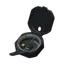 EYE MK.2 手持指南针专业版 | `eye-mk2-professional-hand-held-compass` | 0.106 千克 | — | 商人出售 | 253,898 卢布，需 Jaeger 1 级 | 29,565 卢布（3 家最高） |

> 本分类 **1 件**。价格取各商人中的最优价；「商人最低售价」栏附商人与等级要求，「最高回收」栏标注参与回收的商人数。

本分类 1 件的名称一览（点开可浏览；站内搜索靠它命中物品名）

EYE MK.2 手持指南针专业版

### 便携测距仪

分类路径：物品 › 特殊物品

| # | 名称 | 英文名 | 重量 | 关键属性 | 获取方式 | 商人最低售价 | 商人最高回收 |
|---|------|--------|------|----------|----------|--------------|--------------|
| 1 | 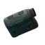 Vortex Ranger 1500测距仪 | `vortex-ranger-1500-rangefinder` | 0.218 千克 | — | 商人出售 | 11,790 卢布，需 Jaeger 1 级 | 4,050 卢布（3 家最高） |

> 本分类 **1 件**。价格取各商人中的最优价；「商人最低售价」栏附商人与等级要求，「最高回收」栏标注参与回收的商人数。

本分类 1 件的名称一览（点开可浏览；站内搜索靠它命中物品名）

Vortex Ranger 1500测距仪

### 维修套件

分类路径：物品 › 特殊物品

| # | 名称 | 英文名 | 重量 | 关键属性 | 获取方式 | 商人最低售价 | 商人最高回收 |
|---|------|--------|------|----------|----------|--------------|--------------|
| 1 | 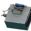 SZ-1 炸药 | `sz-1-explosive-charge` | 1.4 千克 | — | — | — | 6,265 卢布（3 家最高） |
| 2 | 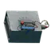 SZ-1 炸药 | `sz-1-explosive-charge-1` | 1.4 千克 | — | 商人出售 | 212,160 卢布，需 Prapor 1 级 | 70,200 卢布（3 家最高） |
| 3 | 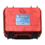 Sudak-Tudak 船用维修工具包 | `sudak-tudak-marine-repair-kit` | 4.5 千克 | — | — | — | 36,000 卢布（1 家最高） |
| 4 | 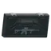 武器维修套件 | `weapon-repair-kit` | 7 千克 | — | 以物换物 / 制作 | — | 31,500 卢布（3 家最高） |
| 5 | 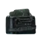 防弹衣维修套件 | `body-armor-repair-kit` | 14 千克 | — | 以物换物 / 制作 | — | 90,000 卢布（3 家最高） |

> 本分类 **5 件**。价格取各商人中的最优价；「商人最低售价」栏附商人与等级要求，「最高回收」栏标注参与回收的商人数。

本分类 5 件的名称一览（点开可浏览；站内搜索靠它命中物品名）

SZ-1 炸药　SZ-1 炸药　Sudak-Tudak 船用维修工具包　武器维修套件　防弹衣维修套件

### 无线电发报器

分类路径：物品 › 特殊物品

| # | 名称 | 英文名 | 重量 | 关键属性 | 获取方式 | 商人最低售价 | 商人最高回收 |
|---|------|--------|------|----------|----------|--------------|--------------|
| 1 |  14-4 KORD 固态硬盘 | `14-4-kord-ssd` | 0.04 千克 | — | — | — | 29,250 卢布（3 家最高） |
| 2 |  本地网络黑客入侵装置 | `local-network-hacking-device` | 0.12 千克 | — | 以物换物 | — | 14,436 卢布（3 家最高） |
| 3 | 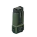 MS2000指示器 | `ms2000-marker` | 0.15 千克 | — | 商人出售 | 18,936 卢布，需 Prapor 1 级 | 6,265 卢布（3 家最高） |
| 4 | 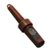 Digital secure DSP无线电收发器 | `digital-secure-dsp-radio-transmitter` | 0.17 千克 | — | 制作 | — | — |
| 5 | 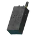 “明眼”迫击炮袭告警装置 | `the-eye-mortar-strike-signaling-device` | 0.2 千克 | — | — | — | — |
| 6 | 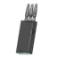 信号干扰器 | `signal-jammer` | 0.3 千克 | — | 商人出售 | 21,852 卢布，需 Mechanic 1 级 | 7,866 卢布（3 家最高） |
| 7 | 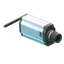 WIFI摄像头 | `wi-fi-camera` | 0.5 千克 | — | 商人出售 / 以物换物 | 62,959 卢布，需 Mechanic 1 级 | 15,791 卢布（3 家最高） |
| 8 | 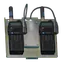 无线电中继器 | `radio-repeater` | 0.5 千克 | — | 制作 | — | 7,866 卢布（3 家最高） |
| 9 | 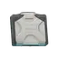 黑色军团加固手提电脑 | `black-division-rugged-laptop` | 2.5 千克 | — | — | — | 49,500 卢布（3 家最高） |

> 本分类 **9 件**。价格取各商人中的最优价；「商人最低售价」栏附商人与等级要求，「最高回收」栏标注参与回收的商人数。

本分类 9 件的名称一览（点开可浏览；站内搜索靠它命中物品名）

14-4 KORD 固态硬盘　本地网络黑客入侵装置　MS2000指示器　Digital secure DSP无线电收发器　“明眼”迫击炮袭告警装置　信号干扰器　WIFI摄像头　无线电中继器　黑色军团加固手提电脑

### 邪教徒护符

分类路径：物品 › 特殊物品

| # | 名称 | 英文名 | 重量 | 关键属性 | 获取方式 | 商人最低售价 | 商人最高回收 |
|---|------|--------|------|----------|----------|--------------|--------------|
| 1 |  神圣护身符 | `sacred-amulet` | 0.1 千克 | — | — | — | — |
| 2 |  神圣护身符 | `sacred-amulet-1` | 0.1 千克 | — | — | — | — |

> 本分类 **2 件**。价格取各商人中的最优价；「商人最低售价」栏附商人与等级要求，「最高回收」栏标注参与回收的商人数。

本分类 2 件的名称一览（点开可浏览；站内搜索靠它命中物品名）

神圣护身符　神圣护身符

### 录音机

分类路径：物品 › 特殊物品

| # | 名称 | 英文名 | 重量 | 关键属性 | 获取方式 | 商人最低售价 | 商人最高回收 |
|---|------|--------|------|----------|----------|--------------|--------------|
| 1 | 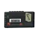 Voevoda 的录音机 | `voevodas-audio-recorder` | 0.6 千克 | — | — | — | — |
| 2 | 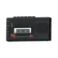 录音机 | `audio-recorder` | 0.6 千克 | — | 以物换物 | — | 1,539 卢布（3 家最高） |

> 本分类 **2 件**。价格取各商人中的最优价；「商人最低售价」栏附商人与等级要求，「最高回收」栏标注参与回收的商人数。

本分类 2 件的名称一览（点开可浏览；站内搜索靠它命中物品名）

Voevoda 的录音机　录音机

### 「听而不闻者」标记

分类路径：物品 › 特殊物品

| # | 名称 | 英文名 | 重量 | 关键属性 | 获取方式 | 商人最低售价 | 商人最高回收 |
|---|------|--------|------|----------|----------|--------------|--------------|
| 1 | 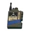 无名者之声 | `mark-of-the-unheard` | 0.35 千克 | — | — | — | — |

> 本分类 **1 件**。价格取各商人中的最优价；「商人最低售价」栏附商人与等级要求，「最高回收」栏标注参与回收的商人数。

本分类 1 件的名称一览（点开可浏览；站内搜索靠它命中物品名）

无名者之声

### 种植工具包

分类路径：物品 › 特殊物品

| # | 名称 | 英文名 | 重量 | 关键属性 | 获取方式 | 商人最低售价 | 商人最高回收 |
|---|------|--------|------|----------|----------|--------------|--------------|
| 1 | 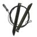 绊线布设装置 | `tripwire-installation-kit` | 0.35 千克 | — | 商人出售 | 30,667 卢布，需 Jaeger 3 级 | 11,088 卢布（3 家最高） |

> 本分类 **1 件**。价格取各商人中的最优价；「商人最低售价」栏附商人与等级要求，「最高回收」栏标注参与回收的商人数。

本分类 1 件的名称一览（点开可浏览；站内搜索靠它命中物品名）

绊线布设装置

### 多功能工具

分类路径：物品 › 特殊物品

| # | 名称 | 英文名 | 重量 | 关键属性 | 获取方式 | 商人最低售价 | 商人最高回收 |
|---|------|--------|------|----------|----------|--------------|--------------|
| 1 | 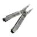 Leatherman多功能工具钳 | `leatherman-multitool` | 0.142 千克 | — | 商人出售 | 14,594 卢布，需 Mechanic 1 级 | 6,912 卢布（3 家最高） |

> 本分类 **1 件**。价格取各商人中的最优价；「商人最低售价」栏附商人与等级要求，「最高回收」栏标注参与回收的商人数。

本分类 1 件的名称一览（点开可浏览；站内搜索靠它命中物品名）

Leatherman多功能工具钳

---

## 📚 相关页面

- [物品图鉴总览](index.md) — 全站物品的分类入口与检索
- [任务需求物品反查](../quests/item-lookup.md) — 某物品被哪些任务要求、要不要留
- [配方速查表](../docs/recipes.md) — 制作与以物换物的完整配方
- [跳蚤定价与手续费](../entries/flea-pricing.md) — 市场侧的定价规则
- [商人系统](../entries/traders.md) — 商人等级与补货机制

📖 [返回物品图鉴总览](index.md)

⬆️ **[回到顶部](#top)**

**最后更新**: 2026 年 10 月 ｜ **贡献者** [GTX950L](https://github.com/GTX950L) ｜ **License**: CC BY-NC-SA 4.0
