---
tags:
  - 物品
  - 速查
---

# 枪械（Item Catalog）

> 版本基线：2026 年 10 月 ｜ 1.2.0.0（第一赛季 KORD BREACH）｜ 数据来源：tarkov.dev（二级）
> 本页为**生成页**，数值随版本调整，引用时请附「以游戏内为准」。

## 📸 本页概览

| 项目 | 说明 |
|------|------|
| **收录件数** | **172 件**（全站物品图鉴共 4,983 件） |
| **叶子分类** | 11 个官方分类：[手枪](#手枪)、[冲锋枪](#冲锋枪)、[突击步枪](#突击步枪)、[突击卡宾枪](#突击卡宾枪)、[霰弹枪](#霰弹枪)、[精确射手步枪](#精确射手步枪)、[狙击步枪](#狙击步枪)、[机枪](#机枪)、[榴弹发射器](#榴弹发射器)、[左轮手枪](#左轮手枪)、[火箭发射器](#火箭发射器) |
| **获取方式** | 站内收录的**固定**渠道：`商人出售` / `以物换物` / `制作`。本页 **21 / 172 件**有至少一条（商人出售 18 ｜ 以物换物 2 ｜ 制作 1）；`—` **不是「拿不到」**，只表示站内没收录它的固定渠道 —— 那类得靠搜刮或跳蚤市场，而这两样站内不给点位（判据见[战利品分布](../entries/loot.md)）|
| **数据来源** | `json.tarkov.dev` 的 `itemCategories` 树与 `items` 接口，二级来源 |
| **抓取日期** | 2026-10-08 |
| **配套页面** | [物品图鉴总览](index.md) ｜ [任务需求物品反查](../quests/item-lookup.md) ｜ [配方速查表](../docs/recipes.md) |

---

## 🔎 检索与筛选

本页的检索、筛选与详情面板需要 JavaScript —— **下方表格是静态生成的，不开 JS 也能读完**。

### 手枪

分类路径：物品 › 组合物品 › 武器

| # | 名称 | 英文名 | 重量 | 关键属性 | 获取方式 | 商人最低售价 | 商人最高回收 |
|---|------|--------|------|----------|----------|--------------|--------------|
| 1 | 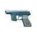 20x1毫米玩具枪 | `20x1mm-toy-gun` | 0.085 千克 | 口径 20×1mm 空爆；最大耐久 100；人机工效 100；垂直后坐 380；水平后坐 265（共 12 项） | — | — | 11,032 卢布（6 家最高） |
| 2 | 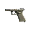 Glock 19X 9x19 手枪 | `glock-19x-9x19-pistol` | 0.197 千克 | 口径 9×19mm Parabellum；最大耐久 100；人机工效 93；垂直后坐 302；水平后坐 250（共 12 项） | — | — | 3,690 卢布（6 家最高） |
| 3 | 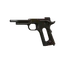 柯尔特 M45A1 .45 ACP 手枪 | `colt-m45a1-45-acp-pistol` | 0.205 千克 | 口径 .45 ACP；最大耐久 100；人机工效 78；垂直后坐 438；水平后坐 325（共 12 项） | — | — | 3,333 卢布（6 家最高） |
| 4 | 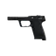 HK USP .45 ACP手枪 | `hk-usp-45-acp-pistol` | 0.222 千克 | 口径 .45 ACP；最大耐久 100；人机工效 82；垂直后坐 410；水平后坐 295（共 12 项） | — | — | 4,275 卢布（6 家最高） |
| 5 | 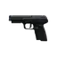 FN Five-seveN MK2 5.7x28 手枪 | `fn-five-seven-mk2-57x28-pistol` | 0.23 千克 | 口径 5.7×28mm；最大耐久 100；人机工效 86；垂直后坐 281；水平后坐 240（共 12 项） | — | — | 6,407 卢布（6 家最高） |
| 6 | 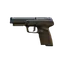 FN Five-seveN MK2 5.7x28 手枪 (FDE) | `fn-five-seven-mk2-57x28-pistol-fde` | 0.23 千克 | 口径 5.7×28mm；最大耐久 100；人机工效 86；垂直后坐 281；水平后坐 240（共 12 项） | — | — | 6,407 卢布（6 家最高） |
| 7 | 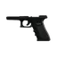 GLOCK 18C 9x19 冲锋手枪 | `glock-18c-9x19-machine-pistol` | 0.231 千克 | 口径 9×19mm Parabellum；最大耐久 100；人机工效 90；垂直后坐 306；水平后坐 286（共 12 项） | — | — | 6,851 卢布（6 家最高） |
| 8 | 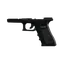 Glock 17 9x19 手枪 | `glock-17-9x19-pistol` | 0.231 千克 | 口径 9×19mm Parabellum；最大耐久 100；人机工效 90；垂直后坐 311；水平后坐 260（共 12 项） | 商人出售 | 8,260 卢布，需 Mechanic 1 级 | 2,973 卢布（6 家最高） |
| 9 | 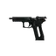 SIG P226R 9x19 手枪 | `sig-p226r-9x19-pistol` | 0.231 千克 | 口径 9×19mm Parabellum；最大耐久 100；人机工效 80；垂直后坐 383；水平后坐 275（共 12 项） | 商人出售 | 7,798 卢布，需 Mechanic 1 级 | 2,807 卢布（6 家最高） |
| 10 | 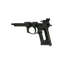 伯莱塔 M9A3 9x19 手枪 | `beretta-m9a3-9x19-pistol` | 0.231 千克 | 口径 9×19mm Parabellum；最大耐久 100；人机工效 70；垂直后坐 404；水平后坐 280（共 12 项） | — | — | 2,160 卢布（6 家最高） |
| 11 | 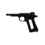 柯尔特 M1911A1 .45 ACP 手枪 | `colt-m1911a1-45-acp-pistol` | 0.231 千克 | 口径 .45 ACP；最大耐久 100；人机工效 75；垂直后坐 451；水平后坐 355（共 12 项） | — | — | 2,433 卢布（6 家最高） |
| 12 | 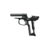 马卡洛夫9x18PM 手枪 | `makarov-pm-9x18pm-pistol` | 0.333 千克 | 口径 9×18mm PM；最大耐久 100；人机工效 85；垂直后坐 380；水平后坐 265（共 12 项） | — | — | 1,843 卢布（6 家最高） |
| 13 | 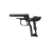 马卡洛夫 PM(t) 9x18PM 手枪 | `makarov-pm-t-9x18pm-pistol` | 0.34 千克 | 口径 9×18mm PM；最大耐久 100；人机工效 84；垂直后坐 380；水平后坐 265（共 12 项） | 商人出售 | 6,897 卢布，需 Mechanic 1 级 | 2,482 卢布（6 家最高） |
| 14 | 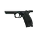 列别杰夫 PL-15 9x19 手枪 | `lebedev-pl-15-9x19-pistol` | 0.49 千克 | 口径 9×19mm Parabellum；最大耐久 100；人机工效 93；垂直后坐 289；水平后坐 235（共 12 项） | — | — | 3,195 卢布（6 家最高） |
| 15 | 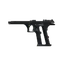 Magnum Research “沙漠之鹰”L5 .357 手枪 | `magnum-research-desert-eagle-l5-357-pistol` | 0.55 千克 | 口径 Caliber9x33R；最大耐久 100；人机工效 68；垂直后坐 455；水平后坐 320（共 12 项） | — | — | 17,403 卢布（6 家最高） |
| 16 | 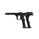 Magnum Research “沙漠之鹰”L5 .50 AE手枪 | `magnum-research-desert-eagle-l5-50-ae-pistol` | 0.55 千克 | 口径 Caliber127x33；最大耐久 100；人机工效 68；垂直后坐 465；水平后坐 330（共 12 项） | — | — | 18,055 卢布（6 家最高） |
| 17 | 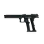 Magnum Research “沙漠之鹰”L6 .50 AE手枪 | `magnum-research-desert-eagle-l6-50-ae-pistol` | 0.578 千克 | 口径 Caliber127x33；最大耐久 100；人机工效 64；垂直后坐 465；水平后坐 330（共 12 项） | — | — | 18,513 卢布（6 家最高） |
| 18 | 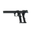 Magnum Research “沙漠之鹰”L6 .50 AE手枪（白色虎纹） | `magnum-research-desert-eagle-l6-50-ae-pistol-wts` | 0.578 千克 | 口径 Caliber127x33；最大耐久 100；人机工效 64；垂直后坐 465；水平后坐 330（共 12 项） | — | — | 20,533 卢布（6 家最高） |
| 19 | 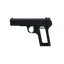 托卡列夫 TT-33 7.62x25 手枪 | `tokarev-tt-33-762x25-tt-pistol` | 0.664 千克 | 口径 Caliber762x25TT；最大耐久 100；人机工效 70；垂直后坐 553；水平后坐 325（共 12 项） | — | — | 1,885 卢布（6 家最高） |
| 20 | 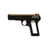 托卡列夫 TT-33 7.62x25 黄金手枪 | `tokarev-tt-33-762x25-tt-pistol-golden` | 0.664 千克 | 口径 Caliber762x25TT；最大耐久 100；人机工效 70；垂直后坐 553；水平后坐 325（共 12 项） | — | — | 10,433 卢布（6 家最高） |
| 21 | 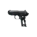 PB 9x18PM消音手枪 | `pb-9x18pm-silenced-pistol` | 0.674 千克 | 口径 9×18mm PM；最大耐久 100；人机工效 80；垂直后坐 380；水平后坐 260（共 12 项） | — | — | 5,174 卢布（6 家最高） |
| 22 | 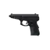 谢尔久科夫 SR1MP 9x21 “斑蝰蛇” 半自动手枪 | `serdyukov-sr-1mp-gyurza-9x21-pistol` | 0.79 千克 | 口径 Caliber9x21；最大耐久 100；人机工效 82；垂直后坐 442；水平后坐 325（共 12 项） | — | — | 8,681 卢布（6 家最高） |
| 23 | 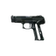 雅利金 MP-443 “乌鸦” 9x19 手枪 | `yarygin-mp-443-grach-9x19-pistol` | 0.79 千克 | 口径 9×19mm Parabellum；最大耐久 100；人机工效 75；垂直后坐 425；水平后坐 310（共 12 项） | — | — | 4,696 卢布（6 家最高） |
| 24 | 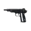 斯捷奇金 APB 9x18PM 消音型自动手枪 | `stechkin-apb-9x18pm-silenced-machine-pistol` | 0.81 千克 | 口径 9×18mm PM；最大耐久 100；人机工效 80；垂直后坐 328；水平后坐 260（共 12 项） | — | — | 5,233 卢布（6 家最高） |
| 25 | 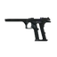 Magnum Research “沙漠之鹰”Mk XIX .50 AE手枪 | `magnum-research-desert-eagle-mk-xix-50-ae-pistol` | 0.829 千克 | 口径 Caliber127x33；最大耐久 100；人机工效 64；垂直后坐 465；水平后坐 330（共 12 项） | — | — | 19,575 卢布（6 家最高） |
| 26 | 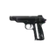 斯捷奇金 APS 9x18PM 冲锋手枪 | `stechkin-aps-9x18pm-machine-pistol` | 0.86 千克 | 口径 9×18mm PM；最大耐久 100；人机工效 70；垂直后坐 328；水平后坐 260（共 12 项） | — | — | 5,220 卢布（6 家最高） |

> 本分类 **26 件**。价格取各商人中的最优价；「商人最低售价」栏附商人与等级要求，「最高回收」栏标注参与回收的商人数。

本分类 26 件的名称一览（点开可浏览；站内搜索靠它命中物品名）

20x1毫米玩具枪　Glock 19X 9x19 手枪　柯尔特 M45A1 .45 ACP 手枪　HK USP .45 ACP手枪　FN Five-seveN MK2 5.7x28 手枪　FN Five-seveN MK2 5.7x28 手枪 (FDE)　GLOCK 18C 9x19 冲锋手枪　Glock 17 9x19 手枪　SIG P226R 9x19 手枪　伯莱塔 M9A3 9x19 手枪　柯尔特 M1911A1 .45 ACP 手枪　马卡洛夫9x18PM 手枪　马卡洛夫 PM(t) 9x18PM 手枪　列别杰夫 PL-15 9x19 手枪　Magnum Research “沙漠之鹰”L5 .357 手枪　Magnum Research “沙漠之鹰”L5 .50 AE手枪　Magnum Research “沙漠之鹰”L6 .50 AE手枪　Magnum Research “沙漠之鹰”L6 .50 AE手枪（白色虎纹）　托卡列夫 TT-33 7.62x25 手枪　托卡列夫 TT-33 7.62x25 黄金手枪　PB 9x18PM消音手枪　谢尔久科夫 SR1MP 9x21 “斑蝰蛇” 半自动手枪　雅利金 MP-443 “乌鸦” 9x19 手枪　斯捷奇金 APB 9x18PM 消音型自动手枪　Magnum Research “沙漠之鹰”Mk XIX .50 AE手枪　斯捷奇金 APS 9x18PM 冲锋手枪

### 冲锋枪

分类路径：物品 › 组合物品 › 武器

| # | 名称 | 英文名 | 重量 | 关键属性 | 获取方式 | 商人最低售价 | 商人最高回收 |
|---|------|--------|------|----------|----------|--------------|--------------|
| 1 | 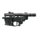 联盟-TM STM-9 Gen.2 9x19 卡宾枪 | `soyuz-tm-stm-9-gen2-9x19-carbine` | 0.35 千克 | 口径 9×19mm Parabellum；最大耐久 100；人机工效 50；垂直后坐 45；水平后坐 226（共 12 项） | — | — | 5,625 卢布（6 家最高） |
| 2 | 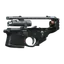 SIG MPX 9x19 冲锋枪 | `sig-mpx-9x19-submachine-gun` | 0.64 千克 | 口径 9×19mm Parabellum；最大耐久 100；人机工效 40；垂直后坐 51；水平后坐 269（共 12 项） | — | — | 8,508 卢布（6 家最高） |
| 3 | 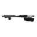 FN P90 5.7x28 冲锋枪 | `fn-p90-57x28-submachine-gun` | 0.7 千克 | 口径 5.7×28mm；最大耐久 100；人机工效 60；垂直后坐 54；水平后坐 243（共 12 项） | — | — | 9,922 卢布（6 家最高） |
| 4 |  FN P90 5.7x28 冲锋枪（灾厄） | `fn-p90-57x28-submachine-gun-scourge` | 0.73 千克 | 口径 5.7×28mm；最大耐久 100；人机工效 59；垂直后坐 57；水平后坐 255（共 12 项） | — | — | 11,722 卢布（6 家最高） |
| 5 | 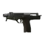 B&T MP9 9x19 冲锋枪 | `bt-mp9-9x19-submachine-gun` | 0.75 千克 | 口径 9×19mm Parabellum；最大耐久 100；人机工效 75；垂直后坐 54；水平后坐 254（共 12 项） | — | — | 6,429 卢布（6 家最高） |
| 6 | 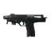 B&T MP9-N 9x19 冲锋枪 | `bt-mp9-n-9x19-submachine-gun` | 0.75 千克 | 口径 9×19mm Parabellum；最大耐久 100；人机工效 75；垂直后坐 51；水平后坐 254（共 12 项） | — | — | 8,325 卢布（6 家最高） |
| 7 | 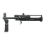 SR-2M 石楠 9x21 冲锋枪 | `sr-2m-veresk-9x21-submachine-gun` | 0.938 千克 | 口径 Caliber9x21；最大耐久 100；人机工效 59；垂直后坐 54；水平后坐 234（共 12 项） | — | — | 13,950 卢布（6 家最高） |
| 8 | 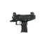 IWI UZI PRO Pistol 9x19冲锋枪 | `iwi-uzi-pro-pistol-9x19-submachine-gun` | 0.939 千克 | 口径 9×19mm Parabellum；最大耐久 100；人机工效 73；垂直后坐 59；水平后坐 203（共 12 项） | — | — | 8,785 卢布（6 家最高） |
| 9 | 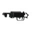 PPSh-41 7.62x25 冲锋枪 | `ppsh-41-762x25-submachine-gun` | 1.01 千克 | 口径 Caliber762x25TT；最大耐久 100；人机工效 16；垂直后坐 89；水平后坐 294（共 12 项） | — | — | 4,612 卢布（6 家最高） |
| 10 | 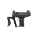 IWI UZI PRO SMG 9x19冲锋枪 | `iwi-uzi-pro-smg-9x19-submachine-gun` | 1.128 千克 | 口径 9×19mm Parabellum；最大耐久 100；人机工效 78；垂直后坐 56；水平后坐 198（共 12 项） | — | — | 10,086 卢布（6 家最高） |
| 11 | 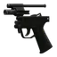 HK MP5K 9x19 微型冲锋枪 | `hk-mp5k-9x19-submachine-gun` | 1.15 千克 | 口径 9×19mm Parabellum；最大耐久 100；人机工效 55；垂直后坐 57；水平后坐 267（共 12 项） | — | — | 4,275 卢布（6 家最高） |
| 12 | 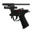 HK MP5 9x19 冲锋枪（海军三发点射） | `hk-mp5-9x19-submachine-gun-navy-3-round-burst` | 1.21 千克 | 口径 9×19mm Parabellum；最大耐久 100；人机工效 50；垂直后坐 56；水平后坐 275（共 12 项） | — | — | 5,459 卢布（6 家最高） |
| 13 | 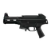 HK UMP .45 ACP冲锋枪 | `hk-ump-45-acp-submachine-gun` | 1.22 千克 | 口径 .45 ACP；最大耐久 100；人机工效 62；垂直后坐 72；水平后坐 240（共 12 项） | — | — | 11,925 卢布（6 家最高） |
| 14 | 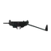 PP-9 楔子 9x18PMM 冲锋枪 | `pp-9-klin-9x18pmm-submachine-gun` | 1.33 千克 | 口径 Caliber9x18PMM；最大耐久 100；人机工效 65；垂直后坐 50；水平后坐 211（共 12 项） | — | — | 11,007 卢布（6 家最高） |
| 15 | 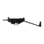 PP-91 雪松 9x18PM冲锋枪 | `pp-91-kedr-9x18pm-submachine-gun` | 1.33 千克 | 口径 9×18mm PM；最大耐久 100；人机工效 65；垂直后坐 50；水平后坐 211（共 12 项） | — | — | 8,480 卢布（6 家最高） |
| 16 | 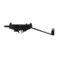 PP-91-01 雪松-B 9x18PM 冲锋枪 | `pp-91-01-kedr-b-9x18pm-submachine-gun` | 1.33 千克 | 口径 9×18mm PM；最大耐久 100；人机工效 65；垂直后坐 50；水平后坐 211（共 12 项） | — | — | 9,107 卢布（6 家最高） |
| 17 | 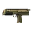 HK MP7A2 4.6x30 冲锋枪 | `hk-mp7a2-46x30-submachine-gun` | 1.58 千克 | 口径 4.6×30mm；最大耐久 100；人机工效 65；垂直后坐 50；水平后坐 178（共 12 项） | — | — | 20,353 卢布（6 家最高） |
| 18 | 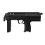 HK MP7A1 4.6x30 冲锋枪 | `hk-mp7a1-46x30-submachine-gun` | 1.62 千克 | 口径 4.6×30mm；最大耐久 100；人机工效 65；垂直后坐 50；水平后坐 178（共 12 项） | — | — | 19,929 卢布（6 家最高） |
| 19 | 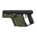 TDI KRISS Vector Gen.2 9x19 冲锋枪 | `tdi-kriss-vector-gen2-9x19-submachine-gun` | 1.8 千克 | 口径 9×19mm Parabellum；最大耐久 100；人机工效 65；垂直后坐 48；水平后坐 315（共 12 项） | — | — | 12,510 卢布（6 家最高） |
| 20 | 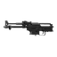 PP-19-01 勇士 9x19 冲锋枪 | `pp-19-01-vityaz-9x19-submachine-gun` | 1.809 千克 | 口径 9×19mm Parabellum；最大耐久 100；人机工效 35；垂直后坐 58；水平后坐 270（共 12 项） | — | — | 6,637 卢布（6 家最高） |
| 21 | 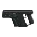 TDI KRISS Vector Gen.2 .45 ACP 冲锋枪 | `tdi-kriss-vector-gen2-45-acp-submachine-gun` | 1.86 千克 | 口径 .45 ACP；最大耐久 100；人机工效 65；垂直后坐 59；水平后坐 356（共 12 项） | — | — | 14,242 卢布（6 家最高） |
| 22 | 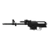 Saiga-9 9x19卡宾枪 | `saiga-9-9x19-carbine` | 1.962 千克 | 口径 9×19mm Parabellum；最大耐久 100；人机工效 32；垂直后坐 42；水平后坐 246（共 12 项） | — | — | 4,475 卢布（6 家最高） |
| 23 | 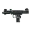 IWI UZI 9x19冲锋枪 | `iwi-uzi-9x19-submachine-gun` | 2.26 千克 | 口径 9×19mm Parabellum；最大耐久 100；人机工效 65；垂直后坐 54；水平后坐 254（共 12 项） | — | — | 7,344 卢布（6 家最高） |

> 本分类 **23 件**。价格取各商人中的最优价；「商人最低售价」栏附商人与等级要求，「最高回收」栏标注参与回收的商人数。

本分类 23 件的名称一览（点开可浏览；站内搜索靠它命中物品名）

联盟-TM STM-9 Gen.2 9x19 卡宾枪　SIG MPX 9x19 冲锋枪　FN P90 5.7x28 冲锋枪　FN P90 5.7x28 冲锋枪（灾厄）　B&T MP9 9x19 冲锋枪　B&T MP9-N 9x19 冲锋枪　SR-2M 石楠 9x21 冲锋枪　IWI UZI PRO Pistol 9x19冲锋枪　PPSh-41 7.62x25 冲锋枪　IWI UZI PRO SMG 9x19冲锋枪　HK MP5K 9x19 微型冲锋枪　HK MP5 9x19 冲锋枪（海军三发点射）　HK UMP .45 ACP冲锋枪　PP-9 楔子 9x18PMM 冲锋枪　PP-91 雪松 9x18PM冲锋枪　PP-91-01 雪松-B 9x18PM 冲锋枪　HK MP7A2 4.6x30 冲锋枪　HK MP7A1 4.6x30 冲锋枪　TDI KRISS Vector Gen.2 9x19 冲锋枪　PP-19-01 勇士 9x19 冲锋枪　TDI KRISS Vector Gen.2 .45 ACP 冲锋枪　Saiga-9 9x19卡宾枪　IWI UZI 9x19冲锋枪

### 突击步枪

分类路径：物品 › 组合物品 › 武器

| # | 名称 | 英文名 | 重量 | 关键属性 | 获取方式 | 商人最低售价 | 商人最高回收 |
|---|------|--------|------|----------|----------|--------------|--------------|
| 1 | 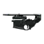 SIG MCX .300 Blackout 突击步枪 | `sig-mcx-300-blackout-assault-rifle` | 0.4 千克 | 口径 Caliber762x35；最大耐久 100；人机工效 43；垂直后坐 127；水平后坐 351（共 12 项） | 商人出售 | 30,672 卢布，需 Skier 3 级 | 9,585 卢布（6 家最高） |
| 2 | 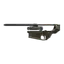 SIG MCX SPEAR 6.8x51突击步枪 | `sig-mcx-spear-68x51-assault-rifle` | 0.4 千克 | 口径 Caliber68x51；最大耐久 100；人机工效 46；垂直后坐 143；水平后坐 425（共 12 项） | — | — | 9,585 卢布（6 家最高） |
| 3 |  CMMG Mk47 Mutant 7.62x39 突击步枪 | `cmmg-mk47-mutant-762x39-assault-rifle` | 0.51 千克 | 口径 7.62×39mm；最大耐久 100；人机工效 38；垂直后坐 136；水平后坐 338（共 12 项） | — | — | 11,338 卢布（6 家最高） |
| 4 |  NL545 (DI) 5.45x39 突击步枪 | `custom-guns-nl545-di-545x39-assault-rifle` | 0.51 千克 | 口径 5.45×39mm；最大耐久 100；人机工效 45；垂直后坐 109；水平后坐 320（共 12 项） | — | — | 8,820 卢布（6 家最高） |
| 5 |  NL545 (GP) 5.45x39 突击步枪 | `custom-guns-nl545-gp-545x39-assault-rifle` | 0.51 千克 | 口径 5.45×39mm；最大耐久 100；人机工效 48；垂直后坐 114；水平后坐 330（共 12 项） | — | — | 9,855 卢布（6 家最高） |
| 6 |  HK 416A5 5.56x45 突击步枪 | `hk-416a5-556x45-assault-rifle` | 0.52 千克 | 口径 5.56×45mm NATO；最大耐久 100；人机工效 51；垂直后坐 125；水平后坐 358（共 12 项） | 商人出售 | 27,250 卢布，需 Mechanic 4 级 | 9,810 卢布（6 家最高） |
| 7 |  HK 416A5 5.56x45 突击步枪 (RAL 8000) | `hk-416a5-556x45-assault-rifle-ral-8000` | 0.52 千克 | 口径 5.56×45mm NATO；最大耐久 100；人机工效 51；垂直后坐 125；水平后坐 358（共 12 项） | — | — | 9,810 卢布（6 家最高） |
| 8 |  北方工业 QBZ-191 5.8x42 突击步枪 | `norinco-qbz-191-58x42-assault-rifle` | 0.625 千克 | 口径 Caliber58x42；最大耐久 100；人机工效 48；垂直后坐 114；水平后坐 330（共 12 项） | — | — | 8,505 卢布（6 家最高） |
| 9 |  Lone Star TX-15 DML 5.56x45 半自动卡宾枪 | `lone-star-tx-15-dml-556x45-carbine` | 0.69 千克 | 口径 5.56×45mm NATO；最大耐久 100；人机工效 50；垂直后坐 101；水平后坐 289（共 12 项） | — | — | 10,978 卢布（6 家最高） |
| 10 |  FN SCAR-L 5.56x45突击步枪 | `fn-scar-l-556x45-assault-rifle` | 0.7 千克 | 口径 5.56×45mm NATO；最大耐久 100；人机工效 45；垂直后坐 90；水平后坐 280（共 12 项） | — | — | 7,650 卢布（6 家最高） |
| 11 |  FN SCAR-L 5.56x45突击步枪 （FDE） | `fn-scar-l-556x45-assault-rifle-fde` | 0.7 千克 | 口径 5.56×45mm NATO；最大耐久 100；人机工效 45；垂直后坐 90；水平后坐 280（共 12 项） | 商人出售 | 22,500 卢布，需 Mechanic 2 级 | 8,100 卢布（6 家最高） |
| 12 |  雷电 Model 1 FA 5.56x45 突击步枪 | `radian-weapons-model-1-fa-556x45-assault-rifle` | 0.7 千克 | 口径 5.56×45mm NATO；最大耐久 100；人机工效 51；垂直后坐 112；水平后坐 335（共 12 项） | — | — | 11,878 卢布（6 家最高） |
| 13 |  柯尔特 M4A1 5.56x45 卡宾枪 | `colt-m4a1-556x45-assault-rifle` | 0.75 千克 | 口径 5.56×45mm NATO；最大耐久 100；人机工效 48；垂直后坐 119；水平后坐 342（共 12 项） | 商人出售 | 22,997 卢布，需 Mechanic 3 级 | 8,278 卢布（6 家最高） |
| 14 |  ADAR 2-15 .223 卡宾枪 | `adar-2-15-556x45-carbine` | 0.76 千克 | 口径 5.56×45mm NATO；最大耐久 100；人机工效 48；垂直后坐 120；水平后坐 344（共 12 项） | 商人出售 | 18,144 卢布，需 Skier 1 级 | 2,835 卢布（6 家最高） |
| 15 |  柯尔特 M16A1 5.56x45 突击步枪 | `colt-m16a1-556x45-assault-rifle` | 0.79 千克 | 口径 5.56×45mm NATO；最大耐久 100；人机工效 48；垂直后坐 121；水平后坐 346（共 12 项） | — | — | 7,942 卢布（6 家最高） |
| 16 |  柯尔特 M16A2 5.56x45 突击步枪 | `colt-m16a2-556x45-assault-rifle` | 0.79 千克 | 口径 5.56×45mm NATO；最大耐久 100；人机工效 48；垂直后坐 117；水平后坐 338（共 12 项） | — | — | 7,627 卢布（6 家最高） |
| 17 |  HK G36 5.56x45 突击步枪 | `hk-g36-556x45-assault-rifle` | 0.8 千克 | 口径 5.56×45mm NATO；最大耐久 100；人机工效 60；垂直后坐 106；水平后坐 298（共 12 项） | — | — | 5,850 卢布（6 家最高） |
| 18 |  FN SCAR-H X-17 7.62x51突击步枪 | `fn-scar-h-x-17-762x51-assault-rifle` | 0.81 千克 | 口径 7.62×51mm NATO；最大耐久 100；人机工效 47；垂直后坐 200；水平后坐 505（共 12 项） | 商人出售 | 36,778 卢布，需 Mechanic 4 级 | 13,239 卢布（6 家最高） |
| 19 |  FN SCAR-H 7.62x51 突击步枪 (FDE) | `fn-scar-h-762x51-assault-rifle-fde` | 0.85 千克 | 口径 7.62×51mm NATO；最大耐久 100；人机工效 45；垂直后坐 200；水平后坐 505（共 12 项） | — | — | 11,610 卢布（6 家最高） |
| 20 |  FN SCAR-H 7.62x51突击步枪 | `fn-scar-h-762x51-assault-rifle` | 0.85 千克 | 口径 7.62×51mm NATO；最大耐久 100；人机工效 45；垂直后坐 200；水平后坐 505（共 12 项） | — | — | 10,980 卢布（6 家最高） |
| 21 |  丰和 20 式 5.56x45 突击步枪 | `howa-type-20-556x45-assault-rifle` | 1.234 千克 | 口径 5.56×45mm NATO；最大耐久 100；人机工效 50；垂直后坐 97；水平后坐 270（共 12 项） | — | — | 4,050 卢布（6 家最高） |
| 22 |  DS Arms SA-58 7.62x51 突击步枪 | `ds-arms-sa58-762x51-assault-rifle` | 1.46 千克 | 口径 7.62×51mm NATO；最大耐久 100；人机工效 30；垂直后坐 210；水平后坐 417（共 12 项） | 商人出售 | 38,867 卢布，需 Mechanic 4 级 | 13,991 卢布（6 家最高） |
| 23 |  Steyr AUG A1 5.56x45突击步枪 | `steyr-aug-a1-556x45-assault-rifle` | 1.49 千克 | 口径 5.56×45mm NATO；最大耐久 100；人机工效 95；垂直后坐 90；水平后坐 265（共 12 项） | — | — | 11,803 卢布（6 家最高） |
| 24 |  Steyr AUG A3 5.56x45 突击步枪（黑色） | `steyr-aug-a3-556x45-assault-rifle-black` | 1.51 千克 | 口径 5.56×45mm NATO；最大耐久 100；人机工效 95；垂直后坐 87；水平后坐 248（共 12 项） | — | — | 13,950 卢布（6 家最高） |
| 25 |  Steyr AUG A3 5.56x45突击步枪 | `steyr-aug-a3-556x45-assault-rifle` | 1.51 千克 | 口径 5.56×45mm NATO；最大耐久 100；人机工效 95；垂直后坐 87；水平后坐 248（共 12 项） | — | — | 13,950 卢布（6 家最高） |
| 26 |  AKS-74U 5.45x39 短突击步枪 | `kalashnikov-aks-74u-545x39-assault-rifle` | 1.809 千克 | 口径 5.45×39mm；最大耐久 100；人机工效 44；垂直后坐 108；水平后坐 272（共 12 项） | 商人出售 | 17,054 卢布，需 Mechanic 1 级 | 6,139 卢布（6 家最高） |
| 27 |  AKS-74UB 5.45x39 短突击步枪 | `kalashnikov-aks-74ub-545x39-assault-rifle` | 1.85 千克 | 口径 5.45×39mm；最大耐久 100；人机工效 44；垂直后坐 108；水平后坐 272（共 12 项） | — | — | 9,785 卢布（6 家最高） |
| 28 |  AKS-74UN 5.45x39 短突击步枪 | `kalashnikov-aks-74un-545x39-assault-rifle` | 1.85 千克 | 口径 5.45×39mm；最大耐久 100；人机工效 44；垂直后坐 108；水平后坐 272（共 12 项） | — | — | 8,705 卢布（6 家最高） |
| 29 |  AK-102 5.56x45 突击步枪 | `kalashnikov-ak-102-556x45-assault-rifle` | 1.992 千克 | 口径 5.56×45mm NATO；最大耐久 100；人机工效 43；垂直后坐 103；水平后坐 280（共 12 项） | — | — | 23,241 卢布（6 家最高） |
| 30 |  AK-104 7.62x39 突击步枪 | `kalashnikov-ak-104-762x39-assault-rifle` | 1.992 千克 | 口径 7.62×39mm；最大耐久 100；人机工效 43；垂直后坐 120；水平后坐 315（共 12 项） | — | — | 17,960 卢布（6 家最高） |
| 31 |  AK-105 5.45x39 突击步枪 | `kalashnikov-ak-105-545x39-assault-rifle` | 1.992 千克 | 口径 5.45×39mm；最大耐久 100；人机工效 43；垂直后坐 100；水平后坐 277（共 12 项） | — | — | 13,887 卢布（6 家最高） |
| 32 |  AK-74 5.45x39 突击步枪 | `kalashnikov-ak-74-545x39-assault-rifle` | 1.992 千克 | 口径 5.45×39mm；最大耐久 100；人机工效 30；垂直后坐 96；水平后坐 244（共 12 项） | — | — | 9,787 卢布（6 家最高） |
| 33 |  AKS-74 5.45x39 突击步枪 | `kalashnikov-aks-74-545x39-assault-rifle` | 1.992 千克 | 口径 5.45×39mm；最大耐久 100；人机工效 31；垂直后坐 90；水平后坐 244（共 12 项） | — | — | 10,647 卢布（6 家最高） |
| 34 |  AK-74N 5.45x39 突击步枪 | `kalashnikov-ak-74n-545x39-assault-rifle` | 2.092 千克 | 口径 5.45×39mm；最大耐久 100；人机工效 31；垂直后坐 96；水平后坐 244（共 12 项） | 商人出售 | 28,934 卢布，需 Mechanic 2 级 | 10,416 卢布（6 家最高） |
| 35 |  AKM 7.62x39 突击步枪 | `kalashnikov-akm-762x39-assault-rifle` | 2.092 千克 | 口径 7.62×39mm；最大耐久 100；人机工效 28；垂直后坐 121；水平后坐 298（共 12 项） | — | — | 13,280 卢布（6 家最高） |
| 36 |  AKMS 7.62x39 突击步枪 | `kalashnikov-akms-762x39-assault-rifle` | 2.092 千克 | 口径 7.62×39mm；最大耐久 100；人机工效 26；垂直后坐 121；水平后坐 298（共 12 项） | — | — | 12,541 卢布（6 家最高） |
| 37 |  AKMSN 7.62x39 突击步枪 | `kalashnikov-akmsn-762x39-assault-rifle` | 2.092 千克 | 口径 7.62×39mm；最大耐久 100；人机工效 26；垂直后坐 121；水平后坐 298（共 12 项） | — | — | 13,037 卢布（6 家最高） |
| 38 |  AKS-74N 5.45x39 突击步枪 | `kalashnikov-aks-74n-545x39-assault-rifle` | 2.092 千克 | 口径 5.45×39mm；最大耐久 100；人机工效 32；垂直后坐 90；水平后坐 244（共 12 项） | — | — | 11,470 卢布（6 家最高） |
| 39 |  VPO-136 野猪-KM 7.62x39 卡宾枪 | `molot-arms-vpo-136-vepr-km-762x39-carbine` | 2.092 千克 | 口径 7.62×39mm；最大耐久 100；人机工效 30；垂直后坐 149；水平后坐 378（共 12 项） | — | — | 8,540 卢布（6 家最高） |
| 40 |  VPO-209 .366TKM 卡宾枪 | `molot-arms-vpo-209-366-tkm-carbine` | 2.092 千克 | 口径 Caliber366TKM；最大耐久 100；人机工效 30；垂直后坐 154；水平后坐 386（共 12 项） | 商人出售 | 26,982 卢布，需 Mechanic 2 级 | 9,713 卢布（6 家最高） |
| 41 |  Rifle Dynamics RD-704 7.62x39突击步枪 | `rifle-dynamics-rd-704-762x39-assault-rifle` | 2.1 千克 | 口径 7.62×39mm；最大耐久 100；人机工效 50；垂直后坐 135；水平后坐 314（共 12 项） | — | — | 20,250 卢布（6 家最高） |
| 42 |  AKMN 7.62x39 突击步枪 | `kalashnikov-akmn-762x39-assault-rifle` | 2.152 千克 | 口径 7.62×39mm；最大耐久 100；人机工效 28；垂直后坐 121；水平后坐 298（共 12 项） | 商人出售 | 42,504 卢布，需 Mechanic 3 级 | 15,301 卢布（6 家最高） |
| 43 |  SAG AK-545 5.45x39截短卡宾枪 | `sag-ak-545-short-545x39-carbine` | 2.192 千克 | 口径 5.45×39mm；最大耐久 100；人机工效 53；垂直后坐 93；水平后坐 270（共 12 项） | — | — | 13,950 卢布（6 家最高） |
| 44 |  Aklys Defense 迅猛龙 .300 Blackout 突击步枪 | `aklys-defense-velociraptor-300-blackout-assault-rifle` | 2.21 千克 | 口径 Caliber762x35；最大耐久 100；人机工效 35；垂直后坐 101；水平后坐 272（共 12 项） | — | — | 28,553 卢布（6 家最高） |
| 45 |  AK-101 5.56x45 突击步枪 | `kalashnikov-ak-101-556x45-assault-rifle` | 2.392 千克 | 口径 5.56×45mm NATO；最大耐久 100；人机工效 35；垂直后坐 98；水平后坐 248（共 12 项） | — | — | 16,048 卢布（6 家最高） |
| 46 |  AK-103 7.62x39 突击步枪 | `kalashnikov-ak-103-762x39-assault-rifle` | 2.392 千克 | 口径 7.62×39mm；最大耐久 100；人机工效 35；垂直后坐 118；水平后坐 295（共 12 项） | — | — | 15,439 卢布（6 家最高） |
| 47 |  AK-12 5.45x39 突击步枪 | `kalashnikov-ak-12-545x39-assault-rifle` | 2.392 千克 | 口径 5.45×39mm；最大耐久 100；人机工效 36；垂直后坐 100；水平后坐 302（共 12 项） | — | — | 20,322 卢布（6 家最高） |
| 48 |  AK-74M 5.45x39 突击步枪 | `kalashnikov-ak-74m-545x39-assault-rifle` | 2.392 千克 | 口径 5.45×39mm；最大耐久 100；人机工效 33；垂直后坐 95；水平后坐 241（共 12 项） | 商人出售 | 32,727 卢布，需 Mechanic 3 级 | 11,781 卢布（6 家最高） |
| 49 |  SAG AK-545 5.45x39卡宾枪 | `sag-ak-545-545x39-carbine` | 2.392 千克 | 口径 5.45×39mm；最大耐久 100；人机工效 50；垂直后坐 91；水平后坐 263（共 12 项） | — | — | 12,735 卢布（6 家最高） |
| 50 |  AK-308 7.62x51 突击步枪 | `kalashnikov-ak-308-762x51-assault-rifle` | 2.6 千克 | 口径 7.62×51mm NATO；最大耐久 100；人机工效 33；垂直后坐 152；水平后坐 325（共 12 项） | — | — | 23,625 卢布（6 家最高） |
| 51 |  沙漠科技 MDR 5.56x45 突击步枪 | `desert-tech-mdr-556x45-assault-rifle` | 2.8 千克 | 口径 5.56×45mm NATO；最大耐久 100；人机工效 67；垂直后坐 79；水平后坐 260（共 12 项） | — | — | 20,353 卢布（6 家最高） |
| 52 |  沙漠科技 MDR 7.62x51 突击步枪 | `desert-tech-mdr-762x51-assault-rifle` | 2.95 千克 | 口径 7.62×51mm NATO；最大耐久 100；人机工效 67；垂直后坐 125；水平后坐 310（共 12 项） | — | — | 28,453 卢布（6 家最高） |
| 53 |  ASh-12 12.7x55 突击步枪 | `ash-12-127x55-assault-rifle` | 5.1 千克 | 口径 12.7×55mm；最大耐久 100；人机工效 55；垂直后坐 128；水平后坐 425（共 12 项） | — | — | 42,210 卢布（6 家最高） |

> 本分类 **53 件**。价格取各商人中的最优价；「商人最低售价」栏附商人与等级要求，「最高回收」栏标注参与回收的商人数。

本分类 53 件的名称一览（点开可浏览；站内搜索靠它命中物品名）

SIG MCX .300 Blackout 突击步枪　SIG MCX SPEAR 6.8x51突击步枪　CMMG Mk47 Mutant 7.62x39 突击步枪　NL545 (DI) 5.45x39 突击步枪　NL545 (GP) 5.45x39 突击步枪　HK 416A5 5.56x45 突击步枪　HK 416A5 5.56x45 突击步枪 (RAL 8000)　北方工业 QBZ-191 5.8x42 突击步枪　Lone Star TX-15 DML 5.56x45 半自动卡宾枪　FN SCAR-L 5.56x45突击步枪　FN SCAR-L 5.56x45突击步枪 （FDE）　雷电 Model 1 FA 5.56x45 突击步枪　柯尔特 M4A1 5.56x45 卡宾枪　ADAR 2-15 .223 卡宾枪　柯尔特 M16A1 5.56x45 突击步枪　柯尔特 M16A2 5.56x45 突击步枪　HK G36 5.56x45 突击步枪　FN SCAR-H X-17 7.62x51突击步枪　FN SCAR-H 7.62x51 突击步枪 (FDE)　FN SCAR-H 7.62x51突击步枪　丰和 20 式 5.56x45 突击步枪　DS Arms SA-58 7.62x51 突击步枪　Steyr AUG A1 5.56x45突击步枪　Steyr AUG A3 5.56x45 突击步枪（黑色）　Steyr AUG A3 5.56x45突击步枪　AKS-74U 5.45x39 短突击步枪　AKS-74UB 5.45x39 短突击步枪　AKS-74UN 5.45x39 短突击步枪　AK-102 5.56x45 突击步枪　AK-104 7.62x39 突击步枪　AK-105 5.45x39 突击步枪　AK-74 5.45x39 突击步枪　AKS-74 5.45x39 突击步枪　AK-74N 5.45x39 突击步枪　AKM 7.62x39 突击步枪　AKMS 7.62x39 突击步枪　AKMSN 7.62x39 突击步枪　AKS-74N 5.45x39 突击步枪　VPO-136 野猪-KM 7.62x39 卡宾枪　VPO-209 .366TKM 卡宾枪　Rifle Dynamics RD-704 7.62x39突击步枪　AKMN 7.62x39 突击步枪　SAG AK-545 5.45x39截短卡宾枪　Aklys Defense 迅猛龙 .300 Blackout 突击步枪　AK-101 5.56x45 突击步枪　AK-103 7.62x39 突击步枪　AK-12 5.45x39 突击步枪　AK-74M 5.45x39 突击步枪　SAG AK-545 5.45x39卡宾枪　AK-308 7.62x51 突击步枪　沙漠科技 MDR 5.56x45 突击步枪　沙漠科技 MDR 7.62x51 突击步枪　ASh-12 12.7x55 突击步枪

### 突击卡宾枪

分类路径：物品 › 组合物品 › 武器

| # | 名称 | 英文名 | 重量 | 关键属性 | 获取方式 | 商人最低售价 | 商人最高回收 |
|---|------|--------|------|----------|----------|--------------|--------------|
| 1 |  西蒙诺夫 OP-SKS 7.62x39 卡宾枪 | `molot-arms-simonov-op-sks-762x39-carbine` | 0.82 千克 | 口径 7.62×39mm；最大耐久 100；人机工效 40；垂直后坐 155；水平后坐 360（共 12 项） | — | — | 9,816 卢布（6 家最高） |
| 2 |  西蒙诺夫 SKS 7.62x39 卡宾枪 | `toz-simonov-sks-762x39-carbine` | 0.82 千克 | 口径 7.62×39mm；最大耐久 100；人机工效 40；垂直后坐 155；水平后坐 360（共 12 项） | — | — | 8,698 卢布（6 家最高） |
| 3 |  KBP 9A-91 9x39紧凑型突击步枪 | `kbp-9a-91-9x39-compact-assault-rifle` | 0.92 千克 | 口径 Caliber9x39；最大耐久 100；人机工效 50；垂直后坐 110；水平后坐 280（共 12 项） | — | — | 8,716 卢布（6 家最高） |
| 4 |  KBP VSK-94 9x39步枪 | `kbp-vsk-94-9x39-rifle` | 0.92 千克 | 口径 Caliber9x39；最大耐久 100；人机工效 50；垂直后坐 110；水平后坐 280（共 12 项） | — | — | 8,716 卢布（6 家最高） |
| 5 |  托卡列夫 AVT-40 7.62x54R 自动步枪 | `tokarev-avt-40-762x54r-automatic-rifle` | 1.069 千克 | 口径 Caliber762x54R；最大耐久 100；人机工效 20；垂直后坐 175；水平后坐 675（共 12 项） | — | — | 8,698 卢布（6 家最高） |
| 6 |  托卡列夫 SVT-40 7.62x54R 步枪 | `tokarev-svt-40-762x54r-rifle` | 1.075 千克 | 口径 Caliber762x54R；最大耐久 100；人机工效 20；垂直后坐 175；水平后坐 675（共 12 项） | — | — | 8,698 卢布（6 家最高） |
| 7 |  AS VAL“巨浪” 9x39 特种突击步枪 | `as-val-9x39-special-assault-rifle` | 1.092 千克 | 口径 Caliber9x39；最大耐久 100；人机工效 43；垂直后坐 80；水平后坐 270（共 12 项） | — | — | 30,091 卢布（6 家最高） |
| 8 |  AS“巨浪”MOD.4 9x39 特种突击步枪 | `as-val-mod4-9x39-special-assault-rifle` | 1.205 千克 | 口径 Caliber9x39；最大耐久 100；人机工效 46；垂直后坐 70；水平后坐 260（共 12 项） | — | — | 33,774 卢布（6 家最高） |
| 9 |  SR-3M 9x39紧凑型突击步枪 | `sr-3m-9x39-compact-assault-rifle` | 1.41 千克 | 口径 Caliber9x39；最大耐久 100；人机工效 45；垂直后坐 74；水平后坐 255（共 12 项） | — | — | 31,685 卢布（6 家最高） |
| 10 |  VPO-101 Vepr-Hunter 7.62x51 卡宾枪 | `molot-arms-vpo-101-vepr-hunter-762x51-carbine` | 2.092 千克 | 口径 7.62×51mm NATO；最大耐久 100；人机工效 29；垂直后坐 150；水平后坐 585（共 12 项） | — | — | 17,540 卢布（6 家最高） |

> 本分类 **10 件**。价格取各商人中的最优价；「商人最低售价」栏附商人与等级要求，「最高回收」栏标注参与回收的商人数。

本分类 10 件的名称一览（点开可浏览；站内搜索靠它命中物品名）

西蒙诺夫 OP-SKS 7.62x39 卡宾枪　西蒙诺夫 SKS 7.62x39 卡宾枪　KBP 9A-91 9x39紧凑型突击步枪　KBP VSK-94 9x39步枪　托卡列夫 AVT-40 7.62x54R 自动步枪　托卡列夫 SVT-40 7.62x54R 步枪　AS VAL“巨浪” 9x39 特种突击步枪　AS“巨浪”MOD.4 9x39 特种突击步枪　SR-3M 9x39紧凑型突击步枪　VPO-101 Vepr-Hunter 7.62x51 卡宾枪

### 霰弹枪

分类路径：物品 › 组合物品 › 武器

| # | 名称 | 英文名 | 重量 | 关键属性 | 获取方式 | 商人最低售价 | 商人最高回收 |
|---|------|--------|------|----------|----------|--------------|--------------|
| 1 |  MP-18 7.62x54R单发步枪 | `mp-18-762x54r-single-shot-rifle` | 0.76 千克 | 口径 Caliber762x54R；最大耐久 100；人机工效 44；垂直后坐 295；水平后坐 753（共 12 项） | — | — | 3,744 卢布（7 家最高） |
| 2 |  MP-133 12 铅径泵动式霰弹枪 | `mp-133-12ga-pump-action-shotgun` | 1.1 千克 | 口径 Caliber12g；最大耐久 100；人机工效 40；垂直后坐 397；水平后坐 522（共 12 项） | — | — | 6,932 卢布（7 家最高） |
| 3 |  MP-155 12铅径半自动霰弹枪 | `mp-155-12ga-semi-automatic-shotgun` | 1.1 千克 | 口径 Caliber12g；最大耐久 100；人机工效 48；垂直后坐 341；水平后坐 457（共 12 项） | — | — | 9,072 卢布（7 家最高） |
| 4 |  Mossberg 590A1 12铅径泵动式霰弹枪 | `mossberg-590a1-12ga-pump-action-shotgun` | 1.1 千克 | 口径 Caliber12g；最大耐久 100；人机工效 48；垂直后坐 421；水平后坐 494（共 12 项） | — | — | 6,912 卢布（7 家最高） |
| 5 |  雷明顿 Model 870 12铅径泵动式霰弹枪 | `remington-model-870-12ga-pump-action-shotgun` | 1.1 千克 | 口径 Caliber12g；最大耐久 100；人机工效 45；垂直后坐 397；水平后坐 471（共 12 项） | — | — | 7,296 卢布（7 家最高） |
| 6 |  MP-153 12铅径半自动霰弹枪 | `mp-153-12ga-semi-automatic-shotgun` | 1.2 千克 | 口径 Caliber12g；最大耐久 100；人机工效 43；垂直后坐 348；水平后坐 474（共 12 项） | — | — | 7,190 卢布（7 家最高） |
| 7 |  Benelli M3 Super 90 12铅径双模式霰弹枪 | `benelli-m3-super-90-12ga-dual-mode-shotgun` | 1.22 千克 | 口径 Caliber12g；最大耐久 100；人机工效 42；垂直后坐 336；水平后坐 595（共 12 项） | — | — | 6,768 卢布（7 家最高） |
| 8 |  MP-43 12铅径截短双管霰弹枪 | `mp-43-12ga-sawed-off-double-barrel-shotgun` | 1.3 千克 | 口径 Caliber12g；最大耐久 100；人机工效 50；垂直后坐 279；水平后坐 413（共 12 项） | — | — | 3,764 卢布（7 家最高） |
| 9 |  TOZ-106 20铅径栓动式霰弹枪 | `toz-106-20ga-bolt-action-shotgun` | 1.3 千克 | 口径 Caliber20g；最大耐久 100；人机工效 60；垂直后坐 663；水平后坐 585（共 12 项） | — | — | 1,692 卢布（7 家最高） |
| 10 |  TOZ KS-23M 23x75 毫米泵动式霰弹枪 | `toz-ks-23m-23x75mm-pump-action-shotgun` | 1.5 千克 | 口径 Caliber23x75；最大耐久 100；人机工效 38；垂直后坐 467；水平后坐 601（共 12 项） | — | — | 8,832 卢布（7 家最高） |
| 11 |  MP-43-1C 12 铅径双管霰弹枪 | `mp-43-1c-12ga-double-barrel-shotgun` | 1.88 千克 | 口径 Caliber12g；最大耐久 100；人机工效 44；垂直后坐 279；水平后坐 413（共 12 项） | — | — | 2,784 卢布（7 家最高） |
| 12 |  Saiga-12K 12 铅径自动霰弹枪 | `saiga-12k-12ga-automatic-shotgun` | 2.622 千克 | 口径 Caliber12g；最大耐久 100；人机工效 30；垂直后坐 298；水平后坐 526（共 12 项） | — | — | 16,626 卢布（7 家最高） |
| 13 |  Saiga-12K 12 铅径自动霰弹枪（红线） | `saiga-12k-12ga-automatic-shotgun-redline` | 2.622 千克 | 口径 Caliber12g；最大耐久 100；人机工效 35；垂直后坐 298；水平后坐 526（共 12 项） | — | — | 18,480 卢布（7 家最高） |
| 14 |  Saiga-12K ver.10 12铅径半自动霰弹枪 | `saiga-12k-ver10-12ga-semi-automatic-shotgun` | 2.622 千克 | 口径 Caliber12g；最大耐久 100；人机工效 30；垂直后坐 298；水平后坐 526（共 12 项） | — | — | 7,928 卢布（7 家最高） |
| 15 |  MPS Auto Assault-12 Gen 2 12铅径自动霰弹枪 | `mps-auto-assault-12-gen-2-12ga-automatic-shotgun` | 2.94 千克 | 口径 Caliber12g；最大耐久 100；人机工效 45；垂直后坐 173；水平后坐 232（共 12 项） | — | — | 22,332 卢布（7 家最高） |
| 16 |  MPS Auto Assault-12 Gen 1 12铅径自动霰弹枪 | `mps-auto-assault-12-gen-1-12ga-automatic-shotgun` | 3.05 千克 | 口径 Caliber12g；最大耐久 100；人机工效 43；垂直后坐 175；水平后坐 235（共 12 项） | — | — | 21,366 卢布（7 家最高） |

> 本分类 **16 件**。价格取各商人中的最优价；「商人最低售价」栏附商人与等级要求，「最高回收」栏标注参与回收的商人数。

本分类 16 件的名称一览（点开可浏览；站内搜索靠它命中物品名）

MP-18 7.62x54R单发步枪　MP-133 12 铅径泵动式霰弹枪　MP-155 12铅径半自动霰弹枪　Mossberg 590A1 12铅径泵动式霰弹枪　雷明顿 Model 870 12铅径泵动式霰弹枪　MP-153 12铅径半自动霰弹枪　Benelli M3 Super 90 12铅径双模式霰弹枪　MP-43 12铅径截短双管霰弹枪　TOZ-106 20铅径栓动式霰弹枪　TOZ KS-23M 23x75 毫米泵动式霰弹枪　MP-43-1C 12 铅径双管霰弹枪　Saiga-12K 12 铅径自动霰弹枪　Saiga-12K 12 铅径自动霰弹枪（红线）　Saiga-12K ver.10 12铅径半自动霰弹枪　MPS Auto Assault-12 Gen 2 12铅径自动霰弹枪　MPS Auto Assault-12 Gen 1 12铅径自动霰弹枪

### 精确射手步枪

分类路径：物品 › 组合物品 › 武器

| # | 名称 | 英文名 | 重量 | 关键属性 | 获取方式 | 商人最低售价 | 商人最高回收 |
|---|------|--------|------|----------|----------|--------------|--------------|
| 1 |  HK G28 7.62x51 精确射手步枪 | `hk-g28-762x51-marksman-rifle` | 0.51 千克 | 口径 7.62×51mm NATO；最大耐久 100；人机工效 48；垂直后坐 146；水平后坐 400（共 12 项） | — | — | 14,640 卢布（7 家最高） |
| 2 |  奈特军械公司 (KAC) SR-25 7.62x51 精确射手步枪 | `knights-armament-company-sr-25-762x51-marksman-rifle` | 0.51 千克 | 口径 7.62×51mm NATO；最大耐久 100；人机工效 47；垂直后坐 155；水平后坐 356（共 12 项） | — | — | 11,810 卢布（7 家最高） |
| 3 |  奈特军械公司 (KAC) SR-25 7.62x51 精确射手步枪（褐灰色） | `knights-armament-company-sr-25-762x51-marksman-rifle-taupe` | 0.51 千克 | 口径 7.62×51mm NATO；最大耐久 100；人机工效 47；垂直后坐 155；水平后坐 356（共 12 项） | — | — | 11,810 卢布（7 家最高） |
| 4 |  VSS “绞丝机”9x39 特种狙击步枪 | `vss-vintorez-9x39-special-sniper-rifle` | 1.088 千克 | 口径 Caliber9x39；最大耐久 100；人机工效 43；垂直后坐 80；水平后坐 270（共 12 项） | — | — | 31,297 卢布（7 家最高） |
| 5 |  春田 M1A 7.62x51 步枪 | `springfield-armory-m1a-762x51-rifle` | 1.426 千克 | 口径 7.62×51mm NATO；最大耐久 100；人机工效 28；垂直后坐 214；水平后坐 405（共 12 项） | 商人出售 | 37,830 卢布，需 Mechanic 3 级 | 14,526 卢布（7 家最高） |
| 6 |  TKPD 9.3x64 突击卡宾枪 | `tkpd-93x64-carbine` | 1.72 千克 | 口径 Caliber93x64；最大耐久 100；人机工效 40；垂直后坐 493；水平后坐 1150（共 12 项） | — | — | 34,608 卢布（7 家最高） |
| 7 |  德拉贡诺夫 SVDS 7.62x54R 半自动狙击步枪 | `svds-762x54r-sniper-rifle` | 1.72 千克 | 口径 Caliber762x54R；最大耐久 100；人机工效 47；垂直后坐 220；水平后坐 647（共 12 项） | — | — | 20,544 卢布（7 家最高） |
| 8 |  雷明顿 R11 RSASS 7.62x51 精确射手步枪 | `remington-r11-rsass-762x51-marksman-rifle` | 1.72 千克 | 口径 7.62×51mm NATO；最大耐久 100；人机工效 50；垂直后坐 145；水平后坐 324（共 12 项） | — | — | 19,970 卢布（7 家最高） |
| 9 |  Kel-Tec RFB 7.62x51 | `kel-tec-rfb-762x51-rifle` | 1.95 千克 | 口径 7.62×51mm NATO；最大耐久 100；人机工效 80；垂直后坐 148；水平后坐 307（共 12 项） | — | — | 11,184 卢布（7 家最高） |
| 10 |  SWORD International Mk-18 .338 LM 精确射手步枪 | `sword-international-mk-18-338-lm-marksman-rifle` | 2.9 千克 | 口径 Caliber86x70；最大耐久 100；人机工效 34；垂直后坐 577；水平后坐 1241（共 12 项） | — | — | 30,912 卢布（7 家最高） |
| 11 |  TheAKGuy AK-50 .50 BMG 反器材步枪 | `theakguy-ak-50-50-bmg-anti-materiel-rifle` | 7.963 千克 | 口径 12.7×99mm；最大耐久 100；人机工效 66；垂直后坐 624；水平后坐 1163（共 12 项） | 制作 | — | 47,990 卢布（7 家最高） |

> 本分类 **11 件**。价格取各商人中的最优价；「商人最低售价」栏附商人与等级要求，「最高回收」栏标注参与回收的商人数。

本分类 11 件的名称一览（点开可浏览；站内搜索靠它命中物品名）

HK G28 7.62x51 精确射手步枪　奈特军械公司 (KAC) SR-25 7.62x51 精确射手步枪　奈特军械公司 (KAC) SR-25 7.62x51 精确射手步枪（褐灰色）　VSS “绞丝机”9x39 特种狙击步枪　春田 M1A 7.62x51 步枪　TKPD 9.3x64 突击卡宾枪　德拉贡诺夫 SVDS 7.62x54R 半自动狙击步枪　雷明顿 R11 RSASS 7.62x51 精确射手步枪　Kel-Tec RFB 7.62x51　SWORD International Mk-18 .338 LM 精确射手步枪　TheAKGuy AK-50 .50 BMG 反器材步枪

### 狙击步枪

分类路径：物品 › 组合物品 › 武器

| # | 名称 | 英文名 | 重量 | 关键属性 | 获取方式 | 商人最低售价 | 商人最高回收 |
|---|------|--------|------|----------|----------|--------------|--------------|
| 1 |  Accuracy International AXMC .338 LM 栓动式狙击步枪 | `accuracy-international-axmc-338-lm-bolt-action-sniper-rifle` | 0.55 千克 | 口径 Caliber86x70；最大耐久 100；人机工效 21；垂直后坐 468；水平后坐 972（共 12 项） | — | — | 10,800 卢布（7 家最高） |
| 2 |  VPO-215 雪貂 .366 TKM 栓动式步枪 | `molot-arms-vpo-215-gornostay-366-tkm-bolt-action-rifle` | 0.55 千克 | 口径 Caliber366TKM；最大耐久 100；人机工效 41；垂直后坐 200；水平后坐 486（共 12 项） | — | — | 3,528 卢布（7 家最高） |
| 3 |  雷明顿Model 700 7.62x51 狙击步枪 | `remington-model-700-762x51-bolt-action-sniper-rifle` | 0.55 千克 | 口径 7.62×51mm NATO；最大耐久 100；人机工效 49；垂直后坐 199；水平后坐 670（共 12 项） | — | — | 8,400 卢布（7 家最高） |
| 4 |  莫辛-纳甘 7.62x54R 栓动式步枪（步兵型） | `mosin-762x54r-bolt-action-rifle-infantry` | 0.76 千克 | 口径 Caliber762x54R；最大耐久 100；人机工效 30；垂直后坐 288；水平后坐 877（共 12 项） | — | — | 5,520 卢布（7 家最高） |
| 5 |  Sako TRG M10 .338 LM 栓动狙击步枪 | `sako-trg-m10-338-lm-bolt-action-sniper-rifle` | 0.78 千克 | 口径 Caliber86x70；最大耐久 100；人机工效 25；垂直后坐 428；水平后坐 924（共 12 项） | — | — | 12,000 卢布（7 家最高） |
| 6 |  莫辛-纳甘 7.62x54R 栓动式步枪（狙击型） | `mosin-762x54r-bolt-action-rifle-sniper` | 0.8 千克 | 口径 Caliber762x54R；最大耐久 100；人机工效 30；垂直后坐 288；水平后坐 877（共 12 项） | — | — | 7,476 卢布（7 家最高） |
| 7 |  马林 MXLR .308 ME 杠杆步枪 | `marlin-mxlr-308-me-lever-action-rifle` | 0.8 千克 | 口径 Caliber784x49；最大耐久 100；人机工效 34；垂直后坐 182；水平后坐 376（共 12 项） | — | — | 7,476 卢布（7 家最高） |
| 8 |  ORSIS T-5000M 7.62x51 栓动式狙击步枪 | `orsis-t-5000m-762x51-bolt-action-sniper-rifle` | 0.842 千克 | 口径 7.62×51mm NATO；最大耐久 100；人机工效 35；垂直后坐 141；水平后坐 567（共 12 项） | — | — | 12,947 卢布（7 家最高） |
| 9 |  DVL-10 7.62x51 栓动式狙击步枪 | `lobaev-arms-dvl-10-762x51-bolt-action-sniper-rifle` | 1.12 千克 | 口径 7.62×51mm NATO；最大耐久 100；人机工效 55；垂直后坐 111；水平后坐 585（共 12 项） | — | — | 20,627 卢布（7 家最高） |
| 10 |  SV-98 7.62x54R 栓动式狙击步枪 | `sv-98-762x54r-bolt-action-sniper-rifle` | 1.5 千克 | 口径 Caliber762x54R；最大耐久 100；人机工效 28；垂直后坐 250；水平后坐 711（共 12 项） | — | — | 11,994 卢布（7 家最高） |

> 本分类 **10 件**。价格取各商人中的最优价；「商人最低售价」栏附商人与等级要求，「最高回收」栏标注参与回收的商人数。

本分类 10 件的名称一览（点开可浏览；站内搜索靠它命中物品名）

Accuracy International AXMC .338 LM 栓动式狙击步枪　VPO-215 雪貂 .366 TKM 栓动式步枪　雷明顿Model 700 7.62x51 狙击步枪　莫辛-纳甘 7.62x54R 栓动式步枪（步兵型）　Sako TRG M10 .338 LM 栓动狙击步枪　莫辛-纳甘 7.62x54R 栓动式步枪（狙击型）　马林 MXLR .308 ME 杠杆步枪　ORSIS T-5000M 7.62x51 栓动式狙击步枪　DVL-10 7.62x51 栓动式狙击步枪　SV-98 7.62x54R 栓动式狙击步枪

### 机枪

分类路径：物品 › 组合物品 › 武器

| # | 名称 | 英文名 | 重量 | 关键属性 | 获取方式 | 商人最低售价 | 商人最高回收 |
|---|------|--------|------|----------|----------|--------------|--------------|
| 1 |  RPK-16 5.45x39 轻机枪 | `rpk-16-545x39-light-machine-gun` | 1.5 千克 | 口径 5.45×39mm；最大耐久 100；人机工效 45；垂直后坐 106；水平后坐 316（共 12 项） | — | — | 10,062 卢布（6 家最高） |
| 2 |  RPD 7.62x39 轻机枪 | `degtyarev-rpd-762x39-machine-gun` | 2.88 千克 | 口径 7.62×39mm；最大耐久 100；人机工效 45；垂直后坐 107；水平后坐 502（共 12 项） | — | — | 10,187 卢布（6 家最高） |
| 3 |  RPDN 7.62x39 轻机枪 | `degtyarev-rpdn-762x39-machine-gun` | 2.94 千克 | 口径 7.62×39mm；最大耐久 100；人机工效 45；垂直后坐 107；水平后坐 502（共 12 项） | — | — | 10,696 卢布（6 家最高） |
| 4 |  PKM 7.62x54R 机枪 | `kalashnikov-pkm-762x54r-machine-gun` | 3.852 千克 | 口径 Caliber762x54R；最大耐久 100；人机工效 55；垂直后坐 138；水平后坐 515（共 12 项） | — | — | 32,562 卢布（6 家最高） |
| 5 |  PKP 7.62x54R 步兵机枪 | `kalashnikov-pkp-762x54r-infantry-machine-gun` | 3.852 千克 | 口径 Caliber762x54R；最大耐久 100；人机工效 55；垂直后坐 138；水平后坐 515（共 12 项） | — | — | 36,064 卢布（6 家最高） |
| 6 |  U.S Ordnance M60E6 7.62x51 轻机枪 | `us-ordnance-m60e6-762x51-light-machine-gun` | 5.378 千克 | 口径 7.62×51mm NATO；最大耐久 100；人机工效 45；垂直后坐 107；水平后坐 502（共 12 项） | — | — | 31,425 卢布（6 家最高） |
| 7 |  U.S Ordnance M60E6 7.62x51 轻机枪（FDE） | `us-ordnance-m60e6-762x51-light-machine-gun-fde` | 5.378 千克 | 口径 7.62×51mm NATO；最大耐久 100；人机工效 45；垂直后坐 107；水平后坐 502（共 12 项） | — | — | 31,425 卢布（6 家最高） |
| 8 |  U.S Ordnance M60E4 7.62x51 轻机枪 | `us-ordnance-m60e4-762x51-light-machine-gun` | 5.763 千克 | 口径 7.62×51mm NATO；最大耐久 100；人机工效 45；垂直后坐 107；水平后坐 502（共 12 项） | — | — | 28,540 卢布（6 家最高） |

> 本分类 **8 件**。价格取各商人中的最优价；「商人最低售价」栏附商人与等级要求，「最高回收」栏标注参与回收的商人数。

本分类 8 件的名称一览（点开可浏览；站内搜索靠它命中物品名）

RPK-16 5.45x39 轻机枪　RPD 7.62x39 轻机枪　RPDN 7.62x39 轻机枪　PKM 7.62x54R 机枪　PKP 7.62x54R 步兵机枪　U.S Ordnance M60E6 7.62x51 轻机枪　U.S Ordnance M60E6 7.62x51 轻机枪（FDE）　U.S Ordnance M60E4 7.62x51 轻机枪

### 榴弹发射器

分类路径：物品 › 组合物品 › 武器

| # | 名称 | 英文名 | 重量 | 关键属性 | 获取方式 | 商人最低售价 | 商人最高回收 |
|---|------|--------|------|----------|----------|--------------|--------------|
| 1 |  ROP-30 反应式照明弹（白色） | `rop-30-reactive-flare-cartridge-white` | 0.19 千克 | 口径 Caliber26x75；最大耐久 100；人机工效 51；垂直后坐 170；水平后坐 400（共 12 项） | — | — | 4,500 卢布（6 家最高） |
| 2 |  RSP-30 反应式信号弹（烟花） | `rsp-30-reactive-signal-cartridge-firework` | 0.19 千克 | 口径 Caliber26x75；最大耐久 100；人机工效 51；垂直后坐 170；水平后坐 400（共 12 项） | — | — | 13,500 卢布（6 家最高） |
| 3 |  RSP-30 反应式信号弹（特种黄） | `rsp-30-reactive-signal-cartridge-special-yellow` | 0.19 千克 | 口径 Caliber26x75；最大耐久 100；人机工效 51；垂直后坐 170；水平后坐 400（共 12 项） | — | — | 4,500 卢布（6 家最高） |
| 4 |  RSP-30 反应式信号弹（红色） | `rsp-30-reactive-signal-cartridge-red` | 0.19 千克 | 口径 Caliber26x75；最大耐久 100；人机工效 51；垂直后坐 170；水平后坐 400（共 12 项） | — | — | 13,500 卢布（6 家最高） |
| 5 |  RSP-30 反应式信号弹（绿色） | `rsp-30-reactive-signal-cartridge-green` | 0.19 千克 | 口径 Caliber26x75；最大耐久 100；人机工效 51；垂直后坐 170；水平后坐 400（共 12 项） | 商人出售 | 7,509 卢布，需 Jaeger 1 级 | 2,579 卢布（6 家最高） |
| 6 |  RSP-30 反应式信号弹（蓝色） | `rsp-30-reactive-signal-cartridge-blue` | 0.19 千克 | 口径 Caliber26x75；最大耐久 100；人机工效 51；垂直后坐 170；水平后坐 400（共 12 项） | 以物换物 | — | — |
| 7 |  RSP-30 反应式信号弹（黄色） | `rsp-30-reactive-signal-cartridge-yellow` | 0.19 千克 | 口径 Caliber26x75；最大耐久 100；人机工效 51；垂直后坐 170；水平后坐 400（共 12 项） | 商人出售 | 2,927 卢布，需 Prapor 1 级 | 968 卢布（6 家最高） |
| 8 |  ZiD SP-81 26x75信号枪 | `zid-sp-81-26x75-signal-pistol` | 0.6 千克 | 口径 Caliber26x75；最大耐久 100；人机工效 51；垂直后坐 170；水平后坐 400（共 12 项） | 以物换物 | — | 4,445 卢布（6 家最高） |
| 9 |  FN GL-40 Mk.2 榴弹发射器 | `fn40gl-mk2-40mm-grenade-launcher` | 2.92 千克 | 口径 Caliber40x46；最大耐久 100；人机工效 51；垂直后坐 230；水平后坐 460（共 12 项） | — | — | 49,500 卢布（6 家最高） |

> 本分类 **9 件**。价格取各商人中的最优价；「商人最低售价」栏附商人与等级要求，「最高回收」栏标注参与回收的商人数。

本分类 9 件的名称一览（点开可浏览；站内搜索靠它命中物品名）

ROP-30 反应式照明弹（白色）　RSP-30 反应式信号弹（烟花）　RSP-30 反应式信号弹（特种黄）　RSP-30 反应式信号弹（红色）　RSP-30 反应式信号弹（绿色）　RSP-30 反应式信号弹（蓝色）　RSP-30 反应式信号弹（黄色）　ZiD SP-81 26x75信号枪　FN GL-40 Mk.2 榴弹发射器

### 左轮手枪

分类路径：物品 › 组合物品 › 武器

| # | 名称 | 英文名 | 重量 | 关键属性 | 获取方式 | 商人最低售价 | 商人最高回收 |
|---|------|--------|------|----------|----------|--------------|--------------|
| 1 |  Chiappa 犀牛 200DS 9x19 左轮手枪 | `chiappa-rhino-200ds-9x19-revolver` | 0.5 千克 | 口径 9×19mm Parabellum；最大耐久 100；人机工效 95；垂直后坐 306；水平后坐 200（共 12 项） | — | — | 2,610 卢布（6 家最高） |
| 2 |  Chiappa 犀牛 50DS .357 左轮手枪 | `chiappa-rhino-50ds-357-revolver` | 0.685 千克 | 口径 Caliber9x33R；最大耐久 100；人机工效 80；垂直后坐 383；水平后坐 280（共 12 项） | — | — | 4,699 卢布（6 家最高） |
| 3 |  MTs-255-12 12铅径转轮霰弹枪 | `mts-255-12-12ga-shotgun` | 1.1 千克 | 口径 Caliber12g；最大耐久 100；人机工效 50；垂直后坐 364；水平后坐 486（共 12 项） | — | — | 4,320 卢布（6 家最高） |
| 4 |  RSh-12 12.7x55转轮手枪 | `rsh-12-127x55-revolver` | 1.86 千克 | 口径 12.7×55mm；最大耐久 100；人机工效 40；垂直后坐 493；水平后坐 340（共 12 项） | — | — | 13,699 卢布（6 家最高） |
| 5 |  Milkor M32A1 MSGL 40 毫米榴弹发射器 | `milkor-m32a1-msgl-40mm-grenade-launcher` | 3.3 千克 | 口径 Caliber40x46；最大耐久 100；人机工效 30；垂直后坐 238；水平后坐 560（共 12 项） | — | — | 83,250 卢布（6 家最高） |

> 本分类 **5 件**。价格取各商人中的最优价；「商人最低售价」栏附商人与等级要求，「最高回收」栏标注参与回收的商人数。

本分类 5 件的名称一览（点开可浏览；站内搜索靠它命中物品名）

Chiappa 犀牛 200DS 9x19 左轮手枪　Chiappa 犀牛 50DS .357 左轮手枪　MTs-255-12 12铅径转轮霰弹枪　RSh-12 12.7x55转轮手枪　Milkor M32A1 MSGL 40 毫米榴弹发射器

### 火箭发射器

分类路径：物品 › 组合物品 › 武器

| # | 名称 | 英文名 | 重量 | 关键属性 | 获取方式 | 商人最低售价 | 商人最高回收 |
|---|------|--------|------|----------|----------|--------------|--------------|
| 1 |  RShG-2 72.5 毫米火箭发射器 | `rshg-2-725mm-rocket-launcher` | 3.77 千克 | 口径 Caliber725；最大耐久 100；人机工效 39；垂直后坐 180；水平后坐 150（共 12 项） | — | — | 19,125 卢布（5 家最高） |

> 本分类 **1 件**。价格取各商人中的最优价；「商人最低售价」栏附商人与等级要求，「最高回收」栏标注参与回收的商人数。

本分类 1 件的名称一览（点开可浏览；站内搜索靠它命中物品名）

RShG-2 72.5 毫米火箭发射器

---

## 📚 相关页面

- [物品图鉴总览](index.md) — 全站物品的分类入口与检索
- [任务需求物品反查](../quests/item-lookup.md) — 某物品被哪些任务要求、要不要留
- [配方速查表](../docs/recipes.md) — 制作与以物换物的完整配方
- [跳蚤定价与手续费](../entries/flea-pricing.md) — 市场侧的定价规则
- [商人系统](../entries/traders.md) — 商人等级与补货机制

📖 [返回物品图鉴总览](index.md)

⬆️ **[回到顶部](#top)**

**最后更新**: 2026 年 10 月 ｜ **贡献者** [GTX950L](https://github.com/GTX950L) ｜ **License**: CC BY-NC-SA 4.0
