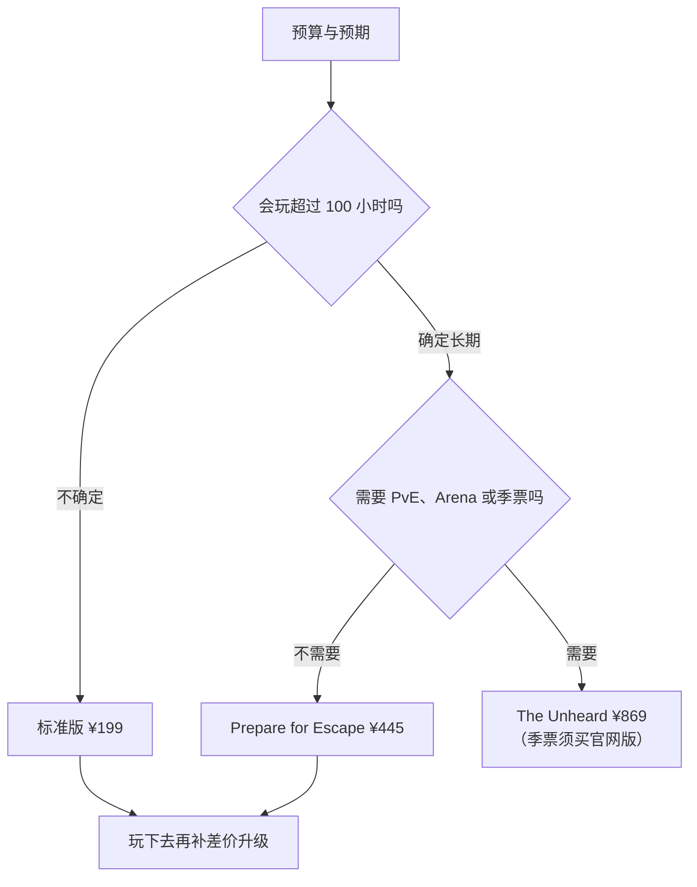

---
tags:
  - 速查
---
# 购买指南：地区与版本怎么选

> 本站其余页面讲的是“进游戏之后”。这一页讲“进游戏之前”——买哪一档、在哪个平台买、买哪个地区、什么时候买最划算。
>
> **价格与地区政策是本站变动最频繁的内容**。本文数据基线：**游戏版本 1.2.0.0**，价格取**官方中国区定价（2026 年 2 月起生效）**；Steam 渠道的价格单独标注，两者并不总是相同。下单前请以购买页面的实时报价为准。
>
> **复核记录**：价格最近一次核对 **2026-09-21**（Steam 商店数据直取）；版本权益最近一次核对 **2026-10-19**（官方商店页、0.14.6.0 补丁说明与中文 Wiki）。触发复核的条件有三条——**官方调价公告、大型版本更新（含 Steam 上线新的版本档位）、每年两次的常规折扣季**。任一条出现，本页即视为待复核。

---

## ⚠️ 先弄清三件事

**第一，塔科夫没有“国服”。**
所谓“中国区”只是一个**定价区**，不是服务器区。游戏服务器全部在海外，简体中文界面与字幕由客户端提供，与你在哪个服务器与谁对战无关。网络连接方式与[听声辨位与音频机制](../entries/audio.md)里的延迟问题另说，但与购买决策无关。

**第二，“区域锁”锁的是启动地点，不是对战对象。**
官方对此的表述很明确：区域锁**不意味着你不能和其他地区、其他服务器的玩家一起玩**——它只意味着你的客户端只能在购买地区物理启动。跨区启动会直接报错（错误代码 **208**）。

**第三，版本权益里真正影响长期体验的，不是“多几件装备”，而是四组东西**：**保险箱与口袋**（每局能带走多少）、**PvE、Arena 与季票**（能玩到什么）、**经验加成、商人好感与技能**（前期快多少）、**邮件/保险/跳蚤槽位等 QoL**（少损失多少）。仓库可以后期扩容，装备会被打光；保险箱也能靠任务或 PvE 转生追平，但那要花时间。**其中经验加成是永久且无法靠玩法追平的**。季票有个**渠道陷阱**：它只跟着**官网版**蓝边走，**Steam 版蓝边不含季票**——这是本文最需要看清的一条，详见下文[两条购买渠道](#channels)。

---

## 📦 版本体系：在售四档，另有一档已停售

塔科夫历史上共出现过五个版本。**目前官网与 Steam 在售的都是这四档**（Steam 上的蓝边自 **2026 年 5 月 20 日**起才可购买）：

| 版本（俗称） | 保险箱 | 仓库 | 战局内经验 | 关键权益 | 中国区定价 |
|------|--------|------|-----------|----------|-----------|
| **标准版** Standard · **白边** | Alpha **2×2** | 10×30 | — | 本体 | **¥199** |
| **Left Behind** · 留守版 | Alpha **2×2** | 10×40 | **+7%** | 专属装备与技能套装 | **¥330** |
| **Prepare for Escape**（PFE）· 准备逃离版 | Beta **3×2** | 10×50 | **+9%** | **全商人初始好感** | **¥445** |
| **The Unheard** · **蓝边** | Gamma **3×3** | 10×72 | **+20%（全队共享）** | 含 **Arena Ryzhy 版**、**PvE 模式**、**季票（后续 DLC，仅官网版含）**、**全商人初始好感**、**口袋扩容**、**技能起始等级提升**、**跳蚤额外槽位**、**邮件/保险领取期延长**、专属身份与外观——**逐项对照见下文** | **¥869** |
| ~~Edge of Darkness~~ · 黑边 | Gamma 3×3 | 10×68 | +12% | **老玩家权益保留**（详见下文黑边说明） | **已停售** |

> **俗称对照：白边、蓝边、黑边到底指什么。**
> 这三个称呼是**国内社区按版本标识与主题色起的绰号，不是官方名称**，但因为流传太广，看老攻略时绕不开：
>
> - **白边** = **Standard 标准版**（最便宜那一档）；
> - **蓝边** = **The Unheard**（因主题色为蓝，也有人叫**金边**）；官网中文把它译作**“未闻者版”**；
> - **黑边** = 已停售的 **Edge of Darkness（EoD）**。
>
> Left Behind 在不同渠道有**“留守版”“遗落版”**两种译法，Prepare for Escape 多称**“准备逃离版”**，其实是同一个版本。
>
> 需要提醒的是：**“白边”与“蓝边”中间隔着 Left Behind 与 Prepare for Escape 两档**，中国区差价接近 ¥670。把选择简化成**“白边还是蓝边”**的二选一，会直接跳过中间两档的性价比区间。

> **关于已停售的“黑边”**：Edge of Darkness 因 2024 年 Unheard 风波后已停止销售，官方支持页明确标注“not available for purchase”。它的权益被 The Unheard 继承并加强（经验加成 +12% → +20%、仓库 10×68 → 10×72）。**已有权益的老账号不受影响**，但新玩家无法再买到——任何声称能提供“全新黑边”的渠道都值得警惕。

---

## 📊 白边 vs 蓝边：逐项拆开看

> 这一节只回答一个问题：**多花的 ¥670，到底买到了什么。**
>
> 先说清楚：这里说的“优化”是**版本权益上的便利**，不是帧数或画质优化——版本不改变性能，性能看[配置与性能](performance.md)。
>
> **一句话**：蓝边买的是**开局容量、全队经验、起跑线、内容门票、QoL 与身份**；真正难追平的是 **+20% 经验、口袋扩容、邮件/保险/跳蚤槽位与身份外观**。

### 1. 每局都生效的数值

| 项目 | 白边（Standard） | 蓝边（The Unheard） | 实际差别 |
|------|------------------|---------------------|----------|
| **保险箱** | Alpha **2×2**（4 格） | Gamma **3×3**（9 格） | **+5 格**；开局即 9 格，白边要任务拿 Epsilon（8 格）或 Kappa（12 格） |
| **仓库** | 10×30（300 格） | 10×72（720 格） | **+420 格**；蓝边开局即 720 格，白边要靠藏身处与商城扩容追，路径见[仓库储存空间升级](#stash-upgrade) |
| **战局经验** | 无加成 | **+20%** | **全队共享**；白边 0，PFE +9% |
| **商人好感** | 无初始加成 | 全商人 **0.2**、Fence **0.5** | 约省 4–10 个任务的声望；PFE 也有全商人 0.2，蓝边相对 PFE 只多 Fence 0.3 |
| **口袋** | 每个 1×1（合计 4 格） | 每个 **2×1**（合计 8 格） | **+4 格**；官方只写“口袋扩容”，尺寸为社区实测 |
| **技能** | 无额外起始等级 | 六项技能起始 **3 级** | 注意力 / 藏身处管理 / 武器维护 / 栓动步枪 / 魅力 / 手枪 |
| **起始资金** | 500,000₽ | 1,000,000₽（另有 $1,000 / €500） | **+500,000₽**；外币起始资金为二级来源 |

> **数值口径**：保险箱、仓库、经验、起始卢布来自官方商店页与补丁说明（一级）；商人好感、口袋、技能与外币起始资金来自二级来源（2026-10 复核），官方只写“提高初始技能等级 / 扩大口袋 / 提高商人好感”。**以购买页与游戏内角色面板为准。**

### 2. 内容与门票

| 项目 | 白边 | 蓝边 | 实际差别 |
|------|------|------|----------|
| **PvE 模式** | 需单买 **¥119** | **已含** | 进度不随删档重置；蓝边不必再买 |
| **Arena** | 需单买 **¥139** | **Arena Ryzhy 版** | 含 Arena 本体与 Ryzhy 版内容 |
| **季票** | 无 | **仅官网版含** | 后续 DLC 访问权；**Steam 版蓝边不含**，详见[渠道差异](#unheard-steam) |
| **ETS** | 无 | **有** | Early Test Server 先导测试服资格；不是正式服进度 |

> **季票现在还没有“现货”**：官方尚未发售任何一款内容型 DLC，蓝边买的是**未来 DLC 的期权**，不是已经能玩到的内容。Steam 版蓝边便宜约 ¥110，缺的正是这一项。

### 3. 长期 QoL：每次死亡、每次成交都生效

| 项目 | 白边 | 蓝边 | 实际差别 |
|------|------|------|----------|
| **跳蚤上架槽位** | 起始 **4** 个 | 起始 **5** 个 | **信誉正常时每档 +1**；信誉仍决定总槽位 |
| **保险领取期** | Prapor 7 天 / Therapist 10 天 / Jaeger 1 天 | **翻倍**：14 / 20 / 2 天 | 死亡后不用急着上线领装备 |
| **跳蚤货款领取期** | 7 天 | **14 天** | 卖完不用当天回来取钱 |
| **任务奖励邮件** | 常规保留期 | **更长** | 官方只写“延长邮件保留时间”，具体以游戏内为准 |
| **仪式圈** | 需自行建造 | **开局即解锁** | 省材料与时间；不是独占玩法，所有版本都能建 |

> **这组是蓝边最容易被忽略的部分。** 它不增加上限，但每次死亡、每次成交都在省钱；如果你经常“死了先下线、过几天再回来”，领取期翻倍的价值会比想象中高。
>
> **来源**：保险与货款领取期来自站内[保险机制](../entries/insurance.md)与[跳蚤定价](../entries/flea-pricing.md)（二级）；跳蚤槽位来自中文 Wiki（2026-09-29）；邮件保留期官方只写“延长邮件保留时间”，没有统一期限表。

### 4. 身份、外观与收藏

| 项目 | 白边 | 蓝边 | 实际差别 |
|------|------|------|----------|
| **游戏内标识** | 无 | 唯一昵称样式 + 专属狗牌 | 身份展示，不影响数值 |
| **臂章** | 无 | 专属臂章 | 占专用槽位，死亡不丢；用于队内识别 |
| **近战武器** | 无 | 专属近战 | 具体属性以游戏内为准 |
| **特殊设备** | 无 | 「无名者之声」（The Mark of the Unheard） | 站内机制见[阵营关系与交战规则](../entries/engagement-rules.md) |
| **专属物品** | 无 | 「紧急信号仪」 | 用途以游戏内为准 |
| **服饰** | 只能穿本阵营 | 专属服饰 + **跨阵营混穿** | 纯外观；混穿会影响别人对你的第一眼判断 |
| **主菜单背景** | 默认 | 专属背景 | 纯外观 |
| **起始装备** | 基础装备 | 专属装备组 + 额外物资 | 会被打光，不是永久资产；别把它算进长期价值 |

> **一句话概括这一组：** 它们不让你变强，只让你“看起来是蓝边”。如果你买版本是为了数值，这一组可以整体按零算。
>
> **来源**：专属标识、臂章、近战、菜单背景与起始装备来自官方 0.14.6.0 补丁说明（一级）；狗牌/昵称样式与紧急信号仪来自官方商店清单与二级整理；服饰混穿见[服装与外观](../entries/clothing.md)。

### 5. 哪些是真优化，哪些只是好看

> 下面是编者按“对实际体验的影响”做的排序，不是官方分级；只打 PvP、只打 PvE、收藏党的权重会不同。

| 档位 | 项目 | 判断 |
|------|------|------|
| **S · 每局都生效** | Gamma 3×3、口袋 +4 格 | 直接决定“这局能带走多少”；死一次就回本一次。但 Gamma 不是终点——Kappa 12 格更大 |
| **S · 整个档期都生效** | +20% 经验（全队） | **永久且无法靠玩法追平的数值**；只加快升级，不改变等级上限 |
| **A · 前期省时间** | 商人好感 0.2 / Fence 0.5、六项技能 3 级、100 万卢布 | 压缩前 10–20 小时；长期会被抹平，但开荒体感明显 |
| **A · 容量、少损失、少等待** | 保险/货款领取期、跳蚤 +1 槽位、仓库 10×72 | 每次死亡/成交都生效；仓库可追平，槽位与领取期不可 |
| **B · 内容门票** | PvE、Arena Ryzhy、ETS | 本来就会买 PvE/Arena 的话，内容部分至少是 ¥219–258；ETS 是另附的测试资格 |
| **B · 未来期权** | 官网版季票 | 现在没有 DLC 现货；值不值取决于未来 DLC 的规模 |
| **C · 身份、外观与便利** | 唯一标识、臂章、近战、专属物品、服饰、菜单背景、仪式圈 | 不影响数值；仪式圈只是省建造，不是独占玩法 |

> **如果只看“每局变强”，排序是：Gamma + 口袋 ＞ +20% 经验 ＞ 商人好感/技能 ＞ 邮件/保险/跳蚤槽位 ＞ 仓库 ＞ 外观。**
> **如果只看“省钱”，排序是：PvE + Arena（¥219–258）＞ 邮件/保险/跳蚤槽位 ＞ 仓库 ＞ 身份外观。**

### 6. 白边想追平，要付出什么

| 蓝边权益 | 白边能否追平 | 追平代价 |
|----------|--------------|----------|
| **Gamma 3×3** | 能，但不是同一件 | Epsilon（Punisher 6，4×2/8 格）→ Kappa（Collector，3×4/12 格）；Gamma 另有 PvE 转生奖励。都要时间与技术 |
| **10×72 仓库** | 能 | 藏身处仓库 4 级（10×68）+ 最后 4 行：官网 +2×2（约 ¥24）或 Expansions Hub 2/4 行包（TarCoin）；材料与时间另计，详见[仓库储存空间升级](#stash-upgrade) |
| **+20% 经验** | **不能** | 只有版本给；无法用玩法补 |
| **商人好感 0.2 / Fence 0.5** | 能，靠任务与时间 | 0.2 约等于 4–10 个任务的声望；蓝边省的就是这 4–10 个任务 |
| **口袋 +4 格** | 官方未单列白边路径 | 以游戏内任务列表为准；蓝边是开局即得 |
| **六项技能 3 级** | 能，靠练 | 省的是前几十小时的练级 |
| **PvE** | 能 | **¥119** |
| **Arena Ryzhy** | 能 | **¥139**（Arena 本体） |
| **季票** | **不能单买** | 只能官网版蓝边；Steam 版也没有 |
| **邮件/保险/跳蚤槽位** | **不能** | 只有版本给 |
| **身份/外观/专属物品** | **不能** | 只有版本给；不影响数值 |

> **仓库那行值得单独看**：蓝边的 10×72 是“开局即 720 格”，不是“只有它能到”。白边把藏身处仓库升到 4 级、再买最后 4 行（官网 +2×2 约 ¥24，或 Expansions Hub 2/4 行包用 TarCoin）——贵的是材料与时间，不是那两行。**所以别为了仓库单独上蓝边。**

### 7. 这笔账到底怎么算

白边 **¥199**，蓝边 **¥869**，差 **¥670**。

- **如果你本来就会买 PvE + Arena**：组合包 **¥219**（单买 ¥258，省约 ¥39）是实打实的内容；按组合包算，剩下约 **¥451** 买的是 Gamma、仓库、口袋、经验、好感、技能、邮件/保险/跳蚤槽位、身份外观与季票期权（按单买算则为 ¥412）。
- **如果你不会买 PvE 和 Arena**：这 ¥670 全部是“便利 + 身份 + 季票期权”。这种情况下，**Prepare for Escape（¥445）仍然是性价比拐点**。
- **如果你只想要大保险箱**：白边可以靠 Punisher 6 拿 Epsilon（8 格，比 Gamma 少 1 格）、靠 Collector 拿 Kappa（12 格，比 Gamma 大 3 格）；**不要为了“保险箱”三个字直接上蓝边**。
- **如果你在意后续 DLC**：只有官网版蓝边含季票；Steam 版蓝边便宜约 ¥110，但未来 DLC 要单独买。**这是两条不同的账，不要混在一起算。**

> **一个反直觉的结论**：蓝边最值钱的东西不是“仓库”或“季票”，而是**Gamma + 口袋 + 全队 +20% 经验**——前两个每局都生效，最后一个整个档期都生效且无法追平。其余权益，要么能靠玩法追平，要么只是身份。

---

## 💡 仓库储存空间升级：10×30 怎么到 10×72

> 这一节把“仓库差 420 格”拆成可执行的升级路径。先说结论：**白边能把仓库补到 10×72，蓝边省的是“从第一天起就有 720 格”，不是“只有它能到 720 格”。**
>
> 下面先以**蓝边起始的 10×72** 为基准；商城的 `60/80`、`80/80` 组合包还能继续往上，见第 3 小节。

### 1. 容量怎么算

仓库按 **10 列 × N 行** 计，容量 = 10 × N 格。版本初始仓库对应的容量是：

| 版本 | 初始仓库 | 格数 | 对应藏身处等级 |
|------|----------|------|----------------|
| 白边 | 10×30 | 300 | 1 级 |
| Left Behind | 10×40 | 400 | 2 级 |
| PFE | 10×50 | 500 | 3 级 |
| 黑边 | 10×68 | 680 | 4 级 |
| 蓝边 | 10×72 | 720 | 4 级 + 4 行 |

> **1.0 起，持久 PvP/PvE 档案的仓库进度长期保留**，藏身处投入不再随大更新清零；**赛季档案仍每 4–6 个月重置**（见[藏身处](../entries/hideout.md)）。所以“慢慢升仓库”对长期玩家是划算的，对只玩赛季的玩家要算回本时间。

### 2. 藏身处仓库 1–4 级：成本、时间与前置

| 等级 | 容量 | 主要成本 | 施工 | 前置 |
|------|------|----------|------|------|
| **1 级** | 10×30（300 格） | 无 | 即时 | — |
| **2 级** | 10×40（400 格） | **250 万₽** + 螺钉×10、钉子×5、WD-40×4、手摇钻×1 | **1 小时** | 通风 1、仓库 1 |
| **3 级** | 10×50（500 格） | **850 万₽** + 螺钉×15、钉子×7、电钻×2 | **12 小时** | 通风 2、供暖 2、仓库 2 |
| **4 级** | 10×68（680 格） | **20 万€** + 棘轮扳手×2（战局内）、螺栓×10、螺母×10、Shustrilo 发泡密封胶×8 | **4 天** | 发电机 3、工作台 3、供暖 3、仓库 3、情报中心 2 |

> **来源**：容量与成本为二级（英文 EFT Wiki / TarkovForge 对账，2026-10 复核）；完整材料表见[藏身处模块详解](../entries/hideout-modules.md)。总施工 **4 天 13 小时**，不含攒材料与前置模块施工的时间。

### 3. 商城里的几种仓库扩容

商城其实有两条线、七种买法：

| 入口 | 商品 | 一次加多少 | 价格/货币 | 限制 |
|------|------|------------|-----------|------|
| 官网 / Steam | **仓库容量升级 +2 行** | +2 行（+20 格） | **¥12 / 次** | 可叠加，受账号仓库上限约束 |
| Expansions Hub | **2 行单独扩容** | +2 行（+20 格） | **TarCoin** | 组合包都买不了时仍可买 |
| Expansions Hub | **4 行单独扩容** | +4 行（+40 格） | **TarCoin** | 组合包都买不了时仍可买 |
| Expansions Hub | **仓库行数特惠包 20/80** | +20 行 | **2,850 TC**（省 150） | 不超过账号仓库上限时可买 |
| Expansions Hub | **仓库行数特惠包 40/80** | +40 行 | **5,550 TC**（省 450） | 同上 |
| Expansions Hub | **仓库行数特惠包 60/80** | +60 行 | **8,100 TC**（省 900） | 同上 |
| Expansions Hub | **仓库行数特惠包 80/80** | +80 行 | **10,500 TC**（省 1,500） | 同上 |

> **价格核对**：以上 TarCoin 价为 **2026-07-09 商店截图 / 日文 Wiki 对账**；组合包比“2 行单买”便宜，购买后需要**重启游戏**才生效。价格与档位随版本调整，以商店当期为准。
>
> **`80/80` 说明商城的扩容上限不止 10×72**：本站前文的 `10×72` 是**蓝边起始 / 藏身处路径**的容量，不是商城货架的上限。实际能买到哪一档，取决于你账号当前的仓库上限与已购行数；官方 FAQ 的例子是“已买 22 行时，只剩 `20/80` 和 `40/80` 可买”。
>
> **简易判据**：先在仓库/商店看**当前剩余可扩行数**；只买 ≤ 剩余行数的档。若只打算追到蓝边的 10×72，剩余 = **72 − 当前行数**；若要继续往上，按账号实际上限算。

### 4. 最后 4 行：10×68 → 10×72

藏身处最高只到 **4 级 = 10×68**。最后 4 行有三种买法，**选一种，别重复买**：

| 买法 | 容量变化 | 价格 |
|------|----------|------|
| 官网 / Steam：+2 行 ×2 | 10×68 → 10×70 → 10×72 | **¥24** |
| Expansions Hub：2 行单独包 ×2 | 10×68 → 10×70 → 10×72 | **TarCoin**（以商店当期为准） |
| Expansions Hub：4 行单独包 | 10×68 → 10×72 | **TarCoin**（以商店当期为准） |

> **如果你平时会捡 TarCoin，优先用 4 行单独包（或 2 行 ×2）**——TarCoin 是战局内可获得的货币，等于用游戏时间换扩容；如果不想碰 TarCoin，就走官网 +2 行 ×2，现金约 ¥24。

> **别把“250 万 / 850 万卢布”当成人民币**：它们是游戏内货币，靠 raid、市场和商人赚；现金路径只有官网最后两次 +2 行扩容（约 ¥24）；不想花现金，就用战局里攒的 TarCoin 换 2/4 行单独包。蓝边则把这 4 级 + 4 行全部省掉，开局直接 720 格。

### 5. 白边追到 10×72，实际要付什么

> 这一节只算到 **10×72（蓝边的起始量）**；商城的 60/80、80/80 还能继续往上，超出部分按第 3 小节另算。

| 成本项 | 数量/代价 |
|--------|-----------|
| 游戏内货币 | 250 万₽ + 850 万₽ + 20 万€（合计 1,100 万₽ + 20 万€） |
| 关键材料 | 螺钉 25、钉子 12、WD-40 4、手摇钻 1、电钻 2、棘轮扳手 2（战局内）、螺栓 10、螺母 10、发泡胶 8 |
| 施工时间 | 1 小时 + 12 小时 + 4 天 = **4 天 13 小时** |
| 前置模块 | 通风 2、供暖 3、发电机 3、工作台 3、情报中心 2（这些本身也要材料与时间） |
| 现金/内购 | 官网 +2 行 ×2：**约 ¥24**；或 Expansions Hub 2/4 行单独包：**TarCoin**（可战局内获得） |

> **贵的是“前置模块 + 攒材料 + 4 天施工”，不是那 ¥24。** 如果你本来就要建发电机 3 / 工作台 3 / 供暖 3 / 情报中心 2（大多数长期玩家都会），仓库 4 级的边际成本会低很多；如果你只玩一个赛季、不打算长期建设，**4 天施工 + 20 万€ 的回收期可能覆盖不了你的游玩时长**。

### 6. 什么时候值得升，什么时候别升

- **购买顺序**：先把藏身处仓库升到 4 级（10×68），再买商城扩容；只买 ≤ 账号剩余可扩行数的档。别一次囤超过剩余量的大包，否则会被上限卡住或买多。
- **长期玩持久 PvP / PvE**：值得。1.0 起仓库进度长期保留，4 级是“一次投入、长期使用”；先 2 级（250 万₽）应急，再慢慢攒 3 级、4 级。
- **只玩赛季角色**：谨慎。赛季档案每 4–6 个月重置，4 级仓库的 4 天施工 + 前置模块可能还没回本，优先建“够用”的 2–3 级。
- **只为“10×72”买蓝边**：不建议。白边能追到 10×72，现金只差约 ¥24；而且商城还能用 60/80、80/80 继续往上。蓝边贵的是“开局就有”，不是“只有它有”。
- **蓝边玩家**：开局 10×72 是实打实的省事，但如果你本来就会把藏身处建满，它的长期价值会被摊薄——**它的价值主要在前 100 小时**。

---

## 🎯 怎么选：三个分水岭

不用把上面的版本表逐列对比，只要依次过三道坎。

**第一道坎：保险箱 2×2 → 3×2 → 3×3。**
这是全版本体系里最硬的分水岭。安全箱内的物品**死亡不丢**（见[背包与容器系统](../entries/inventory.md)），2×2 只能塞下一把钥匙加一个任务物品，3×3 能塞下一整组高价值小件。**Alpha 与 Beta 之间的差距，比 Beta 与 Gamma 之间的差距更大**——前者决定“能不能带任务物品进图”，后者只影响“一次能带几件”。

**第二道坎：PvE、Arena 与季票。**
PvE 模式（进度不随删档重置）是**独立付费项，¥119**；Arena 单买 **¥139**；季票（后续 DLC 访问权）目前**只能通过 The Unheard 获得**。如果你确定只玩 PvP、不买 Arena、也不需要后续 DLC，为这些内容付 ¥424 的差价不划算——但蓝边还含一整套开局数值与 QoL，**别只按“PvE + 季票”两项算账**，逐项见上文[白边 vs 蓝边](#unheard-vs-standard)。

> **一个会改变这笔账的变量：PvE 转生——已实装。** **1.2.0.0（2026-10-06）已为 PvE 上线转生系统，共 6 档**，PvE 本身不删档，转生是它唯一的“重开”方式，且**转生奖励永久保留、wipe 也不丢**。对**打算长期只玩 PvE** 的人来说，这已经抬升了那 ¥119 的长期价值。**如果你正卡在“要不要买 PvE”，值得把它算进去**（逐档门槛见 [Prestige 转生](../entries/prestige.md)）。
>
> **另一条 1.2.0.0 带来的变量：PvE 现在可以直接买卢布。** Expansion Hub 已开放**用真钱购买 PvE Zone 的游戏内卢布**——**只在 PvE，不在 PvP**。这条**不改变版本档位的定价**，但它改变了 PvE 内部的节奏：**起号期可以直接跳过攒钱这一段**。是否使用、以及对 PvP 进度是否有溢出影响，**以游戏内 Expansion Hub 的当前页面为准**。

**第三道坎：商人好感、技能与经验加成。**
PFE 的“全商人初始好感”、Unheard 的 +20% 经验与六项技能起始 3 级，都是**压缩前期而不是改变上限**的东西。前期少卡几天，长期看会被抹平。**不要为这一项单独升档**——但它们是蓝边差价里最常被低估的部分，尤其 +20% 经验是**永久且无法靠玩法追平**的。

**结论式建议**：

| 你的情况 | 建议 |
|----------|------|
| 第一次接触撤离类游戏，不确定能否玩下去 | **标准版**——先验证自己是否喜欢这套机制 |
| 已经确认喜欢，打算长期玩，只玩 PvP、不买 Arena/PvE | **Prepare for Escape**——性价比拐点；蓝边的多数权益是便利，不是内容 |
| 需要 PvE 模式 | **The Unheard**（内含 PvE，不必再单独买），或任意版本 + 单买 PvE **¥119** |
| **确定会买 PvE + Arena，且想开局舒服** | **The Unheard**——内容部分约 ¥219–258，剩下买的是 Gamma、经验、好感、口袋与 QoL |
| **想一次拿全后续所有 DLC** | **只能买官网版** The Unheard——**Steam 版蓝边不含季票**，详见下文渠道对比 |
| 预算极紧，但想要大保险箱 | 标准版 + 后期攒钱升级，见下文“升级路径” |

---

## 🧩 独立付费项一览

这些**不包含在四档版本里**（Unheard 除外），需要单独购买：

| 项目 | 中国区定价 | 说明 |
|------|-----------|------|
| PvE 模式 | **¥119** | 进度不删档的合作模式；Unheard 已含 |
| PvE + Arena 组合包 | **¥219** | 比单买便宜约 ¥39 |
| Escape from Tarkov: Arena | **¥139** | 独立竞技项目；Unheard 已含 Ryzhy 版 |
| Arena 战术地图 | **¥59** | Arena 内购 |
| Arena 10 个战斗通行证等级 | **¥20** | Arena 内购 |
| 仓库容量升级（官网 / Steam，**+2 行**）| **¥12** | 可叠加，是现金补法；Expansions Hub 另有 2/4 行单独包与 20/80、40/80、60/80、80/80 四档特惠包，详见[仓库储存空间升级](#stash-upgrade) |
| 服饰解锁（BEAR / USEC 各款）| **¥19 – ¥55** | 纯外观，不影响任何数值 |
| **TarCoin 内购货币** | **¥19.99** | 2026-07-08 上架；游戏内 **Expansions Hub** 的通用货币 |
| **TarCoin 特惠包** | **¥39.99** | 赠 100% 加成，**每账号限购一次** |

> **Arena 有一条别的项目没有的“先试后买”路径。** 与本体不同，**Arena 会周期性开放免费周末**——期间可以完整试玩，而且**免费周末通常伴随 Arena 本体与战术地图的折扣**。所以对“不确定要不要买 Arena”的人来说，**正确的动作是等一次免费周末**，而不是直接下单或者靠猜。
>
> 这里刻意**不记具体日期**：临时活动一过就变成错信息。记住这条**机制**就够了——**Arena 会开免费周末**，具体时间看官方公告（已发生过的活动见[重大版本更新史](version-history.md)）。

> **2026 年 7 月起，塔科夫多了一套游戏内商店体系。** **TarCoin** 与 **Expansions Hub** 于 2026-07-08 上线：TarCoin 既是**战局内可获得的货币**，也能直接购买，用于外观、仓库扩容、赛季战斗通行证的**加速道具**（Classified Documents，可直接顶替赛季所需的 TerraGroup 文件）等。这是塔科夫第一次把付费内容搬进游戏本体，详见[重大版本更新史](version-history.md)。
>
> **别把“季票”和“战斗通行证”混为一谈**——这两个名字很像，性质完全不同：
>
> | | 季票（Season Pass） | 战斗通行证（Battle Pass） |
> |---|---|---|
> | 是什么 | **后续 DLC 的访问权** | **赛季内的免费活动轨道** |
> | 要额外买吗 | 不单卖，**只有官网版 The Unheard 含** | **免费**，所有玩家都能推进 |
> | 怎么推进 | — | 上交 TerraGroup 文档类道具 |
> | 过期吗 | 不过期，访问权长期有效 | 赛季结束即重置；**未解锁的赛季奖励永久不可获得** |
>
> 也就是说：**战斗通行证不用买，季票买不到（只能通过官网版蓝边获得）**。看到“通行证”三个字先分清是哪一个。

> **仓库扩容是最典型的“别为它买版本”。** 官网 +2 行 **¥12/次**；Expansions Hub 还有 **2/4 行单独包**与 **20/80、40/80、60/80、80/80 四档特惠包**（TarCoin）。但标准版从 10×30 到 10×72 要先把藏身处仓库升到 4 级（10×68），再买最后 4 行（官网约 ¥24，或用 TarCoin）。**蓝边的优势是开局即 720 格，不是只有它能到 10×72**——想省这一步就买高版本，想省钱就慢慢扩容，两条路都成立。逐步拆解见下文[仓库储存空间升级](#stash-upgrade)。

---

## 🔄 升级路径：先买低版本再升，划不划算

**官方流程与规则**（出自官方支持页「How to buy an upgrade」）：

- 登录官网 → 进入购买页 → 选中目标版本 → 点 **Upgrade** → 确认付款。**升级入口在官网页面上，不在游戏里**；
- **升级价 = 目标版本价 − 当前版本价**，只付差价；
- **账号上的现有进度全部保留**——官方原文：升级版本时，你账号上的一切当前进度都会被保存。**升级不需要删档重置**；
- **只发差额部分**，已获得的东西不重复发放。官方举的例子最直白：500,000 卢布是每个版本（The Unheard 除外）都含的初始资金，所以升级时**不再额外给**；而升到 The Unheard 会补 **500,000 卢布**（因为它含 1,000,000）；
- 升级物品以**游戏内系统消息**形式发放（和跳蚤市场成交、保险返还共用一个收件箱），**偶尔延迟**。进游戏没看到不必慌，退出重进或等几分钟。

**该不该“先买低版本再升”？**

| 情形 | 结论 |
|------|------|
| 还没确定能不能玩下去 | **先标准版**——升级只付差价，早期不多花钱，这是这条路的唯一价值 |
| 已经确定要长期玩 | **直接在目标版本上等折扣**。各次活动的折扣档位不同（见下文折扣规律），先买低档会多承担一次非折扣期的差价风险 |
| 想在折扣期升级 | **可行**。官方春促措辞是“**购买或升级至** Left Behind 版本，立享 8 折”——**升级项目本身也打折** |

> **一条容易混淆的规则**：升级只在**你购买的那个渠道内**完成——官网买的走官网购买页的 Upgrade，Steam 买的走 Steam 上对应的扩展包。两条渠道的**权益**会按账号上的“最高版本”合并生效，但**升级动作本身不跨渠道**。后一句官方未逐条写明，是从“Steam 扩展包作为独立 DLC 售卖”这一事实推出的。

---

## 🛒 两条购买渠道：官网与 Steam

两个渠道都能买，但规则不同。

### 官网（Battlestate Games 官方商店）

- 直连官网下单，支付通过 **Xsolla** 完成（支持支付宝等国内常用方式）；
- 版本最全，扩展项（PvE、仓库行、服饰）与升级项目都在这里；
- **支持“赠送他人”**：每个版本都有独立的赠送入口，送出的是 **gift key**。收礼方激活时**会与自己账号上的现有版本合并**——官方举例：已持有标准版的账号激活 The Unheard 的 gift key 后，版本升为 The Unheard，并补发两档之间的差额物品。**但赠送同样受地区限制**（见下文），送人、代购是买错区的高发场景；
- 官网账号是**唯一的账号体系**——无论在哪买，最终都要用 BSG 账号登录；
- **注意：官网订单不支持退款**，详见下文[能不能退款](#refund)。

### Steam

Steam 版于 **2025 年 11 月 15 日**（与 1.0 正式版同日）上架，但它有一条几乎所有人都会踩的规则：

> **已有官网版的玩家，想在 Steam 上玩，必须在 Steam 再买一份。** Steam 版被视为一个**独立的购买渠道**，不提供账号或进度的免费迁移。

不过这里有一个**关键的省钱点**，官方 FAQ 写得很清楚：

> **如果你已经拥有更高版本（如 The Unheard 或已停售的 Edge of Darkness），在 Steam 只需购买标准版即可。** 绑定 BSG 账号后，游戏会自动识别并使用你账号上**最高的那个版本**。

反过来说：**如果你先买了 Steam 标准版，之后想要 PvE，仍然要回到官网或 Steam 单独买 PvE 扩展**——Steam 上的 PvE Zone 单独售价 **¥119**，与官网同价，Steam 版不会自动升级你的官网权益。

### ⚠️ 蓝边的渠道差异：官网版含季票，Steam 版不含

这是两个渠道**唯一一处实质性的版本权益差异**，也是“蓝边”这个俗称最容易误导人的地方。

**Steam 版蓝边是单独的一件商品**（商品名 *The Unheard Steam Edition*，**2026 年 5 月 20 日**上架，比 Steam 本体晚了半年），商店页面的官方说明原文是：

> Please note: The Unheard Steam Edition does not include Season Pass. This limitation is caused by Steam platform rules and was taken into account in pricing.
>
> 译：**Steam 版 The Unheard 不包含季票。这一限制由 Steam 平台规则造成，并已在定价中予以考虑。**

这句话有三层意思，逐层拆开看：

1. **缺的不是“内容”，是季票。** PvE 模式、Arena Ryzhy 版、Gamma 保险箱 3×3、10×72 仓库、口袋扩容、全商人初始好感、六项技能起始 3 级、+20% 经验（全队共享）、跳蚤额外槽位、保险/货款领取期延长、跨阵营服饰、专属近战与游戏内标识——**Steam 版蓝边一样不少**。唯一缺的是季票，也就是**后续所有 DLC 的访问权**。
2. **原因是平台规则，不是区别对待。** 官方把原因明确挂在 Steam 侧，而不是说“我们特意砍掉了”。
3. **价格确实降了。** 官网中国区蓝边 **¥869**，Steam 中国区蓝边 **¥758.99**（本次核对时的实时报价），差约 **¥110**——这个差价大致就是季票的那一份钱。

**这对你意味着什么？**

| 你的打算 | 结论 |
|----------|------|
| 只玩当前内容，不打算追后续 DLC | **Steam 版蓝边更划算**，省下的钱是真的省下 |
| 打算长期跟到后续 DLC | **选官网版**——Steam 版将来要为每个 DLC 单独付费，总价很可能反超官网版 |

**一个重要前提：季票现在还没有“现货”。** 到本文更新时为止，官方**尚未正式发售任何一款内容型 DLC**——季票买到的是**未来 DLC 的期权**，不是已经能玩到的东西。所以上面那 ¥110 的差额，本质是**对赌未来 DLC 的规模与数量**，而不是买与不买一份现成内容。

**如果我已经有官网版蓝边，再补一份 Steam 版，季票会丢吗？**

不会——**季票是绑定在 BSG 账号上的权益，不是绑在 Steam 账号上的**。官方 FAQ 的规则是“实际游玩版本取两个账号中更高的那个”，所以你在 Steam 补一份标准版之后，游戏仍会按账号上的 The Unheard 权益运行，季票随账号保留。**但官方没有对这一组合逐字说明**（Steam FAQ 只写了“Steam 版不含季票”这一句），如果你很在意，下单前可直接找客服确认。

**未来 DLC 在 Steam 上怎么买？** 官方**没有公布**。目前能确定的只有“Steam 版不含季票”这一条。从 Steam 现有做法看（PvE、Arena 内容等都是以独立 DLC 条目挂在库里的），未来 DLC 大概率会**作为 Steam DLC 单独上架**。**这属于合理推断，不是官方口径**，别当成承诺。

Steam 版的其他限制：

| 项目 | 情况 |
|------|------|
| 是否需要 BSG 账号 | **需要**，且需手动绑定 Steam 账号 |
| 启动方式 | 仍走 BSG 启动器（Steam 只负责分发与库内启动） |
| 跨平台对战 | **同服**——官方明确：所有玩家在同一批服务器上，与在哪买无关 |
| 季票 / 后续 DLC | Steam 版蓝边**不含季票**（官方原文见上）；未来 DLC 的 Steam 销售方式官方未公布 |
| 家庭共享 | **不支持** |
| Steam Deck | **不支持**（官方标注 Unsupported） |
| 成就 | 支持（**98 个**，随版本更新递增） |

**该选哪个？**

- 想要**最完整的购买与升级选项**、想用支付宝 → 官网；
- 想要**库内统一管理、Steam 成就与钱包余额** → Steam；
- **想买蓝边**：在意后续 DLC → **官网**；不在意后续 DLC → **Steam 版便宜约 ¥110**；
- 已经在官网投了钱、又想要 Steam 的界面 → 补一份 Steam 标准版（不是必须，属于为便利付费），账号上的原有版本权益与季票会被自动沿用。

### 💸 能不能退款：Steam 有窗口，官网没有

这是两条渠道之间**很少被提到、但试错成本差别巨大**的一条差异。

**官网（Xsolla）：条款层面不提供退款。** 官方支持页「Purchase refund」写明，依据许可协议 **11.4.2**：

> 终止与许可方的协议、撤销游戏使用权，或以任何理由取消协议，**均不构成用户要求许可方返还已支付费用或其他款项的依据**。

实务中，官网订单只能通过 **Xsolla 客服**个案申诉（网上流传的“需 180 天内、需提供购买凭证”属于**用户经验，不是官方承诺**）。**不要按“反正能退”来下单。**

**Steam：走平台通用退款规则，窗口是明确的。**

| 买的东西 | 退款条件 |
|----------|----------|
| 游戏本体 | **购买 14 天内**，且**游戏时间不超过 2 小时** |
| DLC（PvE Zone、蓝边扩展包等）| **购买 14 天内**，且所依赖的本体**自 DLC 购买之时起**运行不超过 2 小时，DLC 未被消耗或转让 |

两个容易忽略的点：

1. **DLC 那 2 小时是从“买了 DLC 之后”起算的**——如果你已经在本体上玩了 50 小时才想起来买 PvE 扩展，这个窗口等于已经关上了。
2. Steam 规则里留了一类例外：**“会不可逆升级游戏角色”的 DLC 可能被排除在退款范围外，且这种例外会在商店页显著标注为概不退款**。核对时 **Steam 的蓝边扩展包页面没有这类标注**，因此按通用 DLC 规则处理——但这终究是平台与发行商之间的裁量空间，**不是保证**。

**务实结论**：**没把握自己会不会玩下去的人，从 Steam 渠道入手——那个退货窗口本身就相当于一次低成本试玩**。官网渠道没有这层保护，下单前请把税费规则和退款条款一起看完。

### 🚫 不要买的渠道

**第三方 key 站（G2A、Kinguin 等）与二手账号。** 这不是保守建议：塔科夫的 key 与账号绑定极紧，来路不明的 key 存在**被回收后账号连带受损**的风险，二手账号则可能触及账号共享与所有权问题。官方从未授权任何第三方分销。

---

## 🌍 地区定价与区域锁

### 中国区定价（2026 年 2 月 10 日起生效）

这是近年对国内玩家影响最大的一次变化——**官方为中国大陆地区设立了独立定价，并整体下调**：

| 版本 | 官网中国区定价 | Steam 中国区核对价 | 此前参考价 |
|------|---------------|-------------------|-----------|
| 标准版 | **¥199** | ¥199.99 | ¥285 |
| Left Behind | **¥330** | ¥329.99 | ¥470 |
| Prepare for Escape | **¥445** | ¥444.99 | ¥635 |
| The Unheard | **¥869** | **¥758.99**（不含季票） | — |
| Arena | **¥139** | — | — |

> **本表来源**：价格取自**官方中国大陆地区定价公告**与**官方中文 FAQ**（官方支持站编号页 **549**，可在官网 `support/knowledge/549` 查证，含全部扩展项与服饰明细）。**Steam 列**是官方商店的对应标价，会随平台活动浮动。

**两条渠道的价格基本对齐，唯一的例外就是蓝边**——Steam 版比官网版便宜约 ¥110，差额对应的是它不含的季票（详见上文[蓝边的渠道差异](#unheard-steam)）。扩展项（PvE、仓库行、服饰）在两条渠道**同样适用地区定价**，核对时 Steam 上的 PvE Zone 为 **¥119**，与官网一致。

### 💳 标价 ≠ 实付：税费与支付渠道附加费

这是“数字对不上”最容易被误认为 bug 的一处。官方购买页底部的原文是：

> **当前价格不包含任何附加税费。产品的最终价格将在支付前的结算流程中显示。使用不同方式支付需要的附加费用可能存在差异。**

拆开看：上表那些数字**只是基数**，不含税费；**最终金额要到结算流程才显示**；而且**换个支付方式，附加费可能不一样**。所以看到“页面标 ¥199、实际扣了 ¥2xx”不必惊讶——这是写在页面上的规则，不是定价错误。真要控预算，就以**结算页的金额**为准，而不是上面这张表。

**必须弄清的四条规则**（均出自官方中国区 FAQ）：

1. **不能把已有账号改成中国区。** 想享受中国区定价，只能**新建账号并重新购买**，地区定价随新账号生效。
   > ⚠️ **这条的代价常被忽略：新建账号 = 从零开始，且丢掉老账号上的版本权益。** 官方不提供账号之间的权益或进度迁移——老账号若是 The Unheard / Edge of Darkness，那份保险箱、仓库与季票**带不到新账号上**。所以“为了 ¥100 多的差价新建账号”对**已经买过高版本的玩家基本不划算**；只有**打算彻底重开、或老账号本来就是标准版**的情况才值得考虑。
2. **中国区定价会随活动同比例打折。** 折扣季时按全价的比例下调，不是固定减额。
3. **中国香港、中国澳门、中国台湾地区不包含在中国大陆定价区内。**
4. **购买时不要开 VPN。** 官方明确提示：开代理购买可能让你**买错地区版本**。

### 区域锁的实际含义

| 误解 | 实际情况 |
|------|----------|
| “买了中国区就只能和中国区玩家玩” | ❌ 官方明确：区域锁**只限制启动地点**，可以和其他地区玩家、其他服务器一起游戏 |
| “在哪买都一样” | ❌ 跨区启动会报**错误 208**，客户端在购买地区之外无法运行 |
| “买错区就只能重买” | ⚠️ 可补救：登录个人资料页，用 **Change region** 购买**地区升级**（升级费用另计） |

**一条实用建议（官方原话的意思）**：**如果你经常出行，EU 版才是省心的选择**——它的覆盖范围最广，是唯一官方推荐的“到处跑”版本。

---

## ⏰ 什么时候买：折扣规律

塔科夫**打折非常频繁**，一年大致 4–6 次，通常绑定季节特卖与大型版本更新。

### 实测折扣记录（2026 年）

| 时间 | 活动 | 折扣 |
|------|------|------|
| 2026-05-26 – 06-01 | 春季特卖（随 1.0.5.0 破冰船上线） | Left Behind / Prepare for Escape **20% off**；The Unheard **25% off**；服饰、仓库行、PvE **15% off** |
| 2026-06-25 – 07-09 | Steam 夏季特卖 | 标准版 **25% off**；Left Behind / PFE **15% off**；PvE **10% off** |

从 Steam 的价格历史看，2025 年 11 月（1.0 上线月）到 2026 年 6 月之间，**几乎每个月都有折扣窗口**，标准版的最低价一度到基础价的 **75%**。

### 三条结论

**1. 折扣同时覆盖“购买”与“升级”。**
这一点常被误解。春季特卖的官方措辞是**“购买或升级至 Left Behind 版本，立享 8 折”**——也就是说**升级项目本身也会打折**。所谓“升级永远不打折”的说法并不成立。

**2. 最低成本路径是“在目标版本上等活动”，而不是“先买便宜后升级”。**
因为每次活动的折扣档位不同：夏季特卖给标准版 25%、却只给 Left Behind 与 PFE 15%；春季特卖则给 The Unheard 25%。**先买低档再升级，会额外承担一次非折扣期的差价风险。**

**3. 两档之间的价差是固定的，折扣不同步会放大差距。**
中国区定价是固定价目，因此**升级差价 = 目标版本价 − 当前版本价**（活动期按各自折后价计算）。在你已经确定要哪一档的前提下，**直接等那一档打折**，永远比“找折扣最大的那一档先买”更划算。

### 第三条路径：折扣码

除了折扣季与赛季窗口，还有一条**力度往往更大、但需要主动去找**的路径：**官方与社区渠道发放的折扣码**。

- 官方会在**周年庆、大型版本上线、联动活动**时放出折扣码，历史上有过 **20%–30%** 的档位；
- 这类码**有效期通常很短**（几天到几周），有的还**限定渠道**（例如只对官网订单生效）；
- 兑换入口在**官网个人资料页的「激活优惠码」**，或**启动器的「激活代码」**。

> **实用动作**：**在结算之前**花一分钟确认当期有没有可用码——这一步成本为零，而折扣码的力度**常常超过折扣季**。
>
> **但别用来路不明的码**：第三方站点常年挂着大量过期或伪造的码，**以官方渠道发布的为准**。

### 折扣之外还有一个窗口：赛季

只盯着折扣会漏掉一个同样硬的时间约束——**赛季**。

- 第一赛季 **KORD BREACH** 于 **2026-08-03**（补丁 1.1.0.0）开启，官方给出的节奏是**每 4–6 个月**换一季；
- 赛季战斗通行证**免费**，但**赛季结束时仍未解锁的赛季奖励会永久不可获得**（官方补丁说明的表述是：已解锁的奖励在各模式间**永久保留**，赛季结束时仍处于锁定状态的奖励**永久不可获得**）；
- 所以**“晚半年再入坑”是有实际成本的**——你会少掉整个赛季的奖励轨道。这与“等折扣省几十块”是两个方向的账。

把两笔账合起来看：

| 你的时间点 | 建议 |
|------------|------|
| 正处赛季中段，且确定要玩 | **不必死等折扣**——赛季奖励的损失可能大于折扣省下的钱 |
| 赛季临近结束、下一季将开 | **等新赛季开季**再买，正好从赛季第一天开始推进 |
| 只玩 PvE、不打算参与赛季 | **纯看折扣**，赛季窗口与你无关 |

> 别搞混一件事：**赛季角色是 PvP 侧的可选玩法**，你原有 PvP 与 PvE 档案的进度**不会因为赛季开始或结束被清空**。赛季窗口影响的是“你要不要参与当季奖励”，不是“你已有的东西会不会没”。详见[赛季与修改器](../entries/seasons.md)。

---

## 🧾 下单流程：五步，别跳第二步

| 步骤 | 做什么 | 跳过的代价 |
|------|--------|-----------|
| 1 · 选渠道 | 官网（权益最全 / 支付宝 / **不退款**）或 Steam（**可退窗口** / 库内管理 / 蓝边不含季票） | — |
| 2 · **确认地区** | 看购买页显示的当前地区是否与你实际所在地一致。**关掉所有代理再打开页面** | 买错区 → 跨区启动报错 **208**，只能靠 Change region 付费补救，或重买 |
| 3 · 选版本 | 按前文三道分水岭选，**别为商人初始好感单独升档** | 多花几百元买用不上的权益 |
| 4 · 核对结算金额 | 税费与支付方式附加费在这一步体现，**以结算页金额为准** | 预算偏差，事后无法追 |
| 5 · **截图存单** | 订单页与支付凭证（订单号、金额、时间）各留一张 | 需要向 Xsolla 客服申诉时，这是唯一凭据 |

> **第 2 步和第 5 步最容易被跳过，也最贵。** 开着代理购买是买错区最常见的原因——官方购买页自己就写着“购买时不要开 VPN”。

---

## ✅ 避坑清单

| 事项 | 说明 |
|------|------|
| **买定离手：官方渠道不退款** | 许可协议 **11.4.2**：终止协议**不构成**要求返还已付款项的依据。官网订单只能走 Xsolla 客服个案申诉，**没有成文保障**；只有 Steam 渠道有 14 天 / 2 小时的法定窗口（[见上文](#refund)） |
| **别把“季票”和“战斗通行证”当成一回事** | 季票 = 后续 DLC 访问权，**只有官网版蓝边含**；战斗通行证 = 赛季内的**免费**轨道，不用买 |
| **标价不含税费** | 官方明文：页面价不含税费，**实付金额到结算页才显示**，且随支付方式浮动（[见上文](#fees)） |
| **官方已支持简体中文** | 界面与字幕官方支持，**不需要任何汉化补丁**。旧攻略里“官方无中文、要打补丁”的说法已经过时；使用非官方修改文件反而有被反作弊识别的风险 |
| **系统与空间** | 官方标称需要 **80 GB** 可用空间；最低配置 GTX 1660 级别 + 16 GB 内存，推荐配置已到 RTX 4070 + **64 GB** 内存——配置与实际表现详见[配置与性能](performance.md) |
| **先想清楚 PvP 还是 PvE** | 两者是**分开付费**的。只玩 PvE 就不必为 PvP 版本权益付高价；但 PvE 的进度不删档特性决定了它更适合时间有限的玩家 |
| **别把“蓝边”当成一件商品** | 官网蓝边**含季票**、Steam 蓝边**不含季票**，两者不是同一件东西，价差约 ¥110。买之前先确认自己在哪个渠道、是否在意后续 DLC |
| **不要为“黑边”付溢价** | Edge of Darkness 已停售，市面上的“全新黑边”渠道都不可信 |
| **别用别人账号试玩** | 账号共享与异地登录在塔科夫属于高风险行为 |
| **下单前确认地区** | 页面会显示你当前的访问地区；开着 VPN 下单是最常见的买错原因 |

---

## 🔗 相关条目

- [赛季与修改器](../entries/seasons.md) — 赛季角色与持久角色的区别，直接影响你该不该买季票
- [配置与性能](performance.md) — 买完之后能不能跑得动、跑得顺，这一页把账算清楚
- [新手成长路线](progression.md) — 买完之后的第一个月该干什么
- [重大版本更新史](version-history.md) — 各版本与定价调整的来龙去脉
- [背包与容器系统](../entries/inventory.md) — 保险箱尺寸为什么是版本分水岭

## 📚 所有条目

📖 [查看全部 89 个条目](../entries/index.md)

---

⬆️ **[回到顶部](#top)**

**最后更新**: 2026年10月 
**贡献者**: GTX950L 
**License**: CC BY-NC-SA 4.0
